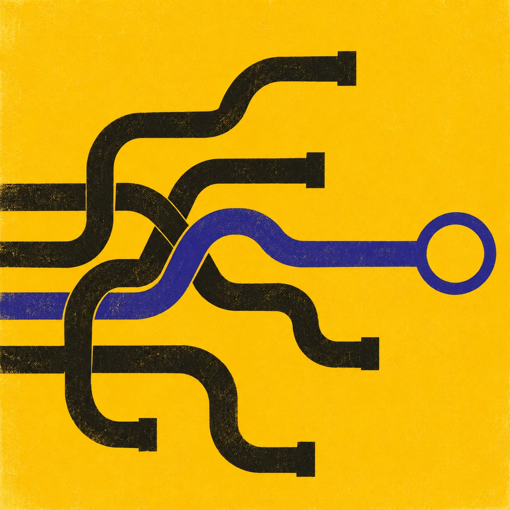
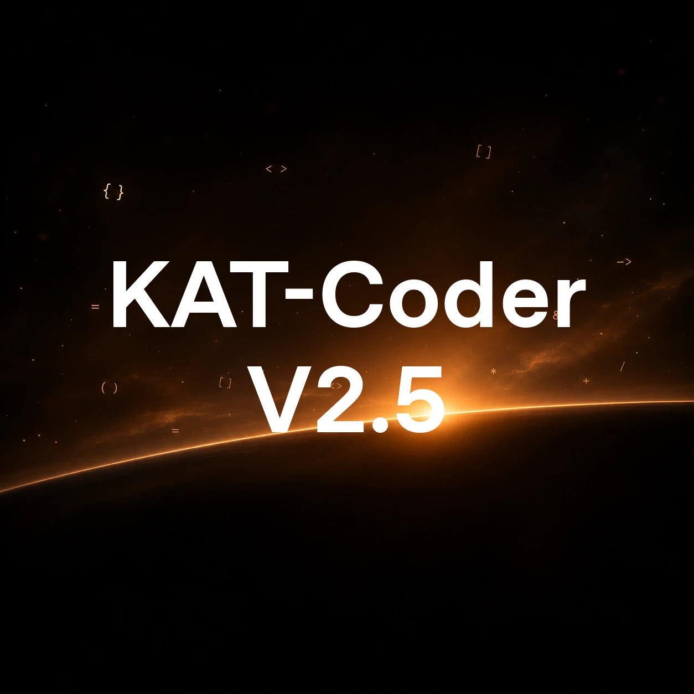
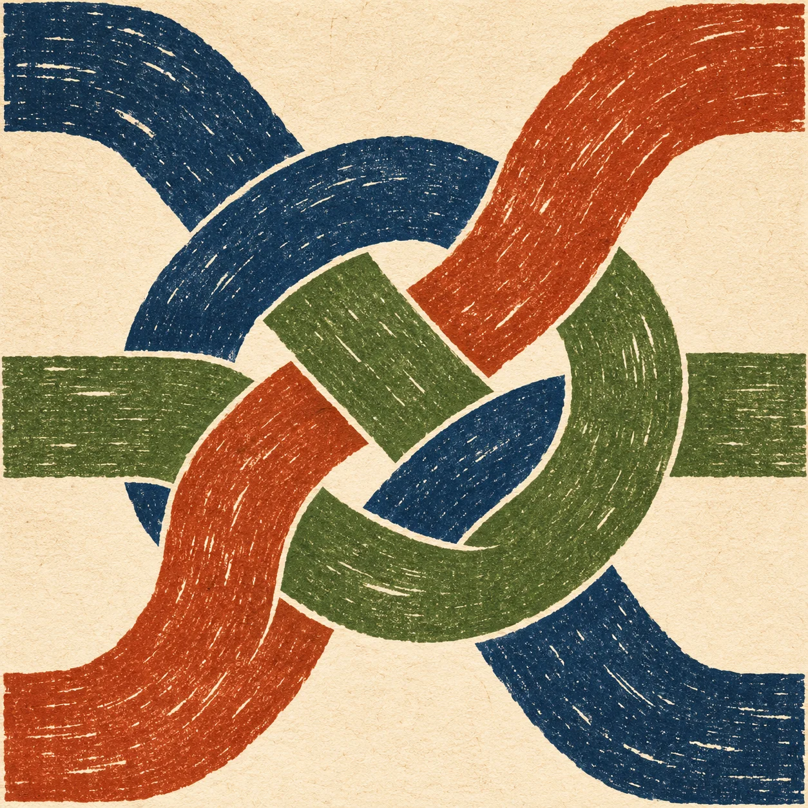

# Models

<article class="home-model-card" data-hf-model="Kwaipilot/KAT-Coder-V2.5-Dev"><h2>KAT-Coder-V2.5-Dev</h2>
Lightweight agentic coding.

<a class="resource-link" href="https://huggingface.co/Kwaipilot/KAT-Coder-V2.5-Dev" title="All-time model downloads · snapshot: September 28, 2026"><i class="fas fa-download resource-link__icon" aria-hidden="true"></i>Model downloads: 66,673</a><a class="resource-link" href="https://huggingface.co/models?other=base_model:Kwaipilot/KAT-Coder-V2.5-Dev" title="Downloads including two verified community quantizations · lower-bound snapshot: September 28, 2026">Total downloads including derived models: 3,034,840</a>
<ul class="home-model-features"><li>✓Open-weight 35B-A3B MoE for long-horizon coding.</li><li>✓Up to 1M tokens; better tool use, less repetition.</li><li>✓SWE-bench Verified: 69.4% · PinchBench: 93.4%.</li></ul><a class="home-model-button" href="/research-lab/articles/kat-v25-dev/">Explore model</a></article>
<article class="home-model-card"><h2>KAT-Coder-V2.5</h2>
Trillion-parameter coding intelligence.

<a class="resource-link" href="https://arxiv.org/abs/2607.05471"><i class="fas fa-file-alt resource-link__icon" aria-hidden="true"></i>Paper</a><a class="resource-link" href="https://mp.weixin.qq.com/s/Ylz2hAbKs9gm5CXMfavIxw"><i class="fab fa-weixin resource-link__icon" aria-hidden="true"></i>News</a>
<ul class="home-model-features"><li>✓Beyond GLM-5.1, approaching GLM-5.2.</li><li>✓SWE-bench Pro: 65.2% (Opus 4.8: 69.2%).</li><li>✓PinchBench: 94.2% (Opus 4.8: 93.5%).</li></ul><a class="home-model-button" href="/research-lab/articles/kat-v25/">Explore model</a></article>
<article class="home-model-card"><h2>KAT-Coder-V2</h2>
Reliable software engineering.

<a class="resource-link" href="https://arxiv.org/abs/2603.27703"><i class="fas fa-file-alt resource-link__icon" aria-hidden="true"></i>Paper</a><a class="resource-link" href="https://mp.weixin.qq.com/s/PGWZfZFGp19QdAGuRE-APg"><i class="fab fa-weixin resource-link__icon" aria-hidden="true"></i>News</a>
<ul class="home-model-features"><li>✓#6 on the Artificial Analysis Coding Index (Mar 2026).</li><li>✓SWE-bench Verified: 79.6% (Opus 4.6: 80.8%).</li><li>✓PinchBench: 88.7%, ahead of GLM-5 and MiniMax M2.7.</li></ul><a class="home-model-button" href="/research-lab/articles/kat-v2/">Explore model</a></article>

