# CPGA: Reusing the Codec’s Clues to Restore Video

CPGA：复用编码线索修复视频

Source: [CVPR 2024 accepted paper](https://openaccess.thecvf.com/content/CVPR2024/papers/Zhu_CPGA_Coding_Priors-Guided_Aggregation_Network_for_Compressed_Video_Quality_Enhancement_CVPR_2024_paper.pdf), PDF pages 1–11 (proceedings 2964–2974), retrieved 2026-11-11. Original figures and tables were visually checked. This is a source-based analysis, not a reproduced experiment.

来源：[CVPR 2024接收版论文](https://openaccess.thecvf.com/content/CVPR2024/papers/Zhu_CPGA_Coding_Priors-Guided_Aggregation_Network_for_Compressed_Video_Quality_Enhancement_CVPR_2024_paper.pdf)，PDF第1–11页（论文集2964–2974页），获取于2026-11-11。原图与表格已逐项视觉核验。本笔记是基于原文的分析，不是实验复现。

## 1. 核心思想一句话总结（Elevator Pitch）

<!-- pair:1-1:en -->

CPGA restores compressed video by reusing the codec’s motion, prediction, and residual signals rather than asking decoded pixels to reveal everything.

<!-- pair:1-1:zh -->

CPGA复用编码器的运动、预测和残差信息，帮助压缩视频恢复细节。

## 2. 论文背景与动机（Background & Motivation）

<!-- pair:2-1:en -->

### Key concepts: restoring what compression removed

Video quality enhancement here means improving decoded frames at their existing resolution, not creating a higher-resolution video. A video codec saves bits by predicting frames, encoding differences, and quantizing those differences. Quantization rounds values; it creates irreversible information loss and visible blocking or texture damage. The quantization parameter, QP, controls compression strength: the tested larger values generally mean stronger degradation. CPGA asks whether intermediate codec information can guide restoration better than pixels alone (§§1–3).

<!-- pair:2-1:zh -->

### 必要概念：修复压缩丢掉的信息

这里的视频质量增强，是在原有分辨率下改善解码帧，不是把视频放大成更高分辨率。视频编码器通过预测画面、编码差值并量化差值来节省码率。量化会对数值取整，造成不可逆的信息损失，也可能带来块效应和纹理损伤。量化参数QP控制压缩强度，本文测试中较大的QP通常意味着更严重的退化。CPGA的问题是：编码过程中的中间信息，能否比单独观察像素更有效地指导修复？（§§1–3）

<!-- pair:2-2:en -->

The three coding priors are not extra clean labels. Motion vectors are block displacement estimates used by the codec; a predictive frame is its reconstruction prediction; a residual frame records prediction error. A prior is information supplied before the enhancement network makes its decision. These signals indicate where content moved, what could already be predicted, and what remained unexplained. They do not recover information that quantization erased, and coding-optimal motion need not equal physical optical flow (§§3, 4.2–4.3).

<!-- pair:2-2:zh -->

三种编码先验并不是额外的干净标签。运动向量是编码器使用的块位移估计；预测帧是编码器对重建画面的预测；残差帧记录预测误差。“先验”在这里指增强网络作出判断前已有的信息。这些信号分别提示内容如何移动、哪些部分已经可以预测，以及哪些部分仍未被解释。它们不能恢复被量化彻底抹掉的信息，而且为压缩优化的运动向量不一定等于真实物理光流。（§§3、4.2–4.3）

<!-- pair:2-3:en -->

How to read: Figure 2 makes the additional inputs concrete. Read each row left to right: decoded frame, motion vector visualization, prediction, residual. Which information is absent if only the first column is retained?

<!-- pair:2-3:zh -->

如何读：图2把额外输入具体化。每行从左到右依次是解码帧、运动向量可视化、预测帧和残差帧。若只保留第一列，会丢掉哪些信息？

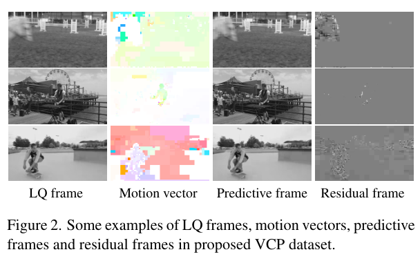

<!-- pair:2-5:en -->

The visible residuals concentrate around changing details, while predictions retain much of the scene structure. This supports using the two kinds of information for different jobs rather than treating all inputs as ordinary RGB frames. The motion colors are an encoding of vectors, not a quality score; these selected examples cannot establish average restoration accuracy. Architecture and controlled ablations are needed next.

<!-- pair:2-5:zh -->

可以观察到，残差主要出现在变化的细节附近，而预测帧保留了大部分场景结构。这支持为不同信号安排不同任务，而不是把所有输入都当成普通RGB图像。运动向量的颜色表示向量编码，不是质量分数；这些选例不能说明平均修复精度，后面还需要结构设计与受控消融实验。

<!-- pair:2-6:en -->

How to read: Table 1 asks whether the necessary training inputs exist. Read the final Coding Priors column, then distinguish training-only datasets from datasets also containing validation/test partitions.

<!-- pair:2-6:zh -->

如何读：表1回答训练所需的输入是否齐备。先看最右侧的编码先验列，再区分仅用于训练的数据集与同时包含验证、测试划分的数据集。

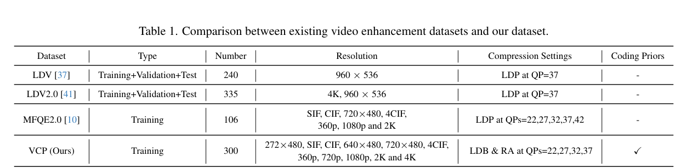

<!-- pair:2-8:en -->

The key observation is that VCP contains 300 training clips with priors, whereas the listed earlier datasets do not provide those priors. Section 3 says each clip has 48 frames, drawn from CDVL and original Vimeo videos, with resolutions from 272×480 to 4K. HEVC HM 16.25 produces Low Delay B (LDB) and Random Access (RA) variants at QP 22/27/32/37. This supports the dataset’s usefulness for codec-aware training, not a claim that 300 clips cover every codec or capture device. Dataset contribution and architectural contribution must be separated experimentally.

<!-- pair:2-8:zh -->

VCP提供300个带编码先验的训练片段，而表中此前的数据集没有提供这些先验。§3说明每段为48帧，来自CDVL和原始Vimeo视频，分辨率覆盖272×480至4K；HEVC HM 16.25生成低延迟B帧配置LDB与随机访问配置RA，并采用QP 22/27/32/37。这支持它对编码感知训练的价值，却不能说明300段视频覆盖了所有编码器或采集设备。数据贡献与结构贡献仍须在实验中分开考察。

## 3. 核心方法/模型详解（The Core Method/Model）

<!-- pair:3-1:en -->

### A complete minimal example

Imagine a basketball edge moving two pixels between neighboring frames. In the decoded target frame its contour is blurred. CPGA receives seven decoded frames centered on the target, their predictions and motion vectors, plus the target residual. First it uses motion and prediction to identify useful neighboring features. Next it uses the residual to emphasize spatial evidence across three scales. Finally a reconstruction module predicts a correction added to the original target. Success is judged against the uncompressed target during evaluation, not against the codec prediction. This is an illustrative example, not a new measured result (§§4.1–4.4).

<!-- pair:3-1:zh -->

### 走完一条机制的最小例子

设想篮球边缘在相邻帧之间移动了两个像素，解码后的目标帧轮廓已经模糊。CPGA接收以目标帧为中心的七个解码帧、对应的预测与运动向量，以及目标帧残差。首先，运动与预测帮助找出邻帧中有用的特征；随后，残差引导三个尺度上的空间信息聚合；最后，重建模块预测修正量，并加回原始目标帧。评测时以未压缩目标帧判断是否成功，而不是以编码器的预测为标准。这是教学示例，不是新增实验结果。（§§4.1–4.4）

<!-- pair:3-2:en -->

How to read: Figure 3 is the full dataflow. Follow the left temporal box, the middle three-scale spatial box, and the final addition to the skip path carrying the original frame.

<!-- pair:3-2:zh -->

如何读：图3给出完整数据流。依次沿左侧的时域模块、中间的三尺度空间模块，以及携带原始帧的跳连与最终加法阅读。

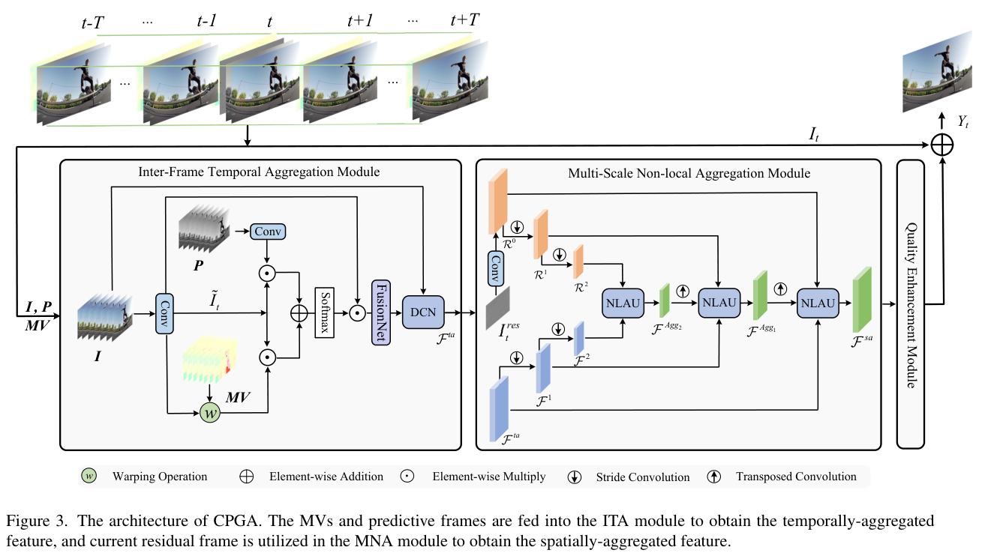

<!-- pair:3-4:en -->

The key observation is the separation of inter-frame temporal aggregation (ITA), multi-scale non-local aggregation (MNA), and quality enhancement (QE). Prediction and motion enter ITA; the target residual enters MNA. The direct path to the output means the network learns a correction rather than regenerating all pixels. This supports a division of labor: retrieve across time, redistribute across space, then reconstruct. It cannot guarantee faithful motion correspondence: learned deformable convolution still compensates for imperfect alignment. Seven frames include future neighbors, so the evaluated network is not automatically a causal, zero-buffer streaming method.

<!-- pair:3-4:zh -->

图中依次是帧间时域聚合ITA、多尺度非局部聚合MNA，以及质量增强QE。预测与运动进入ITA，目标残差进入MNA；直达输出的通路说明网络学习的是修正量，而不是重新生成全部像素。这支持“先跨时间取信息，再跨空间分配，最后重建”的分工。但它不能保证运动对应完全正确，后续可变形卷积仍须补偿不完美的对齐。七帧输入包含未来邻帧，因此实验网络并不天然是因果、零缓存的流式方案。

<!-- pair:3-5:en -->

### Temporal aggregation: use two alignment clues

A convolution converts pixels into features, arrays whose channels describe learned patterns. For target time $t$ and neighbors $i\in[t-T,t+T]$, the paper extracts decoded features $\widetilde I_i$ and prediction features $\widetilde P_i$. Warping moves decoded features according to motion vectors to obtain $\widetilde F_i$. The first frame has no preceding motion vector in the supplied sequence, so its decoded feature is reused. Element-wise multiplication compares each aligned candidate with the target feature. Equations 1–3 on PDF p.5 are:

<!-- pair:3-5:zh -->

### 时域聚合：使用两种对齐线索

卷积把像素变成特征，即用不同通道表示学习到的模式的数组。对于目标时刻$t$及邻帧$i\in[t-T,t+T]$，论文提取解码特征$\widetilde I_i$与预测特征$\widetilde P_i$。按照运动向量对解码特征做位置变换，也就是扭曲对齐，得到$\widetilde F_i$。输入序列第一帧没有来自前一帧的运动向量，因此直接复用其解码特征。逐元素乘法把每个对齐候选与目标特征比较。PDF第5页的式1–3为：

$$
\widehat P_i=\widetilde I_t\odot\widetilde P_i,\qquad \widehat F_i=\widetilde I_t\odot\widetilde F_i,\qquad \mathcal F_i^c=\widetilde I_i\odot\sigma(\widehat P_i+\widehat F_i).
$$

<!-- pair:3-7:en -->

Here $\odot$ is element-wise multiplication and $\sigma$ is softmax, which turns competing scores into nonnegative weights summing to one along its normalization axis. In a toy two-entry case, summed scores 2 and 0 give weights about 0.881 and 0.119, favoring the better-correlated feature. This numerical example illustrates the gate, not the paper’s unspecified softmax axis. A FusionNet, consisting of a 3×3 convolution and a U-Net-like encoder/decoder, fuses the compensated features (Eq.4); deformable convolution then samples learned offsets to produce $\mathcal F^{ta}$. Removing the priors leaves the network to infer these correlations from degraded pixels. Codec vectors, however, can be wrong at occlusions, and neither multiplication nor softmax establishes true correspondence.

<!-- pair:3-7:zh -->

其中$\odot$表示逐元素乘法，$\sigma$是softmax，它沿归一化轴把竞争分数变成非负且和为一的权重。两项分数为2和0的教学例子会得到约0.881和0.119的权重，从而偏向相关性更高的特征。这个数值例子只说明门控作用，并不替论文指定正文未明确的softmax轴。由3×3卷积及U-Net式编码器、解码器组成的FusionNet融合这些补偿后的特征（式4），随后可变形卷积通过学习的偏移位置采样，得到$\mathcal F^{ta}$。去掉先验，网络就必须从退化像素中推断这些相关性。不过编码向量可能在遮挡处失效，乘法和softmax本身也不能证明对应关系真实。

<!-- pair:3-8:en -->

### Spatial aggregation: let residuals decide where context comes from

The target residual and temporal feature form parallel pyramids at scales $s=0,1,2$, with stride-two convolutions reducing spatial dimensions. Starting at the coarsest scale, a non-local aggregation unit (NLAU) gathers information beyond a fixed local window. Equation 5, PDF p.5, then propagates the aggregate upward:

<!-- pair:3-8:zh -->

### 空间聚合：让残差决定上下文从哪里来

目标残差与时域特征构成$s=0,1,2$三个尺度的平行金字塔，步长为2的卷积逐级缩小空间尺寸。从最粗尺度开始，非局部聚合单元NLAU在固定局部窗口之外汇集信息。PDF第5页的式5随后把聚合结果向高分辨率传递：

$$
\mathcal F^{Agg_s}=\begin{cases}\operatorname{NLAU}(\mathcal F^s,\mathcal R^s,\mathcal F^{Agg_{s+1}\uparrow}), & s=0,1,\\\operatorname{NLAU}(\mathcal F^s,\mathcal R^s), & s=2.\end{cases}
$$

<!-- pair:3-10:en -->

$\mathcal F^s$ is the temporal feature at scale $s$; $\mathcal R^s$ is the residual feature; $\uparrow$ denotes learned transposed-convolution upsampling. The coarse level has no incoming aggregate. For the basketball example, coarse context can identify a coherent contour while finer levels restore local detail. This is a hierarchy of learned aggregation, not an exact multigrid solver or a guarantee that the residual identifies every damaged pixel.

<!-- pair:3-10:zh -->

这里$\mathcal F^s$是尺度$s$上的时域特征，$\mathcal R^s$是残差特征，$\uparrow$表示通过可学习的转置卷积上采样。最粗层没有来自更低分辨率的聚合输入。在篮球示例中，粗尺度上下文可以帮助识别连贯轮廓，细尺度则补充局部细节。这是学习得到的层级聚合，不是精确的多重网格求解器，也不能保证残差标出了每一个受损像素。

<!-- pair:3-11:en -->

How to read: Figure 4 opens the NLAU. Read the upper residual branch into softmax, then the matrix multiplication with reshaped features, and finally the lower fusion branch.

<!-- pair:3-11:zh -->

如何读：图4展开NLAU。先看上方残差分支如何进入softmax，再看它与重排后的特征做矩阵乘法，最后看下方融合分支。

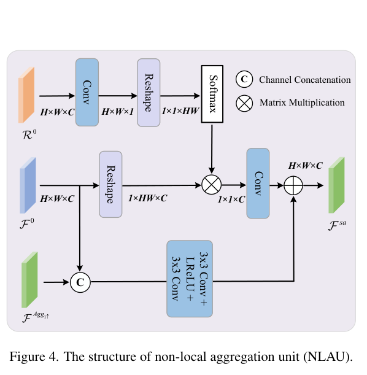

<!-- pair:3-13:en -->

The upper branch reduces an $H\times W\times C$ residual feature to $1\times HW$ spatial weights. Multiplying those weights by an $HW\times C$ feature matrix produces one $1\times C$ context vector. It is transformed and added to a branch fusing current-scale and upsampled features. Thus the observed computation is weighted global pooling with broadcast context, not a full $HW\times HW$ all-pairs attention matrix. This supports the claim that residual salience can influence every location without quadratic spatial attention storage. Its boundary is also clear: one pooled vector compresses spatial distinctions, and salience can emphasize compression noise as well as useful contours.

<!-- pair:3-13:zh -->

上支路把$H\times W\times C$的残差特征转成$1\times HW$的空间权重，再与$HW\times C$的特征矩阵相乘，得到一个$1\times C$的上下文向量。该向量经过变换，与融合当前尺度及上采样特征的分支相加。因此，图中展示的是加权全局池化与上下文广播，而不是完整的$HW\times HW$两两注意力矩阵。这解释了残差显著性为何能影响所有位置，同时不需要空间二次方规模的注意力存储。边界也很明确：单个池化向量压缩了空间差异，显著性既可能强调有效轮廓，也可能强调压缩噪声。

<!-- pair:3-14:en -->

How to read: Figure 5 asks how the aggregated features become a correction. Follow the horizontal and vertical Shift blocks before their channel-attention blocks, and note the residual additions.

<!-- pair:3-14:zh -->

如何读：图5回答聚合特征如何变成修正量。沿水平方向与垂直方向的Shift模块阅读，注意它们位于通道注意力模块之前，以及图中的残差加法。

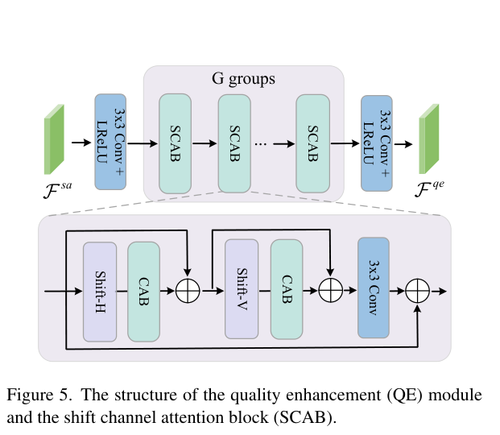

<!-- pair:3-16:en -->

Partial channel shifts move a subset of feature channels horizontally and then vertically. A channel-attention block learns which feature channels to emphasize; stacking the two shifts enlarges the receptive field without adding weights for the shift itself. The implementation uses two SCAB groups, shift distances of two pixels, and a shifted-channel proportion of one eighth (§5.2). This supports inexpensive spatial exchange inside the reconstruction head. It cannot imply that the entire network has zero added compute or that shifts alone explain the improvement: Table 5 tests coding priors, not an isolated shift-versus-no-shift comparison.

<!-- pair:3-16:zh -->

部分通道移位先把一部分特征通道沿水平方向移动，再沿垂直方向移动。通道注意力模块学习哪些特征通道更重要；叠加两个移位可以扩大感受野，而移位操作本身不增加权重。实现采用两个SCAB组、两个像素的移位距离，以及八分之一的移位通道比例（§5.2）。这支持重建头中低成本的空间信息交换，却不能推出整个网络没有额外计算，也不能把全部收益归因于移位：表5消融的是编码先验，而不是单独比较有无移位。

## 4. 实验与结果分析（Experiments & Results）

<!-- pair:4-1:en -->

### What is measured, and under which controls?

The authors train on 128×128, seven-frame clips with batch size 32, Adam, initial learning rate $10^{-4}$, and Charbonnier loss, a smooth robust pixel-error objective. The evaluation uses 18 standard JCT-VC sequences and the luminance Y channel. PSNR measures pixel-error fidelity in decibels; higher is better. SSIM measures local structural similarity; higher is better. Tables report gains over the decoded compressed input, not absolute PSNR or a human preference percentage. Compared methods are retrained on VCP for the main LDB/RA experiments (§§5.1–5.3). No experiments were reproduced for this note.

<!-- pair:4-1:zh -->

### 测量什么，又控制了什么？

作者使用128×128的七帧片段训练，批量大小为32，采用Adam、初始学习率$10^{-4}$和Charbonnier损失，即平滑、稳健的像素误差目标。评测使用18个JCT-VC标准序列，并只计算亮度Y通道。PSNR以分贝衡量像素误差保真度，越高越好；SSIM衡量局部结构相似性，也是越高越好。表中给出的是相对解码压缩输入的增量，不是绝对PSNR，更不是人工偏好百分比。主要LDB/RA实验中，对比方法都在VCP上重新训练。（§§5.1–5.3）本笔记没有重新运行这些实验。

<!-- pair:4-2:en -->

How to read: Table 2 tests LDB fidelity. Read the bottom Average rows first, then inspect individual QP=37 sequences for exceptions. SSIM values are scaled by $10^{-2}$.

<!-- pair:4-2:zh -->

如何读：表2检验LDB配置下的保真度。先读底部Average平均行，再检查QP=37各序列是否有例外。SSIM列的数值带有$10^{-2}$缩放。

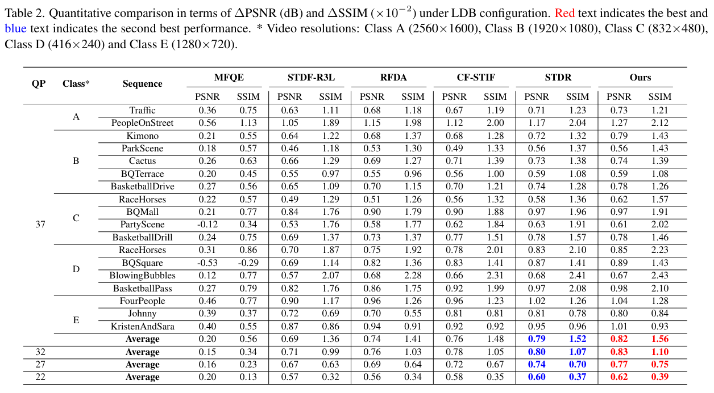

<!-- pair:4-4:en -->

At QP=37 CPGA gains 0.82 dB over the compressed baseline, versus 0.79 for STDR and 0.69 for STDF-R3L. The margin over the strongest listed average baseline is therefore 0.03 dB, not 0.82 dB. QP=32/27/22 averages are 0.83/0.77/0.62 dB versus STDR’s 0.80/0.74/0.60. This strongly supports a small average fidelity improvement in this matched training setting. It cannot support winning every sequence or metric: PartyScene is 0.61 versus STDR’s 0.63, and BasketballDrive SSIM gain is 0.0126 versus 0.0128. No uncertainty intervals are supplied for these small margins.

<!-- pair:4-4:zh -->

QP=37时，CPGA相对压缩基线提高0.82 dB，STDR为0.79，STDF-R3L为0.69。因此，相对表中平均表现最强基线的优势是0.03 dB，而不是0.82 dB。QP=32/27/22时的平均增量为0.83/0.77/0.62 dB，STDR对应为0.80/0.74/0.60。这对相同训练条件下的小幅平均保真度改善提供了强支持，但不能说明每个序列、每项指标都胜出：PartyScene为0.61，低于STDR的0.63；BasketballDrive的SSIM增量为0.0126，低于0.0128。论文也没有给这些小差距提供不确定性区间。

<!-- pair:4-5:en -->

How to read: Table 3 repeats the comparison under RA. Read the paired PSNR/SSIM columns in the last two method groups across all four QPs.

<!-- pair:4-5:zh -->

如何读：表3把比较扩展到RA配置。逐个QP阅读最后两组方法中成对出现的PSNR/SSIM列。

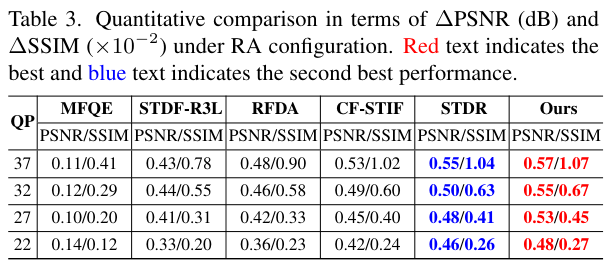

<!-- pair:4-7:en -->

The key observation is that CPGA’s PSNR gains are 0.57/0.55/0.53/0.48 dB at QP 37/32/27/22, compared with STDR’s 0.55/0.50/0.48/0.46. This supports usefulness through a consistent 0.02–0.05 dB average margin beyond a single HEVC configuration. This is moderate robustness evidence; it cannot prove transfer to AV1, VVC, unknown transcoding chains, or unseen bitrate-control policies. Those codecs and distribution shifts are not evaluated here.

<!-- pair:4-7:zh -->

QP 37/32/27/22下，CPGA的PSNR增量为0.57/0.55/0.53/0.48 dB，STDR对应为0.55/0.50/0.48/0.46。持续出现的0.02–0.05 dB平均优势，支持方法不只适用于一种HEVC配置。这是中等强度的稳健性证据，却不是迁移到AV1、VVC、未知转码链或未见码率控制策略的证明，因为本文没有评测这些编码器与分布变化。

<!-- pair:4-8:en -->

How to read: Table 5 asks whether coding priors explain the gain. Read Model-1 without priors against the single-prior rows, two-prior rows, and Model-7 with all three.

<!-- pair:4-8:zh -->

如何读：表5检验增益是否来自编码先验。把不使用先验的Model-1与单先验、双先验及使用全部三种先验的Model-7依次比较。

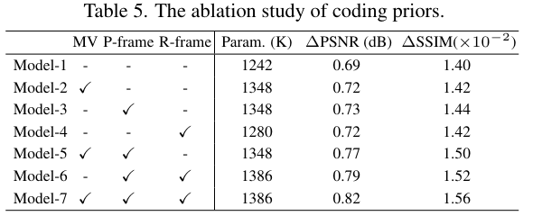

<!-- pair:4-10:en -->

The gain rises from 0.69 to 0.82 dB, with motion-only 0.72, prediction-only 0.73, residual-only 0.72, motion+prediction 0.77, and prediction+residual 0.79. This supports complementary signals through the monotone combination evidence, although parameter count also rises from 1.242M to 1.386M, so it cannot establish a fixed-capacity causal isolation. The prose in §5.4 claims +0.05 dB for prediction and residual separately; the displayed rows instead imply +0.04 and +0.03. This note follows the table and flags the discrepancy rather than inventing a reconciliation.

<!-- pair:4-10:zh -->

从不使用先验到全部使用，增量由0.69升到0.82 dB；仅运动为0.72，仅预测为0.73，仅残差为0.72，运动加预测为0.77，预测加残差为0.79。组合后持续改善的结果支持信号互补，但参数量也从1.242M增加到1.386M，因此并不是固定容量下完全隔离因果因素的实验。§5.4正文把单独加入预测与残差的收益都写成+0.05 dB，而表中实际对应+0.04与+0.03。本笔记以表内数值为准，并标明不一致，不擅自编造解释。

<!-- pair:4-11:en -->

How to read: Table 6 separates training-data effects from architecture. Read each method down the two dataset rows before comparing methods across a row.

<!-- pair:4-11:zh -->

如何读：表6把训练数据的作用与结构作用分开。先在每种方法内部纵向比较两个数据集，再横向比较同一行的方法。

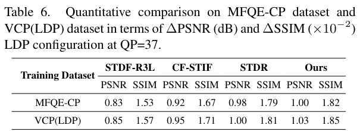

<!-- pair:4-13:en -->

Under Low Delay P at QP=37, CPGA rises from 1.00 dB on MFQE-CP to 1.03 on VCP(LDP); STDR rises from 0.98 to 1.00. This supports a small contribution from the new dataset and preserves an architectural margin within each row. It cannot justify attributing the entire improvement to priors alone. Section 5.4 also states that earlier methods’ MFQE numbers were taken from their papers, whereas CPGA was trained on extracted MFQE-CP priors, so this comparison is less tightly controlled than retraining all main-table baselines on VCP.

<!-- pair:4-13:zh -->

在LDP、QP=37条件下，CPGA从MFQE-CP上的1.00 dB提高到VCP(LDP)上的1.03，STDR从0.98提高到1.00。这支持新数据集带来一部分小幅收益，同时每一行内仍保留结构优势。但它不能支持把全部改善都归因于先验。§5.4还说明，旧方法的MFQE数值取自各自论文，而CPGA使用提取了先验的MFQE-CP训练，因此该比较的控制程度不如主要表格中把所有基线都在VCP上重训。

<!-- pair:4-14:en -->

How to read: Table 4 checks the price of the gain. Compare parameters and frames per second at the same resolution; do not compare FPS across different frame sizes.

<!-- pair:4-14:zh -->

如何读：表4检验收益的代价。必须在相同分辨率下比较参数量和每秒处理帧数，不能把不同尺寸的FPS直接比较。

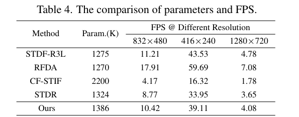

<!-- pair:4-16:en -->

CPGA uses 1.386M parameters versus STDR’s 1.324M. At 832×480 it runs at 10.42 FPS versus 8.77, a calculated 18.8% throughput increase; at 1280×720 it is 4.08 versus 3.65, about 11.8%. This supports being faster than STDR in the reported setup, but cannot establish that it is the fastest method: RFDA reaches 17.91 and 7.08 FPS at those resolutions. The table gives no end-to-end codec extraction and buffering breakdown, and its 720p throughput is below ordinary real-time playback. “Efficient” is a measured tradeoff, not a universal deployment guarantee.

<!-- pair:4-16:zh -->

CPGA参数量为1.386M，STDR为1.324M。在832×480下，速度为10.42 FPS，对比8.77，计算得到吞吐提高约18.8%；1280×720下为4.08对3.65，约提高11.8%。这支持它在所报告条件下比STDR快，却不支持它是最快的方法：RFDA在这两个分辨率下分别达到17.91和7.08 FPS。表格没有分解编码先验提取与缓存的端到端成本，而且720p吞吐低于常规实时播放需求。“高效”应理解为特定条件下的权衡，而不是普遍的部署保证。

<!-- pair:4-17:en -->

How to read: Figure 6 examines temporal behavior on BasketballPass. Read the horizontal frame index 100–120 and vertical PSNR in dB, comparing curve height and oscillation separately.

<!-- pair:4-17:zh -->

如何读：图6考察BasketballPass上的时序表现。横轴是100–120帧的索引，纵轴是以dB计的PSNR，要分别比较曲线高度与波动。

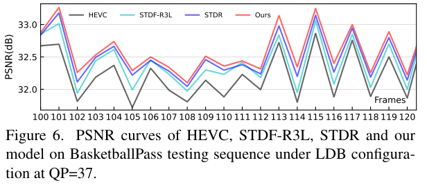

<!-- pair:4-19:en -->

The CPGA curve generally lies above the compressed HEVC baseline and slightly above STDR while following similar frame-to-frame structure. This supports improved fidelity on this illustrated segment. It cannot by itself establish perceptually smoother video: PSNR oscillation is not a flicker metric, only one short segment is shown, and no temporal user study accompanies it. The authors’ lower-fluctuation interpretation should therefore remain a limited qualitative claim.

<!-- pair:4-19:zh -->

CPGA曲线总体高于压缩HEVC基线，并略高于STDR，但仍呈现相似的逐帧起伏。这支持所展示片段的保真度改善，却不能独自证明人眼感到视频更平滑：PSNR波动不是闪烁指标，只展示了一小段序列，也没有配套的时序用户研究。因此，作者关于波动更小的解释应保留为范围有限的定性主张。

<!-- pair:4-20:en -->

How to read: Figure 7 asks what the numeric gain looks like. Compare the same crop across each row, beginning with GT (the uncompressed reference), then compressed input and the five methods. The rows use different QPs and coding settings.

<!-- pair:4-20:zh -->

如何读：图7回答数值收益在画面上是什么样。每行比较同一裁剪区域，先看GT即未压缩参考，再看压缩输入及五种方法。各行使用不同QP和编码配置。

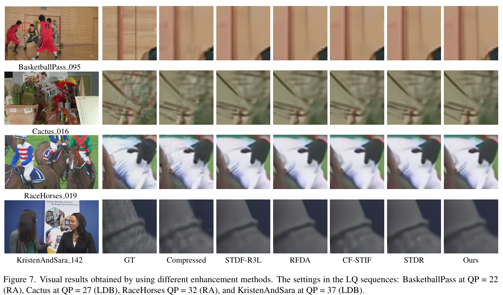

<!-- pair:4-22:en -->

The illustrated contours and fine patterns show reduced compression damage in the final column relative to the compressed input, consistent with the fidelity tables. Differences among the strongest methods are subtler. This supports a visual plausibility check on selected examples, but cannot establish a preference rate, a general semantic restoration ability, or uniform superiority. The full table’s counterexamples should remain visible in the interpretation rather than being displaced by attractive crops.

<!-- pair:4-22:zh -->

选例中的轮廓与细纹理显示，最后一列相对压缩输入减少了压缩损伤，与保真度表格一致；最强几种方法之间的差异则更细微。这为选定样例提供了视觉合理性检查，却不能说明人工偏好率、普遍的语义修复能力或始终胜出。解释时仍应保留完整表格里的反例，而不能让好看的局部裁图取代它们。

## 5. 论文的贡献与影响（Contribution & Impact）

<!-- pair:5-1:en -->

Before CPGA, closely compared methods such as STDF and STDR infer temporal restoration from decoded frames. After CPGA, explicitly extracted coding signals are assigned distinct temporal and spatial roles, with VCP making those inputs available for training. The actual difference is information routing plus a dataset, not the invention of all video alignment or all attention. The tradeoff is dependence on codec-side access and the cost of extracting, storing, and aligning priors. If only an already-decoded video is available, the reported input contract is not automatically satisfied.

<!-- pair:5-1:zh -->

在CPGA之前，直接对比的STDF、STDR等方法从解码帧推断时域修复信息；CPGA则把显式提取的编码信号分别分配给时域与空间任务，并通过VCP提供相应训练输入。真正的差分是信息路由与数据集，而不是发明了所有视频对齐或注意力方法。代价是依赖编码器侧的信息访问，以及先验提取、存储、对齐的开销。如果手里只有已经解码的视频，未必满足论文的输入条件。

<!-- pair:5-2:en -->

A useful next test follows directly from that dependency: evaluate the same architecture with missing or corrupted priors and on a second codec, while logging extraction latency and total memory. To isolate mechanism from capacity, match the no-prior baseline’s parameters and training budget. To test the temporal claim, report a motion-aware flicker measure and a blinded video comparison, not just a short PSNR trace. These are proposed experiments, not results from the paper.

<!-- pair:5-2:zh -->

下一步实验应直接针对这种依赖：在先验缺失、损坏以及另一种编码器上测试同一结构，同时记录提取延迟与总内存。为了把机制与容量分开，需要匹配无先验基线的参数量和训练预算。为了验证时序改善，应报告考虑运动的闪烁指标及盲测视频比较，而不只给一小段PSNR曲线。这些是建议的后续验证，并非论文已经完成的结果。

## 6. 结论（Conclusion）

<!-- pair:6-1:en -->

The strongest conclusion is narrow and useful: in the reported HEVC experiments, combining motion vectors, predictions, and residuals yields a small but consistent average fidelity gain over strong retrained baselines. The ablations support complementarity, while their changing parameter counts limit causal precision. Final judgment: CPGA is a good reference for codec-aware enhancement when decoder-side signals are available; it is not evidence for a plug-in, codec-independent, real-time restoration solution. Preserve the table-level exceptions and unresolved reporting discrepancies when reusing its claims.

<!-- pair:6-1:zh -->

最可靠的结论范围有限，但有实际价值：在所报告的HEVC实验中，组合运动向量、预测与残差，相对强重训基线获得了小而持续的平均保真度提升。消融支持信号互补，但参数量同时变化，限制了精确的因果归因。最终判断：在可以获得解码器侧信号时，CPGA是值得参考的编码感知增强方法；它并不是即插即用、跨编码器、实时修复方案的证据。引用其结论时，应保留表格中的例外与尚未解决的报告差异。
