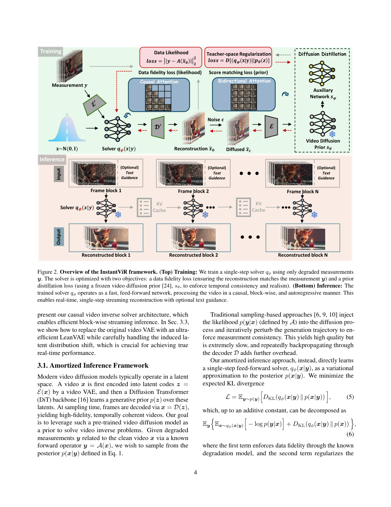
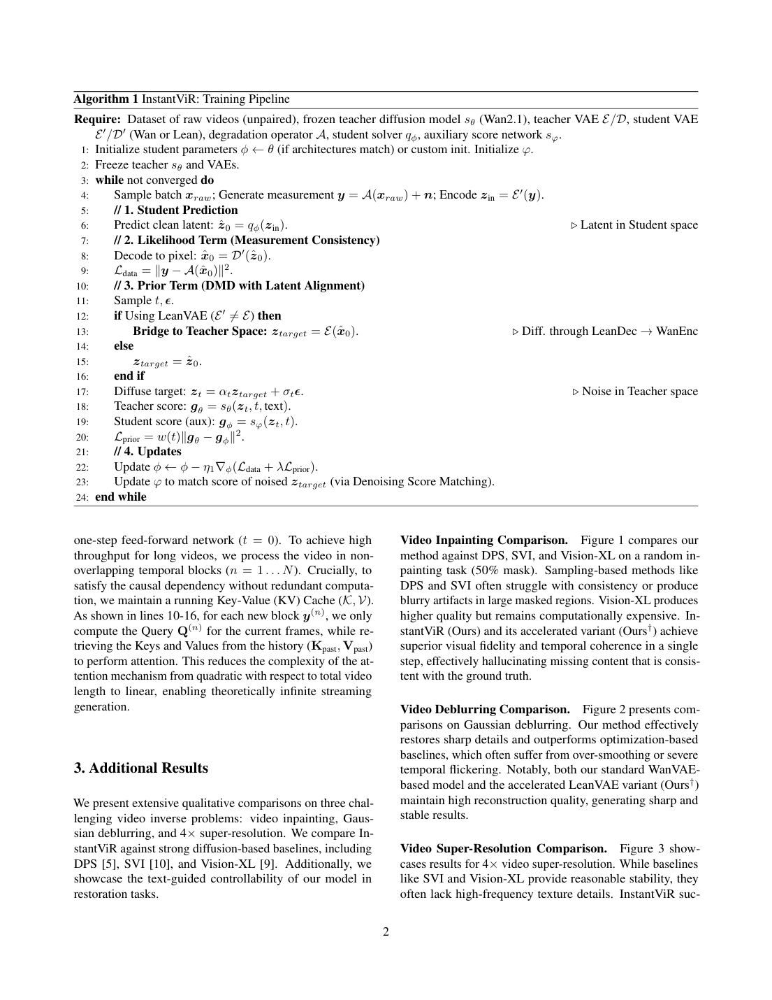
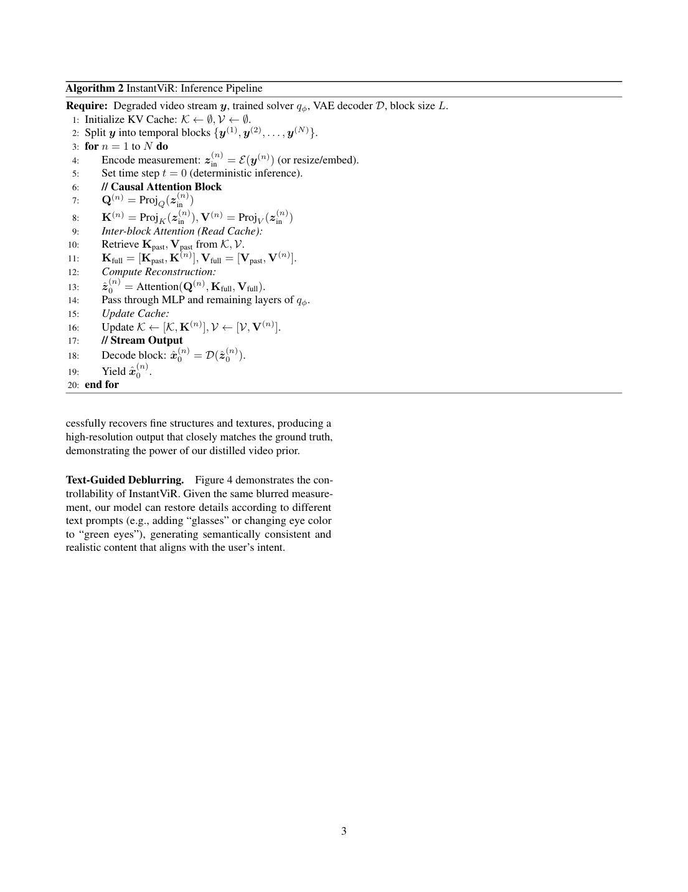
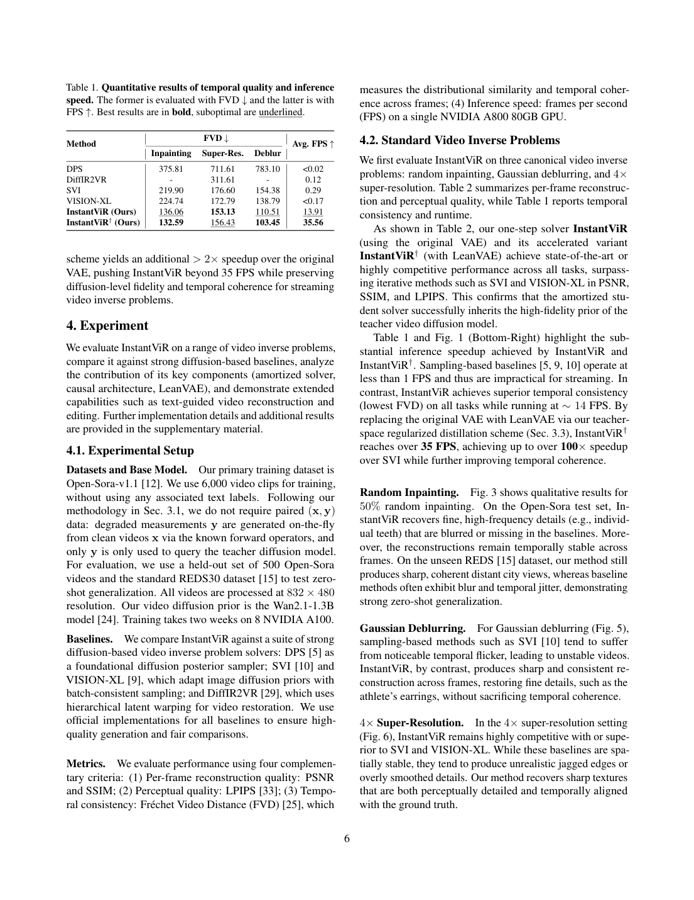
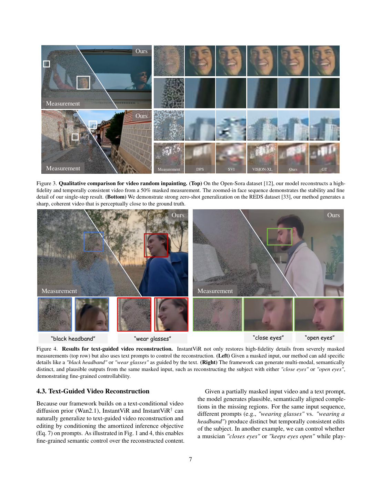
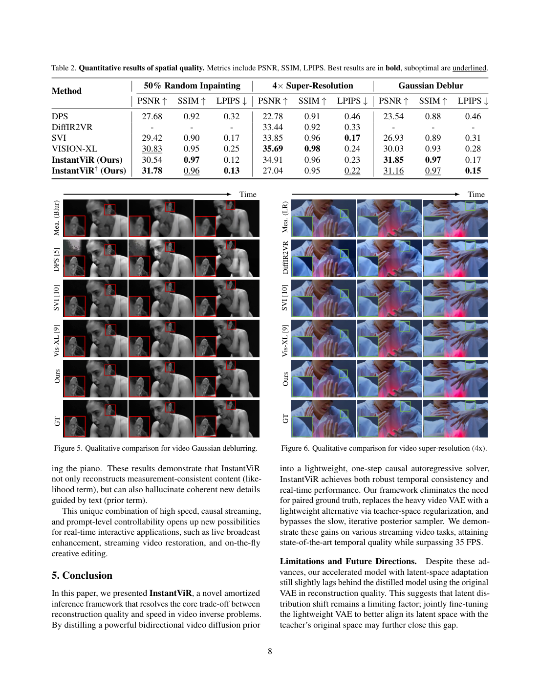

# InstantViR: Real-Time Video Inverse Problem Solver with Distilled Diffusion Prior

InstantViR：以蒸馏扩散先验实现实时视频逆问题求解

Source: [InstantViR: Real-Time Video Inverse Problem Solver with Distilled Diffusion Prior](https://arxiv.org/abs/2511.14208v3), arXiv:2511.14208v3, 13 October 2026. Page references count PDF pages, including the supplement. Figures are verified source-page facsimiles; captions and adjacent evidence remain visible. Numerical claims are paper-reported, not independently reproduced.

来源：[InstantViR: Real-Time Video Inverse Problem Solver with Distilled Diffusion Prior](https://arxiv.org/abs/2511.14208v3)，arXiv:2511.14208v3, 13 October 2026。页码按 PDF 物理页计，含补充材料。配图为已目视核验的原文页面，保留图注与相邻证据。数值来自论文，未独立复现实验。

## 1. 核心思想一句话总结（Elevator Pitch）

<!-- pair:1-1:en -->

InstantViR distills a video diffusion prior into a causal one-step restorer, trading expensive per-video sampling for training and a measurable speed–fidelity compromise.

<!-- pair:1-1:zh -->

InstantViR 将视频扩散先验蒸馏为因果单步修复器，以训练成本换取速度，并承担可测的保真折中。

## 2. 论文背景与动机（Background & Motivation）

<!-- pair:2-1:en -->

### Prerequisites
**Prior:** a distribution expressing which clean videos are plausible before seeing this measurement. **Posterior:** the distribution after conditioning on the measurement. **Amortization:** paying training cost once to reuse a fast solver across many inputs.

<!-- pair:2-1:zh -->

### 前置知识
**先验：** 看到本次观测前，表达哪些干净视频合理的分布。**后验：** 在观测条件下的分布。**摊销：** 一次支付训练成本，在多个输入上复用快速求解器。

<!-- pair:2-2:en -->

### Inverse problems need both observations and a prior
Given an unknown clean video $x$ and a known degradation operator $\mathcal A$, the measurement is $y=\mathcal A(x)$, optionally with noise. Inpainting removes information, blur mixes neighboring pixels, and downsampling discards high frequencies. Many clean videos can produce the same measurement. A likelihood rewards agreement with observed pixels; a video prior favors plausible appearance and motion. Conventional diffusion inverse solvers repeat expensive sampling and decoder-gradient work for every video. InstantViR amortizes that work into a trained conditional solver. [§§1–2]

<!-- pair:2-2:zh -->

### 逆问题既需要观测，也需要先验
给定未知干净视频 $x$ 和已知退化算子 $\mathcal A$，观测为 $y=\mathcal A(x)$，也可叠加噪声。修补任务删除信息，模糊混合相邻像素，下采样丢失高频。多个干净视频都可能产生相同观测。似然奖励与已观测像素一致，视频先验偏好合理外观与运动。传统扩散逆问题求解器对每段视频重复昂贵采样和解码器梯度计算；InstantViR 把这部分工作摊销到条件求解器的训练中。[§§1–2]

<!-- pair:2-3:en -->

“One-step” refers to the learned restoration forward pass, not zero-cost encoding, decoding, training, or temporal buffering. “Unpaired” means the optimization does not require clean targets as supervised reconstruction labels. The experiments still start from raw clean clips and synthesize measurements with known operators; claiming the system never uses clean source videos would be incorrect.

<!-- pair:2-3:zh -->

“单步”指学得的修复前向过程，不代表编码、解码、训练或时间缓存零成本。“非配对”指优化不需要把干净目标当作监督重建标签。实验仍从原始干净片段出发，用已知算子合成观测；说系统从不使用干净源视频是不准确的。

## 3. 核心方法/模型详解（The Core Method/Model）

<!-- pair:3-2:en -->

**How to read:** Compare the upper training region and lower inference region separately.

**Key observation:** Figure 2 (p. 4) separates training from deployment. The upper green region contains measurement consistency, a frozen bidirectional diffusion teacher, and an auxiliary score model. The red gradient path goes through the student decoder and, with LeanVAE, back into teacher latent space. The lower region processes consecutive frame blocks using cached keys and values; the teacher is absent. **Boundary:** This distinction explains why expensive distillation can still yield fast inference.

This supports the amortization of teacher computation into student training.

<!-- pair:3-2:zh -->

**如何读：** 对比分别查看上方训练区与下方推理区。

**关键观察：** 图 2（第 4 页）区分训练与部署。上方绿色区域包括观测一致性、冻结的双向扩散教师和辅助 score 模型；红色梯度路径通过学生解码器，并在使用 LeanVAE 时返回教师潜空间。下方通过缓存键值处理连续帧块，没有教师参与。**边界：** 这解释了昂贵蒸馏为何仍可得到快速推理。

这一观察支持将教师计算摊销到学生训练。

<!-- pair:3-3:en -->

### 1. Distill a posterior rather than run a sampler
Let $q_\phi(x\mid y)$ be the student’s conditional output distribution and $p_\theta(x)$ the pretrained video prior. Bayes’ rule gives $p(x\mid y)\propto p(y\mid x)p_\theta(x)$. Minimizing expected reverse KL separates into data consistency and prior regularization, up to a term independent of $\phi$: [Eqs. 5–7]

<!-- pair:3-3:zh -->

### 1. 蒸馏后验，而非每次运行采样器
令 $q_\phi(x\mid y)$ 为学生的条件输出分布，$p_\theta(x)$ 为预训练视频先验。贝叶斯公式给出 $p(x\mid y)\propto p(y\mid x)p_\theta(x)$。最小化期望反向 KL，可分为数据一致性与先验正则，再加上与 $\phi$ 无关的项：[式 5–7]

$$
\mathcal L=\mathbb E_y D_{KL}\!\left(q_\phi(x\mid y)\|p(x\mid y)\right),
$$

$$
\mathcal L=\mathbb E_y\left[\mathbb E_{x\sim q_\phi}[-\log p(y\mid x)]+D_{KL}\!\left(q_\phi(x\mid y)\|p_\theta(x)\right)\right]+C.
$$

<!-- pair:3-6:en -->

For Gaussian observation noise, the first term becomes a weighted squared mismatch $\|y-\mathcal A(\hat x)\|_2^2$. It constrains only what the operator observes. In a three-pixel toy example with measurement $(a,c)$ and the middle pixel masked, every $(a,b,c)$ has zero observed-pixel mismatch. The prior selects plausible $b$; it cannot establish the historical truth. A wrong assumed blur kernel or masking model can also make the data term enforce the wrong constraint.

<!-- pair:3-6:zh -->

在高斯观测噪声假设下，第一项成为加权平方误差 $\|y-\mathcal A(\hat x)\|_2^2$，只约束算子看得到的信息。三像素最小例子中，若中间像素被遮挡，观测为 $(a,c)$，所有 $(a,b,c)$ 的已观测像素误差都为零。先验选择合理的 $b$，却不能确定历史事实。若假定的模糊核或遮挡模型错误，数据项也会强制错误约束。

<!-- pair:3-7:en -->

### 2. Approximate the prior with score distillation
The student produces a clean latent $z$. Noise it as $z_t=\alpha_tz+\sigma_t\epsilon$. A frozen teacher score $s_\theta$ describes the prior’s log-density gradient, while auxiliary $s_\varphi$ learns the score of current student samples with denoising score matching. The paper expresses a weighted score mismatch:

<!-- pair:3-7:zh -->

### 2. 以 score 蒸馏近似先验
学生生成干净潜变量 $z$，加噪为 $z_t=\alpha_tz+\sigma_t\epsilon$。冻结教师 score $s_\theta$ 描述先验的对数密度梯度，辅助模型 $s_\varphi$ 用去噪 score 匹配学习当前学生样本的 score。论文写出加权 score 差异：

$$
\mathcal L_{prior}\approx\mathbb E_{t,\epsilon}\left[w(t)\|s_\theta(z_t,t)-s_\varphi(z_t,t)\|_2^2\right].
$$

<!-- pair:3-9:en -->

A score is a vector field, not a scalar aesthetic rating. Matching these fields steers student samples toward the teacher prior without solving every inverse problem from scratch. This surrogate is not an algebraic identity equating every squared score distance with the original KL. Algorithm 1 is schematic; reproducing the exact DMD update also requires its gradient handling and training implementation, not merely differentiating a copied formula. [§3.1, Eq. 8, Appendix]

<!-- pair:3-9:zh -->

score 是向量场，不是标量美学分数。匹配向量场使学生样本靠近教师先验，无需从头求解每个逆问题。这个代理目标不是将任意 score 平方距离与原始 KL 等同的代数恒等式。算法 1 是示意，精确复现 DMD 更新还需要梯度处理与训练实现，不能只对抄来的公式直接求导。[§3.1、式 8、附录]

<!-- pair:3-10:en -->

### 3. Stream causally, and bridge VAE spaces
Within a frame block attention is bidirectional; across blocks it sees only the past. Cached keys/values avoid recomputing old representations. The appendix uses three-frame blocks, so “causal” still includes block buffering. The LeanVAE encoder/decoder are faster but have a different latent space. During training, decode the student latent to pixels and re-encode with the teacher encoder before querying the teacher score. At inference only the student encoder, solver, and decoder remain:

<!-- pair:3-10:zh -->

### 3. 因果流式处理，并桥接 VAE 空间
块内注意力是双向的，跨块只能看过去；缓存键值避免重算旧表征。附录使用三帧块，因此“因果”仍包含块缓存延迟。LeanVAE 编解码更快，但潜空间不同。训练时先将学生潜变量解码为像素，再经教师编码器编码，之后查询教师 score。推理只保留学生编码器、求解器与解码器：

$$
z_{teacher}=\mathcal E\!\left(\mathcal D^{\prime}(z_{student})\right)\quad\text{(training)},\qquad \hat x=\mathcal D^{\prime}\!\left(q_\phi(\mathcal E^{\prime}(y))\right)\quad\text{(inference)}.
$$

<!-- pair:3-13:en -->

**How to read:** Compare the measurement loss, latent bridge, and two model updates in order.

**Key observation:** Algorithm 1 (p. 12) specifies the training order: synthesize measurements, predict student latents, decode for the data term, bridge to teacher space if necessary, noise the teacher-space representation, evaluate both scores, then update solver and auxiliary score model. The teacher and VAEs remain frozen. **Boundary:** The decoder–encoder bridge must stay differentiable for teacher-space supervision to reach the student.

This supports the training-time roles of consistency and prior distillation.

<!-- pair:3-13:zh -->

**如何读：** 对比依次查看观测损失、潜空间桥和两个模型更新。

**关键观察：** 算法 1（第 12 页）给出训练顺序：合成观测、预测学生潜变量、解码以计算数据项、必要时桥接到教师空间、加噪教师空间表征、计算两个 score，再更新求解器与辅助 score 模型。教师与 VAE 保持冻结。**边界：** 解码器—编码器桥必须可微，教师空间监督才能传回学生。

这一观察支持训练期一致性与先验蒸馏的作用。

<!-- pair:3-15:en -->

**How to read:** Compare cache concatenation and the keys each new query can access.

**Key observation:** Algorithm 2 (p. 13) resets the cache, processes blocks, attends current queries to concatenated historical/current keys and values, decodes, and emits output. The cache grows with history. Although the appendix describes linear complexity, full-history attention still makes each new block attend to a growing past; total attention work is not linear in video length without a bounded window or equivalent mechanism. No such bound is specified in this pseudocode. **Boundary:** Long-stream memory and latency therefore require measurement rather than assuming “infinite streaming.”

This supports causality but also growing-history cost.

<!-- pair:3-15:zh -->

**如何读：** 对比缓存拼接及新查询可访问的键。

**关键观察：** 算法 2（第 13 页）先清空缓存，逐块处理，让当前查询访问拼接的历史/当前键值，随后解码并输出。缓存随历史增长。尽管附录称复杂度线性，完整历史注意力仍让每个新块访问不断增长的过去；没有有限窗口等机制时，总注意力计算并不随视频长度线性增长。伪代码没有规定这种上界。**边界：** 因此应实测长流显存与延迟，而非假定“无限流式”。

这一观察支持因果性以及不断增长的历史成本。

## 4. 实验与结果分析（Experiments & Results）

<!-- pair:4-1:en -->

**Evidence grade:** Strong for the reported within-paper numerical comparisons and mechanism descriptions; moderate for broader transfer claims; unsupported as a guarantee of exact recovery on arbitrary unseen inputs. No independent reproduction was performed.

<!-- pair:4-1:zh -->

**证据评级：** 文内数值比较与机制描述得到强支持；更广泛迁移主张为中等支持；任意未见输入精确恢复的保证不受支持。这里未进行独立复现。

<!-- pair:4-2:en -->

### Reproduction envelope
Training uses 6,000 Open-Sora clips and no associated text labels, with 500 held out and REDS30 for zero-shot testing. Resolution is 832×480. The teacher is Wan2.1-1.3B; training takes two weeks on eight A100s. Tasks are 50% random inpainting, a 61×61 Gaussian blur with sigma 3, and ×4 anti-aliased downsampling. Appendix settings include AdamW at 2×10⁻⁶, 1,000 warm-up steps, teacher guidance 3.5, auxiliary update ratio 5, and data-term weights 0.1/1/0.3 for inpainting/deblur/SR. These known-operator tests do not establish robustness to arbitrary real degradation.

<!-- pair:4-2:zh -->

### 复现范围
训练使用 6000 段 Open-Sora 视频，不使用其文本标签；保留 500 段测试，并在 REDS30 上测试零样本迁移。分辨率 832×480，教师为 Wan2.1-1.3B，训练耗时八张 A100 两周。任务为 50% 随机修补、61×61 且 sigma 为 3 的高斯模糊、×4 抗混叠下采样。附录设置包括 AdamW 学习率 2×10⁻⁶、1000 步预热、教师引导 3.5、辅助更新比 5，修补/去模糊/超分的数据项权重为 0.1/1/0.3。这些已知算子测试不能证明对任意真实退化都稳健。

<!-- pair:4-4:en -->

**How to read:** Compare FPS and task-wise FVD together, including the GPU description.

**Key observation:** Table 1 (p. 6) reports 13.91 FPS with the original VAE and 35.56 FPS with LeanVAE, versus SVI 0.29 FPS: the fast variant is about 123× faster in this comparison. FVD is lower for InstantViR across tasks: 136.06/153.13/110.51 for inpainting/SR/deblur, versus SVI 219.90/176.60/154.38. LeanVAE gives 132.59/156.43/103.45, so SR FVD worsens slightly. FVD measures distributional video similarity, not exact recovery of each motion or object. The abstract names A100 for speed, whereas the evaluation setup specifies A800 80GB. **Boundary:** Hardware must be clarified before reproducing or advertising the throughput.

This supports large speed gains with task-dependent quality.

<!-- pair:4-4:zh -->

**如何读：** 对比同时查看 FPS、各任务 FVD 及 GPU 说明。

**关键观察：** 表 1（第 6 页）报告原 VAE 为 13.91 FPS，LeanVAE 为 35.56 FPS，SVI 为 0.29 FPS；此比较中快速版约快 123 倍。InstantViR 在修补/超分/去模糊的 FVD 为 136.06/153.13/110.51，低于 SVI 的 219.90/176.60/154.38。LeanVAE 为 132.59/156.43/103.45，因此超分 FVD 略差。FVD 衡量视频分布相似度，不是每个运动或物体的精确恢复。**边界：** 摘要把测速硬件写为 A100，评估设置却指定 A800 80GB；复现或宣传吞吐前应澄清硬件。

这一观察支持速度大幅提高而质量依任务变化。

<!-- pair:4-6:en -->

**How to read:** Compare the GT crops and contrasting text prompts.

**Key observation:** Figures 3–4 (p. 7) demonstrate both restoration and ambiguity. Figure 3 compares masked measurements, baseline crops, the proposed result, and ground truth on Open-Sora and unseen REDS scenes. Sharper teeth or distant buildings are visible, but a still page cannot directly demonstrate absence of flicker. Figure 4 changes prompts to add a headband/glasses or open/close eyes. This proves useful controllability of plausible completions, while also showing why measurement consistency does not uniquely determine missing semantic detail.

This supports plausible restoration and controllable ambiguity.

<!-- pair:4-6:zh -->

**如何读：** 对比真值局部图与相反的文本提示。

**关键观察：** 图 3–4（第 7 页）同时展示修复与歧义。图 3 在 Open-Sora 与未见 REDS 场景中比较遮挡观测、基线局部图、本文结果与真值。能看到更清晰的牙齿或远处建筑，但静态页面无法直接证明无闪烁。图 4 改变提示词来增加头带/眼镜，或睁眼/闭眼。这证明合理补全具有有用的可控性，也说明观测一致性不能唯一确定缺失语义细节。

这一观察支持合理修复与可控歧义。

<!-- pair:4-8:en -->

**How to read:** Compare the SR PSNR rows before the selected temporal crops.

**Key observation:** Table 2 and Figures 5–6 (p. 8) are essential to qualify the speed claim. Original-VAE SR PSNR is 34.91 dB, below VISION-XL 35.69; LeanVAE drops to 27.04, a 7.87 dB decline, while LPIPS changes 0.23→0.22. Calling this only a “slight” quality loss would hide a major fidelity trade-off. Inpainting PSNR improves 30.54→31.78 with LeanVAE, while deblur changes 31.85→31.16. Thus the effect is task-dependent. Figures 5–6 place methods in rows and time in columns, with ear and sleeve crops highlighting consistency. **Boundary:** They support visual comparison on selected frames, not a complete temporal-error measurement.

This supports a substantial LeanVAE SR fidelity cost.

<!-- pair:4-8:zh -->

**如何读：** 对比先看超分 PSNR 行，再看选定时序局部图。

**关键观察：** 表 2 与图 5–6（第 8 页）是限定速度结论的关键。原 VAE 的超分 PSNR 为 34.91 dB，低于 VISION-XL 的 35.69；LeanVAE 降到 27.04，下降 7.87 dB，而 LPIPS 从 0.23 变为 0.22。把这仅称为“轻微”质量损失会掩盖显著保真折中。LeanVAE 的修补 PSNR 从 30.54 升至 31.78，去模糊从 31.85 降到 31.16，因此影响取决于任务。图 5–6 按行排列方法、按列排列时间，耳部与衣袖局部图突出一致性。**边界：** 它们支持选定帧的视觉比较，不是完整时序误差测量。

这一观察支持LeanVAE 显著的超分保真代价。

<!-- pair:4-9:en -->

### What would strengthen the evidence?
The paper compares two VAE variants, but the main tables do not isolate every training ingredient with matched compute and multiple random seeds. Needed controls include removing the teacher-space bridge, changing the auxiliary score update, and matching causal versus bidirectional students at equal capacity. Long-stream cache growth, end-to-end block latency, and performance with misspecified degradation deserve separate tests. The supplementary examples are inventoried separately because their numbering restarts at Figure 1; they are not extra independent quantitative trials.

<!-- pair:4-9:zh -->

### 哪些证据仍需加强？
论文比较两种 VAE，但主表没有以匹配算力和多个随机种子逐一分离所有训练因素。需要的控制包括去掉教师空间桥、改变辅助 score 更新、在等容量下比较因果与双向学生。长流缓存增长、端到端块延迟以及退化模型不匹配时的表现，应单独测试。补充图的编号从图 1 重新开始，已单独清点；它们不是额外独立的定量试验。

## 5. 论文的贡献与影响（Contribution & Impact）

<!-- pair:5-1:en -->

### Future directions and contribution
The contribution is the combination of amortized inverse inference, a causal blockwise student, and a teacher-space bridge that makes a faster VAE usable during distillation. Its strongest result is the large throughput increase over iterative inverse solvers. Its limitations include substantial offline training, dependence on known operators, the LeanVAE SR fidelity drop, ambiguous hardware reporting, and unbounded-cache questions. The natural next step is task-aware deployment: retain the original VAE where reference accuracy matters, use the faster variant only after checking the relevant task, and measure long-video latency rather than assuming FPS describes the whole experience.

<!-- pair:5-1:zh -->

### 贡献与后续方向
贡献是将摊销逆推断、因果分块学生与教师空间桥组合，使更快 VAE 能用于蒸馏。最强结果是相对迭代逆问题求解器的大幅吞吐提升。局限包括可观离线训练、已知算子依赖、LeanVAE 的超分保真下降、硬件表述不一致与无界缓存问题。下一步应按任务部署：参考准确性重要时保留原 VAE，快速版需先验证对应任务，并实测长视频延迟，而非认为 FPS 能概括完整体验。

## 6. 结论（Conclusion）

<!-- pair:6-1:en -->

**Final judgment:** InstantViR shows that a video diffusion prior can be compiled into a fast streaming inverse solver. The paper supports a compelling speed result, not lossless acceleration or guaranteed recovery of missing truth. Read the 35.56 FPS headline together with the 27.04 dB LeanVAE SR result, the teacher-space training cost, and the cache’s long-horizon behavior.

<!-- pair:6-1:zh -->

**最终判断：** InstantViR 表明视频扩散先验可以转化为快速流式逆问题求解器。论文支持有吸引力的速度结果，不代表无损加速或保证恢复缺失事实。阅读 35.56 FPS 时，应同时看到 LeanVAE 超分的 27.04 dB、教师空间训练代价，以及缓存的长时行为。
