# KAT-Coder-V2 Technical Report

KAT-Coder-V2 Technical Report

Primary source: arXiv:2603.27703v1, March 29, 2026; full 22-page PDF. All key figures and tables visually verified. Benchmark dates are historical, not current rankings. Site download statistics retain their separate September 28, 2026 snapshot.

主来源：arXiv:2603.27703v1，2026年3月29日，完整22页 PDF。关键图表已视觉核验。基准日期属于历史记录，不是实时排名；站点下载量仍保留独立的2026年9月28日快照。

## 1. 核心思想一句话总结（Elevator Pitch）

<!-- pair:1-1:en -->

KAT-Coder-V2 trains specialists, then distills a unified coding agent, with cross-scaffold evaluations exposing both capability retention and interface sensitivity.

<!-- pair:1-1:zh -->

KAT先训练专家再蒸馏统一编程智能体，跨框架评测揭示能力保留与接口敏感性。

## 2. 论文背景与动机（Background & Motivation）

<!-- pair:2-1:en -->

A repository bug is rarely solved by writing one correct function. An agent must locate files, inspect dependencies, edit code, run tests and recover when an action fails. The report asks how to train these heterogeneous skills together without letting one domain erase another. KAT-Coder-V2 continues post-training from KAT-Coder-V1; this is a post-training and systems report, not a disclosure of a new pre-training architecture. [§1, PDF p.2]

<!-- pair:2-1:zh -->

仓库缺陷很少靠写对一个函数就能解决。智能体必须定位文件、检查依赖、编辑代码、运行测试，并从失败操作中恢复。报告关心怎样共同训练这些异质技能，而不让一个领域抹去另一个领域的能力。KAT-Coder-V2 在 V1 基础上继续后训练；本文属于后训练与系统报告，并非新预训练架构的完整披露。[§1，PDF p.2]

<!-- pair:2-2:en -->

### Key concepts: what is actually trained?

<!-- pair:2-2:zh -->

### 必要概念：究竟在训练什么？

<!-- pair:2-3:en -->

**Policy:** the model’s conditional distribution over its next generated tokens or actions. **Trajectory:** the recorded sequence of decisions, tool calls and observations. **Scaffold (harness):** the surrounding program that supplies tools, system prompts, context management and stopping rules. **Sandbox:** an isolated executable workspace. **Supervised fine-tuning (SFT):** learning to imitate curated examples. **Reinforcement learning (RL):** changing the policy using rewards from attempted tasks. **Distillation:** training a student to reproduce a teacher’s behavior. On-policy distillation evaluates prefixes generated by the student itself, reducing the mismatch between training examples and the mistakes it will actually make. [§§2–3]

<!-- pair:2-3:zh -->

**策略（policy）**：模型对下一个生成词元或动作的条件概率分布。**轨迹**：决策、工具调用和观察结果组成的记录。**执行框架（scaffold/harness）**：提供工具、系统提示、上下文管理与停止规则的外围程序。**沙箱**：隔离且可执行的工作环境。**监督微调（SFT）**：模仿整理好的示例。**强化学习（RL）**：根据尝试任务后得到的奖励改变策略。**蒸馏**：让学生学习教师的行为；在线策略蒸馏评估学生自己生成的前缀，减少训练示例与实际错误之间的分布差异。[§§2–3]

<!-- pair:2-4:en -->

The closest alternative is to optimize all domains jointly from the outset or merge separately trained weights afterward. V2 instead separates five domain training pipelines and reunifies behavior through student-generated interaction. This shifts cost into maintaining multiple experts and executable environments. It does not establish that monolithic training must always fail: the report does not provide a matched-compute comparison that isolates this choice. [§3.1; §3.4]

<!-- pair:2-4:zh -->

最接近的替代路线是从头联合优化所有领域，或事后合并分别训练的权重。V2 先分开五条领域训练流程，再通过学生生成的交互统一行为；代价转移为维护多个专家和可执行环境。报告没有以等计算预算对照单独隔离这一选择，因此不能推出联合训练必然失败。[§3.1；§3.4]

## 3. 核心方法/模型详解（The Core Method/Model）

<!-- pair:3-1:en -->

### Figure 2: One execution substrate, three learning uses

<!-- pair:3-1:zh -->

### 图2：同一执行底座服务三种用途

<!-- pair:3-2:en -->

**How to read.** Read Figure 2 from task configuration through sandbox interaction to the three outputs: SFT traces, RL rewards and evaluation. The arrows distinguish model requests from patches and verifier scores.

<!-- pair:3-2:zh -->

**如何读。** 图2从任务配置读到沙箱交互，再看 SFT 轨迹、RL 奖励和评测三个输出；箭头区分模型请求、补丁与验证器分数。

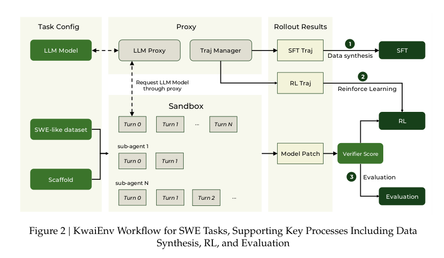

<!-- pair:3-4:en -->

**Key observation, inference and limitations.** The proxy records requests independently of the scaffold; the trajectory manager formats them for learning, while the verifier tests the final artifact. This supports reuse of environments across data synthesis, training and evaluation because these concerns have explicit interfaces. It cannot guarantee unbiased evaluation: sharing infrastructure does not establish disjoint training and test data. [Figure 2, PDF p.4]

<!-- pair:3-4:zh -->

**关键观察、推理桥与边界。** 代理层独立于执行框架记录请求，轨迹管理器把记录转成训练格式，验证器测试最终产物。明确接口使同一环境能够服务数据合成、训练和评测，因此支持模块复用；但共享基础设施不能证明训练集与测试集不重叠，也不能保证评测无偏。 [图2，PDF p.4]

<!-- pair:3-5:en -->

### Table 1: Why five experts need different supervision

<!-- pair:3-5:zh -->

### 表1：五类专家为何需要不同监督

<!-- pair:3-6:en -->

**How to read.** Read the expert column against scenario and methodology, rather than treating the rows as interchangeable data partitions.

<!-- pair:3-6:zh -->

**如何读。** 将专家列与场景、方法逐行对应，不要把这些行当作可互换的数据切片。

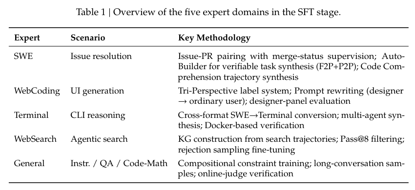

<!-- pair:3-8:en -->

**Key observation, inference and limitations.** SWE learns repository repair; WebCoding learns design decisions from vague requests; Terminal learns stateful command execution; WebSearch learns multi-hop retrieval; General protects instruction following and code–math reasoning. These are training-stage specialist models, not the sparse internal experts of a mixture-of-experts (MoE) layer. MoE refers to activating a subset of internal parameter blocks per token. Keeping these meanings separate is essential to understanding fusion and MCLA. The table describes the recipe, not an ablation proving the value of every expert. [Table 1, PDF p.6]

<!-- pair:3-8:zh -->

**关键观察、推理桥与边界。** SWE 学仓库修复，WebCoding 学从模糊请求推导设计决策，Terminal 学有状态命令执行，WebSearch 学多跳检索，General 保持指令遵循与代码数学推理。这些是训练阶段的领域专家模型，不是混合专家（MoE）层内部的稀疏专家；后者指每个词元只激活部分参数模块。区分两种“专家”才能正确理解融合与 MCLA。该表是流程描述，并非逐项证明各专家必要性的消融。 [表1，PDF p.6]

<!-- pair:3-9:en -->

### Figure 3: Turning merged changes into supervision

<!-- pair:3-9:zh -->

### 图3：把合并变更转成监督

<!-- pair:3-10:en -->

**How to read.** Follow repositories → Issue–PR matching → reconstructed repair chains → retrieval/editing tasks → quality control. A pull request (PR) proposes a code change; an issue describes a problem.

<!-- pair:3-10:zh -->

**如何读。** 沿仓库→Issue–PR 配对→修复链重建→检索/编辑任务→质控阅读。PR 是代码变更提案，Issue 是问题描述。

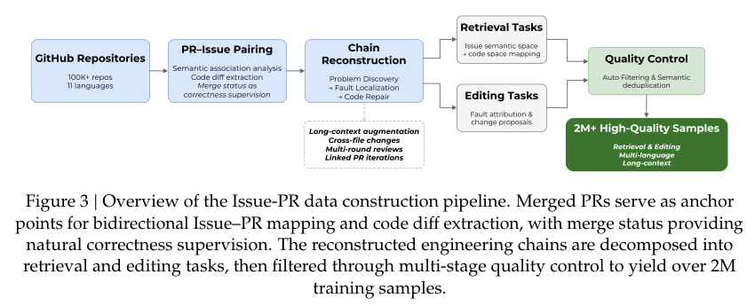

<!-- pair:3-12:en -->

**Key observation, inference and limitations.** Equation (1) keeps issue and PR embeddings whose cosine similarity exceeds a threshold. Embeddings are numeric representations of text; cosine measures directional similarity, not correctness. The pipeline reports over 2M samples across 11 languages. Merge status provides useful natural supervision, but a merged patch can still be wrong or underspecified. Semantic deduplication and artifact filtering improve data hygiene; executable verification is the next necessary step. [Figure 3, PDF p.7]

<!-- pair:3-12:zh -->

**关键观察、推理桥与边界。** 式(1)保留嵌入向量余弦相似度超过阈值的 Issue 与 PR；嵌入是文本的数值表示，余弦衡量方向相近程度，而非正确性。流程报告覆盖11种语言、超过200万样本。合并状态提供自然监督，但已合并补丁仍可能有错或描述不完整；语义去重、过滤自动产物改善数据质量，可执行验证仍不可缺少。 [图3，PDF p.7]

$$
s(i,p)=\cos(\mathbf e_i,\mathbf e_p)>\tau
$$

<!-- pair:3-14:en -->

Here $i,p$ identify an issue and PR, $\mathbf e_i,\mathbf e_p$ are their embeddings and $\tau$ is a selection threshold, not a learned correctness probability. For example, similarity 0.8 passes a hypothetical threshold 0.7; changing the threshold changes recall and noise. Neither this toy threshold nor a calibrated false-match rate is supplied as a result by the report. [Eq. (1), PDF p.7]

<!-- pair:3-14:zh -->

这里 $i,p$ 是 Issue 与 PR，$\mathbf e_i,\mathbf e_p$ 是嵌入，$\tau$ 是筛选阈值，并非学到的正确率。例如相似度0.8可通过假设阈值0.7；阈值改变会影响召回和噪声。这个演示阈值及校准后的误匹配率都不是报告给出的实验结果。[式(1)，PDF p.7]

<!-- pair:3-15:en -->

### Figure 4: A worked repair example needs two test sets

<!-- pair:3-15:zh -->

### 图4：贯穿修复例子需要两组测试

<!-- pair:3-16:en -->

**How to read.** The three stages produce a reproducible environment, an instruction without solution leakage and a verifier. Read the final four-part sample definition at the bottom.

<!-- pair:3-16:zh -->

**如何读。** 三个阶段生成可复现环境、不泄露解法的指令及验证器；最后看底部的四元样本定义。

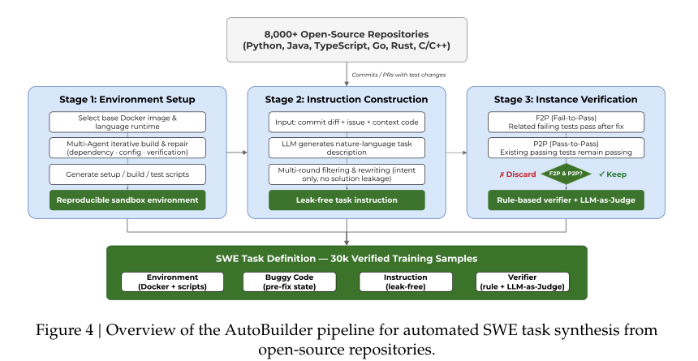

<!-- pair:3-18:en -->

**Key observation, inference and limitations.** Minimal example: suppose a parser rejects an empty list. Build the pinned repository, retain a failing empty-list test, and retain passing ordinary-list tests. Generate an instruction describing expected behavior, not the reference implementation. The agent inspects the parser, edits a guard and reruns both groups. A change that passes the empty-list test but breaks ordinary lists fails verification. The report constructs 30K verified tasks from over 8,000 repositories. This verifies the retained tests, not all possible behavior or freedom from hidden leakage. [Figure 4, PDF p.8]

<!-- pair:3-18:zh -->

**关键观察、推理桥与边界。** 最小例子：解析器错误拒绝空列表。先构建固定版本仓库，保留失败的空列表测试及原本通过的普通列表测试；生成描述预期行为而不透露参考实现的指令。智能体检查解析器、修改判断条件，再运行两组测试。若空列表通过但普通列表失败，仍不通过验证。报告从8000多个仓库构建3万个验证任务；这只验证保留测试的覆盖范围，不能保证所有行为正确或完全没有隐性泄漏。 [图4，PDF p.8]

$$
\left(\forall t\in\mathcal T_{\rm fail},\;t(\hat c)=\mathrm{Pass}\right)\land\left(\forall t\in\mathcal T_{\rm pass},\;t(\hat c)=\mathrm{Pass}\right)
$$

<!-- pair:3-20:en -->

Equation (2) is a conjunction: the repaired code $\hat c$ must satisfy fail-to-pass (F2P) and pass-to-pass (P2P). F2P measures whether a defect is fixed; P2P guards against regressions. With two failing and five passing tests, all seven must pass. The predicate is only as informative as its tests; it is not a proof of program correctness. [Eq. (2), PDF p.8]

<!-- pair:3-20:zh -->

式(2)是逻辑“且”：修复代码 $\hat c$ 必须同时满足失败变通过（F2P）与通过保持通过（P2P）。F2P 检查缺陷是否修好，P2P 防止回归；若原有2个失败、5个通过测试，7个都要通过。判据的信息量受测试覆盖约束，并不是程序正确性的证明。[式(2)，PDF p.8]

<!-- pair:3-21:en -->

### Other domains: preserve the training signal

<!-- pair:3-21:zh -->

### 其他领域：保留各自的训练信号

<!-- pair:3-22:en -->

WebCoding links user perception, design rationale and implementation through seven levels; Eq. (3) predicts each later level from earlier levels. A request such as “street-style” is expanded into layout, typography and assets, then code. Prompt rewrites span designer-level (>1,000 words), professional (200–300) and ordinary-user (~50) descriptions. Terminal data combines experts, synthetic tasks, SWE conversion and public command-line datasets. WebSearch constructs entity-linked questions from visited pages, removes tool-free questions, samples eight answers and retains intermediate empirical success rates; Eq. (4) gives $\hat r=K^{-1}\sum_j\mathbf1[a_j=a^*]$. Two correct answers out of eight give 0.25, while zero or eight are discarded. This is a difficulty filter, not the probability that at least one of eight attempts succeeds, despite the “Pass@8” shorthand in Table 1. General training adds compositional constraints and verified code–math tasks. [§§3.2.2–3.2.5, PDF pp.9–12]

<!-- pair:3-22:zh -->

WebCoding 用七级结构连接用户感受、设计理由与实现；式(3)根据前面级别预测后续级别。“街头风格”会先展开成布局、字体与素材，再生成代码。提示改写覆盖设计师版（1000词以上）、专业用户版（200–300词）和普通用户版（约50词）。Terminal 数据结合专家任务、合成任务、SWE 转换及公开命令行数据。WebSearch 从访问网页构建实体关联问题，去掉不用工具就能回答的问题，采样8个答案，只保留中间成功率；式(4)为 $\hat r=K^{-1}\sum_j\mathbf1[a_j=a^*]$。8次答对2次得到0.25，0次或8次答对均剔除。这是难度筛选，不是8次中至少成功一次的概率，尽管表1简写为“Pass@8”。General 加入组合约束与验证后的代码数学任务。[§§3.2.2–3.2.5，PDF pp.9–12]

<!-- pair:3-23:en -->

### Turn-level optimization and a source inconsistency

<!-- pair:3-23:zh -->

### 轮次级优化及原文的一处不一致

<!-- pair:3-24:en -->

Agentic scaling varies task difficulty, user phrasing and scaffold while retaining environment, tools, scaffold, instruction and verifier as a five-part task record [Eq. (5)]. A turn-level update then compares new and old probabilities for the tokens belonging to one interaction turn, rather than one token or the entire session. The report prints the following product and clipped objective. [Eqs. (6–7), PDF p.13]

<!-- pair:3-24:zh -->

Agentic Scaling 改变任务难度、用户表述与框架，并以环境、工具、框架、指令、验证器五元组记录任务[式(5)]。轮次级更新比较一次交互内所有词元在新旧策略下的概率，而非仅比较一个词元或整个会话。报告给出如下乘积与裁剪目标。[式(6–7)，PDF p.13]

$$
r_n(\theta)=\prod_{i\in\mathcal T_n}\frac{\pi_\theta(y_i\mid x,y_{<i})}{\pi_{\theta_{\rm old}}(y_i\mid x,y_{<i})},\qquad \mathcal L_{\rm Turn}=\mathbb E_\tau\!\left[\frac1N\sum_{n=1}^N\min\{r_n A_n,\operatorname{clip}(r_n,1-\epsilon,1+\epsilon)A_n\}\right]
$$

<!-- pair:3-26:en -->

Here $N$ is the number of turns, $\mathcal T_n$ their token positions, $x$ the prompt, $y$ generated tokens, $A_n$ the reported group-level advantage and $\epsilon$ a clipping width. Advantage expresses performance relative to a baseline. With two ratios 1.1 and 1.2, the turn ratio is 1.32; for positive advantage 1 and hypothetical $\epsilon=0.2$, the contribution is capped at 1.2. This protects against a large single update, but long products can still be unstable. The printed formula has no length normalization, and the text does not fully specify how $A_n$ differs across turns; turn granularity alone does not prove precise causal credit assignment.

<!-- pair:3-26:zh -->

其中 $N$ 是轮数，$\mathcal T_n$ 是对应词元位置，$x$ 是提示，$y$ 是生成词元，$A_n$ 为报告所称组级优势，$\epsilon$ 为裁剪宽度。优势衡量相对于基线的表现。若两个概率比为1.1与1.2，轮次比为1.32；当优势为1、假设 $\epsilon=0.2$ 时，目标贡献被限制为1.2。这限制单次大幅更新，但长乘积仍可能不稳定。原式没有长度归一化，正文也未充分说明各轮 $A_n$ 如何不同；轮次粒度本身不能证明精确的因果信用分配。

$$
\overline{\log\pi(a)}=\frac1K\sum_{k=1}^K\log\pi^{(k)}(a),\qquad K=8
$$

<!-- pair:3-28:en -->

MCLA averages eight repeated forward estimates of a trajectory log-probability to reduce noise from MoE execution [Eq. (11), PDF p.14]. Averaging logs corresponds to a geometric mean of probabilities. Under independent equal-variance noise, averaging divides variance by eight; correlated passes weaken that benefit. It costs extra forward computation and complements IcePop’s clipping of training–inference mismatch. A reproducibility warning matters: Eq. (8) uses train/rollout importance weighting, whereas Eq. (10) prints its reciprocal, exp(log rollout − log train). This note preserves that inconsistency rather than silently selecting an implementation. No isolated MCLA ablation establishes its share of the final gain.

<!-- pair:3-28:zh -->

MCLA 将同一轨迹8次前向估计的对数概率取平均，降低 MoE 执行噪声[式(11)，PDF p.14]。平均对数等价于概率的几何平均；若噪声独立同方差，平均后方差降为八分之一，相关噪声则削弱收益。它增加前向计算，并与 IcePop 对训练/推理不一致的裁剪互补。复现时须注意：式(8)使用 train/rollout 重要性权重，式(10)却写成其倒数 exp(log rollout − log train)。这里保留原文矛盾，不暗自选定实现。报告没有单独 MCLA 消融来量化其最终贡献。

<!-- pair:3-29:en -->

### Figure 5: Reuse prefixes without mixing branches

<!-- pair:3-29:zh -->

### 图5：复用前缀而不混淆分支

<!-- pair:3-30:en -->

**How to read.** Compare the repeated prefixes on the left with the single tree on the right. Shared nodes should be computed once but contribute with the same total training weight.

<!-- pair:3-30:zh -->

**如何读。** 比较左侧重复前缀与右侧单棵树：共享节点应只计算一次，同时保持总训练权重不变。

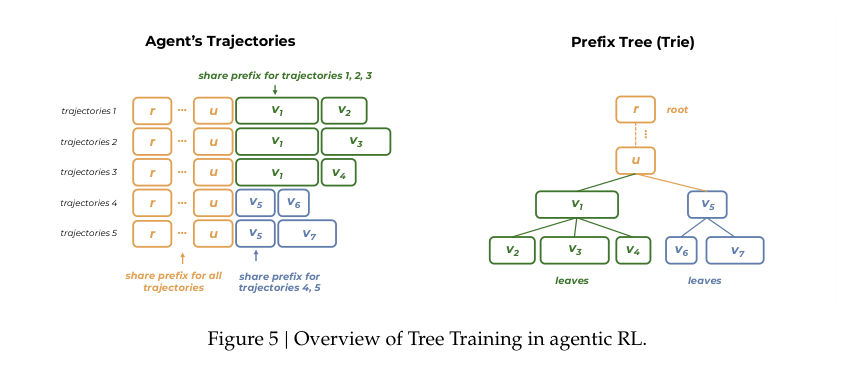

<!-- pair:3-32:en -->

**Key observation, inference and limitations.** In the parser example, several repair attempts share repository exploration before diverging into edits. Tree Training flattens the tree with depth-first traversal, masks attention so each token sees only ancestors on its own path, restores path-relative position IDs and scales per-token losses to preserve root-to-leaf multiplicities. Without the mask, sibling solutions leak into one another; without weights, shared prefixes are undercounted. Gradient equivalence depends on matching the baseline loss normalization and computation. The reported maximum 6.2× speedup is workload-dependent, not a universal reduction in all training costs. [Figure 5, PDF p.14]

<!-- pair:3-32:zh -->

**关键观察、推理桥与边界。** 在解析器例子中，多次修复尝试可能共享仓库探索，再分叉为不同编辑。Tree Training 深度优先展开树，用注意力掩码保证词元只看自己路径上的祖先，恢复路径位置编号，并按根到叶路径中的重复次数缩放词元损失。没有掩码，兄弟分支会泄漏解法；没有权重，共享前缀会被低估。梯度等价依赖于与基线相同的损失归一化和计算。最高6.2倍加速依赖工作负载，并不意味着全部训练成本都同样下降。 [图5，PDF p.14]

<!-- pair:3-33:en -->

### Figure 6: Close the rollout–update loop

<!-- pair:3-33:zh -->

### 图6：闭合采样与更新循环

<!-- pair:3-34:en -->

**How to read.** Follow stages 1–9: task sampling, scaffold assignment, sandbox execution, routing, rollout, reward/packing, engine switch, training and repetition.

<!-- pair:3-34:zh -->

**如何读。** 按1–9阶段阅读：任务采样、框架分配、沙箱执行、请求路由、轨迹生成、奖励与打包、引擎切换、训练、循环。

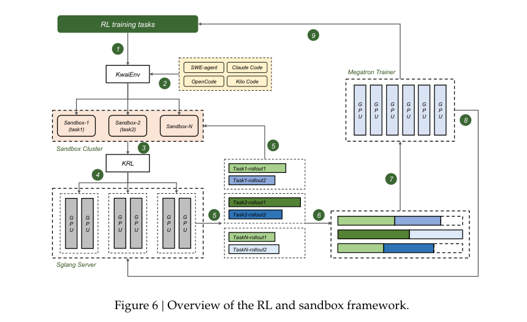

<!-- pair:3-36:en -->

**Key observation, inference and limitations.** KRL routes sandbox requests to SGLang inference workers, then switches GPU resources to Megatron training and synchronizes updated weights. Cache-aware scheduling reuses attention caches; packing groups variable-length trajectories efficiently. This supports high concurrency by coordinating compute and environment work. The paper also reports 2.8× lower unit-sample cost, but gives no complete cost ledger here; it should not be multiplied mechanically by the 6.2× Tree Training figure. [Figure 6, PDF p.15]

<!-- pair:3-36:zh -->

**关键观察、推理桥与边界。** KRL 将沙箱请求路由到 SGLang 推理节点，随后把 GPU 资源切换到 Megatron 训练并同步权重。缓存感知调度复用注意力缓存，打包提高变长轨迹处理效率；这通过协调计算与环境工作支持高并发。论文另报告单样本成本降低2.8倍，但此处未提供完整成本账本，不能与 Tree Training 的6.2倍机械相乘。 [图6，PDF p.15]

<!-- pair:3-37:en -->

### Unification: the student must expose its own mistakes

<!-- pair:3-37:zh -->

### 统一：学生必须暴露自己的错误

<!-- pair:3-38:en -->

The student generates mixed-domain trajectories; a selected domain teacher scores those same prefixes with log-probabilities, while sandbox rewards still ground task success. In the running example, the student may inspect the wrong parser file: the teacher must supervise that actual state, not merely provide a perfect reference trajectory. Dense distillation feedback and sparse task rewards are optimized jointly [§3.4, PDF p.16]. This is behavior-space fusion rather than averaging weights. The introduction calls it “lossless,” but §3.4 explicitly acknowledges a slight drop from isolated experts due to capacity and interference. Without an expert-versus-student table, “lossless fusion” is stronger than the evidence supports.

<!-- pair:3-38:zh -->

学生生成混合领域轨迹，选定领域教师在这些相同前缀上提供对数概率监督，沙箱奖励继续约束任务成功。贯穿例子中，学生可能查看错误的解析文件；教师须在这个实际状态上监督，而非只提供完美参考轨迹。密集蒸馏反馈与稀疏任务奖励共同优化[§3.4，PDF p.16]。这是行为空间融合而非权重平均。引言称其“无损”，但 §3.4 明确承认容量和领域干扰导致相对独立专家的小幅退化；没有专家与学生对照表时，“无损融合”超出了证据。

## 4. 实验与结果分析（Experiments & Results）

<!-- pair:4-1:en -->

### Table 2: A score belongs to a model–scaffold pair

<!-- pair:4-1:zh -->

### 表2：分数属于模型与框架的组合

<!-- pair:4-2:en -->

**How to read.** Read each benchmark block separately and retain the scaffold column. Scores are task-resolution percentages: higher is better. The asterisks identify externally reported Opus values.

<!-- pair:4-2:zh -->

**如何读。** 分别阅读各基准区块并保留框架列；分数是任务解决百分比，越高越好。星号标出外部报告的 Opus 数值。

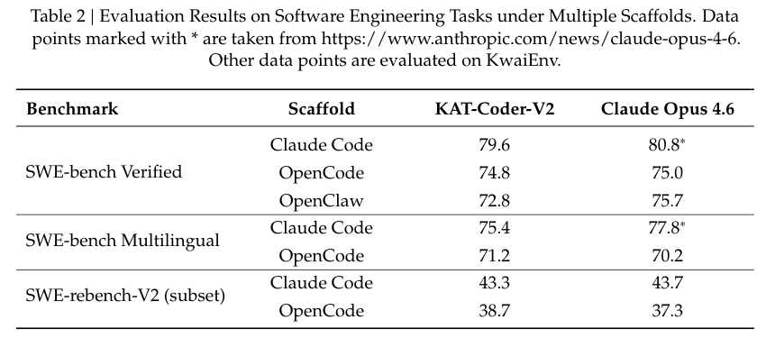

<!-- pair:4-4:en -->

**Key observation, inference and limitations.** SWE-bench Verified is 79.6 with Claude Code, 74.8 with OpenCode and 72.8 with OpenClaw, a 6.8-point spread for V2. Opus is 80.8*, 75.0 and 75.7. Multilingual is 75.4/71.2 for V2 versus 77.8*/70.2; SWE-rebench-V2 subset is 43.3/38.7 versus 43.7/37.3. This supports competence across tested interfaces, not scaffold invariance. Starred Opus results come from Anthropic; the rest were measured on KwaiEnv. Small cross-model differences cannot be treated as significant without repeated runs, and the subset must not be presented as the whole rebench suite. [Table 2, PDF p.17]

<!-- pair:4-4:zh -->

**关键观察、推理桥与边界。** V2 在 SWE-bench Verified 上使用 Claude Code、OpenCode、OpenClaw 时分别为79.6、74.8、72.8，相差6.8个百分点；Opus 对应为80.8*、75.0、75.7。Multilingual 上 V2 为75.4/71.2，Opus 为77.8*/70.2；SWE-rebench-V2 子集为43.3/38.7 对43.7/37.3。这支持在所测接口下具备能力，不支持完全框架不变性。带星号的 Opus 来自 Anthropic，其余由 KwaiEnv 测得；没有重复试验不能把小差异视作显著，也不能把子集当成完整 rebench。 [表2，PDF p.17]

<!-- pair:4-5:en -->

### Table 3: Peak performance and reliability are different

<!-- pair:4-5:zh -->

### 表3：峰值表现与可靠性不同

<!-- pair:4-6:en -->

**How to read.** Read the best and average rows separately, then compare Claw-Eval’s Pass^3 row with its average score. The source snapshot for other models is March 25, 2026.

<!-- pair:4-6:zh -->

**如何读。** 将最佳分与平均分分开阅读，再比较 Claw-Eval 的 Pass^3 与平均分；其他模型来源快照为2026年3月25日。

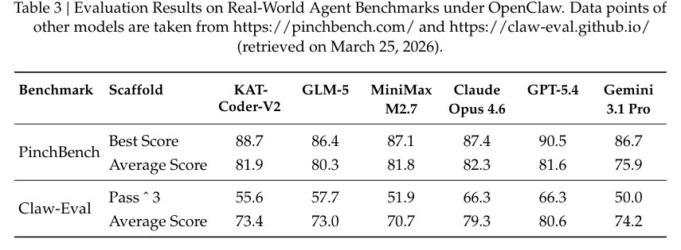

<!-- pair:4-8:en -->

**Key observation, inference and limitations.** V2’s PinchBench best score is 88.7, but its average is 81.9; GPT-5.4’s best is 90.5 and Opus’s average 82.3. Thus V2 does not lead every column. Claw-Eval reports 55.6 on the stricter repeated-success measure Pass^3 and 73.4 average, below Opus’s 66.3 and 79.3. This supports useful task execution with a remaining reliability gap. The report does not fully restate the external metric protocol, so Pass^3 must not be confused with best-of-three pass@3 or derived from the average by cubing it. [Table 3, PDF p.18]

<!-- pair:4-8:zh -->

**关键观察、推理桥与边界。** V2 的 PinchBench 最佳分为88.7，平均为81.9；GPT-5.4 最佳为90.5，Opus 平均为82.3，因此 V2 并非每列领先。Claw-Eval 在更严格的重复成功指标 Pass^3 上为55.6，平均为73.4，低于 Opus 的66.3与79.3。这支持有用的任务执行能力，同时暴露可靠性差距。报告未完整重述外部指标协议，因此不能把 Pass^3 混成三次择优的 pass@3，也不能将平均分立方来推算。 [表3，PDF p.18]

<!-- pair:4-9:en -->

### Table 4: Aesthetics needs a separate measurement

<!-- pair:4-9:zh -->

### 表4：美观需要独立测量

<!-- pair:4-10:en -->

**How to read.** Compare each scenario across the three models. Higher aesthetic score is better, but these are panel-based evaluation scores, not bug-fix pass rates.

<!-- pair:4-10:zh -->

**如何读。** 逐场景比较三个模型；美观分越高越好，但它是评审评分，不是缺陷修复通过率。

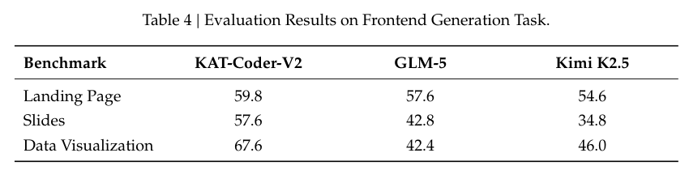

<!-- pair:4-12:en -->

**Key observation, inference and limitations.** V2 leads the evaluated panel on landing pages (59.8), slides (57.6) and data visualization (67.6). Evaluation uses colloquial prompts, calibrated professional designers and blind assessment; the methods section specifies Chrome at 1920×1080 with interactive review, and anchored 0–5 scores per dimension. This makes the test more relevant to visual design than syntactic validity. The aggregate normalization and uncertainty are not fully disclosed, so raw scenario scores should not be interpreted as calibrated percentages or as universal human preference. [Table 4, PDF p.18]

<!-- pair:4-12:zh -->

**关键观察、推理桥与边界。** V2 在所测模型中分别以59.8、57.6、67.6领先落地页、幻灯片和数据可视化。评测使用口语提示、校准后的专业设计师及盲评；方法部分规定 Chrome、1920×1080、交互式检查及每维0–5分锚定量表。这比语法正确性更贴近视觉设计，但汇总归一化与不确定性未充分披露，原始分不能当作校准百分比或普遍人类偏好。 [表4，PDF p.18]

<!-- pair:4-13:en -->

### Figure 7: Examples show range, not an average

<!-- pair:4-13:zh -->

### 图7：示例显示风格范围而非平均质量

<!-- pair:4-14:en -->

**How to read.** Compare the two landing pages, slide and dashboard panels. Look at hierarchy, typography and spacing rather than reading the displayed business numbers as experimental results.

<!-- pair:4-14:zh -->

**如何读。** 比较两张落地页、幻灯片和仪表板，观察层级、字体与间距，不要把界面里的业务数字当作实验结果。

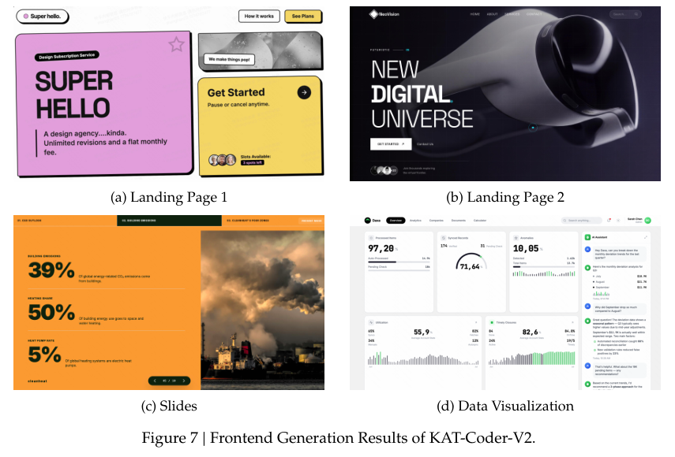

<!-- pair:4-16:en -->

**Key observation, inference and limitations.** The panels demonstrate visibly different layouts and styles, consistent with the goal of escaping one default template. They provide a concrete interpretation of the aesthetic task in Table 4. They cannot establish typical quality, functional correctness, accessibility or animation behavior: these are selected static examples, whereas the evaluation claims include interactive properties. [Figure 7, PDF p.19]

<!-- pair:4-16:zh -->

**关键观察、推理桥与边界。** 面板展示明显不同的布局与风格，与摆脱单一默认模板的目标一致，并让表4的美观任务变得具体。但它们是挑选的静态示例，不能证明平均质量、功能正确性、可访问性或动画表现，而评测声称还包含交互属性。 [图7，PDF p.19]

<!-- pair:4-17:en -->

### Table 5: Breadth survives, but no universal lead

<!-- pair:4-17:zh -->

### 表5：能力广度保留，但并非全面领先

<!-- pair:4-18:en -->

**How to read.** Each row tests a different capability: difficult terminal tasks, telecom interaction, long-context reasoning and instruction constraints. Higher is better within a row; averaging across rows would obscure distinct protocols.

<!-- pair:4-18:zh -->

**如何读。** 各行分别测试困难终端任务、电信交互、长上下文推理和指令约束；同行越高越好，跨行平均会掩盖协议差异。

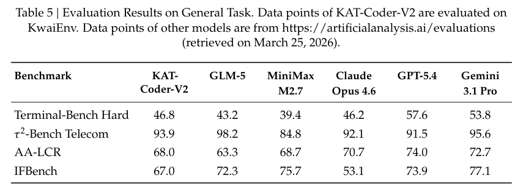

<!-- pair:4-20:en -->

**Key observation, inference and limitations.** V2 scores 46.8, 93.9, 68.0 and 67.0. It exceeds Opus’s 46.2 on Terminal-Bench Hard and 53.1 on IFBench, but trails several other models and is not best on any of these four rows. Competitor values are from Artificial Analysis’s March 25 snapshot, whereas V2 is measured on KwaiEnv. The evidence for retained breadth is moderate; a causal claim that the General expert alone preserved it remains weak without its removal ablation. [Table 5, PDF p.19]

<!-- pair:4-20:zh -->

**关键观察、推理桥与边界。** V2 四项为46.8、93.9、68.0、67.0；Terminal-Bench Hard 高于 Opus 的46.2，IFBench 高于其53.1，但落后若干其他模型，四行均非最高。对手值来自 Artificial Analysis 的3月25日快照，V2 则在 KwaiEnv 测得。保留广度获得中等支持；若声称完全由 General 专家导致，则因缺少移除消融而证据较弱。 [表5，PDF p.19]

## 5. 论文的贡献与影响（Contribution & Impact）

<!-- pair:5-1:en -->

The reusable contribution is the composition of domain-specific supervision, modular executable feedback and behavior-level fusion. KwaiEnv separates integrations; turn-level optimization and MCLA address distinct stability problems; Tree Training exploits trajectory structure. The strongest direct evidence is the explicit cross-scaffold score table. The weakest broad claim is lossless expert fusion, because neither per-expert retention nor a controlled alternative is quantified. [§§2–4]

<!-- pair:5-1:zh -->

可复用贡献在于领域监督、模块化可执行反馈与行为级融合的组合：KwaiEnv 解耦集成，轮次级优化和 MCLA 针对不同稳定性问题，Tree Training 利用轨迹结构。最强直接证据是明确列出的跨框架分数；最弱的宽泛主张是无损专家融合，因为逐专家能力保留与受控替代方案都未量化。[§§2–4]

<!-- pair:5-2:en -->

**Future tests:** hold training tokens and environment budget fixed while comparing joint training, weight merging and OPD; report every specialist before and after fusion. Separately toggle MCLA and routing alignment, recording gradient variance and wall-clock cost. For deployment transfer, freeze task instances and randomize scaffold version, context compression and retry budget, then report paired success differences with uncertainty. These experiments would distinguish a better learned policy from better execution conditions.

<!-- pair:5-2:zh -->

**后续验证**：固定训练词元与环境预算，对比联合训练、权重合并和 OPD，并报告融合前后每个专家的能力；分别开关 MCLA 与路由对齐，记录梯度方差及实际时间成本；部署迁移时固定任务，改变框架版本、上下文压缩和重试预算，报告带不确定性的配对成功率差异。这些实验可区分策略变好与执行条件变好。

## 6. 结论（Conclusion）

<!-- pair:6-1:en -->

**Final judgment: worth close reading with conditions.** V2 is worth reading as a systems recipe for training one agent across incompatible supervision regimes. Its executable task construction and prefix-sharing design are concrete, and its evaluations show useful breadth. The claims of universal scaffold robustness, exact lossless fusion and isolated algorithmic superiority remain underdetermined. Use the benchmark together with its scaffold, source and date, then reproduce the comparison under the intended deployment interface.

<!-- pair:6-1:zh -->

**最终判断：值得有条件精读。** V2 值得作为跨异质监督训练统一智能体的系统方案精读：可执行任务构建、前缀共享设计具体，评测也展示实用广度。但普遍框架鲁棒性、严格无损融合及各算法独立优势仍未充分确定。引用分数时须同时带上框架、来源和日期，并在目标部署接口下复现比较。
