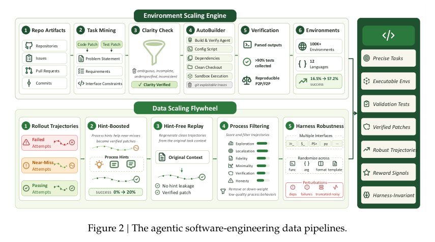
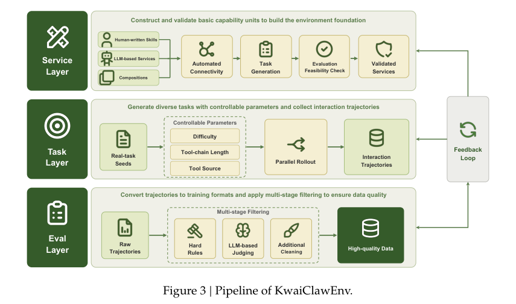
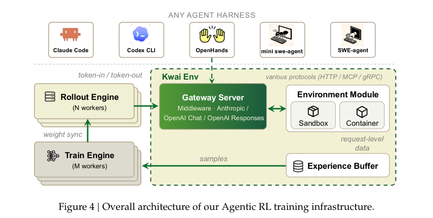
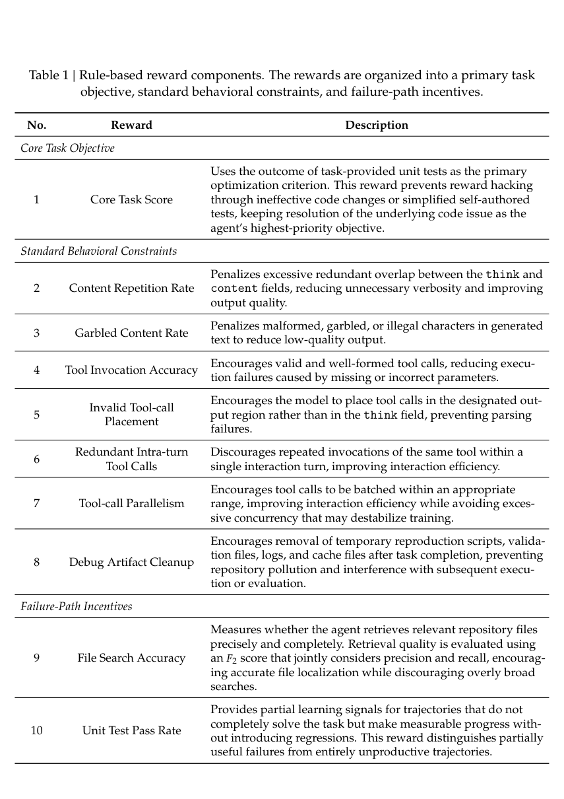
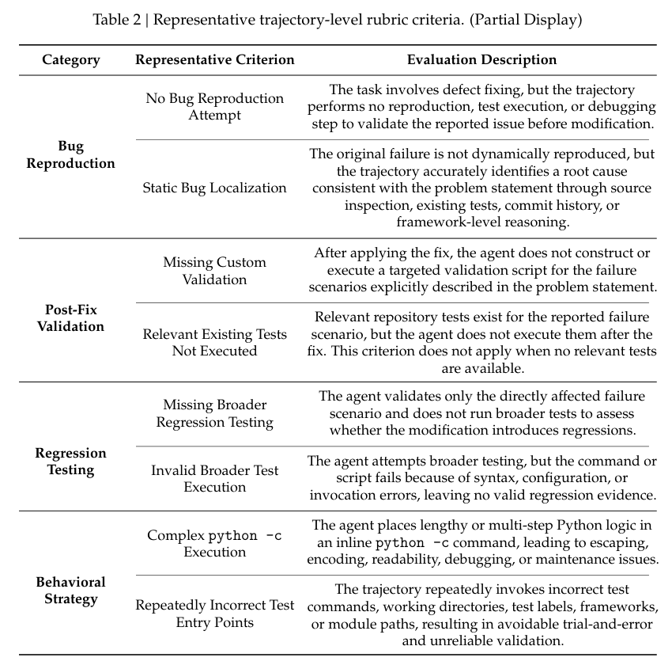
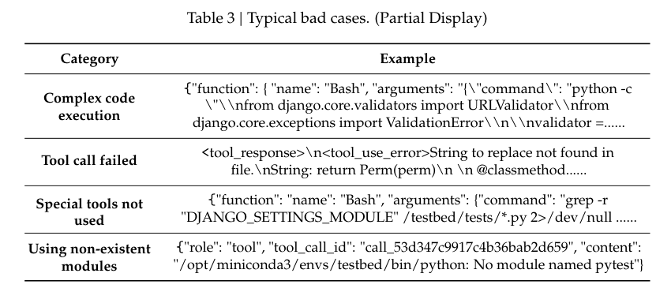
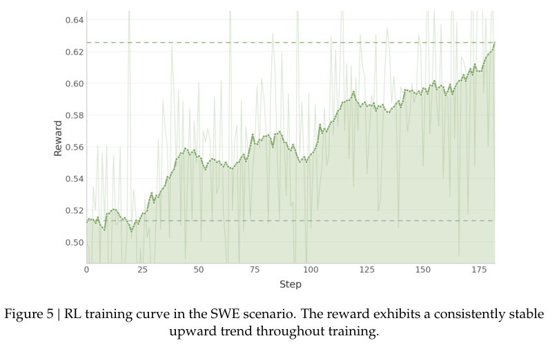
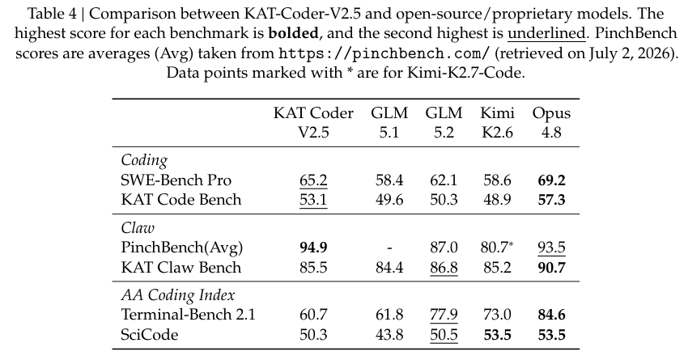

# KAT-Coder-V2.5 Technical Report

KAT-Coder-V2.5 Technical Report

Primary source: arXiv:2607.05471v1, July 6, 2026, full 24-page report including reward tables on pp.23–24. Visually verified source assets. PinchBench is a July 2 historical snapshot. Download statistics elsewhere remain dated September 28, 2026.

主来源：arXiv:2607.05471v1，2026年7月6日，完整24页报告，含23–24页奖励表。原图已视觉核验。PinchBench 为7月2日历史快照，其他位置的下载量仍标注2026年9月28日。

## 1. 核心思想一句话总结（Elevator Pitch）

<!-- pair:1-1:en -->

KAT-Coder-V2.5 improves coding-agent training by repairing environments, filtering behavior and stabilizing long-horizon learning, with strong but task-dependent reported results.

<!-- pair:1-1:zh -->

KAT以可靠环境、过程筛选和长程学习改进编程智能体，报告结果强劲但依赖任务。

## 2. 论文背景与动机（Background & Motivation）

<!-- pair:2-1:en -->

Suppose an agent submits a correct patch, but a broken test runner reports failure. Reinforcement learning then punishes the right behavior. Conversely, a zero exit code can reward a patch even when no intended tests ran. V2.5 treats these failures as corrupted supervision rather than merely infrastructure inconvenience. Its question is how to turn repositories and business workflows into trustworthy learning environments. [§§1–2, PDF pp.2–4]

<!-- pair:2-1:zh -->

设想智能体提交正确补丁，却因测试运行器损坏被判失败，强化学习就会惩罚正确行为。反过来，退出码为零也可能奖励一个根本没有运行目标测试的补丁。V2.5 将这些问题视为监督信号污染，而非普通基础设施故障；核心问题是如何把仓库和业务工作流变成可信训练环境。[§§1–2，PDF pp.2–4]

<!-- pair:2-2:en -->

### Key concepts: outcomes, processes and interfaces

<!-- pair:2-2:zh -->

### 必要概念：结果、过程与接口

<!-- pair:2-3:en -->

**Trajectory:** a sequence of model decisions, tool calls and observations. **Verifier:** executable checks deciding whether a task was solved. **Harness:** the runtime program controlling tools, message formatting, context and termination. **Reward shaping:** adding intermediate incentives or penalties to a final success signal. **Actor–critic:** a policy model chooses actions while a value model estimates expected return to help assign credit. **On-policy distillation:** a student generates its own trajectory and a teacher supervises that same history. These components interact: a stronger critic cannot compensate for systematically wrong test labels. [§§2–5]

<!-- pair:2-3:zh -->

**轨迹**：模型决策、工具调用和观察的序列。**验证器**：判断任务是否完成的可执行检查。**执行框架（harness）**：控制工具、消息格式、上下文与终止规则的运行程序。**奖励塑形**：在最终成功信号之外加入中间奖励或惩罚。**Actor–critic**：策略模型选择动作，价值模型估计预期回报以帮助分配信用。**在线策略蒸馏**：学生生成自己的轨迹，教师监督同一历史。这些组件相互依赖：更强的价值模型也不能补救系统性错误的测试标签。[§§2–5]

<!-- pair:2-4:en -->

Relative to the V2 recipe, V2.5 gives more explicit mechanisms for environment acceptance, near-miss recovery, process grading, token-consistent gateways, hindsight critics and drift-aware multi-teacher fusion. The report’s contribution is the integrated post-training system. It does not supply a factorial ablation that attributes final benchmark gains to each component, and its model must not be conflated with the smaller open-weight V2.5-Dev release.

<!-- pair:2-4:zh -->

相对 V2，V2.5 更明确地描述环境验收、近成功轨迹恢复、过程评分、词元一致网关、事后信息价值模型以及漂移感知多教师融合。贡献是集成式后训练系统；它没有提供因素消融来将最终增益分配到各组件，也不能与较小的开源权重 V2.5-Dev 混为一谈。

## 3. 核心方法/模型详解（The Core Method/Model）

<!-- pair:3-1:en -->

### Figure 2: Two loops produce useful experience

<!-- pair:3-1:zh -->

### 图2：两个循环生产有用经验

<!-- pair:3-2:en -->

**How to read.** Read the upper environment-construction row first, then the lower trajectory-improvement row. The outputs at right require both executable tasks and trustworthy behavior.

<!-- pair:3-2:zh -->

**如何读。** 先读上方环境构建，再读下方轨迹改进；右侧输出同时依赖可执行任务与可信行为。

<!-- pair:3-4:en -->

**Key observation, inference and limitations.** AutoBuilder regenerates the problem statement, behavioral requirements and interface constraints from code/test patches, checks clarity, and builds a clean executable checkout. It accepts environments only after collecting more than 90% of expected tests and reproducing outcomes, rather than trusting an exit code. Reusable build recipes raise reported construction success from 16.5% to 57.2%, yielding over 100K environments across 12 languages. This supports operational scaling, but the missing denominator and controlled breakdown limit causal attribution to any one optimization. [Figure 2, PDF p.3]

<!-- pair:3-4:zh -->

**关键观察、推理桥与边界。** AutoBuilder 根据代码/测试补丁重建问题描述、行为要求与接口约束，检查清晰度，再构建干净可执行仓库。只有实际收集超过90%的预期测试且结果可复现才接受环境，而非相信退出码。复用构建方案后，报告成功率从16.5%升至57.2%，得到覆盖12种语言的10万多个环境。这支持工程扩展能力，但缺少分母细节和受控拆解，不能归因于某一项优化。 [图2，PDF p.3]

<!-- pair:3-5:en -->

### Worked example: recover a failure without teaching the hint

<!-- pair:3-5:zh -->

### 贯穿例子：恢复失败而不教会提示捷径

<!-- pair:3-6:en -->

Consider a JSON parser repair. The reference patch reveals the desired behavior and a test patch specifies empty input and schema constraints. The agent initially finds the right file but returns the wrong field name. A process hint asks it to inspect the assertion, producing a passing patch. Training directly on that hinted conversation would teach a distribution unavailable at deployment. The pipeline therefore fixes the verified patch, regenerates a new trajectory from the original unhinted task, and checks consistency and absence of hint leakage before retention. Previously zero-pass tasks reportedly reach roughly 20% pass rate with hints; that is a recovery rate on this selected subset, not a 20-point gain on the final benchmark. [§2.2, PDF p.5]

<!-- pair:3-6:zh -->

以 JSON 解析器修复为例：参考补丁揭示目标行为，测试补丁规定空输入与字段约束。智能体找到正确文件，却返回错误字段名。过程提示要求检查断言，从而获得通过的补丁；若直接训练这段带提示对话，就会学习部署时不存在的分布。因此流程固定已验证补丁，从原始无提示任务重新生成轨迹，确认一致性且无提示泄漏后才保留。原先零通过的任务加提示后约20%通过；这是所选子集的恢复率，不是最终基准提升20个百分点。[§2.2，PDF p.5]

<!-- pair:3-7:en -->

Passing traces still face rule gates and process scoring for exploration, localization, reasoning before edits, specification fidelity, repository conventions, minimality, verification, recovery and honesty. This removes test tampering and brittle hard-coding that a final pass label can miss. Harness rewriting changes tool names, arguments, output formats and prompts while preserving functionality; perturbations introduce missing dependencies, command failures and noisy/truncated logs. The intended invariant is task semantics, not identical token sequences across different harnesses. Reference-history removal reduces solution leakage, but generation from golden patches still warrants independent leakage auditing. [§§2.1–2.2]

<!-- pair:3-7:zh -->

通过的轨迹仍接受规则与过程评分，覆盖探索、定位、编辑前推理、规范忠实度、仓库惯例、最小修改、验证、恢复及诚实性，过滤最终通过标签可能漏掉的测试篡改与脆弱硬编码。框架改写在功能不变的前提下改变工具名、参数、输出格式和提示，并注入缺失依赖、命令失败、噪声或截断日志。应保持不变的是任务语义，而不是不同框架下完全相同的词元。移除参考提交历史可降低解法泄漏，但从标准补丁生成任务仍需要独立泄漏审计。[§§2.1–2.2]

<!-- pair:3-8:en -->

### Figure 3: Executable services precede generated tasks

<!-- pair:3-8:zh -->

### 图3：先有可执行服务，再生成任务

<!-- pair:3-9:en -->

**How to read.** Read Service → Task → Eval, then follow the feedback loop back upward. This separates whether a tool exists from whether an agent uses it correctly.

<!-- pair:3-9:zh -->

**如何读。** 按 Service→Task→Eval 阅读，再沿反馈环回到上游；这区分“工具是否存在”与“智能体是否正确使用工具”。

<!-- pair:3-11:en -->

**Key observation, inference and limitations.** Human-written skills and generated service specifications become executable APIs, containers and fixture data. Validation checks endpoints and dependencies; seed tasks are varied through parameters, constraints and tool chains; evaluation applies hard rules followed by model judging. The report retains over 100K tasks from millions of candidates, with about 15 tool calls per trajectory on average and some exceeding 100. This provides controlled state transitions instead of unconstrained language-model simulation. It cannot establish fidelity to every real production service: fixtures and generated APIs can simplify permissions, outages and business rules. [Figure 3, PDF p.6]

<!-- pair:3-11:zh -->

**关键观察、推理桥与边界。** 人工技能与生成服务规范转成可执行 API、容器和初始数据。验证检查端点与依赖；种子任务通过参数、约束及工具链扩展；评测先应用硬规则，再用模型评分。报告从数百万候选中保留10万多个任务，轨迹平均约15次工具调用，最长超过100步。这提供受控状态转换，优于无约束语言模拟；但初始数据和生成 API 可能简化权限、故障与业务规则，不能证明完全还原所有真实生产服务。 [图3，PDF p.6]

<!-- pair:3-12:en -->

### Figure 4: Preserve the exact tokens that produced the reward

<!-- pair:3-12:zh -->

### 图4：保存产生奖励的确切词元

<!-- pair:3-13:en -->

**How to read.** Follow the gateway between rollout engine, sandbox and experience buffer. Then follow sampled traces into training and weight synchronization back to rollout.

<!-- pair:3-13:zh -->

**如何读。** 沿网关连接采样引擎、沙箱与经验缓存，再看样本进入训练、权重同步回采样的路径。

<!-- pair:3-15:en -->

**Key observation, inference and limitations.** The gateway isolates arbitrary harness control flow and records request-level data. It bypasses the chat endpoint and sends tokens through the generation interface so reapplying chat templates cannot change the training sequence. The authors observed token drift in about 40% of samples around 200 interaction turns before this fix. This matters because a policy probability ratio must refer to the same action sequence that actually earned the reward. The diagram supports the interface contract, not a measured isolated generalization gain. [Figure 4, PDF p.10]

<!-- pair:3-15:zh -->

**关键观察、推理桥与边界。** 网关隔离任意框架控制流并记录请求级数据；绕过聊天端点，经生成接口传递词元，避免再次应用聊天模板改变训练序列。修复前作者在约200轮任务中观察到约40%样本存在词元漂移。重要性概率比必须对应实际获得奖励的同一动作序列，因此这项一致性至关重要。该图支持接口设计，但不是单独测得的泛化增益。 [图4，PDF p.10]

<!-- pair:3-16:en -->

### PPO: local updates with a hindsight-informed baseline

<!-- pair:3-16:zh -->

### PPO：借助事后信息基线进行局部更新

<!-- pair:3-17:en -->

Proximal Policy Optimization (PPO) limits large policy changes through a clipped likelihood ratio. Generalized Advantage Estimation (GAE) combines prediction errors across time to balance bias and variance. Below, $\rho_t$ denotes the token probability ratio and $r_t^{\rm env}$ the reward; this deliberately disambiguates the report’s reuse of $r_t$ for both quantities. [Eqs. (1–4), PDF pp.12–13]

<!-- pair:3-17:zh -->

近端策略优化（PPO）用裁剪概率比限制过大的策略变化；广义优势估计（GAE）沿时间组合预测误差，权衡偏差与方差。下式用 $\rho_t$ 表示词元概率比，用 $r_t^{\rm env}$ 表示奖励，明确区分原文将两者都记作 $r_t$ 的符号复用。[式(1–4)，PDF pp.12–13]

$$
\begin{aligned}\rho_t&=\frac{\pi_\theta(a_t\mid s_t)}{\pi^{\prime}(a_t\mid s_t)},\\J_{\rm PPO}&=\mathbb E\!\left[\frac1{|o|}\sum_{t=1}^{|o|}\min\{\rho_t\hat A_t,\operatorname{clip}(\rho_t,1-\epsilon,1+\epsilon)\hat A_t\}\right],\\\delta_t&=r_t^{\rm env}+\gamma V^{\prime}(s_{t+1})-V^{\prime}(s_t),\\\hat A_t&=\sum_{l=0}^{T-t-1}(\gamma\lambda)^l\delta_{t+l}.\end{aligned}
$$

<!-- pair:3-19:en -->

The behavior policy $\pi^{\prime}$ generated action $a_t$ in state/history $s_t$; $\pi_\theta$ is the updated actor. $o$ is the output sequence, $\epsilon$ the clipping width, $\gamma$ a discount factor, $\lambda$ the GAE decay and $V^{\prime}$ the previous critic. For a two-step illustrative trace with $\gamma=\lambda=1$, values 0.4 then 0.6, terminal value zero and rewards 0 then 1, the errors are 0.2 and 0.4, giving first-step advantage 0.6. If $\rho=1.4$ and $\epsilon=0.2$, a positive advantage is clipped at 1.2 times its value. These are teaching numbers, not reported hyperparameters.

<!-- pair:3-19:zh -->

行为策略 $\pi^{\prime}$ 在状态/历史 $s_t$ 中生成动作 $a_t$，$\pi_\theta$ 是更新中的策略；$o$ 为输出序列，$\epsilon$ 为裁剪宽度，$\gamma$ 为折扣，$\lambda$ 为 GAE 衰减，$V^{\prime}$ 为上轮价值模型。两步演示中取 $\gamma=\lambda=1$，价值依次为0.4、0.6，终止价值为0，奖励为0、1，则误差为0.2、0.4，首步优势为0.6。若概率比为1.4、$\epsilon=0.2$，正优势贡献被截在其1.2倍。这些是教学数字，不是报告超参数。

$$
\mathcal L^{\rm asym}_{\rm critic}(\psi)=\mathbb E[(V_\psi(s_t,c_t)-R_t)^2],\qquad R_t=\hat A_t+V^{\prime}(s_t,c_t)
$$

<!-- pair:3-21:en -->

The critic additionally sees $c_t$, training-only hindsight such as final test outcomes, patch differences and later turns. The actor sees only rollout-available history; the critic is discarded at deployment. A critic predicting 0.4 for target 1 incurs squared error 0.36. Better prediction can reduce noisy credit assignment, but action-dependent hindsight is not automatically an unbiased baseline: the report does not prove this estimator’s equivalence to an ordinary state-only policy gradient or isolate its bias empirically. A reproduction must specify the exact context and stop-gradient treatment, not simply append the solution to the actor prompt. [§4.3.2]

<!-- pair:3-21:zh -->

价值模型额外看到 $c_t$，即仅训练可见的事后信息，如最终测试结果、补丁差异与后续轮次；策略只看采样时可用历史，部署时删除价值模型。若目标为1、价值预测0.4，平方误差为0.36。更好预测可能减少信用分配噪声，但依赖动作的事后信息并不自动构成无偏基线；报告未证明它与仅依赖状态的普通策略梯度等价，也未单独实测其偏差。复现必须指定具体上下文及梯度截断处理，而不是直接把答案放进策略提示。[§4.3.2]

<!-- pair:3-22:en -->

### Table 1: Reward a result, discipline and useful partial progress

<!-- pair:3-22:zh -->

### 表1：奖励结果、规范过程与有效部分进展

<!-- pair:3-23:en -->

**How to read.** Read the three groups: core task objective, behavioral constraints and failure-path incentives. The ten rows are reward components, not ten benchmark outcomes.

<!-- pair:3-23:zh -->

**如何读。** 阅读三组：核心任务目标、行为约束、失败路径激励。十行是奖励组件，不是十项基准结果。

<!-- pair:3-25:en -->

**Key observation, inference and limitations.** All F2P and P2P tests must pass for full core credit. Auxiliary constraints penalize repetition, garbled text, invalid/incorrectly placed calls, redundant calls, excessive parallelism and leftover debug artifacts. Failure incentives reward file localization using an F2 score and partial test progress. F2 weights recall more than precision: finding relevant files matters, but searching everything is not free. This supports denser feedback in the parser example even before all tests pass. Exact weights and thresholds are not supplied, so the table is not an executable reward specification and cannot guarantee freedom from reward hacking. [Table 1, PDF p.23]

<!-- pair:3-25:zh -->

**关键观察、推理桥与边界。** 核心满分要求全部 F2P 与 P2P 测试通过；辅助约束惩罚重复、乱码、无效或位置错误的调用、冗余调用、过度并行与遗留调试产物；失败激励以 F2 分数奖励文件定位，并奖励部分测试进展。F2 更重召回而非精度，即找到相关文件很重要，但遍历全部文件也有代价。这使解析器例子在全部通过前仍获得密集反馈。确切权重与阈值未提供，因此该表不是可直接执行的奖励规范，也不能保证没有奖励投机。 [表1，PDF p.23]

<!-- pair:3-26:en -->

### Table 2: Grade behavior in its actual context

<!-- pair:3-26:zh -->

### 表2：根据实际上下文评判行为

<!-- pair:3-27:en -->

**How to read.** Compare criteria with their applicability conditions. In particular, static root-cause reasoning is not identical to failing to investigate a bug.

<!-- pair:3-27:zh -->

**如何读。** 将标准与适用条件对照；尤其静态根因推理不等于没有调查缺陷。

<!-- pair:3-29:en -->

**Key observation, inference and limitations.** The rubric distinguishes missing reproduction, valid static localization, missing targeted checks, skipped relevant existing tests, inadequate regression coverage and invalid test entry points. This means keyword matching for “pytest” is insufficient: a test command may fail before collecting any tests, and absent tests cannot be treated as skipped tests. A trained generative reward model (GRM) judges the full trajectory. The table is explicitly partial, leaving full rubric coverage and inter-annotator agreement unknown. [Table 2, PDF p.24]

<!-- pair:3-29:zh -->

**关键观察、推理桥与边界。** 量表区分未复现、有效静态定位、缺失针对性验证、跳过相关现有测试、回归覆盖不足和错误测试入口。因此匹配“pytest”关键词不够：测试命令可能根本没收集到测试，而不存在的测试也不能算被跳过。训练后的生成式奖励模型（GRM）评判完整轨迹。表中明确仅展示部分规则，完整覆盖范围与标注者一致性仍未知。 [表2，PDF p.24]

<!-- pair:3-30:en -->

### Table 3: Failure examples explain why the judge needs semantics

<!-- pair:3-30:zh -->

### 表3：失败案例说明评分需要语义

<!-- pair:3-31:en -->

**How to read.** Read each category beside its trace fragment: complex inline execution, failed replacement, avoiding specialized tools and unavailable modules.

<!-- pair:3-31:zh -->

**如何读。** 把类别与轨迹片段并读：复杂行内执行、替换失败、不用专用工具、模块不存在。

<!-- pair:3-33:en -->

**Key observation, inference and limitations.** These examples reveal that failed execution can come from command construction or environment assumptions rather than the patch itself. The missing-pytest example motivates checking available runners; a failed text replacement motivates inspecting current content before retrying. This supports contextual process feedback, but selected snippets do not measure how often the failures occur or prove that penalizing every Bash call helps. A rigid rule can punish valid exploration. [Table 3, PDF p.24]

<!-- pair:3-33:zh -->

**关键观察、推理桥与边界。** 这些例子说明执行失败可能源于命令构造或环境假设，而非补丁本身。缺少 pytest 的例子要求先确认可用运行器，文本替换失败则要求重试前检查当前内容。这支持上下文过程反馈，但挑选的片段不能衡量失败频率，也不能证明惩罚每次 Bash 调用都有益；机械规则可能误伤有效探索。 [表3，PDF p.24]

$$
r_{\rm GRM}=\begin{cases}\dfrac{|G\cap P|}{|G|}-\lambda|P\setminus G|,&G\ne\varnothing,\\1-\lambda|P\setminus G|,&G=\varnothing.\end{cases}
$$

<!-- pair:3-35:en -->

Equation (5) trains the judge to detect annotated rubric violations: $G$ is the ground-truth violation set, $P$ its prediction and $\lambda$ the false-positive penalty. If two violations are annotated and the judge finds one plus one false alarm, reward is $0.5-\lambda$; when none are annotated, predicting none earns 1. This trades recall against over-accusation. It trains the judge, not directly the coding actor, and cannot repair mistaken human labels. [Eq. (5), PDF p.15]

<!-- pair:3-35:zh -->

式(5)训练评分模型识别标注的规则违规：$G$ 为真实违规集合，$P$ 为预测集合，$\lambda$ 为误报惩罚。若标注2项违规，模型命中1项并误报1项，奖励为 $0.5-\lambda$；没有真实违规且不预测违规时得1。这权衡召回与过度指责，训练对象是评分模型而非直接训练编程策略，也无法修复错误人工标签。[式(5)，PDF p.15]

<!-- pair:3-36:en -->

### Multi-teacher fusion must detect unreliable supervision

<!-- pair:3-36:zh -->

### 多教师融合必须识别不可靠监督

<!-- pair:3-37:en -->

The full method describes five experts, although the abstract foregrounds SWE, Claw and WebCoding. For each domain-labeled prompt, the student samples a trajectory and the matching teacher supplies a token distribution. Reverse KL encourages the student to remain in high-probability teacher modes. [§5, PDF pp.15–17]

<!-- pair:3-37:zh -->

完整方法描述五个专家，尽管摘要重点提到 SWE、Claw 与 WebCoding。对带领域标签的提示，学生采样轨迹，匹配的教师给出词元分布；反向 KL 鼓励学生集中在教师高概率模式。[§5，PDF pp.15–17]

$$
\mathcal L_{\rm MOPD}=\mathbb E_{(x,d),\,y\sim\pi_\theta}\!\left[\sum_{t=1}^{|y|}w_t\,D_{\rm KL}\!\left(\pi_\theta(\cdot\mid x,y_{<t})\,\Vert\,\pi_{T_d}(\cdot\mid x,y_{<t})\right)\right]
$$

<!-- pair:3-39:en -->

Here $x$ is the task, $d$ its domain, $T_d$ its teacher, $y$ the student output and $w_t\in[0,1]$ a reliability weight. For a two-token vocabulary, student (0.8,0.2) versus teacher (0.6,0.4) has reverse KL about 0.092 nats; identical distributions give zero. A teacher conditioned on a bizarre student prefix can be confidently wrong, so low divergence is not equivalent to task correctness. Unlike V2’s log-probability discussion, Eq. (6) specifies distribution-level KL; implementation details of full versus approximate vocabulary evaluation are not disclosed.

<!-- pair:3-39:zh -->

其中 $x$ 是任务，$d$ 是领域，$T_d$ 为教师，$y$ 为学生输出，$w_t\in[0,1]$ 是可靠性权重。二词元词表中，学生分布(0.8,0.2)相对教师(0.6,0.4)的反向 KL 约0.092 nats；分布相同则为零。教师在异常学生前缀上可能自信地犯错，因此低散度不等于任务正确。不同于 V2 对数概率监督的描述，式(6)写的是分布级 KL，未披露完整词表或近似词表计算细节。

$$
\mathcal L_{\rm cold}=\mathbb E_{(x,d),\,y\sim\pi_{T_d}}\!\left[-\sum_t\log\pi_\theta(y_t\mid x,y_{<t})\right],\qquad \rho_t^{\rm overlap}=\frac{|\mathcal T_t^k\cap\mathcal S_t^k|}{k}
$$

<!-- pair:3-41:en -->

Cold start first imitates teacher-generated traces [Eq. (7)]. Then the top-$k$ overlap [Eq. (8)] measures whether teacher and student still consider similar next tokens plausible: with $k=4$ and two shared candidates, overlap is 0.5. A monotonic function assigns lower weights to lower overlap; sufficiently low overlap for $m$ consecutive tokens masks the remaining suffix. Valid prefixes remain, and length-stratified batches reduce bias toward short trajectories. The paper does not give the precise weight function, threshold or $m$. Agreement is a proxy for reliability; two models can agree on an error, and masking hard suffixes can hide rather than solve long-horizon weakness.

<!-- pair:3-41:zh -->

冷启动先模仿教师轨迹[式(7)]，随后 top-$k$ 重叠[式(8)]衡量双方是否仍认为相似的下一词元合理：$k=4$ 且共有2个候选时重叠为0.5。单调函数给低重叠较低权重；若连续 $m$ 个词元低于阈值，就屏蔽后缀梯度。有效前缀保留，并按长度分层组批，减少短轨迹偏置。论文没有给出确切权重函数、阈值或 $m$。一致只是可靠性的代理，两模型可能共同犯错，屏蔽困难后缀也可能掩盖而不是解决长程弱点。

## 4. 实验与结果分析（Experiments & Results）

<!-- pair:4-1:en -->

### Figure 5: Training improves, but the curve is not an ablation

<!-- pair:4-1:zh -->

### 图5：训练在改善，但曲线不是消融

<!-- pair:4-2:en -->

**How to read.** The horizontal axis is training step and the vertical axis is reward. Inspect the noisy trace together with the darker trend, not only its endpoint.

<!-- pair:4-2:zh -->

**如何读。** 横轴为训练步数，纵轴为奖励；同时观察噪声轨迹与较深趋势，不要只看终点。

<!-- pair:4-4:en -->

**Key observation, inference and limitations.** The displayed trend rises roughly from 0.51 to 0.62 over about 180 steps, with local declines and substantial batch fluctuation. This supports successful optimization in the displayed SWE run; it is not a confidence interval or a held-out benchmark curve. The text reports sandbox feedback errors dropping from about 16% to below 2%, timeouts from 6–7% to below 1%, and verifier errors from 6–7% to below 1%. These categories can overlap and must not be summed. Multiple fixes changed together, so the curve cannot isolate PPO, the gateway or any reward component. [Figure 5, PDF p.11]

<!-- pair:4-4:zh -->

**关键观察、推理桥与边界。** 图中趋势在约180步内从约0.51升至0.62，存在局部下降和明显批次波动。这支持展示的 SWE 训练成功优化，但不是置信区间或独立测试基准曲线。正文报告沙箱反馈错误由约16%降至2%以下，超时由6–7%降至1%以下，验证错误也由6–7%降至1%以下；类别可能重叠，不能相加。多项修复同时改变，不能用曲线单独归因 PPO、网关或奖励组件。 [图5，PDF p.11]

<!-- pair:4-5:en -->

### What the six benchmarks measure

<!-- pair:4-5:zh -->

### 六项基准各测什么

<!-- pair:4-6:en -->

SWE-Bench Pro measures repository issue resolution; KAT Code Bench tests internal engineering tasks across 12 languages with pinned environments and executable checks. PinchBench tests tool-using tasks, while KAT Claw Bench covers seven business-workflow categories and combines automatic checks with judgment for open-ended deliverables. Terminal-Bench tests command-line work; SciCode tests scientific programming. Higher scores indicate better performance within each protocol, not the same underlying unit of intelligence. Internal benchmark selection, independent access and contamination controls remain important limitations. [§6.1, PDF pp.17–18]

<!-- pair:4-6:zh -->

SWE-Bench Pro 测仓库问题解决；KAT Code Bench 在固定环境、可执行检查下测12种语言的内部工程任务；PinchBench 测工具任务，KAT Claw Bench 覆盖七类业务工作流，对开放产物结合自动检查与人工判断；Terminal-Bench 测命令行工作，SciCode 测科学编程。各协议内高分代表更好表现，但不是同一“智能单位”。内部基准的选样、独立访问与污染控制仍是重要局限。[§6.1，PDF pp.17–18]

<!-- pair:4-7:en -->

### Table 4: Strong repository work is not universal dominance

<!-- pair:4-7:zh -->

### 表4：仓库能力强不等于全面领先

<!-- pair:4-8:en -->

**How to read.** Read the model columns within each benchmark row. Bold means best and underline second; preserve the PinchBench footnote and the Kimi model exception.

<!-- pair:4-8:zh -->

**如何读。** 逐行比较模型列；粗体为第一、下划线为第二，必须保留 PinchBench 脚注与 Kimi 型号例外。

<!-- pair:4-10:en -->

**Key observation, inference and limitations.** V2.5 scores 65.2 on SWE-Bench Pro and 53.1 on KAT Code Bench, trailing Opus 4.8 by 4.0 and 4.2 points. PinchBench average is 94.9 versus Opus 93.5, but KAT Claw Bench is 85.5 versus Opus 90.7 and GLM-5.2 86.8. Terminal-Bench 2.1 is 60.7 versus Opus 84.6, a 23.9-point gap; SciCode 50.3 trails 53.5. This supports a task-specific profile, not a single overall frontier rank. The default evaluation uses Claude Code with fixed tools, context and decoding, but PinchBench averages are explicitly external values retrieved July 2, 2026; Kimi’s starred score is K2.7-Code, not K2.6. Missing GLM-5.1 PinchBench is unknown, not zero. No repeated-run uncertainty is supplied. [Table 4, PDF p.19]

<!-- pair:4-10:zh -->

**关键观察、推理桥与边界。** V2.5 的 SWE-Bench Pro 为65.2，KAT Code Bench 为53.1，分别落后 Opus 4.8 4.0和4.2个百分点。PinchBench 平均94.9，高于 Opus 93.5，但 KAT Claw Bench 85.5低于 Opus 90.7和 GLM-5.2 86.8。Terminal-Bench 2.1 为60.7，对 Opus 84.6差23.9点；SciCode 50.3低于53.5。这支持任务特定能力画像，而非单一总体前沿排名。默认评测采用 Claude Code 并固定工具、上下文和解码，但 PinchBench 明确引用2026年7月2日外部平均分；带星 Kimi 实为 K2.7-Code 而非 K2.6。缺失的 GLM-5.1 分数表示未知，不是零；也未给出重复运行不确定性。 [表4，PDF p.19]

<!-- pair:4-11:en -->

**Evidence strength:** strong for the reported score ordering within Table 4; moderate for a useful integrated training recipe; weak for the causal claim that infrastructure rather than model scale is the primary bottleneck, because matched scaling experiments are absent. Reward corruption is documented with concrete failure modes, but its exact measurement procedure and audit sample size are not fully reported. Model-scale, pre-training and compute differences remain confounders in cross-model comparisons.

<!-- pair:4-11:zh -->

**证据强度**：表4所报分数排序获得强支持；集成训练方案有用获得中等支持；“基础设施而非模型规模是首要瓶颈”的因果主张较弱，因为缺少匹配的规模实验。奖励污染有具体故障模式佐证，但精确测量程序与审计样本量未完整披露。跨模型比较仍混杂规模、预训练和计算差异。

## 5. 论文的贡献与影响（Contribution & Impact）

<!-- pair:5-1:en -->

The contribution is treating the quality of execution as part of the learning algorithm: test collection, state consistency and token identity determine whether the gradient is meaningful. Near-miss recovery and process grading provide a practical alternative to discarding every failure or trusting every success. Multi-teacher fusion explicitly handles teacher unreliability on student prefixes instead of assuming dense supervision is always beneficial. [§§2–5]

<!-- pair:5-1:zh -->

贡献是把执行质量视为学习算法的一部分：测试收集、状态一致性与词元身份决定梯度是否有意义。近成功恢复与过程评分提供比“失败全丢、成功全信”更实用的路线。多教师融合显式处理教师在学生前缀上的不可靠性，而不假设密集监督总是有益。[§§2–5]

<!-- pair:5-2:en -->

**Future experiments:** inject known sandbox faults into a fixed task set and measure reward-label flips versus policy learning; compare hinted-only, hint-free regenerated and ordinary successful traces at equal tokens; compare state-only and hindsight critics with identical data and report both bias diagnostics and task success; evaluate drift truncation by trajectory length and success on late-stage repairs. For deployment, reproduce the terminal gap under several harnesses before attributing it entirely to model knowledge. Each test targets a specific unresolved explanation in this report.

<!-- pair:5-2:zh -->

**后续实验**：在固定任务集中注入已知沙箱故障，测奖励标签翻转与策略学习；等词元比较带提示、无提示重生成及普通成功轨迹；相同数据下比较仅状态与事后信息价值模型，同时报告偏差诊断和任务成功；按轨迹长度分析漂移截断及后半程修复成功率。部署前还应跨多个框架复现终端差距，再判断是否全由模型知识造成。每项实验都针对报告中一个未排除解释。

## 6. 结论（Conclusion）

<!-- pair:6-1:en -->

**Final judgment: worth close reading with conditions.** V2.5 is a valuable engineering reference for making agentic post-training reproducible and less noisy. The precise environment checks, hint-free recovery and token-consistent gateway are more transferable than any headline rank. Its results support strong repository repair and tool use under stated protocols, while terminal performance, isolated ablations and critic-estimator details remain limitations. Read it as a complete system with open causal questions, not as proof that any single component explains the gains.

<!-- pair:6-1:zh -->

**最终判断：值得有条件精读。** V2.5 是让智能体后训练更可复现、更少噪声的重要工程参考。精确环境检查、无提示恢复和词元一致网关，比头条排名更可迁移。结果支持既定协议下较强的仓库修复与工具使用，但终端表现、独立消融与价值估计细节仍有局限。应将它作为带有未解因果问题的完整系统，而不是某个组件解释全部增益的证明。
