# LPM: Industrial-Scale Generative Video Restoration

LPM: Industrial-Scale Generative Video Restoration

Primary source: arXiv:2607.13460v2, updated November 6, 2026, full 21-page PDF. All seven figures and five tables visually verified. The PDF cover prints October 1, 2025; version identification follows the arXiv record, not that cover date. v1 is retained only as a historical source, not mixed into v2 results. Download statistics dated September 28, 2026 elsewhere remain a separate historical snapshot.

主来源：arXiv:2607.13460v2，2026年11月6日更新，完整21页 PDF；七图五表均视觉核验。PDF 封面印2025年10月1日，版本识别遵循 arXiv 记录而非该封面日期。v1仅作历史来源保留，不混入v2结果；其他位置2026年9月28日下载量仍是独立历史快照。

## 1. 核心思想一句话总结（Elevator Pitch）

<!-- pair:1-1:en -->

LPM combines curated video data, image-first generative restoration, temporal anchors and accelerated inference to trade plausible detail, temporal consistency and industrial serving cost.

<!-- pair:1-1:zh -->

LPM结合数据筛选、图像先行训练、时间锚点与推理加速，权衡细节、时序和成本。

## 2. 论文背景与动机（Background & Motivation）

<!-- pair:2-1:en -->

User-generated video accumulates blur, noise and compression through capture and repeated transcoding. Conventional restoration tries to invert these corruptions; generative restoration also uses a learned image prior to synthesize plausible missing detail. A sharpened face or sign can look convincing without matching what was originally recorded. The report’s question is therefore a systems question: can a generative model improve perceived quality at platform scale while preserving content, temporal coherence and affordable latency? [§1, PDF pp.1–2]

<!-- pair:2-1:zh -->

用户视频在拍摄和多次转码中积累模糊、噪声与压缩失真。传统复原试图逆转损坏，生成式复原还利用学到的图像先验合成合理细节。变清晰的人脸或招牌可能很可信，却不符合原始记录。因此报告问的是系统问题：生成模型能否在平台规模改善观感，同时保持内容、时序一致性和可承担的延迟？[§1，PDF pp.1–2]

<!-- pair:2-2:en -->

### Key concepts and prerequisites

<!-- pair:2-2:zh -->

### 必要概念与前置知识

<!-- pair:2-3:en -->

A variational autoencoder (VAE) compresses pixels into a latent representation and decodes it back. A diffusion transformer (DiT) learns how to transform a noisy latent toward a clean one, conditioned on the degraded video. Rectified flow describes this transformation as a velocity field along an interpolation path. Spatial attention relates locations within a frame; temporal attention relates frames. Distillation trains a cheaper student to approximate a costly teacher. Quantization uses lower-precision numerical representations to reduce memory and computation. These components address different bottlenecks and their speedups must not be multiplied without checking the baseline.

<!-- pair:2-3:zh -->

变分自编码器（VAE）把像素压缩成潜表示，再解码回像素。扩散 Transformer（DiT）在退化视频条件下，学习把含噪潜表示变向干净潜表示。整流流把变化写成插值路径上的速度场。空间注意力关联帧内位置，时间注意力关联不同帧；蒸馏让便宜学生逼近昂贵教师；量化用较低数值精度减少内存与计算。这些组件解决不同瓶颈，不能未经基线检查就将加速倍数相乘。

<!-- pair:2-4:en -->

LPM deliberately starts with image restoration using a 2D VAE and spatial backbone, then adds temporal layers and video training. This differs from simply adopting a large text-to-video backbone with a 3D VAE. The motivation is fidelity and flexible temporal sampling rather than unrestricted video generation. Production deployment and benchmark performance are separate evidence streams: neither deployment volume alone nor attractive examples prove recovery of true lost detail. [§2.2]

<!-- pair:2-4:zh -->

LPM 刻意先用二维 VAE 与空间主干训练图像复原，再加入时间层和视频训练，不是直接套用大型文生视频主干与三维 VAE。动机是保真及灵活时间采样，而非无约束视频生成。生产部署与基准表现是不同证据：部署规模或漂亮例子都不能单独证明恢复了真实丢失细节。[§2.2]

## 3. 核心方法/模型详解（The Core Method/Model）

<!-- pair:3-1:en -->

### Figure 1: The data distribution is itself a design choice

<!-- pair:3-1:zh -->

### 图1：数据分布本身就是设计选择

<!-- pair:3-2:en -->

**How to read.** Read the three panels separately: quality-score distribution, resolution distribution and content categories. KVQ is a learned perceptual quality score, not ground-truth fidelity.

<!-- pair:3-2:zh -->

**如何读。** 分别读质量分布、分辨率分布与内容类别；KVQ 是学习型感知质量分数，不是对真实内容的保真度。

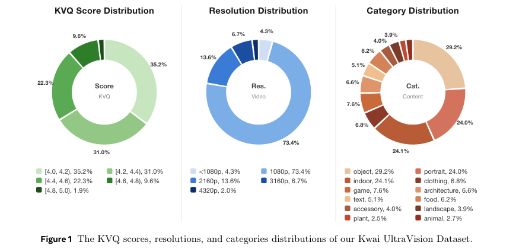

<!-- pair:3-4:en -->

**Key observation, inference and limitations.** The billion-scale KwaiUltraVision collection has reported average KVQ 4.31/5, with 73.4% of the resolution chart at 1080P. Twelve content categories broaden coverage, but the printed category percentages do not sum to 100%; the report does not explain whether they overlap or contain a chart inconsistency. Do not reconstruct a mutually exclusive sample distribution from those labels. High perceptual scores and broad categories support useful priors, not exhaustive coverage of rare scenes or absence of dataset bias. [Figure 1, PDF p.3]

<!-- pair:3-4:zh -->

**关键观察、推理桥与边界。** 十亿规模 KwaiUltraVision 集合报告平均 KVQ 4.31/5，分辨率图中1080P占73.4%。十二类内容扩展覆盖，但图上类别百分比之和不为100%，报告未解释是多标签重叠还是图表不一致，不能据此重建互斥样本分布。高感知分与多类别支持有用先验，却不证明覆盖罕见场景或没有数据偏置。 [图1，PDF p.3]

<!-- pair:3-5:en -->

### Figure 2: Filtering creates two different learning regimes

<!-- pair:3-5:zh -->

### 图2：筛选形成两个学习阶段

<!-- pair:3-6:en -->

**How to read.** Follow the filtering flow into pretraining and stricter fine-tuning branches. Ribbon widths are illustrative; the source does not provide counts for every transition.

<!-- pair:3-6:zh -->

**如何读。** 沿筛选流程进入预训练和更严格微调分支；流带宽度是示意，原文未给每步转化数量。

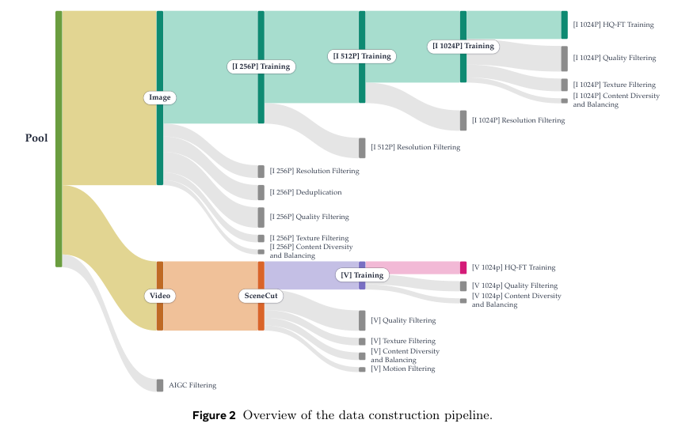

<!-- pair:3-8:en -->

**Key observation, inference and limitations.** KVQ thresholds are above 4 for pretraining and above 4.7 for fine-tuning; strict image selection retains about 4.08 per mille, or 0.408%, with 48K fine-tuning images. KTQ combines Laplacian-responsive pixel proportion and high-frequency DCT energy to select texture; CLIP supports semantic categorization and deduplication. The pipeline removes suspected AI-generated content to favor natural detail. For videos it detects cuts, requires high quality across frames and balances optical-flow motion. Strict sharpness selection can remove fast-motion footage; frame subsampling and real high-motion clips compensate. No isolated ablation establishes the causal benefit of each filter. [Figure 2, PDF p.4]

<!-- pair:3-8:zh -->

**关键观察、推理桥与边界。** 预训练 KVQ 阈值大于4，微调大于4.7；严格图像筛选保留约4.08‰，即0.408%，微调图像4.8万张。KTQ 结合拉普拉斯响应像素比例与高频 DCT 能量筛选纹理，CLIP 用于语义分类和去重；流程去掉疑似生成内容以偏向自然细节。视频做切镜检测、要求逐帧高质量并平衡光流运动。严格锐度筛选可能排除高速运动；抽帧及真实高运动片段用于补偿。没有独立消融证明每个过滤器的因果收益。 [图2，PDF p.4]

<!-- pair:3-9:en -->

### Table 1: The latent bottleneck must preserve detail

<!-- pair:3-9:zh -->

### 表1：潜空间瓶颈必须保留细节

<!-- pair:3-10:en -->

**How to read.** Compare VAE reconstruction PSNR and SSIM, both higher-is-better. This table evaluates compression/reconstruction, not the full restoration system.

<!-- pair:3-10:zh -->

**如何读。** 比较 VAE 重建 PSNR 与 SSIM，两者越高越好；此表测压缩重建，不是完整复原系统。

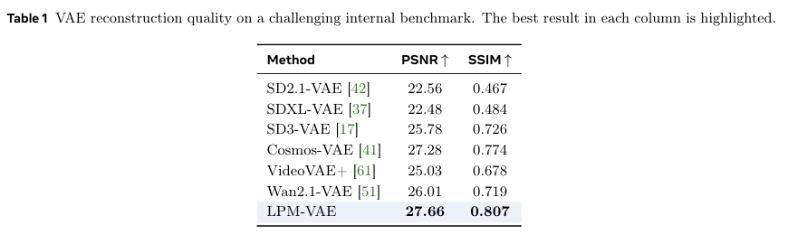

<!-- pair:3-12:en -->

**Key observation, inference and limitations.** LPM’s VAE scores 27.66 dB and 0.807 versus Cosmos 27.28 and 0.774 on the internal test. This supports the chosen representation’s reconstruction fidelity in this setup, because losses introduced before restoration cannot be freely recovered afterward. It does not prove superiority at equal compression ratio, training data or compute, which are not fully matched in the table. A high reconstruction score is also not a temporal-consistency measure. [Table 1, PDF p.6]

<!-- pair:3-12:zh -->

**关键观察、推理桥与边界。** 内部测试中 LPM VAE 为27.66 dB、0.807，Cosmos 为27.28、0.774。这支持所选表示在该设置下的重建保真，因为复原前已经丢失的信息无法任意恢复。但表格未完整匹配压缩率、训练数据或计算，不能证明等预算优势；高重建分也不是时序一致性指标。 [表1，PDF p.6]

<!-- pair:3-13:en -->

The spatial backbone replaces GeLU with SwiGLU gated feed-forward activations, LayerNorm with RMSNorm, and encodes spatial relationships through rotary positional embeddings (RoPE). These choices change expressivity, normalization cost and resolution handling; the report supplies no component-by-component ablation. Initial image pretraining is at 256×256, followed by the 48K high-quality subset and fidelity refinement. Spatial RoPE and temporal NoPE are distinct choices, not a contradiction. [§2.2.1–2.2.2]

<!-- pair:3-13:zh -->

空间主干以 SwiGLU 门控前馈激活替换 GeLU，以 RMSNorm 替换 LayerNorm，并用旋转位置编码 RoPE 表达空间关系。这些选择改变表达能力、归一化成本及分辨率处理，但报告未逐组件消融。初始图像预训练分辨率为256×256，再用4.8万高质量子集微调并保真细化。空间 RoPE 与时间 NoPE 是不同轴上的选择，并不矛盾。[§2.2.1–2.2.2]

<!-- pair:3-14:en -->

### Figure 3: From image velocity prediction to video

<!-- pair:3-14:zh -->

### 图3：从图像速度预测扩展到视频

<!-- pair:3-15:en -->

**How to read.** Read left to right: encoded degraded input conditions the noisy target latent; spatial blocks are followed by temporal blocks; decoded output returns to pixels. The VAE is frozen while restoration layers learn.

<!-- pair:3-15:zh -->

**如何读。** 从左到右看：编码后的退化输入作为含噪目标潜变量的条件，空间块后接时间块，再解码成像素；VAE 冻结，复原层训练。

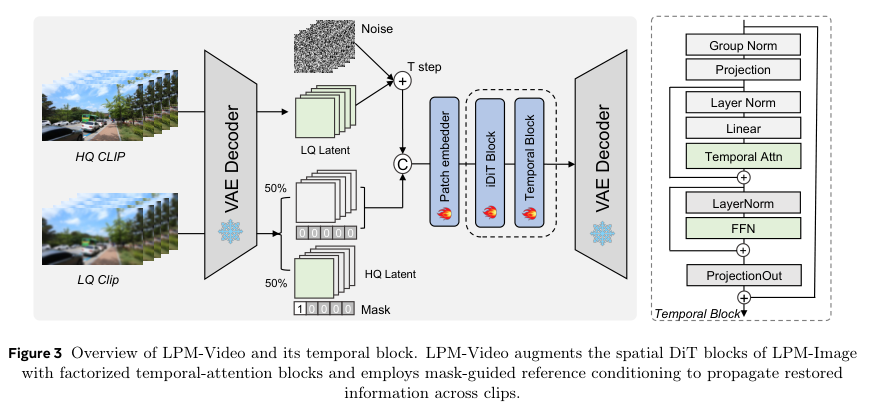

<!-- pair:3-17:en -->

**Key observation, inference and limitations.** Channel concatenation supplies spatially aligned low-quality evidence directly, avoiding a separate control branch. Temporal attention is inserted after spatial blocks and omits explicit temporal positional encoding (NoPE), supporting variable temporal sampling. The source diagram labels an input block “VAE Decoder” although the text describes encoding; another latent label is also ambiguous. This note follows the explicit encoder definition in §2.2 rather than silently treating the illustration as an executable graph. NoPE flexibility is not proof of perfect ordering or arbitrary-motion understanding. [Figure 3, PDF p.7]

<!-- pair:3-17:zh -->

**关键观察、推理桥与边界。** 通道拼接直接提供空间对齐的低质量证据，无需单独控制分支。时间注意力插在空间块之后，不加显式时间位置编码（NoPE），支持可变时间采样。原图把输入块标为“VAE Decoder”，但正文描述编码，另一潜变量标注也含混；本文遵循§2.2明确的编码器定义，不把示意图悄悄当成可执行图。NoPE 的灵活性不证明完美顺序理解或任意运动能力。 [图3，PDF p.7]

<!-- pair:3-18:en -->

### Rectified flow: define the direction before reading the loss

<!-- pair:3-18:zh -->

### 整流流：先定义方向，再读损失

$$
z_\tau=(1-\tau)\epsilon+\tau z_{\rm HQ},\qquad v^*=z_{\rm HQ}-\epsilon,\qquad \mathcal L_{\rm FM}=\mathbb E\left[\|v_\theta(z_\tau,z_{\rm LQ},\tau)-v^*\|_2^2\right]
$$

<!-- pair:3-20:en -->

Here $z_{\rm HQ}=E(I_{\rm HQ})$ and $z_{\rm LQ}=E(I_{\rm LQ})$ are clean and degraded latents, $E$ is the VAE encoder, $\epsilon$ is sampled noise, $\tau\in[0,1]$ is flow time and $v_\theta$ predicts velocity. The target velocity follows by differentiating the linear path. At $\tau=0$ it is noise; at 1 it is the clean target. Scalar example: $\epsilon=0$, $z_{\rm HQ}=2$ gives $z_{0.25}=0.5$ and target velocity 2. A prediction 1.5 contributes squared error 0.25. This is a teaching example, not a measured latent. Concatenating two aligned $C$-channel latents produces $2C$ input channels before projection. [Eq. (1), PDF p.6]

<!-- pair:3-20:zh -->

其中 $z_{\rm HQ}=E(I_{\rm HQ})$、$z_{\rm LQ}=E(I_{\rm LQ})$ 为干净与退化潜表示，$E$ 是 VAE 编码器，$\epsilon$ 为噪声，$\tau\in[0,1]$ 是流时间，$v_\theta$ 预测速度。对线性路径求导即得到目标速度；$\tau=0$ 是噪声，1是干净目标。标量演示：$\epsilon=0$、$z_{\rm HQ}=2$ 时，$z_{0.25}=0.5$，目标速度为2，预测1.5产生平方误差0.25。这是教学数值，不是实测潜变量。两个空间对齐的 $C$ 通道潜表示拼接后，在投影前有 $2C$ 通道。[式(1)，PDF p.6]

$$
I_{\rm LQ}=M\odot I_{\rm HQ}+(1-M)\odot D_{\rm deg}(I_{\rm HQ})
$$

<!-- pair:3-22:en -->

Equation (2) leaves selected regions clean while degrading the rest. $M$ is a binary spatial mask, $\odot$ elementwise multiplication and $D_{\rm deg}$ the degradation process, not the VAE decoder. Where $M=1$, the correct action is to preserve existing detail; where $M=0$, restoration is needed. For a readable sign beside a blurred wall, this discourages “improving” already-clear letters. It teaches identity behavior locally but cannot guarantee factual text or face preservation for every input. [§2.2.2]

<!-- pair:3-22:zh -->

式(2)保留部分干净区域，只退化其余区域。$M$ 为二元空间掩码，$\odot$ 为逐元素乘法，$D_{\rm deg}$ 是退化过程而非 VAE 解码器。$M=1$ 处应保留已有细节，$M=0$ 处才需要复原。清晰招牌旁有模糊墙面时，这会抑制对清楚文字的无谓“改善”。它局部教授恒等行为，却不能保证所有输入的文字与人脸事实性。[§2.2.2]

<!-- pair:3-23:en -->

Temporal blocks rearrange features from $(BT,N,D)$ to $(BN,T,D)$: $B$ is batch, $T$ frames, $N$ spatial tokens and $D$ feature dimension. Each spatial location can now attend across frames. Ignoring projections, factorized attention has pair-count cost proportional to $TN^2+NT^2$, versus $T^2N^2$ for joint attention over all frame-position tokens; this is an explanatory complexity derivation, not a reported speed measurement. A single-channel frame mask identifies clean high-quality references versus degraded frames. During fine-tuning, the reference is replaced with high quality with probability 50%; pretraining disables this mask. Image samples with $T=1$ remain mixed into video training to preserve texture learning. [§2.3.1–2.3.2]

<!-- pair:3-23:zh -->

时间块将特征从 $(BT,N,D)$ 重排为 $(BN,T,D)$：$B$ 是批大小，$T$ 为帧数，$N$ 为空间词元数，$D$ 为特征维度，使每个空间位置可跨帧注意。忽略投影，分解注意力的配对成本正比于 $TN^2+NT^2$，全时空联合注意力则为 $T^2N^2$；这是解释性复杂度推导，不是报告的实测加速。单通道帧掩码区分高质量参考与退化帧；微调时以50%概率用高质量替换参考，预训练禁用该掩码。视频训练仍混入 $T=1$ 的图像样本以保留纹理学习。[§2.3.1–2.3.2]

<!-- pair:3-24:en -->

### Figure 4: Synthetic degradation must remain coherent through time

<!-- pair:3-24:zh -->

### 图4：合成退化也必须时序一致

<!-- pair:3-25:en -->

**How to read.** Read blur, resizing, noise and JPEG operations with the FFmpeg compression stage, then compare motion sampling strategies. Shared degradation configuration applies across a clip.

<!-- pair:3-25:zh -->

**如何读。** 结合 FFmpeg 压缩阶段阅读模糊、缩放、噪声与 JPEG 操作，再看运动采样策略；同片段共享退化配置。

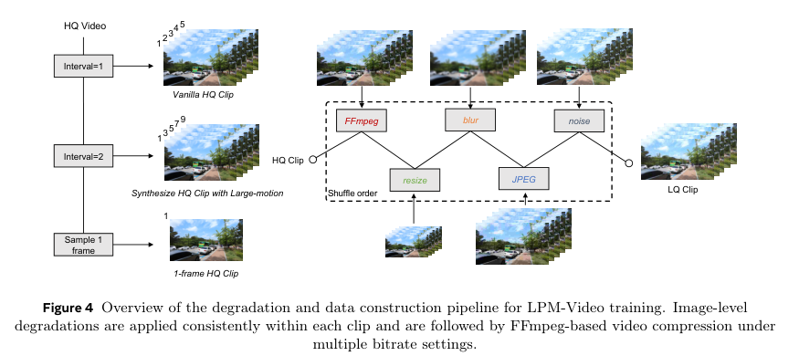

<!-- pair:3-27:en -->

**Key observation, inference and limitations.** BSRGAN-style corruption plus video compression approximates common UGC damage. Sharing configuration avoids arbitrary changes in degradation strength between frames, but does not require identical sampled noise pixels. Sampling temporal intervals of one or two increases apparent displacement without synthesizing extra motion blur. Together with real high-motion clips and image/video mixing, this broadens the training distribution. It remains a model of degradation: unseen camera pipelines, severe blur and repeated platform processing can differ from the synthetic recipe. [Figure 4, PDF p.9]

<!-- pair:3-27:zh -->

**关键观察、推理桥与边界。** BSRGAN 式退化加视频压缩模拟常见 UGC 损坏。共享配置避免帧间退化强度任意跳变，不等于每帧噪声像素完全一样。按一或二的时间间隔采样，可增加表观位移而不额外合成运动模糊；结合真实高运动片段及图像视频混训，扩展训练分布。但这仍只是退化模型，未知相机处理、严重模糊和多次平台转码可能不同。 [图4，PDF p.9]

<!-- pair:3-28:en -->

### Figure 5: Temporal pyramid: anchor before propagating

<!-- pair:3-28:zh -->

### 图5：时间金字塔：先锚定，再传播

<!-- pair:3-29:en -->

**How to read.** The top level establishes distant anchors; lower levels fill shorter intervals with overlap. Distinguish a fixed shot anchor from the recently restored overlap frames.

<!-- pair:3-29:zh -->

**如何读。** 上层先建立远距锚点，下层以重叠窗口补足短区间；区分固定镜头锚点与刚复原的重叠帧。

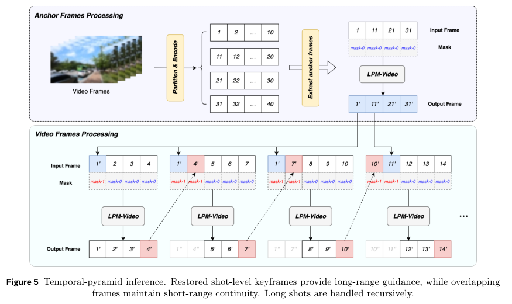

<!-- pair:3-31:en -->

**Key observation, inference and limitations.** Ordinary sliding windows condition each new block on the previous output, allowing color or texture errors to accumulate. LPM additionally restores and reuses a shot-level anchor, then recursively inserts intermediate anchors when the interval exceeds the model window. The figure’s long-span example moves from coarse frames such as 1, 11, 21 and 31 to local intervals. This gives each local prediction a longer-range appearance reference without processing the entire video jointly. It reduces the mechanism for chained drift but does not mathematically eliminate it; shot detection errors and a wrong anchor can propagate consistently wrong detail. [Figure 5, PDF p.11]

<!-- pair:3-31:zh -->

**关键观察、推理桥与边界。** 普通滑窗依赖前一窗口输出，颜色或纹理误差可能累积。LPM 额外复原并复用镜头级锚点；间隔超出窗口时递归插入中间锚点。图中长跨度示例先处理1、11、21、31等粗粒度帧，再补局部区间，使局部预测拥有较远外观参照而无需整段联合计算。这减少链式漂移来源，却非数学上消灭漂移；切镜错误与错误锚点仍会传播一致但错误的细节。 [图5，PDF p.11]

$$
\hat z_{W\setminus O}=H(z^{\rm LQ}_{W\setminus O};\hat z_O),\qquad \hat z_{W\setminus O}=H(z^{\rm LQ}_{W\setminus O};\hat z_{\rm anchor},\hat z_O)
$$

<!-- pair:3-33:en -->

This notation summarizes Eqs. (3)–(5): $H$ is restoration, $W$ a window and $O$ its overlap with already processed frames. The left form uses only overlap; the right adds an independently maintained anchor. Equation (4) describes jointly restoring the first-frame reference with the initial block before reuse. For a 40-frame shot, coarse anchors can stabilize later short windows even though those windows never jointly attend all 40 frames. “Arbitrarily long” means recursively schedulable windows, not unbounded attention memory or a proof of uniform quality for every length. [§2.4, PDF pp.10–11]

<!-- pair:3-33:zh -->

此记号概括式(3)–(5)：$H$ 是复原器，$W$ 是窗口，$O$ 为与已处理帧重叠的部分。左式仅用重叠，右式加入独立保留的锚点；式(4)描述先把首帧参考与初始块联合复原，再复用它。对40帧镜头，粗锚点可稳定后续短窗，尽管短窗从未联合注意全部40帧。“任意长”意味着窗口可递归调度，不代表无限注意力记忆，也不证明所有长度质量一致。[§2.4，PDF pp.10–11]

<!-- pair:3-34:en -->

### Figure 6: Distillation changes the cost of each restoration

<!-- pair:3-34:zh -->

### 图6：蒸馏改变每次复原的成本

<!-- pair:3-35:en -->

**How to read.** Read teacher trajectories, multi-step skipping and the successive student training stages. The schematic’s time direction differs from the earlier flow-loss notation.

<!-- pair:3-35:zh -->

**如何读。** 阅读教师轨迹、跨多步跳跃及学生训练阶段；此示意图的时间方向不同于前面的流损失记号。

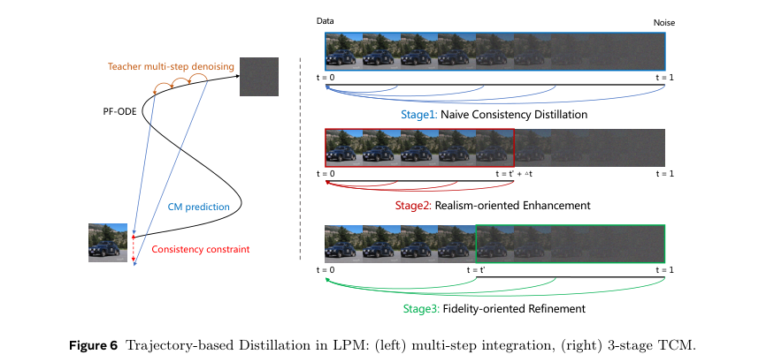

<!-- pair:3-37:en -->

**Key observation, inference and limitations.** A 25-step rectified-flow teacher is compressed toward one-step inference, with two-step inference also supported. Training progresses through naive consistency learning, near-clean realism refinement and fidelity refinement. Skipping integrates teacher information across multiple steps so the student need not trace each one at runtime. Figure 6 labels data near t=0 and noise near t=1, opposite to τ in Eq. (1); a reproduction must reconcile conventions before copying update signs. The figure describes a strategy, but does not provide all loss weights, schedules or matched one/two-step quality ablations. [Figure 6, PDF p.12]

<!-- pair:3-37:zh -->

**关键观察、推理桥与边界。** 25步整流流教师被压缩至单步推理，也支持两步。训练经过基础一致性学习、近干净端真实感细化及保真细化；多步跳跃整合教师跨步信息，学生运行时无需逐步复走。图6将数据放在 t=0 附近、噪声在 t=1 附近，与式(1)的 τ 相反；复现应先统一约定，再复制更新符号。图说明策略，但未提供全部损失权重、调度与等条件一/两步质量消融。 [图6，PDF p.12]

$$
x_{t_n}=x_{t_{n+1}}+(t_{n+1}-t_n)v
$$

<!-- pair:3-39:en -->

This is the source’s velocity-to-state reparameterization: $x_{t_n}$ is the explicit state predicted from the adjacent state $x_{t_{n+1}}$, a time increment and velocity $v$. It lets a velocity-trained backbone participate in a consistency objective that compares states. For an illustrative increment 0.1 and velocity 2, the update adds 0.2 to the current state. The plus sign is reproduced as printed; because the section uses a different time convention from Eq. (1), it must not be transplanted unchanged into the earlier noise-to-data parameterization. The paper does not provide a fully specified consistency-loss equation. [§2.5.1, PDF p.11]

<!-- pair:3-39:zh -->

这是原文的速度到状态重参数化：$x_{t_n}$ 由相邻状态 $x_{t_{n+1}}$、时间增量及速度 $v$ 得到，让速度训练主干参与比较状态的一致性目标。演示中增量0.1、速度2会给当前状态加0.2。加号按原文保留；本节时间约定不同于式(1)，不能原样移植到前面的噪声到数据参数化。论文未给完整的一致性损失公式。[§2.5.1，PDF p.11]

<!-- pair:3-40:en -->

Inference additionally uses FP8 DiT computation, SageAttention, INT8 VAE tiling and TensorRT-LLM fusion/CUDA optimization. Tiling limits memory by processing spatial pieces, but boundaries and temporal consistency still need testing. Distillation, quantization and compiler optimization are different approximations or implementation changes; their combined gain must be read against a common reference rather than multiplied as independent factors. [§2.5]

<!-- pair:3-40:zh -->

推理还使用 FP8 DiT、SageAttention、INT8 VAE 分块及 TensorRT-LLM 融合/CUDA 优化。分块通过局部空间处理限制内存，但边界与时序仍需测试。蒸馏、量化及编译优化是不同近似或实现变化，组合收益须对同一参考读取，不能当独立因子相乘。[§2.5]

## 4. 实验与结果分析（Experiments & Results）

<!-- pair:4-1:en -->

### Table 2: Cumulative acceleration, not multiplicative claims

<!-- pair:4-1:zh -->

### 表2：累计加速，不是倍数连乘

<!-- pair:4-2:en -->

**How to read.** Read the baseline and cumulative speedup columns alongside fidelity to the unaccelerated system. The reference is not ground-truth clean video.

<!-- pair:4-2:zh -->

**如何读。** 把基线、累计加速及相对未加速系统保真一起读；参考不是干净真实视频。

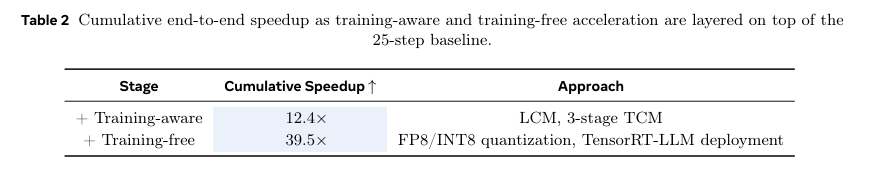

<!-- pair:4-4:en -->

**Key observation, inference and limitations.** Training-aware acceleration reaches 12.4× and the full stack 39.5×. The latter is the total, not an additional multiplier; the extra factor relative to 12.4× is about 3.19. PSNR above 43 dB, SSIM above 0.99 and KVQ difference below 0.01 indicate small differences from the unaccelerated output in the reported test. They do not establish 43 dB accuracy against real clean targets. Without hardware, absolute throughput, resolution and concurrency details sufficient for reproduction, this is a relative engineering result rather than a universal serving-cost estimate. [Table 2, PDF p.13]

<!-- pair:4-4:zh -->

**关键观察、推理桥与边界。** 训练感知加速达到12.4倍，完整系统39.5倍；后者是总计而非新增乘数，相对12.4倍额外约3.19倍。PSNR大于43 dB、SSIM大于0.99、KVQ差小于0.01表示所测输出与未加速版本接近，不代表对真实干净目标有43 dB准确度。缺乏足以复现的硬件、绝对吞吐、分辨率及并发细节时，应视为相对工程结果，而非普遍服务成本估算。 [表2，PDF p.13]

<!-- pair:4-5:en -->

### Metrics: perceptual appeal and truth can disagree

<!-- pair:4-5:zh -->

### 指标：观感与真实可以不一致

<!-- pair:4-6:en -->

PSNR measures pixel error on paired data in decibels; SSIM measures local structural similarity. MUSIQ, CLIP-IQA and KVQ are no-reference perceptual predictors, with higher reported scores preferred. They can reward convincing detail without knowing whether it is true. The image tests use RealSR, RealSet and an internal LPM benchmark; video tests use SPMCS, REDS, YouHQ, VideoLQ and an internal 192-video collection. Comparisons use shared inputs/output resolution and metric implementations, but model training data and compute are not matched. KVQ also helps curate the training data, so evaluation alignment to that scorer deserves independent checking. None of the main result tables directly measures flicker. [§3, PDF pp.12–15]

<!-- pair:4-6:zh -->

PSNR 在配对数据上用分贝表达像素误差，SSIM 衡量局部结构相似；MUSIQ、CLIP-IQA、KVQ 是无参考感知预测器，所报数值越高越好。它们可能奖励可信细节，却不知道细节是否真实。图像测 RealSR、RealSet 及内部 LPM 基准；视频测 SPMCS、REDS、YouHQ、VideoLQ 及内部192视频集合。比较共享输入、输出分辨率和指标实现，但训练数据与计算未匹配。KVQ 同时参与训练数据筛选，评测对该评分器的适配值得独立检查；主要结果表均不直接测闪烁。[§3，PDF pp.12–15]

<!-- pair:4-7:en -->

### Table 3: Public image tests reveal a fidelity–perception trade-off

<!-- pair:4-7:zh -->

### 表3：公开图像测试揭示保真与观感权衡

<!-- pair:4-8:en -->

**How to read.** Compare each metric within a dataset. RealSet has no paired PSNR; missing entries are not zero.

<!-- pair:4-8:zh -->

**如何读。** 在同一数据集内逐指标比较；RealSet 没有配对 PSNR，缺项不是零。

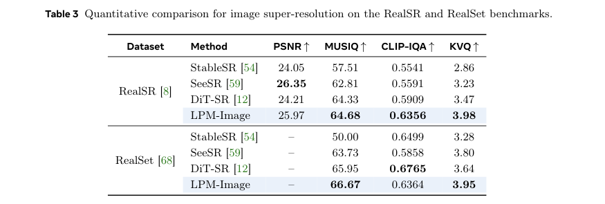

<!-- pair:4-10:en -->

**Key observation, inference and limitations.** On RealSR, LPM obtains PSNR 25.97, MUSIQ 64.68, CLIP-IQA 0.6356 and KVQ 3.98. SeeSR has higher PSNR 26.35, so LPM does not lead every metric. On RealSet, LPM leads MUSIQ 66.67 and KVQ 3.95, while DiT-SR has higher CLIP-IQA 0.6765 versus 0.6364. This supports strong perceptual performance with metric-dependent ranking, not uniformly superior reconstruction. No confidence intervals or repeated sampling variance are shown. [Table 3, PDF p.13]

<!-- pair:4-10:zh -->

**关键观察、推理桥与边界。** RealSR 上 LPM 的 PSNR25.97、MUSIQ64.68、CLIP-IQA0.6356、KVQ3.98；SeeSR 的 PSNR26.35更高，故不是每项领先。RealSet 上 LPM 的 MUSIQ66.67、KVQ3.95领先，但 DiT-SR 的 CLIP-IQA0.6765高于其0.6364。这支持较强感知表现及依赖指标的排序，而非全面更优重建；没有置信区间或重复采样方差。 [表3，PDF p.13]

<!-- pair:4-11:en -->

### Table 4: Internal image evaluation broadens the comparison

<!-- pair:4-11:zh -->

### 表4：内部图像评测扩展对比

<!-- pair:4-12:en -->

**How to read.** Read MUSIQ, CLIP-IQA and KVQ columns across methods, including accelerated competitors. This is the authors’ internal benchmark.

<!-- pair:4-12:zh -->

**如何读。** 横向读各方法的 MUSIQ、CLIP-IQA、KVQ，包括加速模型；这是作者内部基准。

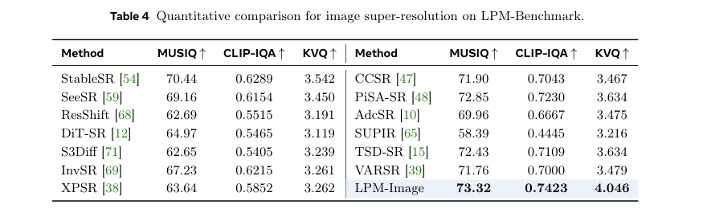

<!-- pair:4-14:en -->

**Key observation, inference and limitations.** LPM reports 73.32, 0.7423 and 4.046, ahead of PiSA-SR at 72.85, 0.7230 and 3.634, and TSD-SR at 72.43, 0.7109 and 3.634. The result supports its perceptual ranking on the selected internal distribution. No pixel-reference metric is shown here, and internal selection plus learned scoring limit claims about arbitrary real-world fidelity. A small MUSIQ gap is not automatically a statistically significant human preference. [Table 4, PDF p.14]

<!-- pair:4-14:zh -->

**关键观察、推理桥与边界。** LPM 为73.32、0.7423、4.046，高于 PiSA-SR 的72.85、0.7230、3.634及 TSD-SR 的72.43、0.7109、3.634。这支持所选内部分布上的感知排序。此处无像素参考指标，内部选样与学习型评分限制对任意现实保真的推广；小幅 MUSIQ 差也不自动等于统计显著的人类偏好。 [表4，PDF p.14]

<!-- pair:4-15:en -->

### Table 5: Video gains must be separated from temporal evidence

<!-- pair:4-15:zh -->

### 表5：视频增益须与时序证据区分

<!-- pair:4-16:en -->

**How to read.** Read dataset groups, then PSNR and the three no-reference metrics. Dashes indicate unavailable paired references on VideoLQ and the internal benchmark.

<!-- pair:4-16:zh -->

**如何读。** 先看数据集分组，再看 PSNR 与三种无参考指标；VideoLQ、内部基准的横线表示无配对参考。

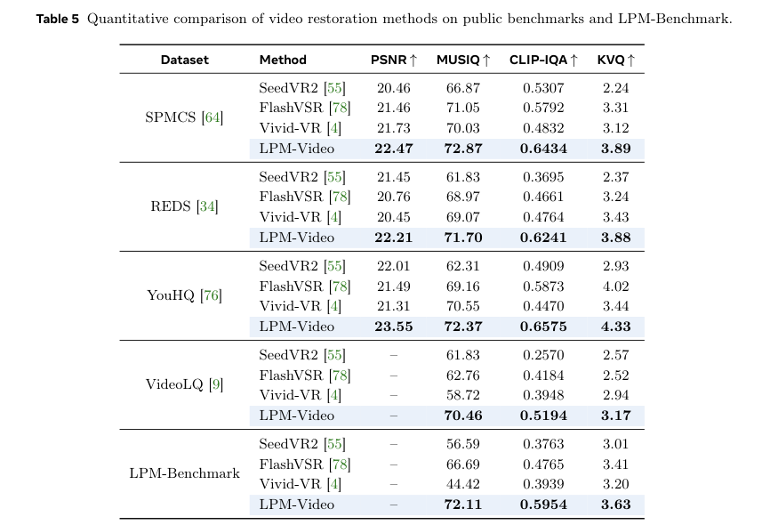

<!-- pair:4-18:en -->

**Key observation, inference and limitations.** LPM leads the listed methods across reported columns: SPMCS 22.47/72.87/0.6434/3.89, REDS 22.21/71.70/0.6241/3.88, and YouHQ 23.55/72.37/0.6575/4.33 in PSNR/MUSIQ/CLIP-IQA/KVQ order. VideoLQ has 70.46/0.5194/3.17 on the three no-reference measures; the internal set has 72.11/0.5954/3.63. These are substantial quality results across several distributions, but frame-quality metrics cannot by themselves validate the temporal-pyramid claim. A temporal ablation, motion-aligned error and flicker assessment would test that mechanism more directly. [Table 5, PDF p.15]

<!-- pair:4-18:zh -->

**关键观察、推理桥与边界。** LPM 在已列方法、已报列中领先：按 PSNR/MUSIQ/CLIP-IQA/KVQ 顺序，SPMCS 为22.47/72.87/0.6434/3.89，REDS为22.21/71.70/0.6241/3.88，YouHQ为23.55/72.37/0.6575/4.33。VideoLQ 三种无参考指标为70.46/0.5194/3.17，内部集为72.11/0.5954/3.63。这是跨多种分布的质量结果，但帧质量指标不能单独验证时间金字塔；时间模块消融、运动对齐误差与闪烁评估更直接检验该机制。 [表5，PDF p.15]

<!-- pair:4-19:en -->

### Figure 7: Selected images are diagnostic, not a temporal test

<!-- pair:4-19:zh -->

### 图7：精选图像可诊断，但不是时序测试

<!-- pair:4-20:en -->

**How to read.** Read the first two rows against open restoration baselines and the last two against commercial services. Compare local edges, faces and textures at matching positions.

<!-- pair:4-20:zh -->

**如何读。** 前两行对比开放复原基线，后两行对比商业服务；在相同位置比较边缘、人脸与纹理。

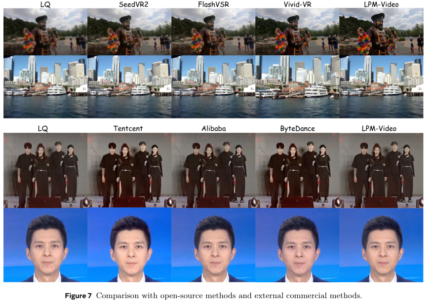

<!-- pair:4-22:en -->

**Key observation, inference and limitations.** The examples show visibly sharper detail in selected street/city, concert and portrait scenes. They illustrate the kinds of artifacts the authors target and complement the numeric tables. Static crops do not expose flicker, identity drift over time, average human preference or whether a newly sharp texture is authentic. Commercial-service outputs also lack fully matched hidden pipelines and settings. Treat this as qualitative support, not proof of universal superiority or temporal stability. [Figure 7, PDF p.15]

<!-- pair:4-22:zh -->

**关键观察、推理桥与边界。** 所选街景/城市、演出和人像中可见更锐利的细节，说明作者针对的伪影类型，并补充数值表。静态裁剪看不到闪烁、跨时间身份漂移、平均人类偏好，也不能确认新锐利纹理是否真实；商业服务隐藏流程与设置亦未完全匹配。它是定性支持，不是普遍领先或时序稳定的证明。 [图7，PDF p.15]

<!-- pair:4-23:en -->

**Evidence strength:** strong for the reported table values and their metric-specific ordering; moderate for a useful integrated image/video system; partial for the claim that temporal anchors cause superior long-video stability, since matched temporal ablations are absent. Production claims are author-reported: processed videos account for approximately 45% of viewing time, not 45% of videos or users; bitrate is reduced by about 20% versus an in-house codec at comparable perceptual quality. “Hundreds of millions” in annual savings has no stated currency or independently audited cost breakdown. These figures do not isolate LPM from other deployment changes. [Abstract; §1; §4]

<!-- pair:4-23:zh -->

**证据强度**：所报表格值及各指标排序有强支持；完整图像视频系统的实用性有中等支持；因缺少匹配时序消融，“时间锚点导致更优长视频稳定性”只获部分支持。生产数据由作者报告：处理视频约占观看时长45%，不是视频数或用户数45%；在相当观感下，相对内部编码器约省20%码率。“每年数亿”节省未给币种或独立审计成本明细，也无法从其他部署变化中隔离 LPM 的作用。[摘要；§1；§4]

## 5. 论文的贡献与影响（Contribution & Impact）

<!-- pair:5-1:en -->

LPM’s main contribution is coordinating data, representation, training schedule, temporal scheduling and inference economics. Image-first learning protects spatial detail; reference conditioning reuses that ability across time; a hierarchy of anchors addresses long-video drift without quadratic full-sequence attention; distillation and numerical optimization make the system more deployable. The value lies in those interfaces, not in treating every component as individually novel or proven necessary.

<!-- pair:5-1:zh -->

LPM 的主要贡献是协同数据、表示、训练顺序、时间调度与推理经济性。图像先行保护空间细节，参考条件把能力扩展到时间轴，分层锚点避免全序列二次注意力成本并处理长视频漂移，蒸馏和数值优化促进部署。价值在组件接口，不在于声称每个组件独立新颖或已被证明必要。

<!-- pair:5-2:en -->

The authors acknowledge weaker coverage of long-tail scenes and smaller benefits for already high-quality inputs. Useful next tests would compare no anchor, overlap-only, fixed-anchor and hierarchical-anchor inference at equal compute; stratify results by motion and shot length; measure OCR preservation, face identity, temporal warping error and human preference; and evaluate clean-region masks on already-good inputs. A deployment study should publish absolute throughput, hardware, energy and failure rates, with a controlled bitrate-quality experiment. These would connect plausible engineering mechanisms to causal and economic evidence.

<!-- pair:5-2:zh -->

作者承认长尾场景覆盖较弱、已高质量输入收益较小。后续应等计算比较无锚点、仅重叠、固定锚点、分层锚点；按运动及镜头长度分层；测 OCR 保真、人脸身份、时间形变误差与人类偏好；并在原本优质输入上检验干净区域掩码。部署研究应公开绝对吞吐、硬件、能耗和失败率，并做受控码率质量实验，才能把合理工程机制连接到因果与经济证据。

## 6. 结论（Conclusion）

<!-- pair:6-1:en -->

**Final judgment: worth close reading with conditions.** Read LPM as a strong systems blueprint for generative restoration, with meaningful perceptual results and a plausible route to economical serving. Do not equate attractive generated detail with ground truth, “arbitrary length” with unlimited context, cumulative speedup with independent multipliers, or author-reported deployment savings with an audited experiment. The highest-value lessons are the clean-region identity objective, image-to-video progression and anchor scheduling; their individual contributions still need controlled evaluation.

<!-- pair:6-1:zh -->

**最终判断：值得有条件精读。** 应把 LPM 当作生成式复原的重要系统蓝图：感知结果有价值，低成本服务路线合理。但不能把漂亮生成细节等同真实，把“任意长”等同无限上下文，把累计加速当独立乘数，把作者所报部署节省当审计实验。最值得借鉴的是干净区域恒等目标、图像到视频的渐进训练与锚点调度，单项贡献仍需受控验证。
