# How successive reconnections tie magnetic knots

连续重联如何系出磁纽结

Source: Hao & Yang, Journal of Fluid Mechanics 912, A48 (2021), DOI 10.1017/jfm.2020.1145. Complete 27-page published PDF, explicitly uploaded by coauthor Yue Yang to ResearchGate, was read including Appendices A–B; all 23 figures were visually checked. Publisher title/DOI agree. Anchors use 1-based PDF pages. The publisher PDF route returned an access page; the verified author upload supplies the actual paper.

来源：Hao 与 Yang，Journal of Fluid Mechanics 912，A48（2021），DOI 10.1017/jfm.2020.1145。已阅读合作者 Yue Yang 明确上传至 ResearchGate 的27页正式全文及附录 A–B，并核验全部23幅图；标题与 DOI 同出版社记录一致。页码为从1开始的 PDF 页码。出版社 PDF 地址返回访问页，实际全文来自经核验的作者上传。

## 1. 核心思想一句话总结（Elevator Pitch）

<!-- pair:1-1:en -->

Successive reconnections of opposite-twist magnetic tubes generate increasingly complex knots, supported by geometric sequences and sampled knot statistics within a finite dissipative interval.

<!-- pair:1-1:zh -->

几何序列与采样统计表明，反向拧转磁管可经连续重联产生更复杂纽结，但级联仅持续有限时段。

## 2. 论文背景与动机（Background & Motivation）

<!-- pair:2-1:en -->

### Prerequisites: twist, knots and reconnection

A magnetic field line is a curve tangent to the magnetic field, not a physical thread. A magnetic flux tube is a bundle of these curves. Twist describes winding around a tube axis; chirality is the winding’s handedness. A knot, strictly, is a closed curve that cannot be deformed into a circle without cutting or crossing itself. Helical winding around a straight axis therefore does not automatically establish a closed knot. [§1–2, PDF pp.1–4]

In a perfectly conducting ideal fluid, field-line connectivity is frozen into smooth fluid motion. Resistive magnetohydrodynamics (MHD), the coupled evolution of conducting fluid and magnetic field with diffusion, permits reconnection: nearby field segments exchange connections. Previous studies often began with an already knotted tube and watched it simplify. Here the question is how complexity can temporarily grow from initially unknotted, counter-helical tubes. Dissipation still removes energy overall; increasing knot complexity need not mean increasing total energy. [§1, PDF pp.2–3]

<!-- pair:2-1:zh -->

### 必要概念：拧转、纽结与重联

磁力线是处处与磁场相切的曲线，而非实体细线；磁通管是一束这样的曲线。拧转描述绕管轴缠绕，手性表示其左右旋方向。严格的纽结是一条闭合曲线，若不切断或自相穿越，便不能变成圆。因此绕直轴的螺旋缠绕本身并不自动构成闭合纽结。[§1–2，PDF 第1–4页]

在完全导电的理想流体中，场线连接被冻结于光滑流动。电阻磁流体力学（MHD）描述导电流体和磁场含扩散的耦合演化，允许相邻场线片段交换连接，即重联。此前研究往往从已打结磁管出发，观察其简化。本文则问：初始无结、反向螺旋的两管如何暂时增长复杂性？耗散仍使总体能量减少，纽结变复杂不必意味着总能量增加。[§1，PDF 第2–3页]

<!-- pair:2-2:en -->

### Figure 1

How to read: Read the two perpendicular axes and opposite winding directions, then the two local cylindrical coordinate systems.

<!-- pair:2-2:zh -->

### 图1

如何读：先读两根垂直管轴及相反绕转方向，再读各自局部柱坐标。

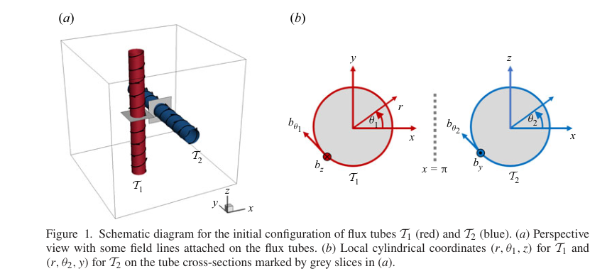

<!-- pair:2-4:en -->

Key observation, why this supports the interpretation, and limitations: The starting tubes have radius 0.6, axial length $2\pi$ and twist parameters $q=10$ and $-10$. A prescribed stagnation-type initial velocity pushes them together; this is not a fluid-at-rest experiment. The setup isolates a collision mechanism, but its symmetry and absence of imposed instability perturbations limit direct astrophysical interpretation. [Figure 1; Eqs.(2.5)–(2.9), PDF pp.3–4]

<!-- pair:2-4:zh -->

关键观察、为何支持该解释及其边界：初始管半径0.6、轴向长度 $2\pi$，拧转参数分别为 $q=10$ 与 $-10$。给定的停滞点型初始速度把两管推近，并非静止流体实验。该构型隔离碰撞机制，但对称性及没有外加失稳扰动限制了直接天体物理解释。[图1；式(2.5)–(2.9)，PDF 第3–4页]

## 3. 核心方法/模型详解（The Core Method/Model）

<!-- pair:3-1:en -->

### From initial field to topological evidence

The numerical input is velocity $\mathbf u$ and magnetic field $\mathbf b$ in a periodic cube of side $2\pi$. Magnetic induction is in Alfvén-velocity units, so density and permeability factors are absorbed. The solver uses $512^3$ grid points, Fourier pseudo-spectral derivatives, two-thirds dealiasing, second-order Runge–Kutta and CFL below 0.5. Viscosity $\nu$ and magnetic diffusivity $\eta$ both equal 0.005, giving magnetic Prandtl number one. Initial magnetic and kinetic energies are matched. [§2.1, PDF pp.3–5]

In local cylindrical coordinates the field is $(b_r,b_\theta,b_z)=(0,qrf(r),f(r))$. Here $r$ is radial distance, $f(r)$ is the compact radial profile and $q$ controls handedness and twist. With $q=10$, $r=0.1$, the circumferential and axial components have equal magnitude; changing $q$ to $-10$ reverses the circumferential direction while preserving its magnitude. This illustrative substitution explains chirality without mistaking it for a knot invariant. [Eq.(2.6), PDF p.4]

<!-- pair:3-1:zh -->

### 从初始场到拓扑证据

数值输入是边长 $2\pi$ 周期立方体中的速度 $\mathbf u$ 与磁场 $\mathbf b$。磁感应强度采用 Alfvén 速度单位，密度与磁导率因子已被吸收。求解器使用 $512^3$ 网格、Fourier 伪谱导数、三分之二去混叠、二阶 Runge–Kutta 及小于0.5的 CFL 数。黏性 $\nu$ 与磁扩散率 $\eta$ 均为0.005，磁 Prandtl 数为一，初始磁能与动能匹配。[§2.1，PDF 第3–5页]

局部柱坐标场为 $(b_r,b_\theta,b_z)=(0,qrf(r),f(r))$。其中 $r$ 是径向距离，$f(r)$ 为紧支撑径向剖面，$q$ 控制手性和拧转。取 $q=10$、$r=0.1$，周向与轴向分量幅值相同；改为 $q=-10$ 则反转周向方向而不改变幅值。这一教学代入解释手性，却不能把手性当作纽结不变量。[式(2.6)，PDF 第4页]

<!-- pair:3-2:en -->

The main measurement tool is a magnetic-surface field (MSF), a scalar label $\phi_b$ whose constant-value surfaces are tangent to $\mathbf b$. It is post-processing, not a force added to the fluid. Starting with positive labels on one tube and negative labels on the other, predict advection by the DNS velocity, then correct along the frozen magnetic field in auxiliary pseudo-time. Numerical diffusion in fifth-order WENO regularizes small scales. Remove correction and a material surface can drift off the field; use magnetic strength alone and threshold geometry need not be tangent at all. [Eqs.(2.13)–(2.18), PDF pp.5–7]

<!-- pair:3-2:zh -->

主要测量工具是磁面场（MSF），即等值面与 $\mathbf b$ 相切的标量标签 $\phi_b$。它是后处理，不是加给流体的力。初始时一管用正标签、一管用负标签；先按 DNS 速度预测平流，再沿冻结磁场在辅助伪时间中校正。五阶 WENO 的数值扩散正则化小尺度。若删除校正，物质面会偏离场线；若只用磁场强度，阈值面的几何甚至不一定相切。[式(2.13)–(2.18)，PDF 第5–7页]

$$
\mathbf b\cdot\nabla\phi_b=0,\qquad \lambda_b=\frac{\mathbf b\cdot\nabla\phi_b}{|\mathbf b|\,|\nabla\phi_b|}
$$

<!-- pair:3-4:en -->

The constraint defines a magnetic surface; the cosine $\lambda_b$ measures departure from tangency (absolute zero is ideal, one is maximal). For $\mathbf b=(0,0,2)$, a gradient $(1,0,0)$ gives zero, while $(0,0,1)$ gives one. The reported mean error below 1% supports the surfaces as integration boundaries. It does not identify one material field line uniquely across reconnection. The authors explicitly acknowledge that such a trajectory can be ill-defined in resistive flow. [§2.2; §3.5, PDF pp.7,19]

<!-- pair:3-4:zh -->

约束定义磁面；余弦 $\lambda_b$ 衡量偏离相切的程度，绝对值零为理想、一为最大。若 $\mathbf b=(0,0,2)$，梯度 $(1,0,0)$ 给出零，$(0,0,1)$ 给出一。报告的平均误差低于1%，支持把这些面作为积分边界，但不能跨越重联唯一识别同一物质场线。作者明确承认电阻流动中这种轨迹可能无法良好定义。[§2.2；§3.5，PDF 第7、19页]

<!-- pair:3-5:en -->

### Minimal example: the three-event chain

Start with two opposite-handed helices pushed toward one another. At the first antiparallel encounter, reconnect two segments into U-shaped lines; neither is yet knotted. One U-shaped branch wraps around the central plasmoid, the concentrated magnetic structure created by the collision. At a second encounter, reconnect that wrapped branch with a remaining helix: an overhand knot appears. Lorentz-force-driven local rotation and stretching bring newly deformed segments back to the interaction zone, enabling a third reconnection and a double overhand knot. Success requires showing both the connections and the resulting knot class, not counting visible curls. Removing the first encounter removes the wrapped geometry needed for the second; removing the flow feedback prevents this particular repeated-contact pathway. [§3.2–3.4, PDF pp.9–17]

<!-- pair:3-5:zh -->

### 最小例子：三个事件串起的机制

从两根被推近的相反手性螺旋线出发。第一次反平行相遇后，两个片段重联成 U 形线，此时尚未成结。其中一支绕过中央等离子团，即碰撞形成的磁结构集中区。第二次相遇时，这条绕行分支与剩余螺旋线重联，生成单套结。Lorentz 力驱动的局部旋转和拉伸把变形片段重新带回作用区，允许第三次重联产生双套结。成功标准是同时展示连接变化与所得结型，而不是数可见卷曲。没有第一次相遇，就没有第二次所需绕行几何；去掉流动反馈，便失去这条重复接触路径。[§3.2–3.4，PDF 第9–17页]

<!-- pair:3-6:en -->

### Figure 5

How to read: Trace how the incoming red and blue segments exchange partners at the X-shaped encounter.

<!-- pair:3-6:zh -->

### 图5

如何读：沿红蓝入射片段追踪其如何在 X 型相遇处交换连接。

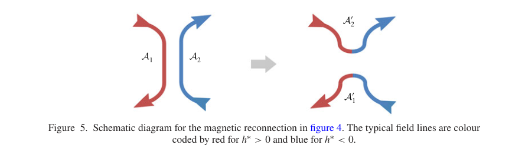

<!-- pair:3-8:en -->

Key observation, why this supports the interpretation, and limitations: The outgoing U-shaped lines each contain pieces of both original chiralities. This supports the first necessary geometric rearrangement, but not knot creation: the first reconnection still yields unknotted lines. The second encounter is essential. [Figure 5, PDF p.10]

<!-- pair:3-8:zh -->

关键观察、为何支持该解释及其边界：输出的 U 形线各含原先两种手性的片段。这支持第一次必要几何重组，但并未证明成结，因为首次重联后仍无结；第二次相遇不可缺少。[图5，PDF 第10页]

<!-- pair:3-9:en -->

### Figure 8

How to read: Follow the already wrapped branch through the second reconnection; compare the departing U branch and retained loop.

<!-- pair:3-9:zh -->

### 图8

如何读：跟随已经绕行的分支穿过第二次重联，比较离开的 U 形支与保留环路。

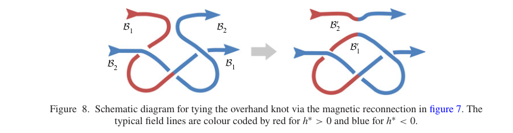

<!-- pair:3-11:en -->

Key observation, why this supports the interpretation, and limitations: The retained line has an overhand entanglement and alternating chirality segments. This supports a sequential mechanism: the second event acts on geometry prepared by the first, rather than two independent crossings. It remains a schematic; the DNS field-line extraction below supplies the direct evidence. [Figure 8, PDF p.12]

<!-- pair:3-11:zh -->

关键观察、为何支持该解释及其边界：留下的线出现单套缠结，并包含交替手性片段。这支持序贯机制：第二次作用于第一次准备好的几何，而非两次独立交叉。但这里仍是示意图，下方 DNS 场线提取才提供直接证据。[图8，PDF 第12页]

<!-- pair:3-12:en -->

To quantify rather than merely illustrate, the authors integrate 3700 field lines from uniformly sampled points on a specified central symmetry-plane region at each of $t=1.75,2,2.25$. Each open line is artificially closed with an unknotted, unlinked segment outside the box. The resulting loop is classified with an Alexander polynomial using pyknotid. Alexander–Briggs notation $n_i$ names a knot by minimum crossing number $n$ and an index $i$: $3_1$, $5_1$, $7_1$ are trefoil, cinquefoil and septafoil. The polynomial is not a complete identifier of all complex knots. [§3.5, PDF pp.18–19]

Before: start with a knot or use strength snapshots. After: identify tube surfaces, locate reconnection, reconstruct successive connections, close extracted lines and classify sampled loops. The trade-off is regularized surface tracking, closure-dependent knot definitions and spatially restricted sampling. These are distributions at separate times, not trajectories proving every same line progresses through all three classes.

<!-- pair:3-12:zh -->

为实现量化而非只画图，作者在 $t=1.75,2,2.25$ 各从中央指定对称平面区域均匀采样，积分3700条磁力线。每条开放曲线在盒外添加无结、无链环线段以人工闭合，再用 pyknotid 计算 Alexander 多项式分类。Alexander–Briggs 记号 $n_i$ 用最小交叉数 $n$ 与编号 $i$ 标识结型；$3_1$、$5_1$、$7_1$ 分别是三叶、五叶、七叶结。该多项式并不能完整辨识所有复杂纽结。[§3.5，PDF 第18–19页]

此前通常从已有纽结或强度快照出发；本文先识别磁面、定位重联，再重建连接、闭合提取的曲线并分类采样回路。代价是正则化曲面追踪、依赖闭合方式的结型定义和空间受限采样。这是不同时间的分布，不是证明每条同一场线依次经过全部三种结型的轨迹。

## 4. 实验与结果分析（Experiments & Results）

<!-- pair:4-1:en -->

### Figure 2

How to read: Read energy and its derivative on their separate vertical axes, especially the kinetic plateau around $t=1$–1.4.

<!-- pair:4-1:zh -->

### 图2

如何读：分别读能量与导数的纵轴，重点看 $t=1$–1.4 的动能平台。

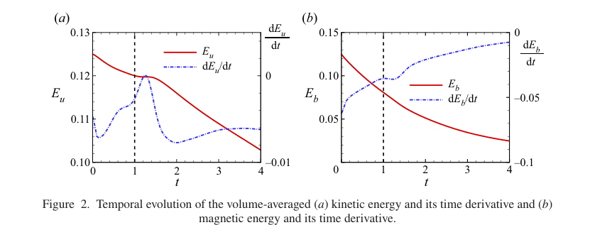

<!-- pair:4-3:en -->

Key observation, why this supports the interpretation, and limitations: Kinetic energy temporarily stops declining while magnetic energy continues falling. This supports magnetic-to-kinetic conversion offsetting viscous loss, rather than spontaneous total-energy creation. The whole-domain signal is diluted by background flow, so the tube-local budget is needed next. [Figure 2, PDF p.7]

<!-- pair:4-3:zh -->

关键观察、为何支持该解释及其边界：动能暂时停止下降，磁能却持续减少。这支持磁能转动能抵消黏性失能，而非总能量凭空产生。全域信号被背景流动稀释，因此还需管内局部预算。[图2，PDF 第7页]

<!-- pair:4-4:en -->

### Figure 3

How to read: Follow the four times from collision through central distortion to separated late tubes; colour is normalized helicity density, not a unique knot label.

<!-- pair:4-4:zh -->

### 图3

如何读：沿四个时刻观察碰撞、中央变形及后期分离；颜色为归一化螺度密度，不是唯一结型标签。

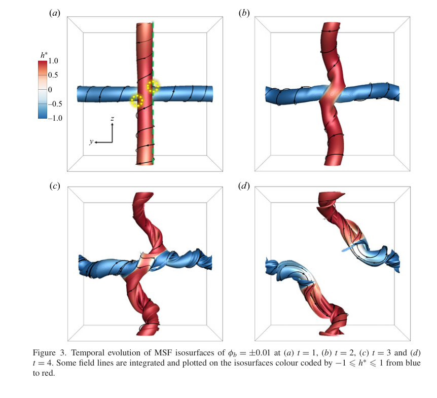

<!-- pair:4-6:en -->

Key observation, why this supports the interpretation, and limitations: The central structure becomes convoluted and later stretches out, leaving U-shaped tubes. This supports a transient interaction region rather than indefinite complexity growth. Smooth isosurfaces alone cannot establish knot types, so the next close-ups trace actual field-line connectivity. [Figure 3, PDF p.8]

<!-- pair:4-6:zh -->

关键观察、为何支持该解释及其边界：中央结构先复杂化、后被拉开，留下 U 形管。这支持暂时存在的作用区，而非复杂性无限增长。光滑等值面本身不能识别结型，因此随后必须近看实际场线连接。[图3，PDF 第8页]

<!-- pair:4-7:en -->

### Figure 4

How to read: Compare the field-line connections before and after the highlighted first reconnection at $t=1$.

<!-- pair:4-7:zh -->

### 图4

如何读：在 $t=1$ 标出的首次重联区比较前后场线连接。

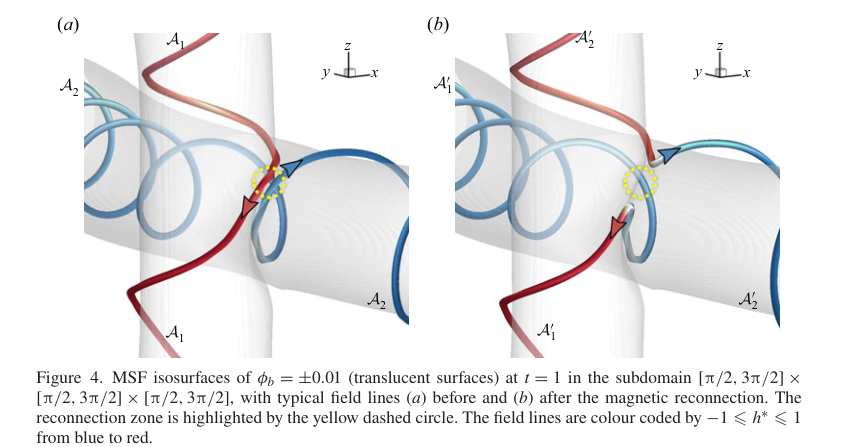

<!-- pair:4-9:en -->

Key observation, why this supports the interpretation, and limitations: Antiparallel lines exchange connections into two U-shaped branches moving away in opposite directions. This supports the initial geometric preparation for knotting. These are representative instantaneous integrations near the reconnection zone, not uniquely tagged trajectories of a single line through resistive evolution. [Figure 4; §3.2, PDF p.9]

<!-- pair:4-9:zh -->

关键观察、为何支持该解释及其边界：反平行线交换连接，形成向相反方向离开的两条 U 形支，支持成结所需的初始几何准备。但它们是重联区附近的代表性瞬时积分曲线，不是电阻演化中唯一标记的单条场线轨迹。[图4；§3.2，PDF 第9页]

<!-- pair:4-10:en -->

### Figure 6

How to read: Locate the current sheet between the MSF contours, then read the projected Lorentz-force arrows in the enlargement.

<!-- pair:4-10:zh -->

### 图6

如何读：先找 MSF 轮廓之间的电流片，再读放大图中投影 Lorentz 力箭头。

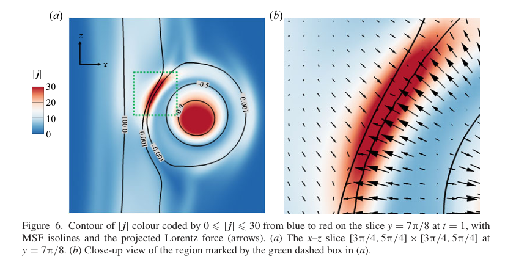

<!-- pair:4-12:en -->

Key observation, why this supports the interpretation, and limitations: High current lies where opposing surfaces approach, and forces point toward the interaction sheet. This supports feedback from the magnetic deformation to local motion, beyond the imposed initial strain. A current maximum alone is not a full reconnection-rate measurement; geometry and flux changes must corroborate it. [Figure 6, PDF p.11]

<!-- pair:4-12:zh -->

关键观察、为何支持该解释及其边界：相向曲面接近处具有高电流，力指向作用电流片，支持磁变形对局部运动的反馈，而不仅是外加初始应变。电流最大值本身不是完整重联率测量，仍需几何和通量变化互证。[图6，PDF 第11页]

<!-- pair:4-13:en -->

### Figure 7

How to read: Trace the wrapped $B_1$ line and incoming $B_2$ line across the second highlighted encounter at $t=1.75$.

<!-- pair:4-13:zh -->

### 图7

如何读：在 $t=1.75$ 第二次标注相遇处，追踪绕行的 $B_1$ 与入射 $B_2$。

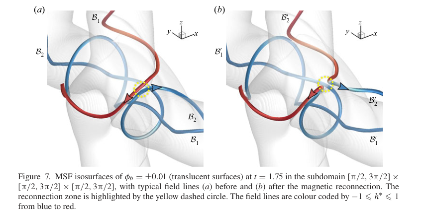

<!-- pair:4-15:en -->

Key observation, why this supports the interpretation, and limitations: The retained branch forms the overhand knot while the other branch departs as a U. This directly supports the second-event mechanism illustrated earlier. It cannot assign a topological knot class to an open curve without the subsequent closure convention. [Figure 7, PDF p.11]

<!-- pair:4-15:zh -->

关键观察、为何支持该解释及其边界：保留分支形成单套结，另一支以 U 形离开，直接支持前述第二事件机制。但开放曲线若不指定后续闭合约定，还不能赋予严格拓扑结型。[图7，PDF 第11页]

<!-- pair:4-16:en -->

### Figure 9

How to read: Compare this later current-sheet/force map with Figure 6 rather than treating it as a different mechanism.

<!-- pair:4-16:zh -->

### 图9

如何读：把后期电流片/力图与图6比较，而非把它当作另一套机制。

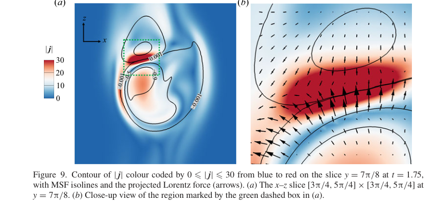

<!-- pair:4-18:en -->

Key observation, why this supports the interpretation, and limitations: A concentrated sheet and converging surfaces persist at the secondary event. This supports repeated reconnection near the same region, now acting on changed geometry. It cannot by itself prove knot formation; that inference depends on Figure 7’s connections and the knot diagrams. [Figure 9, PDF p.12]

<!-- pair:4-18:zh -->

关键观察、为何支持该解释及其边界：第二次事件仍具有集中电流片和靠近的曲面，支持在近似同一区域重复重联，但作用几何已经改变。此图本身不能证明成结，还须依赖图7的连接及纽结图。[图9，PDF 第12页]

<!-- pair:4-19:en -->

### Figure 10

How to read: Separate inner-tube and outer-tube averages, then distinguish energy from normalized helicity density.

<!-- pair:4-19:zh -->

### 图10

如何读：区分内管与外管均值，再把能量与归一化螺度密度分开。

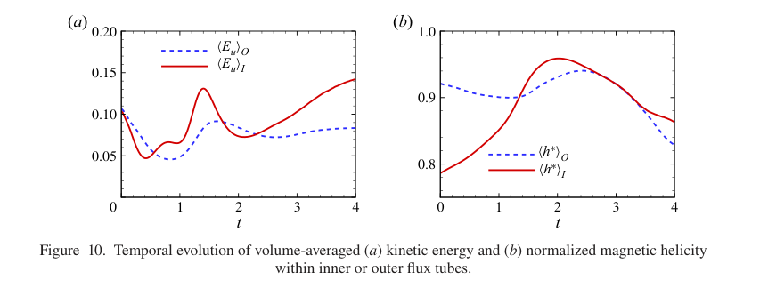

<!-- pair:4-21:en -->

Key observation, why this supports the interpretation, and limitations: Inner-tube kinetic energy develops a stronger early peak, and normalized helicity density surges during knotting. This supports concentrating the energetic event inside the tubes rather than the background. The normalized quantity is an alignment diagnostic, not conserved total magnetic helicity or a unique measure of knot number; net flux in the periodic box complicates helicity interpretation. [Figure 10; §3.3, PDF pp.12–13]

<!-- pair:4-21:zh -->

关键观察、为何支持该解释及其边界：内管动能早期峰值更强，成结时归一化螺度密度快速上升，支持能量事件集中于管内而非背景。归一化量是对齐诊断，不是守恒总磁螺度，也不是唯一纽结计数；周期盒中的净通量使螺度解释复杂化。[图10；§3.3，PDF 第12–13页]

<!-- pair:4-22:en -->

The flux diagnostic integrates field crossing two diagonal planes. For $F_1$, the plane normal is $(\mathbf e_z-\mathbf e_y)/\sqrt2$, so its signed density is $(b_z-b_y)/\sqrt2$. $F_2$ uses the sum. The surfaces $S_1,S_2$ are bounded by the tracked tube’s intersections, not arbitrary fixed squares. For an illustrative uniform $b_z=1,b_y=0$ and unit area, both fluxes are $1/\sqrt2$; rotating the field toward one plane can reduce its crossing flux without reducing total field magnitude. [Eq.(3.3), PDF p.13]

<!-- pair:4-22:zh -->

通量诊断对两个对角平面上的穿越磁场积分。$F_1$ 的法向为 $(\mathbf e_z-\mathbf e_y)/\sqrt2$，带符号密度因此为 $(b_z-b_y)/\sqrt2$；$F_2$ 使用两分量之和。$S_1,S_2$ 由追踪磁管与平面的交线界定，不是任意固定方形。教学上取均匀 $b_z=1,b_y=0$、面积一，两个通量均为 $1/\sqrt2$；把场转向某平面即可降低穿越通量，而无需减小场总幅值。[式(3.3)，PDF 第13页]

$$
F_1=\frac{1}{\sqrt2}\int_{S_1}(b_z-b_y)\,dS,\qquad F_2=\frac{1}{\sqrt2}\int_{S_2}(b_z+b_y)\,dS
$$

<!-- pair:4-24:en -->

### Figure 11

How to read: Read signed fluxes: moving toward zero is a reduction in magnitude. Inspect both the early change and the later $F_1$ plateau.

<!-- pair:4-24:zh -->

### 图11

如何读：读带符号通量，向零移动表示幅值减少；同时看早期变化与后期 $F_1$ 平台。

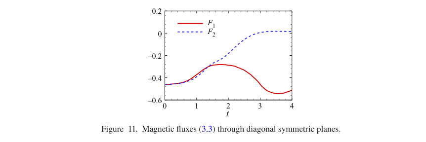

<!-- pair:4-26:en -->

Key observation, why this supports the interpretation, and limitations: Both magnitudes drop around the first event. Later $F_1$ temporarily plateaus while the geometry continues changing. This supports flux as an event diagnostic, but a plateau does not prove reconnection stopped: oppositely signed contributions can cancel. Figure 12 explains that ambiguity. [Figure 11, PDF p.14]

<!-- pair:4-26:zh -->

关键观察、为何支持该解释及其边界：首次事件附近，两通量幅值均下降；此后几何仍在变化，$F_1$ 却暂时出现平台。这支持把通量用作事件诊断，但平台不能证明重联停止，因为正负贡献可以抵消。图12解释这一歧义。[图11，PDF 第14页]

<!-- pair:4-27:en -->

### Figure 12

How to read: Compare the two perspectives at each time, paying attention to field direction through the same diagonal plane.

<!-- pair:4-27:zh -->

### 图12

如何读：逐时刻比较两个视角，重点看场线如何穿过同一对角平面。

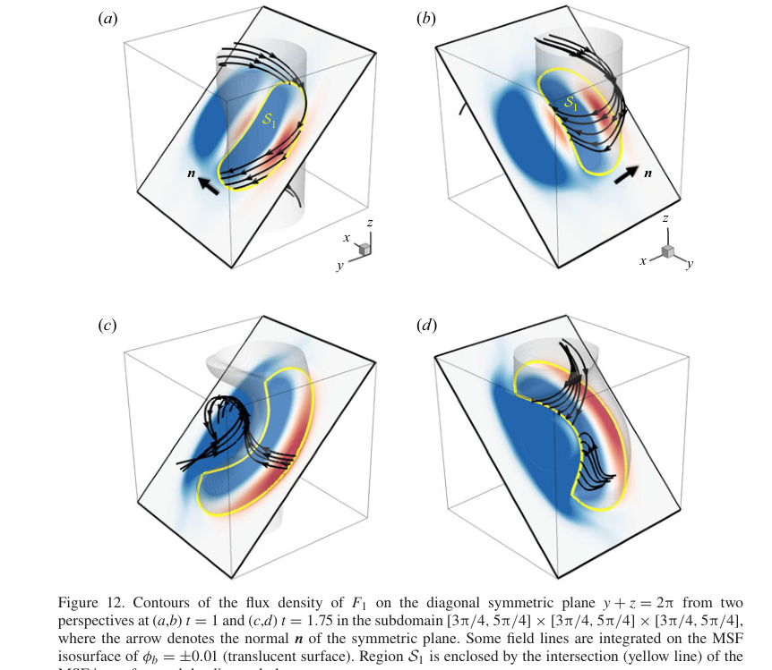

<!-- pair:4-29:en -->

Key observation, why this supports the interpretation, and limitations: At the second event, positive and negative crossing contributions both increase in different regions. This supports the cancellation explanation for the flux plateau. It cannot turn net flux into a unique count of reconnection events or knots; those require geometric and topological diagnostics. [Figure 12; §3.3, PDF pp.14–15]

<!-- pair:4-29:zh -->

关键观察、为何支持该解释及其边界：第二次事件时，不同区域的正负穿越贡献都增强，支持通量平台来自相消的解释。但不能把净通量变成重联事件或纽结的唯一计数，仍需几何与拓扑诊断。[图12；§3.3，PDF 第14–15页]

<!-- pair:4-30:en -->

### Figure 13

How to read: Trace the third encounter at $t=2$ and compare the outgoing retained branch with the overhand knot in Figure 7.

<!-- pair:4-30:zh -->

### 图13

如何读：在 $t=2$ 追踪第三次相遇，并把保留输出支与图7单套结比较。

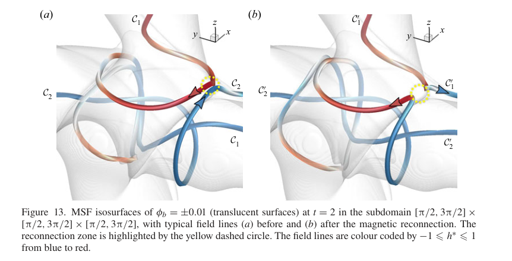

<!-- pair:4-32:en -->

Key observation, why this supports the interpretation, and limitations: The new connection creates a double overhand configuration. This supports a repeated local reconnection pathway toward complexity. The claim concerns selected representative lines within the central interaction zone, not every field line or every initial magnetic configuration. [Figure 13, PDF p.15]

<!-- pair:4-32:zh -->

关键观察、为何支持该解释及其边界：新连接产生双套构型，支持通过重复局部重联增加复杂性的路径。但该主张针对中央作用区的代表性场线，不适用于每条磁力线或任意初始磁场构型。[图13，PDF 第15页]

<!-- pair:4-33:en -->

### Figure 14

How to read: Read projected velocity arrows alongside the evolving knotted lines at 1.75, 2 and 2.25.

<!-- pair:4-33:zh -->

### 图14

如何读：把投影速度箭头与1.75、2、2.25时刻的纽结场线一同阅读。

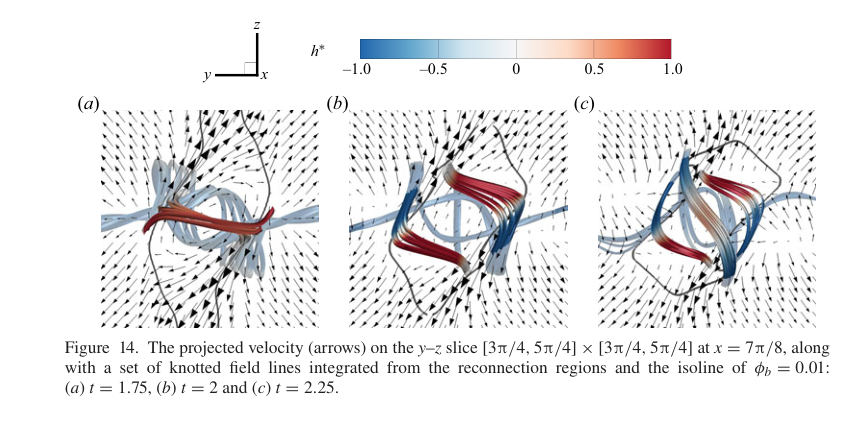

<!-- pair:4-35:en -->

Key observation, why this supports the interpretation, and limitations: The local pattern first rotates and later stretches the knots, bringing segments back near the reconnection zone. This supports the geometry–Lorentz-force–motion feedback. It does not show that stretching always increases knotting: later stretching also separates the tubes and helps terminate the cascade. [Figure 14; §3.4, PDF pp.15–17]

<!-- pair:4-35:zh -->

关键观察、为何支持该解释及其边界：局部运动先旋转、后拉伸纽结，把片段再次带到重联区域附近，支持几何—Lorentz 力—运动反馈。但不能推出拉伸总增强成结；后期拉伸还使两管分离，帮助终止级联。[图14；§3.4，PDF 第15–17页]

<!-- pair:4-36:en -->

### Figure 15

How to read: Compare extracted diagrams above with reduced closed-knot diagrams below; count irreducible crossings, not every projected overlap.

<!-- pair:4-36:zh -->

### 图15

如何读：比较上排提取图与下排约化闭合纽结图；数不可约交叉，而非所有投影重叠。

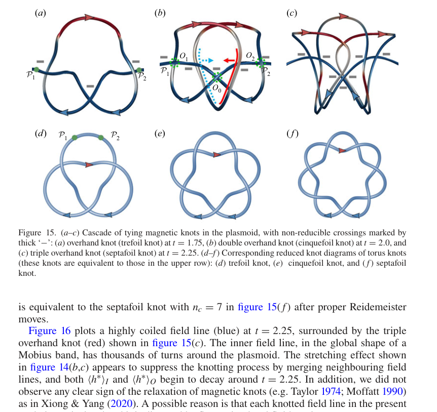

<!-- pair:4-38:en -->

Key observation, why this supports the interpretation, and limitations: The examples reduce to minimum crossing numbers 3, 5 and 7 at 1.75, 2 and 2.25. This strongly supports increasing complexity of these closed representative curves. The conclusion paragraph prints 5 again for the last time, conflicting with Figure 15 and §3.4; this report uses 7 with that explicit correction. Closure outside the box remains part of the definition. [Figure 15, PDF p.17; §4, p.20]

<!-- pair:4-38:zh -->

关键观察、为何支持该解释及其边界：代表曲线在1.75、2、2.25时刻约化为最小交叉数3、5、7，强力支持这些闭合代表曲线的复杂性增长。结论段把最后时刻再次写成5，与图15及 §3.4 冲突；本报告明确指出差异并采用7。盒外闭合仍是定义的一部分。[图15，PDF 第17页；§4，第20页]

<!-- pair:4-39:en -->

### Figure 16

How to read: Compare the simple-looking red knot with the densely coiled blue line inside it.

<!-- pair:4-39:zh -->

### 图16

如何读：比较相对清晰的红色结与内部密集盘绕的蓝色场线。

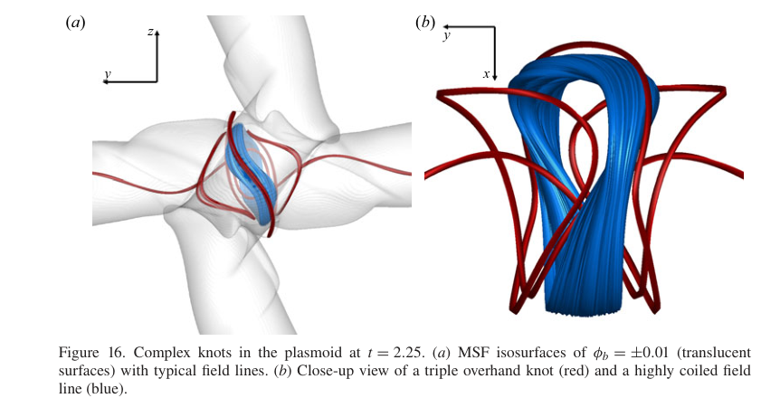

<!-- pair:4-41:en -->

Key observation, why this supports the interpretation, and limitations: A visually dense coil can be harder to classify than the illustrated torus knots. This supports the need to report classification failure, rather than assigning every complex line a guessed knot type. The authors report thousands of turns, but this image cannot independently count them or establish a unique minimum crossing number. [Figure 16; §3.4–3.5, PDF pp.17–18]

<!-- pair:4-41:zh -->

关键观察、为何支持该解释及其边界：密集盘绕曲线比展示的环面结更难分类，支持必须报告分类失败，而不是猜测每条复杂场线的结型。作者报告其绕转数达数千，但此图不能独立计数，也不能建立唯一最小交叉数。[图16；§3.4–3.5，PDF 第17–18页]

<!-- pair:4-42:en -->

### Figure 17

How to read: Compare the modal knot type across the three sampling times, then check what the plotted distribution omits.

<!-- pair:4-42:zh -->

### 图17

如何读：比较三个采样时刻的众数结型，再检查图中省略了什么。

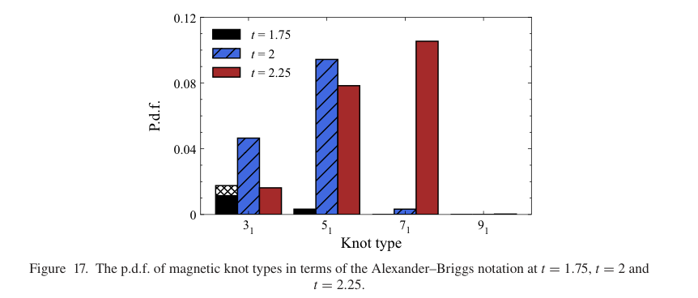

<!-- pair:4-44:en -->

Key observation, why this supports the interpretation, and limitations: The peak shifts from $3_1$ to $5_1$ to $7_1$, and the authors report identified knotted fractions growing from below 4% to about 20%. This is strong evidence of a sampled transient cascade, not a population-wide exact probability law. Unknotted lines are not plotted, and 12.5% of late-time lines are omitted because complex classifications are unreliable. Sampling is uniform in a selected plane, not flux-weighted across the whole domain. [Figure 17; §3.5, PDF pp.18–19]

<!-- pair:4-44:zh -->

关键观察、为何支持该解释及其边界：峰值从 $3_1$ 移到 $5_1$ 再到 $7_1$，作者报告已识别有结比例从不足4%升至约20%。这对采样到的短暂级联提供强证据，但不是全体场线的精确概率规律。图中不显示无结线，后期还有12.5%的线因复杂分类不可靠而省略。采样是在指定平面上均匀取点，并非全域磁通加权。[图17；§3.5，PDF 第18–19页]

<!-- pair:4-45:en -->

### Figure 18

How to read: Compare mean tangency error of MSF against magnetic-strength surfaces and the 1% reference.

<!-- pair:4-45:zh -->

### 图18

如何读：比较 MSF 与磁强度等值面的平均相切误差，并参照1%线。

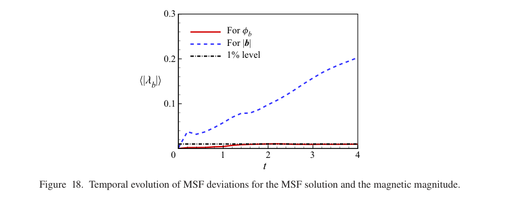

<!-- pair:4-47:en -->

Key observation, why this supports the interpretation, and limitations: MSF remains below 1%; strength surfaces reach roughly 10% at $t=2$ and 20% at $t=4$. This strongly supports MSF as a better tangent boundary for flux integrals. It cannot prove exact temporal identity or all-grid convergence, because tangency, uniqueness and resolution are separate questions. [Figure 18; Appendix A, PDF pp.20–21]

<!-- pair:4-47:zh -->

关键观察、为何支持该解释及其边界：MSF 保持低于1%，磁强度面在 $t=2$ 约10%、$t=4$ 约20%。这强力支持 MSF 更适合作为通量积分的相切边界，但不能证明精确时间身份或所有网格的收敛，因为相切、唯一性与分辨率是不同问题。[图18；附录 A，PDF 第20–21页]

<!-- pair:4-48:en -->

### Figure 19

How to read: Check whether the black field lines stay on the magnetic-strength surfaces at the two times.

<!-- pair:4-48:zh -->

### 图19

如何读：检查两个时刻黑色场线是否留在磁强度等值面上。

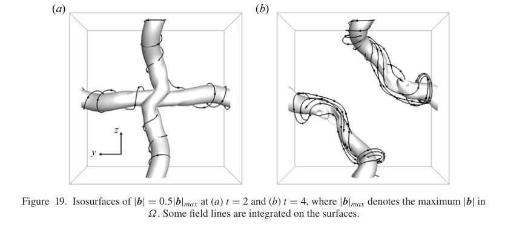

<!-- pair:4-50:en -->

Key observation, why this supports the interpretation, and limitations: Several lines visibly depart from the surfaces. This supplies geometric evidence behind Figure 18’s error metric and explains why intensity alone is a poor magnetic-tube boundary. It does not make every MSF label unique, or demonstrate that all ordinary isosurfaces fail equally. [Figure 19, PDF p.21]

<!-- pair:4-50:zh -->

关键观察、为何支持该解释及其边界：若干场线明显离开曲面，为图18误差指标提供几何证据，说明为何强度本身不是好的磁管边界。但这不保证每个 MSF 标签唯一，也不意味着所有普通等值面的失效程度相同。[图19，PDF 第21页]

<!-- pair:4-51:en -->

### Figure 20

How to read: Read normalized inner-tube energy and helicity-density curves across twist values 5, 10 and 15.

<!-- pair:4-51:zh -->

### 图20

如何读：比较拧转参数5、10、15时归一化内管能量和螺度密度曲线。

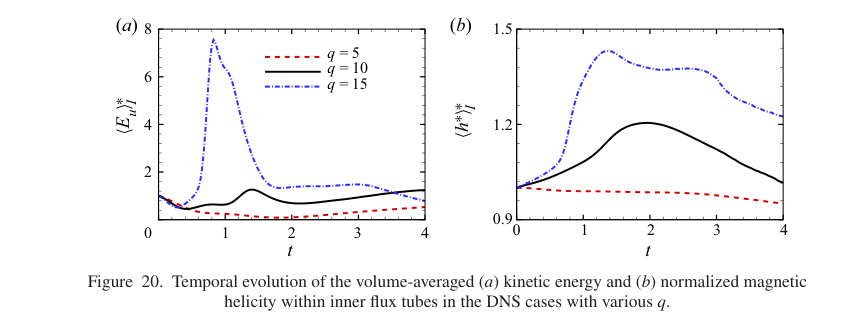

<!-- pair:4-53:en -->

Key observation, why this supports the interpretation, and limitations: Stronger twist advances and amplifies the peaks, while the weakest case lacks the helicity-density peak. This supports initial twist as a mechanism-relevant control, rather than an incidental visual choice. Changing twist also changes the initial field’s energy distribution, so this is not an independently energy-matched twist-only causal estimate. [Figure 20; Appendix B, PDF p.22]

<!-- pair:4-53:zh -->

关键观察、为何支持该解释及其边界：较强拧转使峰值提前并增大，最弱算例没有螺度密度峰，支持初始拧转是与机制相关的控制量，而非偶然的绘图选择。但改变拧转也改变初始场能量分布，并非独立等能量匹配的纯拧转因果估计。[图20；附录 B，PDF 第22页]

<!-- pair:4-54:en -->

### Figure 21

How to read: At the same $t=1.75$, compare low- and high-twist tubes and their enlarged central lines.

<!-- pair:4-54:zh -->

### 图21

如何读：在同一 $t=1.75$ 比较低拧转、高拧转磁管及其中央场线放大图。

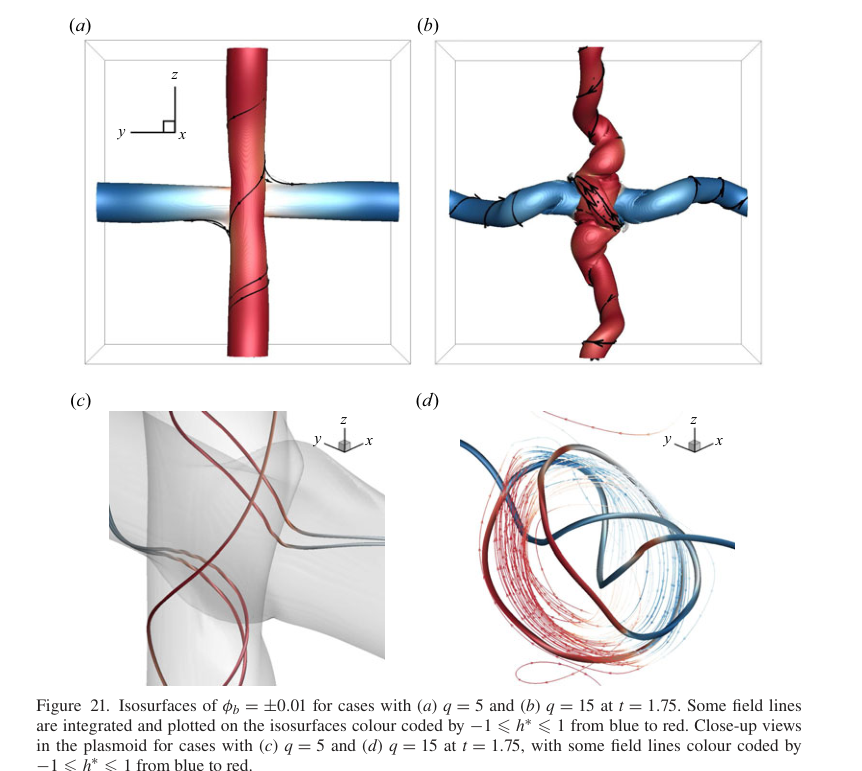

<!-- pair:4-56:en -->

Key observation, why this supports the interpretation, and limitations: The $q=5$ case remains simply deformed and unknotted, while $q=15$ already contains a double overhand knot and coiled line. This supports a real failure boundary for the cascade, not merely a timing variation. The tested values do not locate a sharp universal threshold between 5 and 15. [Figure 21, PDF p.23]

<!-- pair:4-56:zh -->

关键观察、为何支持该解释及其边界：$q=5$ 仅简单变形且无结，$q=15$ 已含双套结与盘绕线。这支持级联确有失败边界，而不只是时间变化。但所测数值不能定位5到15之间的普适尖锐阈值。[图21，PDF 第23页]

<!-- pair:4-57:en -->

### Figure 22

How to read: Compare both axial profile $f(r)$ and circumferential profile $qr f(r)$; the outer-tube twist strength is the important difference.

<!-- pair:4-57:zh -->

### 图22

如何读：同时比较轴向剖面 $f(r)$ 与周向剖面 $qr f(r)$，重点是外层磁管的拧转强度差。

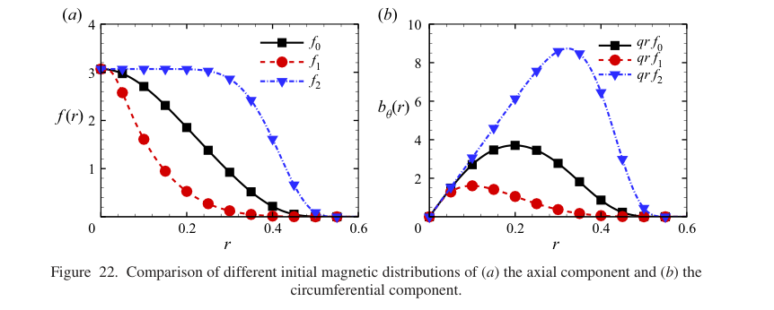

<!-- pair:4-59:en -->

Key observation, why this supports the interpretation, and limitations: The flatter $f_2$ profile carries much stronger circumferential field at larger radius than $f_0$ or $f_1$. This supports the prediction of earlier peripheral reconnection. It changes more than one property, including magnetic strength distribution, so it cannot isolate twist from all energy and force changes. [Figure 22; Appendix B, PDF pp.22–23]

<!-- pair:4-59:zh -->

关键观察、为何支持该解释及其边界：更平坦的 $f_2$ 在较大半径具有比 $f_0$、$f_1$ 更强的周向场，支持外围更早重联的预测。但它同时改变磁强分布等多个性质，因此不能把拧转与所有能量、受力变化完全分离。[图22；附录 B，PDF 第22–23页]

<!-- pair:4-60:en -->

### Figure 23

How to read: Compare the same knot sequence with earlier event times under the $f_2$ profile.

<!-- pair:4-60:zh -->

### 图23

如何读：比较 $f_2$ 剖面下同样结型序列对应的更早时刻。

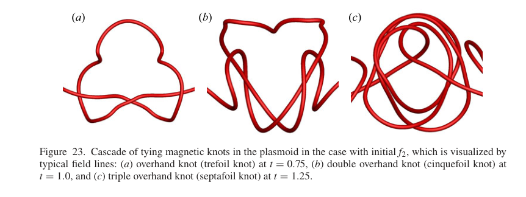

<!-- pair:4-62:en -->

Key observation, why this supports the interpretation, and limitations: Trefoil, cinquefoil and septafoil appear at approximately 0.75, 1 and 1.25 instead of 1.75, 2 and 2.25. The sampled identified knot fraction rises from 1.5% to 47.2% over 0.75–1.25; the weaker $f_1$ case shows no knotting. This supports sensitivity to initial profile, but not universality of those percentages beyond this sampling procedure. [Figure 23; Appendix B, PDF p.24]

<!-- pair:4-62:zh -->

关键观察、为何支持该解释及其边界：三叶、五叶、七叶结约在0.75、1、1.25出现，而非1.75、2、2.25；在0.75–1.25内，采样已识别有结比例从1.5%增至47.2%，较弱 $f_1$ 则无成结。这支持对初始剖面的敏感性，但这些百分比不能脱离该采样流程普遍使用。[图23；附录 B，PDF 第24页]

<!-- pair:4-63:en -->

**Evidence assessment.** Strong support: a finite sequence of increasingly complex, explicitly closed representative curves and a corresponding shift of sampled knot classes. Moderate support: the proposed Lorentz-feedback explanation, corroborated by force maps and parameter variations but not a separate force-removal ablation. Weak support: extrapolation to fully turbulent plasmas or an exact knotting contribution to total energy release. Same-chirality tubes, weak twist, weak peripheral field and a low magnetic interaction parameter provide non-knotting cases. The paper reports no independent full grid-refinement study of knot classification; finite integration length and resolution already exclude some samples. [§3.5; Appendix B, PDF pp.18–19,22–24]

<!-- pair:4-63:zh -->

**证据判断。** 强支持：明确闭合的代表曲线出现有限的复杂性增长序列，同时采样结型分布迁移。中等支持：Lorentz 反馈机制有力图与参数变化互证，但没有单独删除该力的消融。弱支持：推广到充分湍流等离子体，或精确量化成结对总能量释放的贡献。同手性、弱拧转、弱外围磁场与低磁相互作用参数都提供无成结反例。论文没有独立完整的纽结分类网格加密研究；有限积分长度与分辨率已经使部分样本无法分类。[§3.5；附录 B，PDF 第18–19、22–24页]

## 5. 论文的贡献与影响（Contribution & Impact）

<!-- pair:5-1:en -->

### What changes, and what should be tested next

The contribution is a demonstrated route in which reconnection temporarily builds rather than merely destroys topological complexity, plus MSF-guided evidence connecting local events to sampled knot classes. It does not overturn eventual dissipative simplification. The same local motion that enables repeated contact ultimately separates the interaction region.

A concrete future test is to repeat classification with several non-intersecting closure conventions and longer field-line integration, retaining an explicit “unclassified” bin. A second is to grid-refine the late $t=2.25$ sample and compare flux-weighted with uniform-plane statistics. These tests address the reported 12.5% exclusion and whether the distribution represents magnetic flux rather than sampling geometry. To investigate energy causality, measure local conversion during identified events against matched non-knotting runs, rather than equating helicity-density peaks with knot-caused energy release. [§3.5–4; Appendix B, PDF pp.18–24]

<!-- pair:5-1:zh -->

### 改变了什么，下一步该验证什么

贡献是证明了一条重联暂时构建、而非仅摧毁拓扑复杂性的路径，并用 MSF 引导的证据把局部事件与采样结型连接起来。它并未推翻耗散导致最终简化的趋势：允许重复接触的同一局部运动最终也会分离作用区。

具体后续实验可以采用多种不相交闭合约定和更长场线积分重复分类，并显式保留“未分类”一栏；还可对 $t=2.25$ 样本做网格加密，比较磁通加权与平面均匀采样统计。这直接检验已报告的12.5%排除，以及分布代表的是磁通还是采样几何。若研究能量因果，应测量已识别事件中的局部转换，并与匹配的无成结算例比较，而非把螺度密度峰直接等同于纽结引起的能量释放。[§3.5–4；附录 B，PDF 第18–24页]

## 6. 结论（Conclusion）

<!-- pair:6-1:en -->

**Final judgment: a persuasive transient mechanism with important diagnostic qualifications.** Opposite-twist tubes, an imposed collision flow and magnetic feedback can produce a sequence from unknotted lines to increasingly complex closed representatives. The strongest evidence is the conjunction of local reconnection diagrams, 3–5–7 crossing classification and sampled distribution shifts. The boundary is equally central: closure is artificial, difficult samples are omitted, and resistive evolution does not give a unique persistent line identity. Read this as a controlled knot-generation pathway, not a universal law that reconnection increases complexity.

<!-- pair:6-1:zh -->

**最终判断：有说服力的短暂机制，但诊断限定不可省略。** 反向拧转磁管、给定碰撞流与磁反馈可产生从无结场线到更复杂闭合代表曲线的序列。最强证据是局部重联图、3–5–7交叉分类与采样分布迁移共同成立。边界同样关键：闭合是人工的，困难样本被排除，电阻演化也不提供唯一持久场线身份。应把它读作受控的成结路径，而非“重联必然增加复杂性”的普适规律。
