# How vortices change magnetic-tube splitting

涡旋如何改变磁通管分裂

Source: Kang et al., Journal of Fluid Mechanics 1009, A55 (2025), DOI 10.1017/jfm.2025.263. The complete 28-page published PDF from Shiying Xiong’s website, including Appendix A, was read. All 20 figures and Table 1 were visually checked. PDF page numbers are 1-based. Internal caption/text conflicts are stated rather than silently repaired.

来源：Kang 等，Journal of Fluid Mechanics 1009，A55（2025），DOI 10.1017/jfm.2025.263。已阅读熊诗颖网站提供的28页正式全文及附录 A，并核验全部20幅图和表1。PDF 页码从1开始；图注与正文冲突会明确标注，不静默修补。

## 1. 核心思想一句话总结（Elevator Pitch）

<!-- pair:1-1:en -->

Curved magnetic tubes generate splitting vortex pairs; matched-strength nearby vortices can suppress them, as geometric analysis and controlled simulations show.

<!-- pair:1-1:zh -->

几何分析与受控模拟表明：弯曲磁管生成分裂涡对，相近强度的邻近涡管可将其抑制。

## 2. 论文背景与动机（Background & Motivation）

<!-- pair:2-1:en -->

### Prerequisites: a field is not a material rope

A magnetic flux tube is a bundle of magnetic field lines within a tube-shaped region. A vortex tube bundles vorticity lines, where vorticity $\boldsymbol\omega=\nabla\times\mathbf u$ measures fluid rotation. Magnetohydrodynamics (MHD) couples a conducting fluid’s velocity $\mathbf u$ to magnetic induction $\mathbf b$. The Lorentz force $\mathbf F_L=\mathbf j\times\mathbf b$ transfers magnetic stresses to the fluid; current $\mathbf j$ is proportional to the curl of $\mathbf b$. Resistivity allows magnetic diffusion and topology changes. [§1–2, PDF pp.2–5]

Splitting means one concentrated magnetic tube separates into narrower structures. It is not automatically equivalent to proving reconnection of every individual field line. Earlier work connected splitting to Lorentz forces and its suppression to twist. This paper supplies a local geometric force decomposition and tests what happens when an independent vortex occupies the same neighbourhood. The practical motivation is plasma structure, but these periodic, incompressible simulations are not a solar-eruption forecast. [§1, PDF pp.2–4]

<!-- pair:2-1:zh -->

### 必要概念：场线不是物质绳索

磁通管是管状区域内的一束磁力线；涡管则由涡量线组成，其中涡量 $\boldsymbol\omega=\nabla\times\mathbf u$ 测量流体旋转。磁流体力学（MHD）把导电流体速度 $\mathbf u$ 与磁感应强度 $\mathbf b$ 耦合。Lorentz 力 $\mathbf F_L=\mathbf j\times\mathbf b$ 把磁应力传给流体，电流 $\mathbf j$ 与 $\mathbf b$ 的旋度成正比；电阻率允许磁扩散与拓扑变化。[§1–2，PDF 第2–5页]

分裂指一根磁场集中的管分成更细结构，并不自动等价于证明每条磁力线都发生重联。已有研究把分裂与 Lorentz 力联系起来，并发现拧转能抑制分裂。本文增加局部几何力分解，检验独立涡管位于同一区域时会发生什么。等离子体结构是应用动机，但周期、不可压缩模拟并非太阳爆发预测。[§1，PDF 第2–4页]

<!-- pair:2-2:en -->

### Figure 2

How to read: Compare overlap at zero angle with the rotated vortex configuration. Arrows indicate orientation, not measured velocity magnitude.

<!-- pair:2-2:zh -->

### 图2

如何读：比较零夹角重合构型与旋转后的涡管构型；箭头表示方向，不是速度大小。

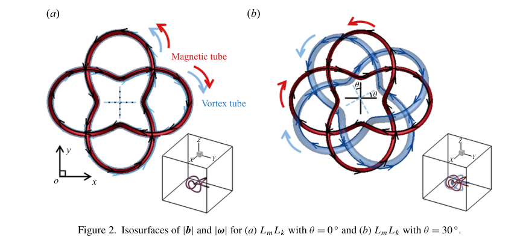

<!-- pair:2-4:en -->

Key observation, why this supports the interpretation, and limitations: The magnetic geometry stays prescribed while the vortex arrangement is rotated. This supports interpreting angle as a controlled interaction variable. It cannot isolate angle from every local change: rotation also changes spatial overlap and cross-helicity. The experiment therefore tests coupled configuration, not an abstract angle acting alone. [Figure 2, PDF p.6]

<!-- pair:2-4:zh -->

关键观察、为何支持该解释及其边界：磁场几何保持给定，涡管构型被旋转。这支持把夹角作为受控相互作用变量。但旋转同时改变空间重叠与交叉螺度，不能把夹角与所有局部变化完全分离；实验检验的是耦合构型，不是独立作用的抽象角度。[图2，PDF 第6页]

## 3. 核心方法/模型详解（The Core Method/Model）

<!-- pair:3-1:en -->

### A local coordinate system that reveals the mechanism

At each curved field line, the Frenet–Serret frame provides a tangent $\mathbf T$, an inward bending direction $\mathbf N$, and a binormal $\mathbf B=\mathbf T\times\mathbf N$. Here bold $\mathbf B$ is a unit geometric direction, not the magnetic field $\mathbf b$. Curvature $\kappa$ measures bending per unit length; torsion $\tau$ measures turning out of the local plane. The frame needs nonzero field and nonzero curvature; inflection points require special treatment. [§3.1, PDF pp.8–9]

<!-- pair:3-1:zh -->

### 用局部坐标系显露机制

沿每条弯曲磁力线，Frenet–Serret 标架提供切向 $\mathbf T$、指向弯曲内侧的法向 $\mathbf N$，以及副法向 $\mathbf B=\mathbf T\times\mathbf N$。粗体 $\mathbf B$ 是单位几何方向，不是磁场 $\mathbf b$。曲率 $\kappa$ 衡量单位长度的弯曲，挠率 $\tau$ 衡量离开局部平面的转动。标架要求磁场和曲率非零，拐点需特殊处理。[§3.1，PDF 第8–9页]

<!-- pair:3-2:en -->

### Figure 1

How to read: Read the cross-section as radial distance and angle around a curved centreline.

<!-- pair:3-2:zh -->

### 图1

如何读：把截面读成绕弯曲中心线的径向距离与角度坐标。

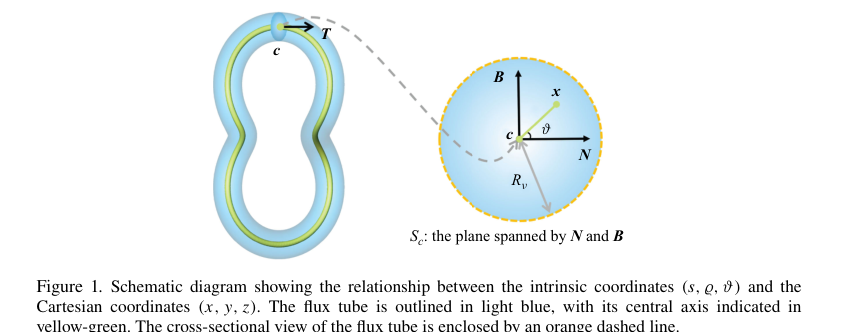

<!-- pair:3-4:en -->

Key observation, why this supports the interpretation, and limitations: The construction assigns a Gaussian-strength field along the tangent, with width about 0.025 and truncation radius about 0.125 in nondimensional coordinates. This supports controlled finite-thickness initial tubes. It does not describe every possible twisted plasma tube: the chosen initial field has a specific transverse structure. [Figure 1; Eq.(2.3), PDF p.5]

<!-- pair:3-4:zh -->

关键观察、为何支持该解释及其边界：构造沿切向放置高斯强度场，无量纲宽度约0.025、截断半径约0.125。这支持可控的有限粗细初始管，但并不覆盖任意拧转等离子体磁管，因为初始横向结构受到特定约束。[图1；式(2.3)，PDF 第5页]

<!-- pair:3-5:en -->

### Figure 4

How to read: Follow how the three orthogonal directions rotate along a magnetic line.

<!-- pair:3-5:zh -->

### 图4

如何读：沿磁力线观察三个正交方向如何旋转。

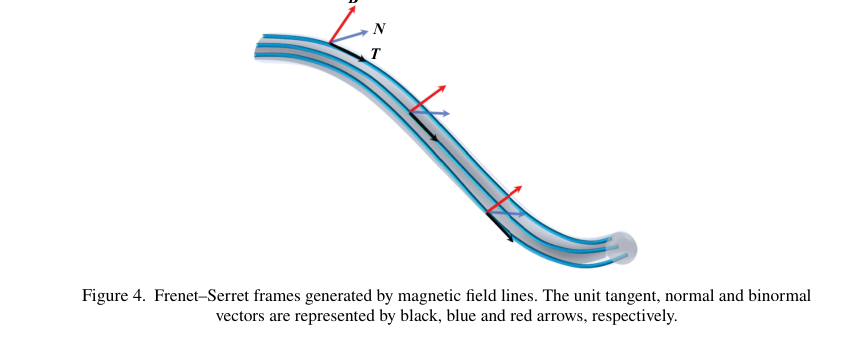

<!-- pair:3-7:en -->

Key observation, why this supports the interpretation, and limitations: The frame turns a Cartesian force into bending and along-line contributions, making the source of rotation interpretable. This supports the analysis below, but is a coordinate representation rather than a new physical force. Its equations cannot be extended unchanged through zero curvature. [Figure 4, PDF p.8]

<!-- pair:3-7:zh -->

关键观察、为何支持该解释及其边界：标架把笛卡尔分量中的力变成弯曲与沿线贡献，让旋转来源更易理解。这支持下方分析，但只是坐标表述，不是新物理力；其方程不能原样延伸到曲率为零处。[图4，PDF 第8页]

<!-- pair:3-8:en -->

For nondimensional density and permeability equal to one, write $b=|\mathbf b|$. The Lorentz force separates into magnetic-pressure gradient, along-line magnitude change and curvature tension. Taking its curl removes the pure pressure gradient; vorticity generation depends on spatially varying tension, not just on a force being large. [Eqs.(3.9),(3.12), PDF pp.9–10]

<!-- pair:3-8:zh -->

在密度与磁导率归一为一的无量纲形式中，记 $b=|\mathbf b|$。Lorentz 力分成磁压力梯度、沿线强度变化和曲率张力。取旋度后纯压力梯度消失，因此涡量生成取决于张力的空间变化，而不只是力很大。[式(3.9)、(3.12)，PDF 第9–10页]

$$
\mathbf F_L=-\tfrac12\nabla b^2+b(\mathbf T\cdot\nabla b)\mathbf T+\kappa b^2\mathbf N
$$

<!-- pair:3-10:en -->

Under the specific initially parallel cross-sectional tangent field of Eq.(2.3), the curl simplifies to Eq.(3.21). The first term creates rotation along the tube; the second involves torsion; the third involves curvature change along the line. All are nondimensional vorticity-source terms (inverse time squared in dimensional form). The authors report the first dominates because the magnetic-strength gradient is large; this dominance is an early-stage regime assumption, not an identity for arbitrary fields.

<!-- pair:3-10:zh -->

在式(2.3)特定的初始截面切向平行构造下，力的旋度简化为式(3.21)。第一项生成沿管旋转，第二项涉及挠率，第三项涉及沿线曲率变化。三者均为无量纲涡量源项，恢复量纲后为时间平方倒数。作者报告第一项因磁强梯度大而占优；这是早期阶段的区间假设，不是任意场中的恒等关系。

$$
\nabla\times\mathbf F_L=-[\mathbf B\cdot\nabla(b^2\kappa)]\mathbf T-b^2\kappa\tau\mathbf N+b^2(\mathbf T\cdot\nabla\kappa)\mathbf B
$$

<!-- pair:3-12:en -->

### Minimal example: from a ring to a split pair

Start with a planar ring of constant curvature, no fluid rotation, and field strength highest at its cross-sectional centre. Set $\tau=0$ and $\mathbf T\cdot\nabla\kappa=0$. The remaining source is $-\kappa(\mathbf B\cdot\nabla b^2)\mathbf T$. Across the two sides of the ring the gradient changes sign, so two opposite vorticity sources appear. For an illustrative local $\kappa=4$ and gradients $\pm2$, the sources are $\mp8\mathbf T$. Integrating over a short time creates an opposing vortex pair; its flow separates the concentrated magnetic field. Add a strong aligned vortex and one sign is reinforced while the other is cancelled, disrupting the pair. Check success through both local streamlines and energy transfer, not tube appearance alone. [§3.2; §4.2, PDF pp.11–13,22–24]

The zero-curvature cylindrical limit gives zero source within this restricted construction. Removing curvature therefore removes this mechanism, not all conceivable plasma instabilities. The numerical scaling in §4.2 estimates induced vorticity $4.2\times10^3$ versus imposed vorticity $4.4\times10^3$; this supports comparable-strength cancellation, not a measured universal threshold.

<!-- pair:3-12:zh -->

### 最小例子：从圆环走向分裂涡对

从曲率恒定的平面磁环出发，流体初始不旋转，磁场强度在截面中心最大。令 $\tau=0$、$\mathbf T\cdot\nabla\kappa=0$，剩余源项为 $-\kappa(\mathbf B\cdot\nabla b^2)\mathbf T$。磁环两侧梯度符号相反，因而产生两种反向涡量源。例如局部取 $\kappa=4$、梯度为 $\pm2$，源项便为 $\mp8\mathbf T$。短时间积分生成反向涡对，涡对流动使集中的磁场分离。加入强的对齐涡管，会增强一种符号、抵消另一种，破坏涡对。成功标准须同时看局部流线和能量转移，不能只看管形。[§3.2；§4.2，PDF 第11–13、22–24页]

在这一受限构造中，零曲率圆柱极限的源项为零。去掉曲率是去掉这一机制，并非排除所有等离子体失稳。§4.2 的尺度估算给出感生涡量 $4.2\times10^3$、外加涡量 $4.4\times10^3$，支持相近强度抵消，但不是测得的普适阈值。

<!-- pair:3-13:en -->

### Figure 5

How to read: Read the opposite signs across the binormal direction, then the local rotating pattern in the enlarged panel.

<!-- pair:3-13:zh -->

### 图5

如何读：先读副法向两侧的相反符号，再看放大图中的局部旋转形态。

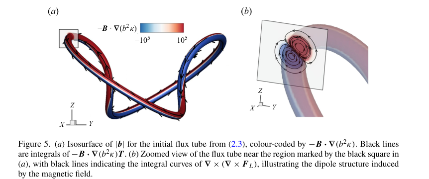

<!-- pair:3-15:en -->

Key observation, why this supports the interpretation, and limitations: The dominant source changes sign across the tube. This supports the causal step from curved-field tension to a counter-rotating pair, rather than merely correlating splitting with curvature. The picture alone does not quantify the neglected torsion and curvature-gradient terms; their reported smallness is part of the model’s restricted regime. [Figure 5, PDF p.11]

<!-- pair:3-15:zh -->

关键观察、为何支持该解释及其边界：主导源项在磁管两侧变号，支持从弯曲场张力到反向涡对的机制，而不只是分裂与曲率相关。图片本身不能量化忽略的挠率和曲率梯度项，其较小程度仍属于模型受限区间的报告条件。[图5，PDF 第11页]

<!-- pair:3-16:en -->

### Figure 7

How to read: Use the constant-curvature ring as the simplified example; compare before and after, noting different isosurface thresholds.

<!-- pair:3-16:zh -->

### 图7

如何读：把恒曲率环当作简化例子，比较前后时注意等值面阈值不同。

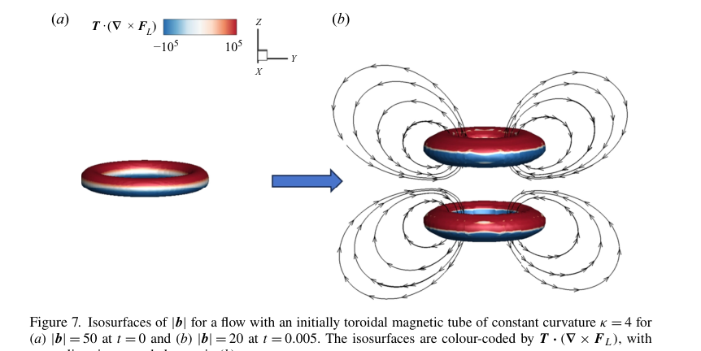

<!-- pair:3-18:en -->

Key observation, why this supports the interpretation, and limitations: A single ring becomes two separated structures with induced circulation. This supports the curvature-plus-transverse-gradient mechanism even without varying curvature along the axis. It cannot quantify conserved tube volume because the plotted thresholds change from 50 to 20. [Figure 7, PDF p.13]

<!-- pair:3-18:zh -->

关键观察、为何支持该解释及其边界：单环变成两个分离结构并伴随感生环流，支持即使轴向曲率不变，曲率加横向梯度仍可产生分裂。但绘图阈值从50变为20，不能据此量化管体积守恒。[图7，PDF 第13页]

<!-- pair:3-19:en -->

A second claim is quasi-Lagrangian motion: field-line geometry approximately follows fluid motion early on. The proof uses $D\mathbf L/Dt=\mathbf L\cdot\nabla\mathbf u+\lambda\mathbf L$. A source parallel to $\mathbf L$ changes its magnitude without rotating it away from an initially tangent material surface. For a zero initial tangency error $g=\mathbf L\cdot\nabla\phi$, the equation $Dg/Dt=\lambda g$ keeps $g=0$. A nonzero initial error, however, may grow. Applying this to vorticity requires source alignment with vorticity, neglected diffusion and the early-stage geometric approximation; it is not an exact frozen-in theorem for all resistive MHD. [Corollary 1, PDF pp.13–14]

Before: infer splitting from Lorentz force or topology alone. After: isolate its curl in a local frame, connect it to a vortex pair, and perturb that pair with a prescribed vortex. The trade-off is an idealized tube profile, restricted early-time approximations and substantial DNS cost.

<!-- pair:3-19:zh -->

第二项主张是准拉格朗日运动，即场线几何在早期近似随流体运动。证明使用 $D\mathbf L/Dt=\mathbf L\cdot\nabla\mathbf u+\lambda\mathbf L$：平行于 $\mathbf L$ 的源改变幅值，却不会使它偏离初始相切的物质面。若初始相切误差 $g=\mathbf L\cdot\nabla\phi$ 为零，则 $Dg/Dt=\lambda g$ 保持 $g=0$；但非零误差仍可能增长。将其用于涡量，需要源项与涡量对齐、忽略扩散并采用早期几何近似，并不是任意电阻 MHD 中精确的冻结定理。[推论1，PDF 第13–14页]

此前主要从 Lorentz 力或拓扑解释分裂；本文在局部标架中分解其旋度，连接到涡对，再用给定涡管扰动涡对。收益对应的代价是理想化管剖面、受限的早期近似与昂贵的直接数值模拟。

<!-- pair:3-20:en -->

Energy needs a separate ledger. $D(b^2/2)/Dt=A_m+B_m$, with $A_m=\alpha b^2$ and $\alpha=\mathbf T\cdot\nabla\mathbf u\cdot\mathbf T$, describes stretching or shortening; $B_m$ contains magnetic diffusion. Positive $A_m$ transfers energy into the magnetic field; negative $A_m$ removes it. With illustrative $b=2$, $\alpha=0.5$, $A_m=2$; changing the sign of $\alpha$ reverses transfer. Locally $B_m$ includes transport and need not be everywhere negative; its periodic-domain integral is dissipative. Magnetic energy loss therefore is not identical to kinetic energy gain. [Eqs.(3.30)–(3.31), PDF p.15]

<!-- pair:3-20:zh -->

能量必须另记账。$D(b^2/2)/Dt=A_m+B_m$ 中，$A_m=\alpha b^2$、$\alpha=\mathbf T\cdot\nabla\mathbf u\cdot\mathbf T$ 表示拉伸或缩短，$B_m$ 包含磁扩散。$A_m$ 为正表示能量进入磁场，为负表示磁场失能。教学代入 $b=2$、$\alpha=0.5$ 得 $A_m=2$；改变 $\alpha$ 符号便反转传递方向。局部 $B_m$ 包含输运，不必处处为负；在周期域积分后才是耗散。因此磁能损失并不等于动能增加。[式(3.30)–(3.31)，PDF 第15页]

## 4. 实验与结果分析（Experiments & Results）

<!-- pair:4-1:en -->

### Table 1

How to read: Read energy matching and grid size before comparing cases. The symbols L/R indicate linking orientation; O means the corresponding field is absent.

<!-- pair:4-1:zh -->

### 表1

如何读：比较前先看初始能量匹配与网格数；L/R 表示链环方向，O 表示相应场缺失。

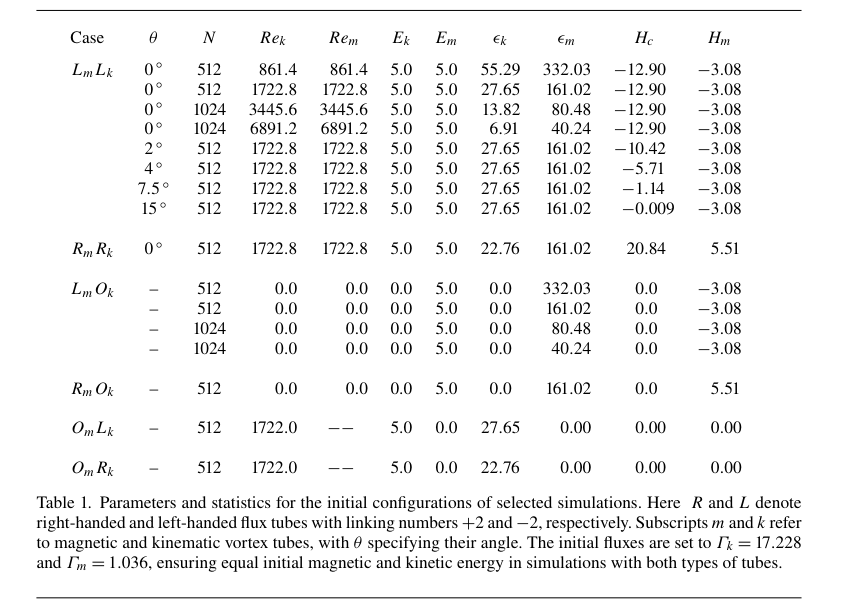

<!-- pair:4-3:en -->

Key observation, why this supports the interpretation, and limitations: Combined-field cases start with $E_k=E_m=5$, using fluxes 17.228 and 1.036. Thus comparable energy does not mean numerically equal flux. The table lists $512^3$ and $1024^3$ grids and equal diffusivities; simulations use Fourier pseudo-spectral derivatives, two-thirds dealiasing and second-order Runge–Kutta with CFL below 0.5. This supports controlled comparison, but Reynolds-number conventions are internally inconsistent: several captions use 103.6 while table/text values use 1722.8. Keep labels as printed; exact reproduction needs clarification. [§2; Table 1, PDF pp.4–7]

<!-- pair:4-3:zh -->

关键观察、为何支持该解释及其边界：双场算例初始 $E_k=E_m=5$，通量分别为17.228与1.036，因此能量相近不等于通量数值相同。表中使用 $512^3$、$1024^3$ 网格及相等扩散率；模拟采用 Fourier 伪谱导数、三分之二去混叠、二阶 Runge–Kutta 和小于0.5的 CFL 数。这支持受控比较，但雷诺数约定存在内部不一致：一些图注使用103.6，表格/正文使用1722.8。此处保留原标签，精确复现仍需澄清。[§2；表1，PDF 第4–7页]

<!-- pair:4-4:en -->

### Figure 3

How to read: Inspect the enlarged field-line bundle, not the colour alone. Colour measures $\mathbf j\cdot\mathbf b$, a current–field alignment quantity.

<!-- pair:4-4:zh -->

### 图3

如何读：看放大的场线束，而非仅看颜色；颜色表示 $\mathbf j\cdot\mathbf b$，即电流与磁场的对齐量。

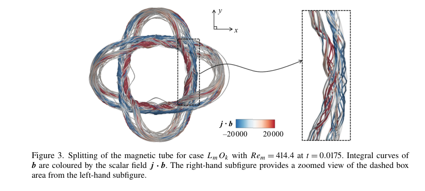

<!-- pair:4-6:en -->

Key observation, why this supports the interpretation, and limitations: The bundle develops narrower strands. This motivates studying splitting, but does not by itself distinguish the force mechanism, resistive effects or threshold selection. The following curvature comparison and local flow controls supply that missing explanation. [Figure 3, PDF p.8]

<!-- pair:4-6:zh -->

关键观察、为何支持该解释及其边界：场线束出现更细分支，提出了分裂这一研究对象，但单凭此图不能区分受力机制、电阻效应或阈值选择影响。后续曲率比较与局部流动对照才补上机制解释。[图3，PDF 第8页]

<!-- pair:4-7:en -->

### Figure 6

How to read: Compare points A and B for curvature, then C for torsion; read the separation labels in the enlarged panels.

<!-- pair:4-7:zh -->

### 图6

如何读：在 A、B 比较曲率，再在 C 检查挠率，并读取放大图中的分离距离。

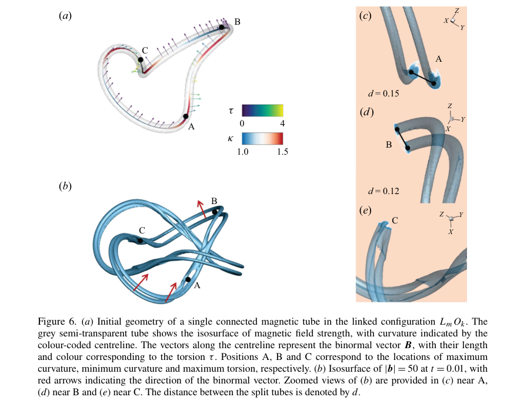

<!-- pair:4-9:en -->

Key observation, why this supports the interpretation, and limitations: The displayed separation is 0.15 at higher-curvature A versus 0.12 at B, and the split direction follows the binormal. This supports the predicted geometric tendency; the high-torsion location resists clean separation. It is a within-tube comparison, not a parameter sweep proving a universal linear law between curvature and splitting distance. [Figure 6, PDF p.12]

<!-- pair:4-9:zh -->

关键观察、为何支持该解释及其边界：较高曲率 A 的分离距离为0.15，B 为0.12；分裂方向近似沿副法向。这支持预测的几何趋势，高挠率位置则抑制清晰分离。但这是同一管内的比较，不是证明曲率与分离距离普适线性关系的参数扫描。[图6，PDF 第12页]

<!-- pair:4-10:en -->

### Figure 8

How to read: Compare magnetic structures in the upper row with vorticity in the lower row at each matched time.

<!-- pair:4-10:zh -->

### 图8

如何读：逐时刻比较上排磁结构与下排涡量结构。

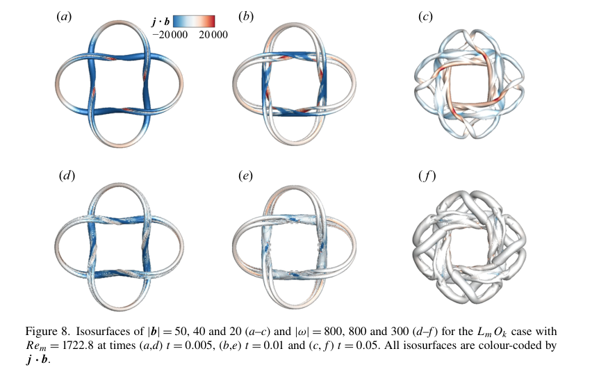

<!-- pair:4-12:en -->

Key observation, why this supports the interpretation, and limitations: The early shapes resemble each other, then diverge more at late time. This supports only early quasi-Lagrangian correspondence, consistent with neglected diffusion eventually mattering. Thresholds change across time, so apparent thickness is not a direct decay measurement. The caption says $Re_m=1722.8$, while adjacent prose says 103.6; no silent choice is made here. [Figure 8; §3.3, PDF pp.14–15]

<!-- pair:4-12:zh -->

关键观察、为何支持该解释及其边界：早期形状相似，后期差别增大，仅支持早期准拉格朗日对应，也符合被忽略的扩散最终变得重要。阈值随时间变化，表观粗细不能直接测量衰减。图注写 $Re_m=1722.8$，相邻正文却写103.6，此处不静默选择其一。[图8；§3.3，PDF 第14–15页]

<!-- pair:4-13:en -->

### Figure 9

How to read: Compare signed magnetic component $b_x$ in the two linkage cases with their common vorticity pattern.

<!-- pair:4-13:zh -->

### 图9

如何读：比较两种链环构型中带符号的 $b_x$，再看共同的涡量形态。

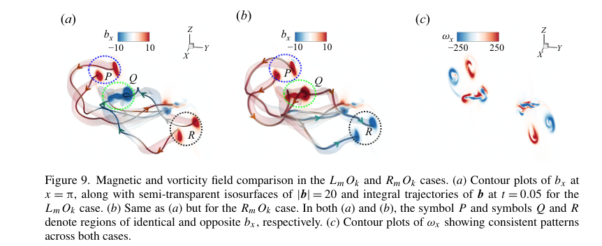

<!-- pair:4-15:en -->

Key observation, why this supports the interpretation, and limitations: Some magnetic directions reverse while the induced vorticity pattern remains similar. This supports the force’s quadratic dependence on field orientation in this symmetric set-up. It cannot establish that arbitrary local polarity reversals leave all interactions unchanged: the comparison relies on the constructed geometry. [Figure 9, PDF p.16]

<!-- pair:4-15:zh -->

关键观察、为何支持该解释及其边界：部分磁场方向反转，而感生涡量图样相似。这支持该对称构型中力对磁场方向的二次依赖，但不能证明任意局部极性反转都不影响所有相互作用；结论依赖给定几何。[图9，PDF 第16页]

<!-- pair:4-16:en -->

Helicity is a measure of field-line linkage rather than energy: magnetic helicity integrates $\mathbf a\cdot\mathbf b$ with $\nabla\times\mathbf a=\mathbf b$; cross-helicity integrates $\mathbf u\cdot\mathbf b$; kinetic helicity integrates $\mathbf u\cdot\boldsymbol\omega$. Their signs contain orientation information, not simply “more turbulence”. Periodic boundaries cancel surface terms. Magnetic and cross-helicity lose their dissipative terms in the ideal limit; kinetic helicity can still exchange with Lorentz forcing. [§3.4, PDF pp.17–18]

<!-- pair:4-16:zh -->

螺度刻画场线链环关系而非能量：磁螺度是 $\mathbf a\cdot\mathbf b$ 的积分，其中 $\nabla\times\mathbf a=\mathbf b$；交叉螺度是 $\mathbf u\cdot\mathbf b$ 的积分；动螺度是 $\mathbf u\cdot\boldsymbol\omega$ 的积分。其正负包含方向信息，不是简单的“湍流更强”。周期边界使表面积分相消；理想极限下磁螺度和交叉螺度的耗散项消失，但动螺度仍可与 Lorentz 力交换。[§3.4，PDF 第17–18页]

<!-- pair:4-17:en -->

### Figure 10

How to read: Read the negative helicity values numerically: rising toward zero decreases their absolute magnitude.

<!-- pair:4-17:zh -->

### 图10

如何读：按数值读负螺度：向零上升意味着绝对值减小。

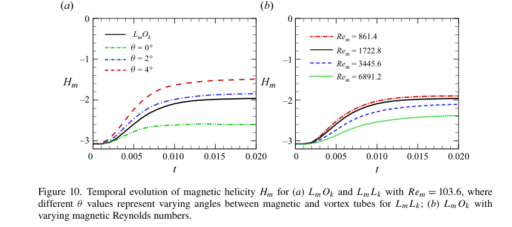

<!-- pair:4-19:en -->

Key observation, why this supports the interpretation, and limitations: Initial rapid changes level off, with angle-dependent plateaus and diffusivity dependence. This supports sensitivity of magnetic linkage diagnostics to the configuration, but helicity alone does not identify a knot type or prove that every field line preserved topology. [Figure 10, PDF p.16]

<!-- pair:4-19:zh -->

关键观察、为何支持该解释及其边界：初期快速变化随后趋平，平台值依赖夹角与扩散率。这支持磁链环诊断对构型敏感，但螺度本身不能辨认纽结类型，也不能证明每条磁力线都保持拓扑。[图10，PDF 第16页]

<!-- pair:4-20:en -->

### Figure 11

How to read: Compare each continuous time derivative with the independently evaluated equation right-hand-side markers.

<!-- pair:4-20:zh -->

### 图11

如何读：比较连续时间导数曲线与独立计算的方程右端标记。

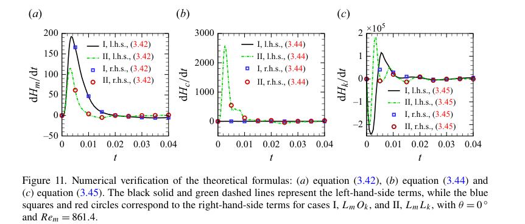

<!-- pair:4-22:en -->

Key observation, why this supports the interpretation, and limitations: The curves and symbols agree for magnetic, cross and kinetic helicity balances. This supports consistency between the derived budgets and solver, not independent experimental validation. Both sides come from the same simulated fields, and the result does not remove the approximations used for early-time line transport. [Figure 11, PDF p.19]

<!-- pair:4-22:zh -->

关键观察、为何支持该解释及其边界：磁螺度、交叉螺度和动螺度预算中曲线与标记吻合，支持推导预算与求解器的一致性，但不是独立实验验证。两端仍来自同一模拟场，也不能消除早期场线输运的近似。[图11，PDF 第19页]

<!-- pair:4-23:en -->

### Figure 12

How to read: Read signed magnetic loss separately from kinetic gain across angle. In particular, inspect the blue-square trend rather than relying only on the prose.

<!-- pair:4-23:zh -->

### 图12

如何读：随夹角分别读带符号的磁能损失与动能增益，尤其直接检查蓝色方块趋势，不只依赖正文。

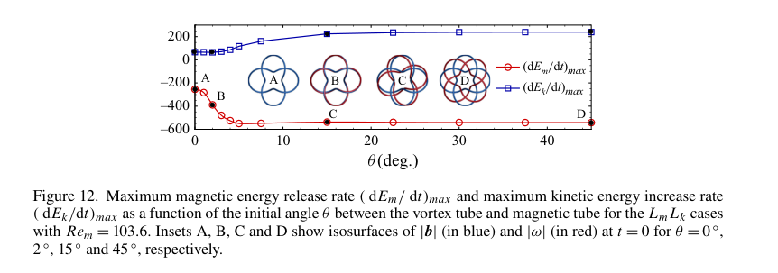

<!-- pair:4-25:en -->

Key observation, why this supports the interpretation, and limitations: Magnetic loss magnitude changes sharply at small angles and then levels off. The blue kinetic-gain curve rises from near zero toward positive values, whereas §4.1 says it is maximal at zero angle and decreases: the source conflicts with itself. The robust conclusion is strong small-angle sensitivity; the claimed direction and precise kinetic optimum should not be reused without author clarification. [Figure 12; §4.1, PDF p.19]

<!-- pair:4-25:zh -->

关键观察、为何支持该解释及其边界：磁能损失幅值在小夹角迅速变化，随后趋平。蓝色动能增益曲线从接近零向正值上升，但 §4.1 却称它在零夹角最大、随后下降，原文内部矛盾。稳健结论是小夹角敏感性强；动能最优点及方向性主张在作者澄清前不宜复用。[图12；§4.1，PDF 第19页]

<!-- pair:4-26:en -->

### Figure 13

How to read: Compare residual magnetic energy at matched time and separate the angle panel from the diffusivity panel.

<!-- pair:4-26:zh -->

### 图13

如何读：在同一时刻比较剩余磁能，并区分夹角组与扩散率组。

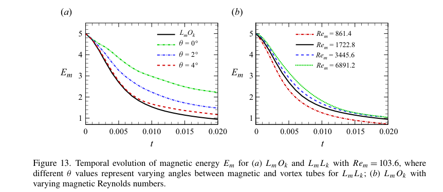

<!-- pair:4-28:en -->

Key observation, why this supports the interpretation, and limitations: Aligned vortices retain more magnetic energy than the magnetic-only case, and smaller diffusivity also slows loss. This supports inhibited release but does not reveal where the retained energy would otherwise go. Comparing Figure 14 is necessary because magnetic loss includes both conversion and dissipation. [Figure 13, PDF p.20]

<!-- pair:4-28:zh -->

关键观察、为何支持该解释及其边界：对齐涡管比纯磁场算例保留更多磁能，较小扩散率也减慢失能。这支持能量释放受抑，但不能说明原本损失的能量会去哪。磁能损失同时包含转换与耗散，因此必须再看图14。[图13，PDF 第20页]

<!-- pair:4-29:en -->

### Figure 14

How to read: Read the dissipative peak height and timing, not only the final energy.

<!-- pair:4-29:zh -->

### 图14

如何读：读耗散峰值及峰值时刻，不只看最终能量。

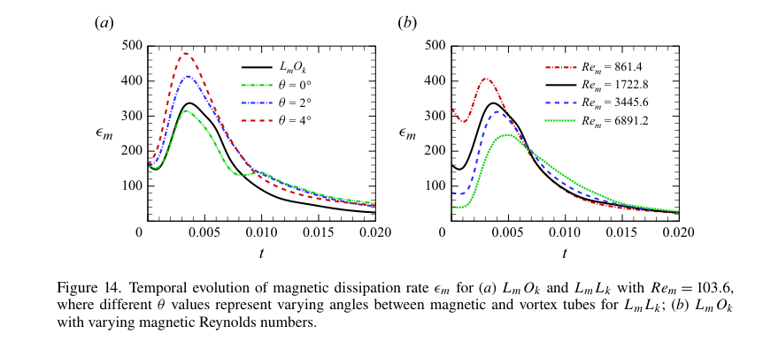

<!-- pair:4-31:en -->

Key observation, why this supports the interpretation, and limitations: Configurations with similar magnetic energy histories can have different dissipation peaks. This supports the need for a two-channel energy budget: conversion cannot be inferred from energy decay alone. Initial overlap does not simply eliminate resistive dissipation, and late-time ordering differs from the early response. [Figure 14; §4.1, PDF pp.20–21]

<!-- pair:4-31:zh -->

关键观察、为何支持该解释及其边界：磁能历史相似的构型可以具有不同耗散峰值，这支持双通道能量预算的必要性，不能只凭能量衰减推断转换。初始重叠并非简单消除电阻耗散，后期排序也不同于早期响应。[图14；§4.1，PDF 第20–21页]

<!-- pair:4-32:en -->

### Figure 15

How to read: Interpret this as kinetic dissipation according to the caption and §4.1, while retaining the source’s inconsistent vertical-axis label.

<!-- pair:4-32:zh -->

### 图15

如何读：按图注和 §4.1 将其解释为动能耗散，同时保留原图不一致的纵轴标签。

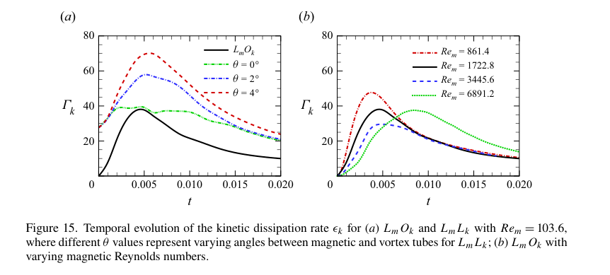

<!-- pair:4-34:en -->

Key observation, why this supports the interpretation, and limitations: The aligned case has a lower peak than small nonzero-angle cases, and higher Reynolds number shifts peaks later. This supports configuration-dependent energy processing. The rendered axis reads $\Gamma_k$ although the caption calls the quantity $\epsilon_k$; that labelling conflict prevents using the figure as an unqualified circulation measurement. [Figure 15, PDF p.21]

<!-- pair:4-34:zh -->

关键观察、为何支持该解释及其边界：对齐算例峰值低于小非零夹角算例，更高雷诺数使峰值延后，支持构型影响能量处理过程。原图纵轴写 $\Gamma_k$，图注却称 $\epsilon_k$；这一标签冲突使它不能被当作毫无疑问的环量测量。[图15，PDF 第21页]

<!-- pair:4-35:en -->

### Figure 16

How to read: At the same late time compare 0°, 2°, 15° and 45°, noting that overlapping vortex tubes may be hidden.

<!-- pair:4-35:zh -->

### 图16

如何读：在同一后期时刻比较0°、2°、15°、45°，注意重叠涡管可能被遮挡。

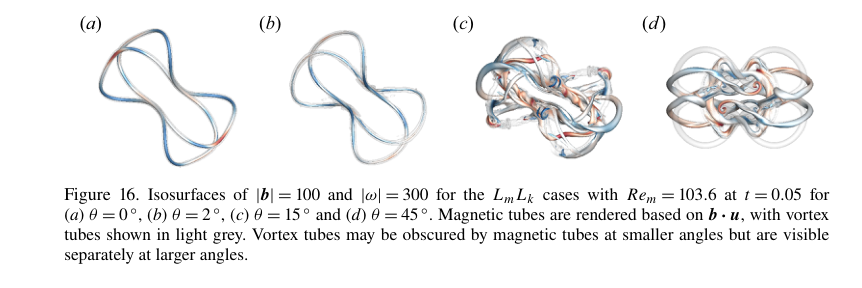

<!-- pair:4-37:en -->

Key observation, why this supports the interpretation, and limitations: Small-angle cases retain coherent tube shapes, while larger angles show more distorted, fragmented magnetic structures. This supports the inhibition trend. It cannot establish all transient splitting was absent: the text reports partial early splitting followed by suppression, and the strength isosurfaces do not directly label material identities. [Figure 16; §4.1, PDF pp.21–22]

<!-- pair:4-37:zh -->

关键观察、为何支持该解释及其边界：小夹角构型保持连贯管形，大夹角呈现更多扭曲和碎裂磁结构，支持抑制趋势。但不能据此声称从未发生瞬态分裂：正文报告早期局部分裂后受到抑制，强度等值面也不直接标记物质身份。[图16；§4.1，PDF 第21–22页]

<!-- pair:4-38:en -->

### Figure 17

How to read: Compare local streamline organisation for magnetic-only and aligned magnetic–vortex cases.

<!-- pair:4-38:zh -->

### 图17

如何读：比较纯磁场与对齐磁涡构型的局部流线组织。

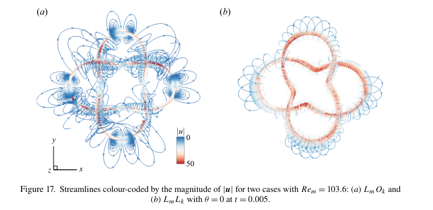

<!-- pair:4-40:en -->

Key observation, why this supports the interpretation, and limitations: The magnetic-only case has the dipole circulation associated with splitting; aligned vorticity replaces it with a predominantly circulating structure. This is direct mechanism-level support, not just a late-time shape correlation. Streamlines remain instantaneous diagnostics, however, not trajectories of individually tagged fluid particles. [Figure 17, PDF p.23]

<!-- pair:4-40:zh -->

关键观察、为何支持该解释及其边界：纯磁场算例具有与分裂相关的偶极环流，对齐涡量则使其变成主要绕转的结构。这直接支持机制，而不只是后期形状相关。不过流线仍是瞬时诊断，并非逐个标记粒子的轨迹。[图17，PDF 第23页]

<!-- pair:4-41:en -->

### Figure 18

How to read: First read initial Lorentz-force arrows in (a); then compare the later velocity patterns in (b,c). These arrows represent different fields.

<!-- pair:4-41:zh -->

### 图18

如何读：先读(a)的初始 Lorentz 力箭头，再比较(b,c)后期速度图样；各图箭头并非同一种场。

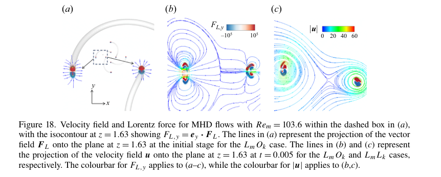

<!-- pair:4-43:en -->

Key observation, why this supports the interpretation, and limitations: Outward magnetic forcing persists, but the magnetic-only case forms a dipole whereas the aligned case retains a point-vortex-like pattern. This supports suppression through reorganising the velocity response rather than switching off the Lorentz force. It cannot yield a universal required vortex strength; the order-of-magnitude estimate is case-specific. [Figure 18; §4.2, PDF pp.22–24]

<!-- pair:4-43:zh -->

关键观察、为何支持该解释及其边界：向外磁力仍存在，但纯磁场形成偶极子，对齐算例则保持类似点涡的图样。这支持通过重组速度响应抑制分裂，而非关闭 Lorentz 力。但它不能给出普适所需涡强度，尺度估计仅针对该算例。[图18；§4.2，PDF 第22–24页]

<!-- pair:4-44:en -->

### Figure 19

How to read: Read the sign of stretching term $A_m$ before comparing dissipative term $B_m$.

<!-- pair:4-44:zh -->

### 图19

如何读：先读拉伸项 $A_m$ 的符号，再比较耗散项 $B_m$。

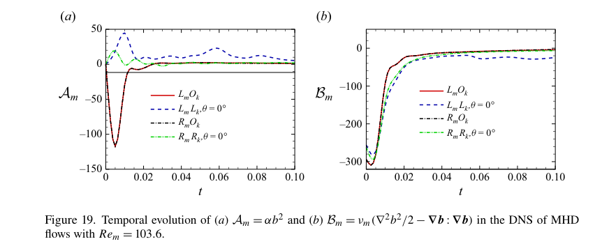

<!-- pair:4-46:en -->

Key observation, why this supports the interpretation, and limitations: Magnetic-only cases have a strong negative stretching contribution; aligned cases can have positive transfer into the magnetic field. This supports the proposed energy-exchange mechanism. A positive transfer term is not perpetual magnetic-energy growth because dissipation still acts; the result also depends on linkage and time. [Figure 19, PDF p.24]

<!-- pair:4-46:zh -->

关键观察、为何支持该解释及其边界：纯磁场算例具有强负拉伸贡献，对齐算例则可向磁场输入能量。这支持能量交换机制，但正传递项不等于磁能永久增长，因为耗散仍在作用，结果也依赖链环方向与时刻。[图19，PDF 第24页]

<!-- pair:4-47:en -->

### Figure 20

How to read: Use kinetic energy as well as magnetic energy to judge convergence; the former separates the coarse grids more clearly.

<!-- pair:4-47:zh -->

### 图20

如何读：同时用动能和磁能判断收敛，动能更清楚地区分粗网格。

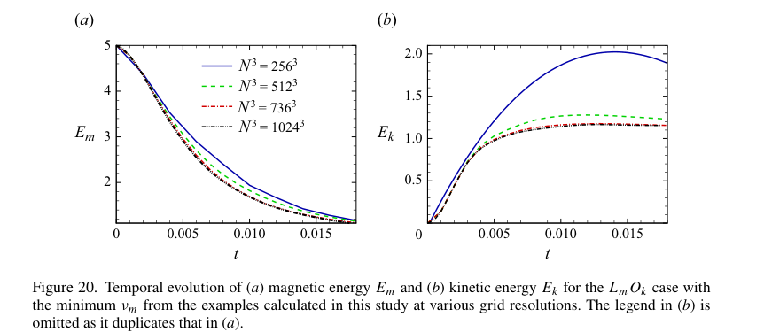

<!-- pair:4-49:en -->

Key observation, why this supports the interpretation, and limitations: The $256^3$ kinetic curve differs substantially while high-resolution curves approach one another, supporting the authors’ $1024^3$ choice for the strongest-resolution demand. This is strong evidence for energy convergence in one case, not convergence of every reconnection or angle optimum. The legend says $736^3$ while Appendix A says $768^3$; exact intermediate grid identity remains uncertain. [Figure 20; Appendix A, PDF pp.25–26]

<!-- pair:4-49:zh -->

关键观察、为何支持该解释及其边界：$256^3$ 动能曲线明显偏离，高分辨率曲线彼此接近，支持作者对最高分辨率需求算例使用 $1024^3$。这对单个算例的能量收敛提供强证据，但不证明每次重联或夹角最优点均收敛。图例写 $736^3$，附录 A 却写 $768^3$，中间网格的确切身份仍不确定。[图20；附录 A，PDF 第25–26页]

<!-- pair:4-50:en -->

**Evidence assessment.** Support is strong for a curvature-generated dipole mechanism in the chosen initial tubes and for suppression by comparable aligned vorticity. Support is moderate for transfer to other resistive, incompressible tube geometries. A universal critical angle, a universal strength threshold and quantitative solar applicability are not supported. No randomized ensemble or confidence intervals are presented; numerical convergence and controlled configurations, rather than statistical significance, carry the argument.

<!-- pair:4-50:zh -->

**证据判断。** 对所选初始磁管中的曲率生涡偶极机制，以及相近强度对齐涡量的抑制作用，证据强。推广到其他电阻、不可压缩磁管几何的支持中等。普适临界角、普适涡强阈值和定量太阳应用并不受支持。论文没有随机样本集或置信区间，论证依靠数值收敛与受控构型，而非统计显著性。

## 5. 论文的贡献与影响（Contribution & Impact）

<!-- pair:5-1:en -->

### Contribution and testable extensions

The contribution is a local mechanism connecting field-line geometry, vorticity generation, tube morphology and energy exchange, with an external vortex as a controlled intervention. It is more reusable than the exact initial curve. For future work, hold tube geometry fixed and sweep imposed-vorticity amplitude around the estimated induced value while measuring signed dipole circulation: this tests whether cancellation actually predicts the suppression boundary. Separately vary the viscosity-to-magnetic-diffusivity ratio away from one to test the early-time quasi-Lagrangian approximation. Reproduce the small-angle energy curves after resolving Reynolds-number and Figure 12 label/prose conflicts before fitting any angular law. [§4.2–5, PDF pp.23–25]

<!-- pair:5-1:zh -->

### 贡献与可检验延伸

贡献是连接场线几何、涡量生成、管形和能量交换的局部机制，并以外加涡管进行受控干预。它比某一条具体初始曲线更可迁移。后续可固定管几何，围绕估算的感生涡强扫描外加涡量幅值，同时测量带符号的涡偶极环量，以检验抵消机制是否真能预测抑制边界。还可让黏性与磁扩散率之比偏离一，检验早期准拉格朗日近似。在拟合任何夹角规律之前，应先澄清雷诺数及图12标注/正文冲突，再复现小夹角能量曲线。[§4.2–5，PDF 第23–25页]

## 6. 结论（Conclusion）

<!-- pair:6-1:en -->

**Final judgment: useful mechanism, conditional quantitative claims.** A curved magnetic field can create the very vortex pair that splits it; an aligned vortex can interrupt that response without removing magnetic forcing. The clearest evidence combines local force/velocity maps with energy budgets and convergence checks. Do not turn equal-energy idealized cases into a universal suppression threshold, or repeat the inconsistent kinetic-angle trend as a settled result.

<!-- pair:6-1:zh -->

**最终判断：机制值得借鉴，定量主张需保留条件。** 弯曲磁场可以生成使自身分裂的涡对，对齐涡管则可在不去除磁力的情况下打断这一响应。最清晰证据结合局部力/速度图、能量预算与收敛检验。不要把等能量理想算例变成普适抑制阈值，也不要把内部矛盾的动能夹角趋势当作定论复述。
