# MMG2Skill: Can Agents Distill In-the-Wild Guides into Self-Evolving Skills?

MMG2Skill：把公开指南转为可迭代修订的智能体技能

Primary source: [MMG2Skill: Can Agents Distill In-the-Wild Guides into Self-Evolving Skills?](https://arxiv.org/abs/2606.01993), arXiv v1, 1 June 2026. Page references use physical PDF pages. Read against the complete paper and appendices; numerical results are reported results, not an independent replication.

一手来源：[MMG2Skill: Can Agents Distill In-the-Wild Guides into Self-Evolving Skills?](https://arxiv.org/abs/2606.01993)，arXiv v1, 1 June 2026。页码均为 PDF 物理页码。基于论文全文及附录阅读；数值为论文报告结果，并非独立复现。

## 1. 核心思想一句话总结（Elevator Pitch）

<!-- pair:1-1:en -->

Turn public guides into editable skills, then revise those skills from visible execution evidence without changing model weights or using benchmark rewards.

<!-- pair:1-1:zh -->

把公开指南变成可编辑技能，再依据可见执行证据修订，无需更新模型或读取评测奖励。

## 2. 论文背景与动机（Background & Motivation）

<!-- pair:2-1:en -->

### Key concepts: knowing a procedure is not the same as executing it
A human guide can omit assumptions that feel obvious to its writer: the current inventory, which window has focus, what counts as a saved file, or when a general card-game heuristic applies. Pasting the guide into an agent’s context cannot resolve those assumptions. MMG2Skill asks whether a fixed vision-language model (VLM) can turn this material into an executable, editable procedural representation and repair it after seeing what actually happened. Here “self-evolving” means revising a skill file across attempts at a supplied task, not unrestricted model self-improvement.

<!-- pair:2-1:zh -->

### 必要概念：知道流程，不等于执行得出来
人类指南会省略作者认为显而易见的假设：当前背包里有什么、哪个窗口获得焦点、怎样才算保存成功，或牌局中的一般启发式何时适用。把指南粘到智能体上下文中，不会自动补齐这些条件。MMG2Skill 研究固定的视觉语言模型（VLM）能否把材料转成可执行、可编辑的程序性表示，并在观察实际执行结果后修正。这里的“自我演进”是针对已提供任务，在多次尝试间修订技能文件，不是无限制的模型自我提升。

<!-- pair:2-2:en -->

### How to read Figure 2: which worlds and which knowledge are actually tested?

<!-- pair:2-2:zh -->

### 如何读图 2：究竟测试了哪些环境与知识？

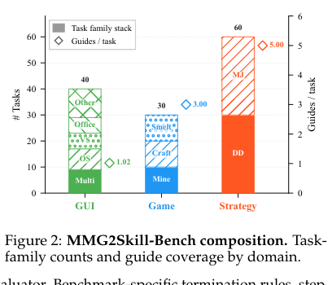

<!-- pair:2-4:en -->

Key observation and interpretation. The stacked bars show 40 GUI tasks, 30 Minecraft tasks and 60 strategy-game hands; diamonds use the right axis for mean guides per task, approximately 1.02, 3.00 and 5.00. GUI covers OSWorld applications, Game covers mining/crafting/smelting, and Strategy covers Doudizhu and Mahjong. This supports cross-domain breadth, but not large-scale coverage: there are only 130 main tasks. Public, task-relevant guides exclude solution traces, gold action sequences and hidden evaluation labels. Tasks whose answers can be copied directly from public references are excluded. The upstream problem of finding the right guide is not evaluated.

<!-- pair:2-4:zh -->

关键观察与解释：堆叠柱分别显示 40 个 GUI 任务、30 个 Minecraft 任务、60 局策略游戏；菱形对应右轴，表示每任务平均指南数，约为 1.02、3.00、5.00。GUI 来自 OSWorld 应用，Game 涵盖挖掘、合成和冶炼，Strategy 涵盖斗地主与麻将。这说明领域有一定广度，却不代表大规模覆盖：主要评估只有 130 个任务。公开且任务相关的指南不包含标准解题轨迹、正确动作序列或隐藏评测标签；能直接从公开资料抄答案的任务被排除。如何先找到正确指南这一上游问题没有被评估。

<!-- pair:2-5:en -->

The main guide format is HTML plus image resources, with a rendered-screenshot alternative. One qualification matters: Minecraft HTML image references are filtered because many are tiny duplicated sprites or navigation icons; its HTML condition is effectively text-only guide input. Thus “multimodal” describes the framework and benchmark, not every guide in every condition. Main tasks are selected so success is inferable from visible trajectories or a public final state. Hold’em is deliberately outside that boundary because private cards can determine payoff.

<!-- pair:2-5:zh -->

主要指南格式是 HTML 加图片资源，另有渲染截图版本。一个重要限定是：Minecraft 的 HTML 图片引用因包含大量微小重复精灵图与导航图标而被过滤，因此该领域的 HTML 条件实际上只输入指南文本。“多模态”描述的是框架和基准，不意味着每种条件下的每份指南都有多模态输入。主要任务要求成功可由可见轨迹或公开终态推断；德州扑克被刻意放在此范围之外，因为私人底牌可能决定收益。

## 3. 核心方法/模型详解（The Core Method/Model）

<!-- pair:3-1:en -->

### How to read Figure 3: the persistent object is the skill, not the weights

<!-- pair:3-1:zh -->

### 如何读图 3：持续修改的是技能，而不是权重

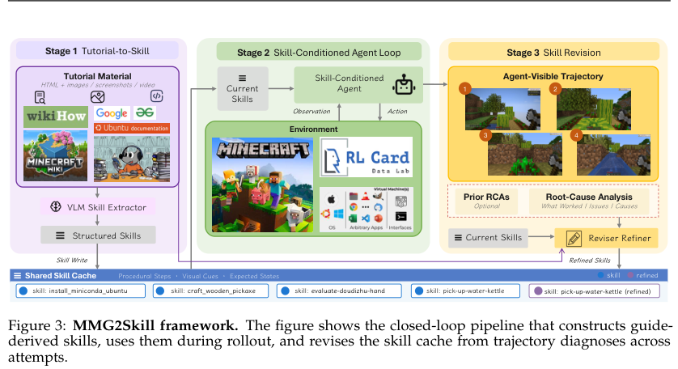

<!-- pair:3-3:en -->

Key observation and interpretation. Figure 3 moves from tutorial material to a shared skill cache, through environment execution, then back through root-cause analysis and skill rewriting. All four roles use the same backbone in a model condition; there is no separately stronger judge. This supports a representation-level learning interpretation. The purple return path is a change to procedural context, not a gradient update to θ. It cannot establish cross-task transfer or a growing universal skill library.

<!-- pair:3-3:zh -->

关键观察与解释：图 3 从教程材料生成技能缓存，进入环境执行，再通过根因分析与技能重写返回。同一模型条件中的四种角色使用相同骨干，没有另外配备更强裁判。这支持表示层面的学习解释：紫色返回箭头修改程序性上下文，而不是对 θ 做梯度更新。图中并未证明跨任务迁移，也未证明形成不断扩张的通用技能库。

<!-- pair:3-4:en -->

### Five equations, two different information boundaries
Equation 1 states an **evaluation objective**: choose a guide-derived skill set S that maximizes expected benchmark score under fixed policy πθ. The method never receives that score during construction, execution, analysis or refinement. Confusing this objective with online feedback would turn the method into a much easier oracle-assisted system. Ω(G) denotes skill sets induced by guide G; I is the task instruction, τ the executed trajectory and s(τ) the offline score.

<!-- pair:3-4:zh -->

### 五个公式，两种不同的信息边界
式 1 表达的是评估目标：在固定策略 πθ 下，选择由指南产生的技能集 S，使预期评测得分最大。构建、执行、分析、修订过程中，方法始终看不到该得分。若把这个目标误当作在线反馈，就把方法变成了更容易的、由标准答案辅助的系统。Ω(G) 表示指南 G 可诱导的技能集合，I 是任务指令，τ 是执行轨迹，s(τ) 是离线评分。

$$
S^*\in\arg\max_{S\in\Omega(G)}\mathbb E_{\tau\sim p_\theta(\tau\mid I,S)}[s(\tau)].
$$

<!-- pair:3-6:en -->

Construction produces S₁={zᵢ}, with conceptual skill zᵢ=(uᵢ,cᵢ,vᵢ,qᵢ): procedure, applicability conditions, expected-state cues and recovery knowledge. These fields explain what the representation should retain; the implementation is Markdown with text and referenced images, not a mandatory four-field data schema. At attempt k, actions condition on the task, current skill set and bounded recent history hₜ. Skills remain available even when older observation/action turns leave the window.

<!-- pair:3-6:zh -->

构建过程生成 S₁={zᵢ}，每项技能概念上写为 zᵢ=(uᵢ,cᵢ,vᵢ,qᵢ)：操作流程、适用条件、预期状态线索和恢复知识。这些字段说明表示应保留什么；实际实现是包含文字和引用图片的 Markdown，并非强制四字段数据结构。第 k 次尝试中，动作以任务、当前技能和有限长度近期历史 hₜ 为条件。较早的观察与动作退出窗口后，技能仍可访问。

$$
S_1=\operatorname{ConstructSkills}(G,I)=\{z_i\}_{i=1}^{m},\quad z_i=(u_i,c_i,v_i,q_i),\qquad a_t\sim\pi_\theta(a_t\mid h_t,I,S_k).
$$

<!-- pair:3-8:en -->

After execution, Analyze reads only I and the agent-visible trajectory τₖ, producing ρₖ=(eₖ,rₖ): grounded evidence plus a self-assessed outcome such as likely_success. Refine receives the original guide, the current skill set and **all accumulated diagnoses** ρ₁:ₖ. The guide lets it recover omitted details; diagnosis history helps avoid undoing earlier fixes. The output is a normalized rewritten skill set, rather than a growing transcript of complaints. Both the diagnosis and the repair can still be wrong.

<!-- pair:3-8:zh -->

执行后，Analyze 只读取 I 和智能体可见轨迹 τₖ，生成 ρₖ=(eₖ,rₖ)：有轨迹依据的证据及 likely_success 等自评结果。Refine 接收原指南、当前技能集和全部累积诊断 ρ₁:ₖ。原指南用于恢复遗漏细节，诊断历史有助于避免撤销之前的修复。输出是规范化重写的技能集，而非不断增长的问题聊天记录。诊断与修订本身仍可能出错。

$$
\rho_k=\operatorname{Analyze}(I,\tau_k)=(e_k,r_k),\qquad S_{k+1}=\operatorname{Refine}(G,I,S_k,\rho_{1:k}).
$$

<!-- pair:3-10:en -->

### How to read Algorithm 1: stopping is part of the method

<!-- pair:3-10:zh -->

### 如何读算法 1：何时停止也是方法的一部分

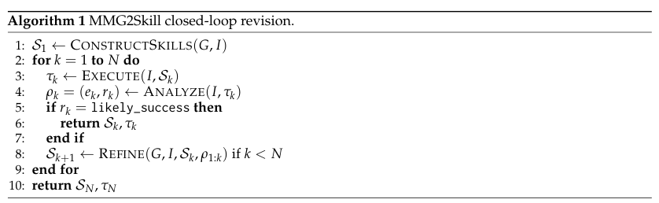

<!-- pair:3-12:en -->

Key observation and interpretation. Algorithm 1 returns the first attempt judged likely_success within N=5; if no such judgment appears, it returns the final attempt. This supports a deployable selection rule using only visible evidence, not “pick the attempt with highest benchmark reward.” For analysis, the authors continue recorded runs beyond hypothetical stop points and replay early-stop and full-run policies on the same attempts. This controls trajectory differences between those policy comparisons, but cannot eliminate the analyzer’s false positives.

<!-- pair:3-12:zh -->

关键观察与解释：算法 1 在 N=5 的预算内返回首个被判断为 likely_success 的尝试；若始终未触发，则返回最后一次。这是一种只使用可见证据的可部署选择规则，不是“挑评测奖励最高的一次”。分析时，作者继续记录本来应停止之后的尝试，再在同组轨迹上回放提前停止与完整运行策略。这控制了比较两种停止策略时的轨迹差异，却不能消除分析器的假阳性。

<!-- pair:3-13:en -->

### How to read Algorithm 2: how long trajectories and old fixes survive

<!-- pair:3-13:zh -->

### 如何读算法 2：如何处理长轨迹并保留旧修复？

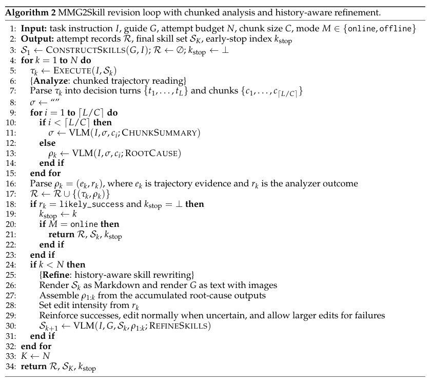

<!-- pair:3-15:en -->

Key observation and interpretation. Algorithm 2 chunks decision turns, passes a running summary between chunks and asks the final chunk for the root-cause diagnosis. Refinement intensity depends on the assessment: preserve and reinforce successes, edit normally under uncertainty, permit larger changes after failure. This supports bounded per-call analysis without discarding the diagnosis chain. It cannot guarantee lossless summarization or preservation of every correct rule. Table 4 specifies GUI/Game/Strategy step caps 15/60/60, recent-history windows 3/10/60 and analyzer chunk sizes 15/15/30. Those budgets are part of the experimental conditions, not incidental implementation trivia.

<!-- pair:3-15:zh -->

关键观察与解释：算法 2 将决策轮次分块，在块之间传递累积摘要，并在最后一块生成根因诊断。修订幅度依评估而定：成功时保留并强化，不确定时常规编辑，失败时允许较大修改。这支持在限制单次分析长度的同时保留诊断链，却不能保证摘要无损或每条正确规则都被保留。表 4 给出 GUI/Game/Strategy 的步骤上限 15/60/60、近期历史窗口 3/10/60、分析分块大小 15/15/30。这些预算属于实验条件，而非无关紧要的实现细节。

<!-- pair:3-16:en -->

### Worked example: “run the crop command” is an incomplete contract
Appendix G.1 follows Claude-Sonnet-4.6 cropping the top 20% from cola.png and saving cropped.png. Attempt 1 executes the GIMP batch procedure, declares DONE, but no output file exists; the offline score is 0. The diagnosis identifies premature completion. Refinement edits run-gimp-crop-command/SKILL.md by extending the wait and adding an explicit “ls -la cropped.png” output-file check before completion. The next attempt scores 1.0. Input guide → procedural skill → visible missing output → diagnosis → new verification precondition → successful execution is the entire loop.

This example demonstrates repairing a runtime assumption that static extraction missed. It cannot show that the analyzer saw the oracle score: that score is only the researcher’s evaluation. Conversely, Appendix G.2’s essay-submission case shows surface completion triggering likely_success while the oracle score is 0. The same interface can encode a useful fix or confidently preserve an error.

<!-- pair:3-16:zh -->

### 具体例子：“执行裁剪命令”并不是完整契约
附录 G.1 跟踪 Claude-Sonnet-4.6 将 cola.png 顶部裁掉 20% 并保存为 cropped.png 的过程。第一次尝试执行 GIMP 批处理流程后宣布 DONE，但输出文件不存在，离线得分为 0。诊断定位到过早结束；修订器修改 run-gimp-crop-command/SKILL.md，延长等待，并在完成前加入明确的“ls -la cropped.png”输出文件检查。下一次得分为 1.0。输入指南→程序性技能→可见的文件缺失→诊断→新增验证前提→成功执行，构成完整闭环。

该例说明可修复静态提取遗漏的运行时假设，却不说明分析器看到了标准评分；评分只是研究者的离线评估。相反，附录 G.2 的论文提交案例中，表面完成触发 likely_success，但标准评分为 0。同一个接口既能写入有效修复，也能自信地保留错误。

## 4. 实验与结果分析（Experiments & Results）

<!-- pair:4-1:en -->

### How to read Tables 1–2: guide access, skill extraction and revision are separate treatments

<!-- pair:4-1:zh -->

### 如何读表 1–2：指南访问、技能提取和迭代修订是三种不同处理

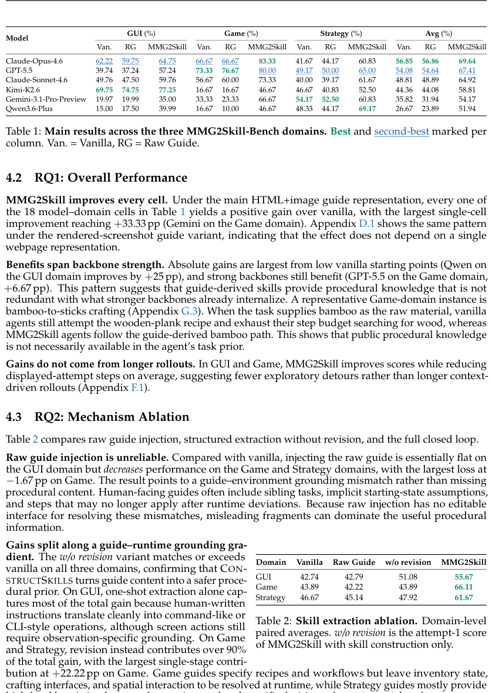

<!-- pair:4-3:en -->

Key observation and interpretation. Table 1’s macro-average rises from 56.85→69.64 for Opus-4.6, 54.08→67.41 for GPT-5.5, 48.81→64.92 for Sonnet-4.6, 44.36→58.81 for Kimi-K2.6, 35.82→54.17 for Gemini-3.1-Pro and 26.67→51.94 for Qwen3.6-Plus. All 18 model-domain cells improve over vanilla. These are domain-score averages, not 18 independent large benchmarks.

Table 2 isolates the stages: GUI vanilla/raw guide/construction/full gives 42.74/42.79/51.08/55.67; Game 43.89/42.22/43.89/66.11; Strategy 46.67/45.14/47.92/61.67. Raw guides can hurt. Extraction supplies much of the GUI gain; revision accounts for over 90% of the gain in Game and Strategy. This supports repairing guide-to-runtime mismatches rather than merely adding knowledge. It cannot by itself isolate skill editing from extra attempts: the full method receives up to five attempts.

<!-- pair:4-3:zh -->

关键观察与解释：表 1 的领域宏平均中，Opus-4.6 从 56.85→69.64，GPT-5.5 从 54.08→67.41，Sonnet-4.6 从 48.81→64.92，Kimi-K2.6 从 44.36→58.81，Gemini-3.1-Pro 从 35.82→54.17，Qwen3.6-Plus 从 26.67→51.94。全部 18 个模型×领域单元都高于 vanilla。这是领域得分平均值，不能当成 18 个独立大型基准。

表 2 分离各阶段：GUI 的 vanilla/原始指南/仅构建/完整方法分别为 42.74/42.79/51.08/55.67；Game 为 43.89/42.22/43.89/66.11；Strategy 为 46.67/45.14/47.92/61.67。原始指南可能有害；GUI 的很多收益来自提取，Game 和 Strategy 超过 90% 的收益来自修订。这支持修补指南与实际运行之间的不匹配，而不只是增加知识。但该表本身不能把技能编辑与额外尝试分开，因为完整方法最多尝试五次。

<!-- pair:4-4:en -->

### How to read Figures 9–10: is persistent editing better than more feedback in context?

<!-- pair:4-4:zh -->

### 如何读图 9–10：持久化编辑是否优于把更多反馈塞进上下文？

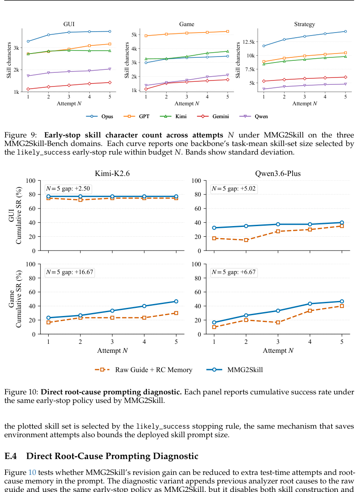

<!-- pair:4-6:en -->

Key observation and interpretation. Figure 10 compares skill edits with Raw Guide + root-cause memory under the same N=5 budget, analyzer and early-stop rule. At N=5, Kimi/Qwen gaps favor skills by 2.50/5.02 points on GUI and 16.67/6.67 on Game. This supports an advantage for materializing feedback in the skill interface beyond simply supplying diagnoses and retries, within four tested model-domain pairs. It cannot establish superiority to every memory architecture or an equal-token-budget baseline. Figure 9 plots skill characters across attempts: content generally grows, especially Strategy, while some curves flatten. That supports monitoring prompt-size cost; it cannot mean the method’s persistent representation is free or bounded under unlimited revision.

<!-- pair:4-6:zh -->

关键观察与解释：图 10 在相同 N=5 预算、分析器和提前停止规则下，比较技能编辑与“原始指南＋根因记忆”。到 N=5 时，Kimi/Qwen 在 GUI 上分别领先 2.50/5.02 个百分点，在 Game 上领先 16.67/6.67 个百分点。这支持在四个已测试的模型×领域组合中，把反馈落成技能接口比只提供诊断和重试更有价值。但不能说明它优于所有记忆架构，也不是等词元预算的比较。图 9 绘制多次尝试后的技能字符数：内容总体增加，Strategy 尤其明显，部分曲线逐渐趋平。这说明应关注提示长度成本，不能认为持久表示免费，或无限修订时仍有长度上界。

<!-- pair:4-7:en -->

### How to read Figure 4 and Table 3: improvement and stopping calibration are different quantities

<!-- pair:4-7:zh -->

### 如何读图 4 与表 3：性能改善与停止校准是不同指标

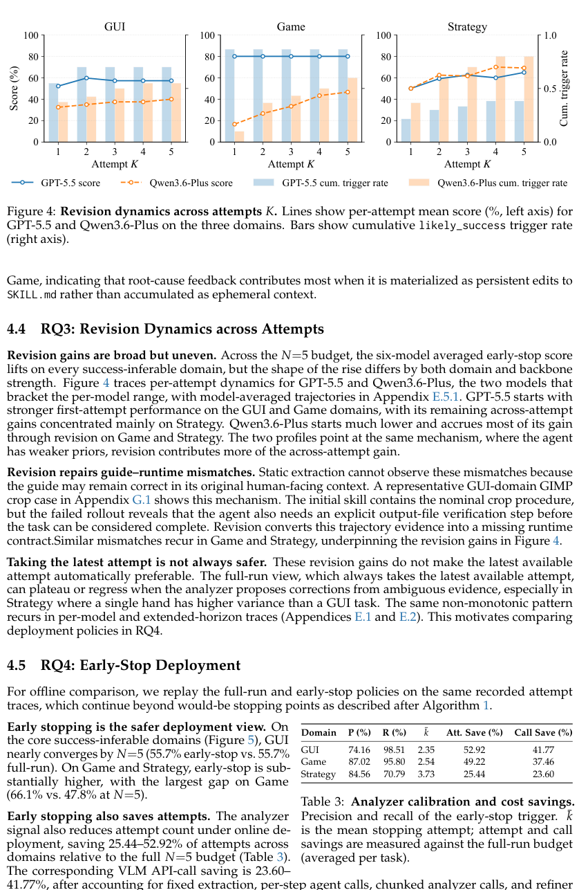

<!-- pair:4-9:en -->

Key observation and interpretation. Figure 4 uses lines for per-attempt scores and bars on a second axis for cumulative stop-trigger rates. GPT-5.5 starts stronger in GUI/Game; Qwen accumulates more benefit through revision. Some score curves regress even while trigger rates increase. Table 3 reports likely_success precision/recall: GUI 74.16/98.51%, Game 87.02/95.80%, Strategy 84.56/70.79%; mean stopping attempts are 2.35/2.54/3.73. This supports early stopping when success is observable, but a limitation is that a high trigger rate is not high accuracy, and 74% precision still permits consequential false stops. Attempt savings of 52.92/49.22/25.44% and API-call savings of 41.77/37.46/23.60% are relative to always running the **full MMG2Skill budget**, not vanilla.

<!-- pair:4-9:zh -->

关键观察与解释：图 4 的折线是各次尝试的得分，第二纵轴的柱形是累计停止触发率。GPT-5.5 在 GUI/Game 起点较强，Qwen 则通过修订积累更多收益。部分得分曲线会退步，即使累计触发率仍在增长。表 3 报告 likely_success 的精确率/召回率：GUI 为 74.16/98.51%，Game 为 87.02/95.80%，Strategy 为 84.56/70.79%；平均停止次数为 2.35/2.54/3.73。这支持在成功可观察时提前停止，但高触发率不等于高准确率，74% 精确率仍会发生有后果的错误停止。尝试节省 52.92/49.22/25.44%、API 调用节省 41.77/37.46/23.60%，比较对象是始终运行完整 MMG2Skill 预算，不是 vanilla。

<!-- pair:4-10:en -->

### How to read Figure 5: the last attempt can be worse than an earlier one

<!-- pair:4-10:zh -->

### 如何读图 5：最后一次尝试可能不如之前的一次

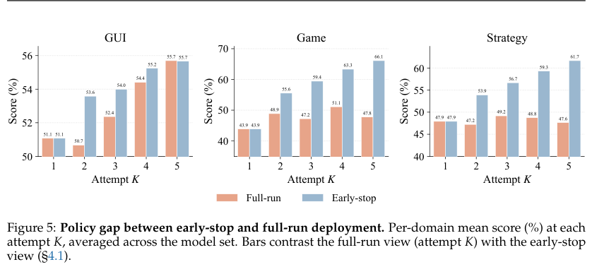

<!-- pair:4-12:en -->

Key observation and interpretation. The paired bars compare returning attempt K with replaying the first likely_success up to K on the same recorded attempts. At K=5 GUI is approximately 55.7 for both; Game is 47.8 full-run versus 66.1 early-stop; Strategy 47.6 versus 61.7. This supports the claim that deployment policy contributes materially to the headline result, particularly where late revisions regress. It cannot turn early-stop into an oracle: the broader Table 8 shows exceptions and remaining oracle gaps, especially Mahjong.

<!-- pair:4-12:zh -->

关键观察与解释：配对柱比较在同组记录轨迹上返回第 K 次，还是返回 K 以内首个 likely_success。K=5 时，GUI 两者约为 55.7；Game 完整运行是 47.8，提前停止为 66.1；Strategy 为 47.6 对 61.7。这说明部署时的选择策略明显影响主结果，尤其在后期修订退步的领域。但提前停止不是标准答案选择器：更完整的表 8 仍有例外及与 oracle 的差距，麻将尤其明显。

<!-- pair:4-13:en -->

### How to read Figure 8: extending the budget is not a monotone improvement guarantee

<!-- pair:4-13:zh -->

### 如何读图 8：增加预算不保证单调进步

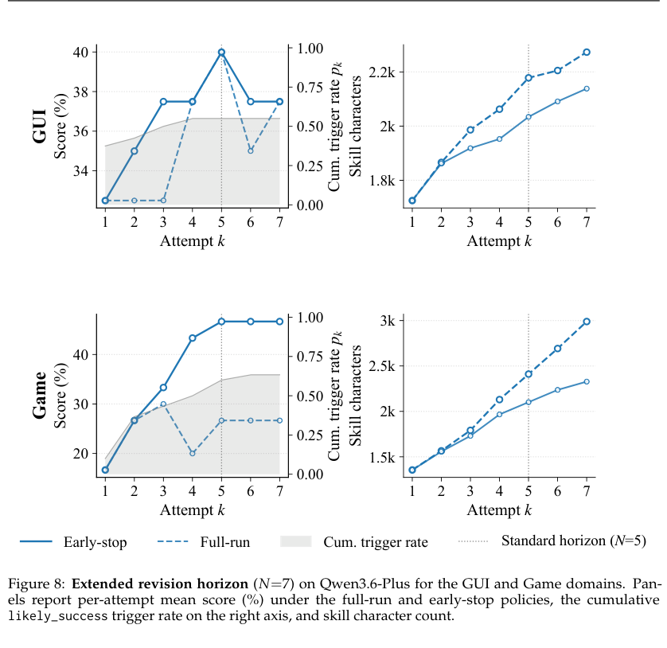

<!-- pair:4-15:en -->

Key observation and interpretation. The left panels separate early-stop and full-run scores, while the right panels track skill characters for Qwen at N=7. Game’s early-stop curve plateaus by five attempts while full-run remains lower; GUI visibly rises to 40 at five and falls to about 37.5 at six and seven. This supports diminishing returns and regression risk rather than indefinite self-improvement. The text describes a plateau in both domains, but the GUI curve is more qualified: tasks that have not triggered stopping can still change the aggregate as their fallback attempt changes. A one-backbone, two-domain extension cannot establish a universal optimal N=5.

<!-- pair:4-15:zh -->

关键观察与解释：左侧面板区分提前停止与完整运行得分，右侧跟踪 Qwen 在 N=7 时的技能字符数。Game 的提前停止曲线在五次后趋平，完整运行仍较低；GUI 图中则在第五次达到 40，六、七次下降到约 37.5。这支持收益递减与退步风险，而不是无限自我改善。文字称两个领域均趋平，但 GUI 曲线需要更谨慎解释：尚未触发停止的任务，其兜底返回尝试会随预算变化，因而总体得分仍可改变。只测试一个骨干、两个领域，不能证明 N=5 普遍最优。

<!-- pair:4-16:en -->

### How to read Table 12 and Figure 11: a stricter signal is not automatically safer overall

<!-- pair:4-16:zh -->

### 如何读表 12 与图 11：更严格的信号不一定整体更好

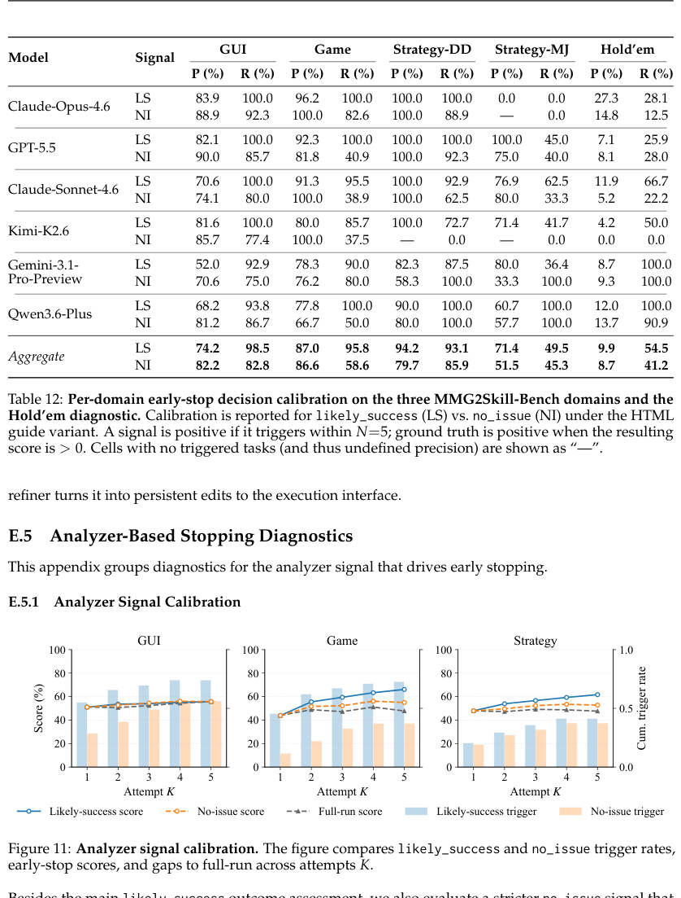

<!-- pair:4-18:en -->

Key observation and interpretation. Table 12 compares likely_success with no_issue, and Figure 11 plots their selected scores and trigger rates. For GUI, no_issue raises precision from 74.2 to 82.2 but lowers recall from 98.5 to 82.8; for Game it lowers recall from 95.8 to 58.6 without a precision advantage (87.0 versus 86.6). This supports selecting a stopping signal using its actual precision–recall trade-off. It cannot imply likely_success is always appropriate: aggregate Strategy hides Mahjong’s lower 71.4% precision and 49.5% recall, and hidden-outcome tasks are a different regime.

<!-- pair:4-18:zh -->

关键观察与解释：表 12 比较 likely_success 与 no_issue，图 11 绘制它们选择后的得分与触发率。在 GUI 中，no_issue 将精确率由 74.2 提高到 82.2，但召回率由 98.5 降到 82.8；Game 中召回率由 95.8 降到 58.6，精确率还没有优势（87.0 对 86.6）。这支持根据实际精确率—召回率权衡选择停止信号。但不意味着 likely_success 总是适用：Strategy 汇总掩盖了麻将较低的 71.4% 精确率和 49.5% 召回率，而隐藏结果任务属于另一种条件。

<!-- pair:4-19:en -->

### How to read Tables 13–14: the private-information boundary is a decisive negative result

<!-- pair:4-19:zh -->

### 如何读表 13–14：私人信息边界是关键负面结果

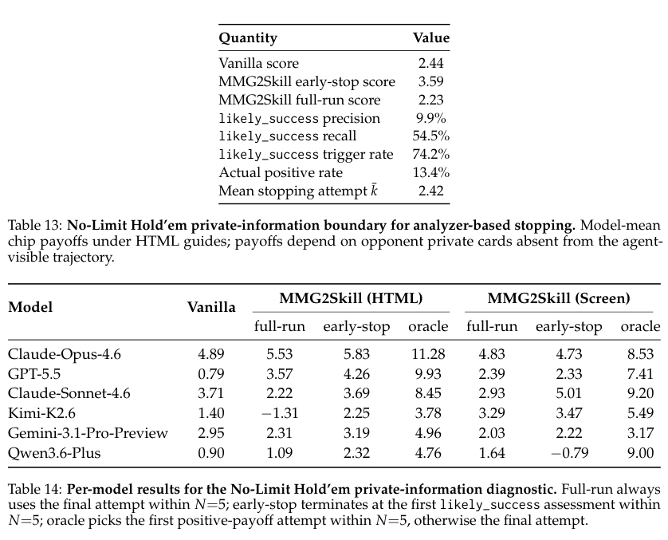

<!-- pair:4-21:en -->

Key observation and interpretation. Table 13 shows Hold’em likely_success triggering on 74.2% of tasks with only 9.9% precision; actual positive outcomes occur on 13.4%. Mean payoffs are 2.44 vanilla, 3.59 early-stop and 2.23 full-run. Table 14 exposes much larger oracle gaps and model variation, including a negative Qwen screenshot early-stop payoff. This supports the paper’s warning that plausible visible behavior is not evidence of a favorable hidden outcome. An improved average payoff cannot validate this stopping rule. Where outcome-determining information is unavailable, disable analyzer-based stopping or use external outcome feedback; the skill-revision loop itself can still run.

<!-- pair:4-21:zh -->

关键观察与解释：表 13 显示德州扑克中 likely_success 在 74.2% 的任务上触发，却只有 9.9% 精确率；实际正收益比例为 13.4%。平均收益分别为 vanilla 2.44、提前停止 3.59、完整运行 2.23。表 14 展示更大的 oracle 差距与模型差异，包括 Qwen 截图条件下提前停止的负收益。这支持论文的警告：可见行为看似合理，并不证明隐藏结果有利。平均收益提高也不能验证该停止规则。如果决定结果的信息不可见，应关闭基于分析器的停止，或使用外部结果反馈；技能修订循环本身仍可运行。

<!-- pair:4-22:en -->

### How to read Figure 6: residual failures are conditional error counts

<!-- pair:4-22:zh -->

### 如何读图 6：残余失败是条件性错误计数

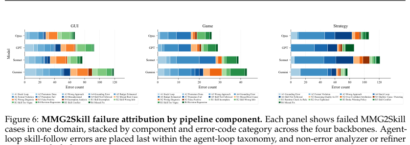

<!-- pair:4-24:en -->

Key observation and interpretation. The stacked bars count error tags among attempts that still fail, split by domain and model. GUI mixes grounding, diagnosis and bad skill information; Game emphasizes grounded execution and exhausted budgets; Strategy often fails to turn general advice into the next state-dependent action. This supports domain-specific debugging rather than one universal broken stage. Multiple tags can occur per case, and the denominator excludes successes, so bar length cannot measure a component’s causal share of all failures or directly rank models by success rate.

<!-- pair:4-24:zh -->

关键观察与解释：堆叠柱按领域和模型统计仍然失败的尝试中的错误标签。GUI 混合了界面定位、诊断与技能信息错误；Game 更强调实际执行与预算耗尽；Strategy 往往无法把一般建议变成当前状态下的下一步动作。这支持按领域调试，而不是认定一个普遍失效的阶段。每个案例可有多个标签，分母也排除了成功案例，因此柱长既不是某组件对全部失败的因果贡献比例，也不能直接作为模型成功率排名。

<!-- pair:4-25:en -->

### How to read Tables 9–10: what is the unit of statistical evidence?

<!-- pair:4-25:zh -->

### 如何读表 9–10：统计证据的单位是什么？

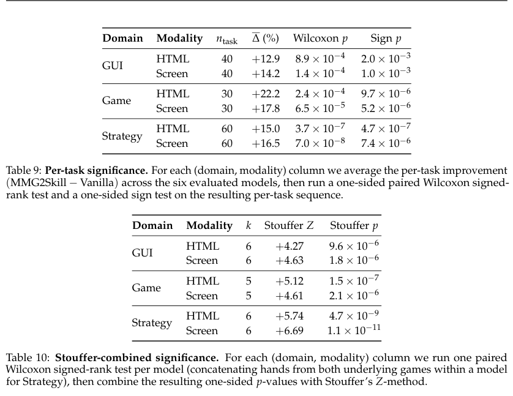

<!-- pair:4-27:en -->

Key observation and interpretation. Table 9 first averages each task’s gain over six models, then tests paired task differences. All six domain/modality cells have one-sided Wilcoxon p≤8.9×10⁻⁴ and sign-test p≤2.0×10⁻³. Table 10 instead combines per-model paired Wilcoxon tests with Stouffer’s method; the paper reports significance surviving Bonferroni correction over six cells. This supports gains beyond a few favorable examples under these tests. It cannot manufacture independent evidence from correlated models or establish population-wide transfer; the small, curated task collection remains the sampling unit that matters.

<!-- pair:4-27:zh -->

关键观察与解释：表 9 先对每个任务跨六个模型的增益取平均，再检验成对任务差值。六个领域×模态单元的一侧 Wilcoxon p≤8.9×10⁻⁴，符号检验 p≤2.0×10⁻³。表 10 则用 Stouffer 方法合并各模型的成对 Wilcoxon 检验；论文报告在六个单元的 Bonferroni 校正后仍显著。这支持收益不只来自少数漂亮案例，但不能把相关模型变成独立证据，也不能证明总体迁移能力；小规模人工筛选任务集仍是重要的抽样单位。

<!-- pair:4-28:en -->

### How to read Table 11: an independent rerun, not a narrow confidence interval

<!-- pair:4-28:zh -->

### 如何读表 11：独立重跑，不等于窄置信区间

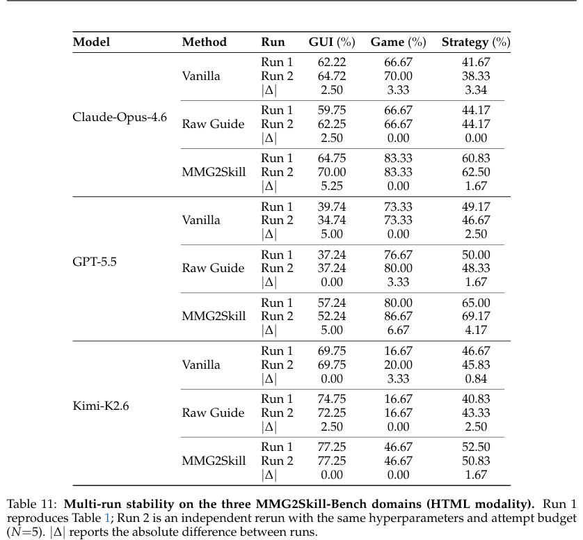

<!-- pair:4-30:en -->

Key observation and interpretation. Table 11 repeats vanilla, raw guide and MMG2Skill for Opus, GPT and Kimi with unchanged settings. The method’s advantage persists, while individual cells move by several points: GPT’s MMG Game score changes 80.00→86.67 and Opus GUI 64.75→70.00. This supports directional stability for three backbones. Two runs cannot tightly characterize variance, tail risk or every model’s reliability; the exact main-table decimal should not be treated as a guaranteed deployment rate.

<!-- pair:4-30:zh -->

关键观察与解释：表 11 在配置不变的情况下，对 Opus、GPT、Kimi 的 vanilla、原始指南和 MMG2Skill 重新运行。方法优势仍在，但个别单元变化数个百分点：GPT 的 MMG Game 从 80.00→86.67，Opus GUI 从 64.75→70.00。这支持三个骨干上的方向性稳定。仅两次运行不能精确刻画方差、尾部风险或全部模型的可靠性，主表的小数也不应被当成保证的部署成功率。

<!-- pair:4-31:en -->

### How to read Table 15 and Figure 12: shorter returned trajectories are not lower total cost

<!-- pair:4-31:zh -->

### 如何读表 15 与图 12：返回轨迹更短，不等于总成本更低

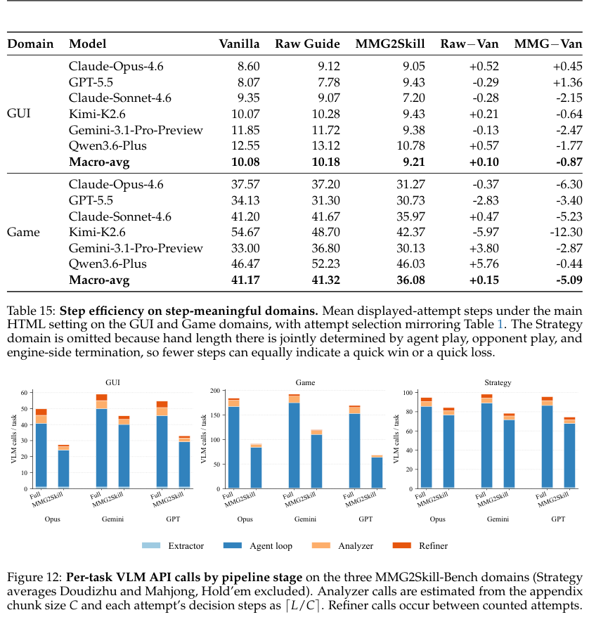

<!-- pair:4-33:en -->

Key observation and interpretation. Table 15 counts steps in the displayed/selected attempt: macro means fall 10.08→9.21 for GUI and 41.17→36.08 for Game. Figure 12 instead counts all pipeline calls, including attempts before stopping, extraction, analysis and refinement. Agent-loop calls dominate, so earlier stopping saves calls compared with five full attempts. This supports more directed execution and a cost benefit for early stopping, but they cannot prove MMG2Skill is cheaper than single-attempt vanilla. Strategy is omitted from step-efficiency claims because a short hand can be a quick win or quick loss.

<!-- pair:4-33:zh -->

关键观察与解释：表 15 统计展示或选中尝试的步数：宏平均在 GUI 中从 10.08→9.21，在 Game 中从 41.17→36.08。图 12 则统计整个流程的调用，包括停止前的尝试、提取、分析和修订。行动循环调用占主导，因此提前停止比完整执行五次更省调用。这些观察支持执行更有针对性及提前停止有成本收益，但不能证明 MMG2Skill 比单次 vanilla 更便宜。策略游戏未纳入步数效率主张，因为一局很短既可能是迅速获胜，也可能是迅速失败。

<!-- pair:4-34:en -->

### How to read Figure 13: call count and token count tell different cost stories

<!-- pair:4-34:zh -->

### 如何读图 13：调用数与词元数揭示不同成本结构

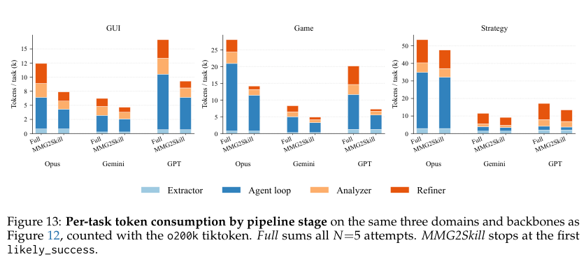

<!-- pair:4-36:en -->

Key observation and interpretation. Figure 13 stacks token use by stage for three models with full logs. Early-stop uses fewer tokens than full N=5 in every shown domain/model cell; GUI and Game are loop-heavy, whereas refinement can dominate Strategy for Gemini and GPT. This supports measuring both calls and token volumes before deployment. The o200k tokenizer accounting is a diagnostic, not a universal provider billing estimate, and three fully logged backbones cannot cover every model in Table 1.

<!-- pair:4-36:zh -->

关键观察与解释：图 13 对三个有完整日志的模型按阶段堆叠词元量。所有展示的领域×模型组合中，提前停止都比完整 N=5 使用更少词元；GUI 和 Game 以行动循环为主，Strategy 中 Gemini 和 GPT 的修订阶段却可能占主导。这支持部署前同时测量调用数与词元量。基于 o200k 分词器的统计只是诊断，不是所有供应商通用的计费估算；三个完整记录的骨干也不能覆盖表 1 中全部模型。

## 5. 论文的贡献与影响（Contribution & Impact）

<!-- pair:5-1:en -->

### The transferable contribution
The paper makes skill files an explicit intervention point between a fixed model and its environment: extract procedures, expose applicability and completion checks, observe failures, then revise the representation. Matched-feedback controls make this more informative than a generic “reflection helps” claim. The benchmark also treats **success observability** as a condition of self-evaluation, which is an important boundary for any autonomous workflow.

Remaining limits include curated task-relevant guides, only 130 main tasks, finite attempt budgets, errors in grounding and self-diagnosis, and no established transfer to unseen tasks. A useful future study would hold total tokens fixed while comparing skill rewriting, retrieval and structured memory; another would freeze a learned skill and test different tasks and guide sources. These are proposed tests, not demonstrated capabilities.

<!-- pair:5-1:zh -->

### 可迁移的贡献
论文把技能文件变成固定模型与环境之间可明确干预的位置：提取流程、写清适用条件与完成检查、观察失败，再修订表示。匹配反馈条件的控制实验，使它比笼统的“反思有帮助”更有信息量。基准还把成功可观察性视作自评成立的条件，这对任何自主工作流都是重要边界。

尚有限制包括任务相关指南经过筛选、主要任务仅 130 个、尝试预算有限、界面定位和自诊断会出错，也未建立向未见任务的迁移能力。后续值得固定总词元预算，比较技能重写、检索和结构化记忆；还可冻结已学技能，再测试不同任务和指南来源。这些是建议的测试，不是已经展示的能力。

## 6. 结论（Conclusion）

<!-- pair:6-1:en -->

Final judgment. MMG2Skill’s strongest lesson is that procedural knowledge needs an editable interface and explicit completion evidence. The results favor guide-derived skill revision over raw guide injection under the tested budgets. They cannot license trusting an agent’s own success judgment when the decisive outcome is hidden.

<!-- pair:6-1:zh -->

MMG2Skill 最重要的启示是：程序性知识需要可编辑接口和明确的完成证据。在已测试预算下，指南衍生技能的修订优于直接注入指南；但决定性结果不可见时，不能据此信任智能体自己的成功判断。
