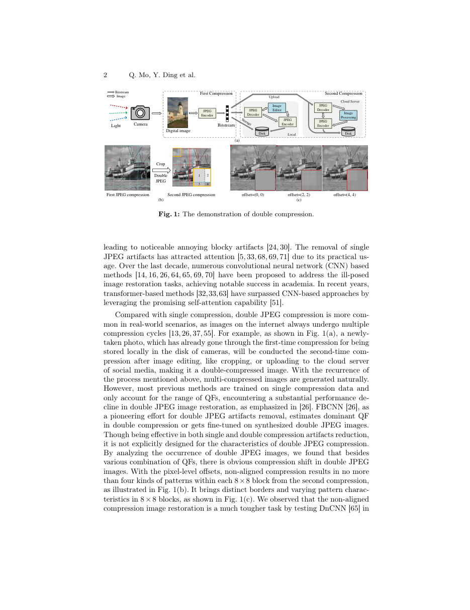
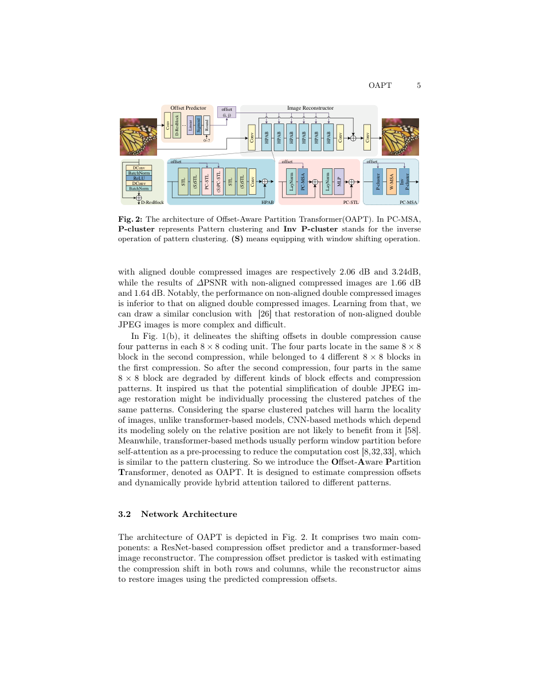
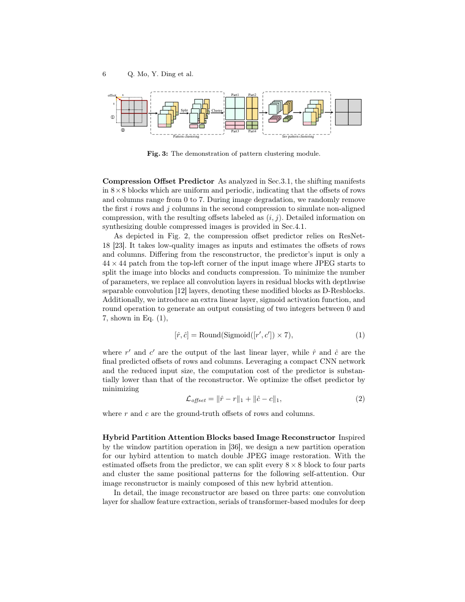
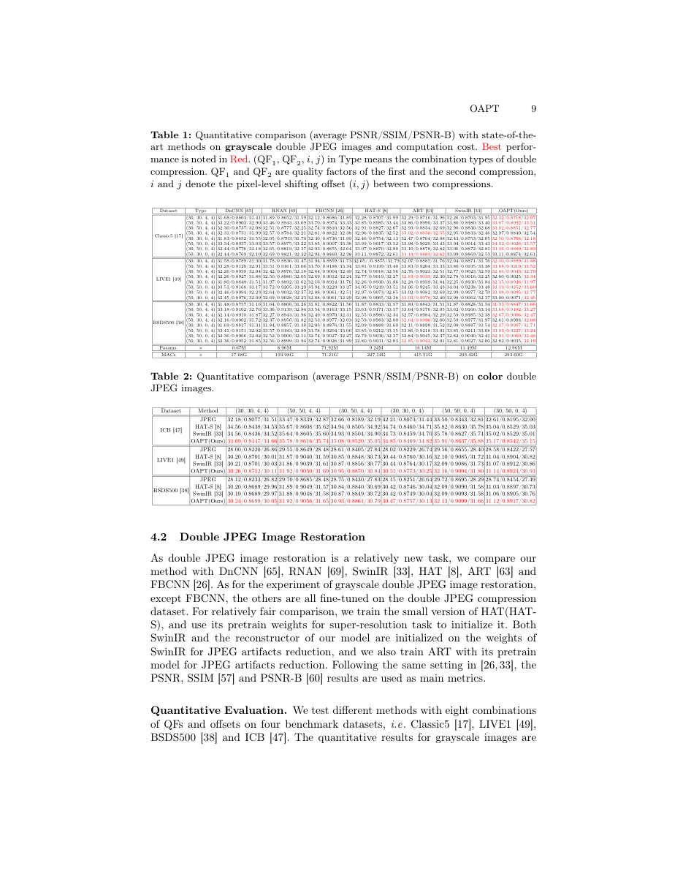
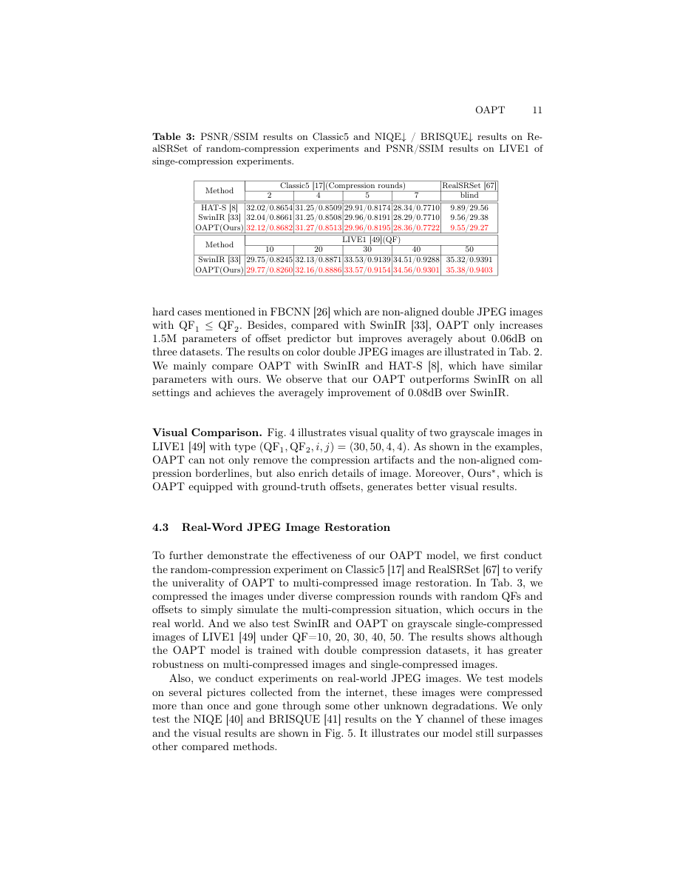
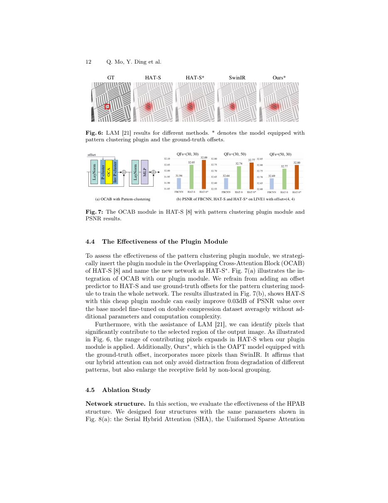
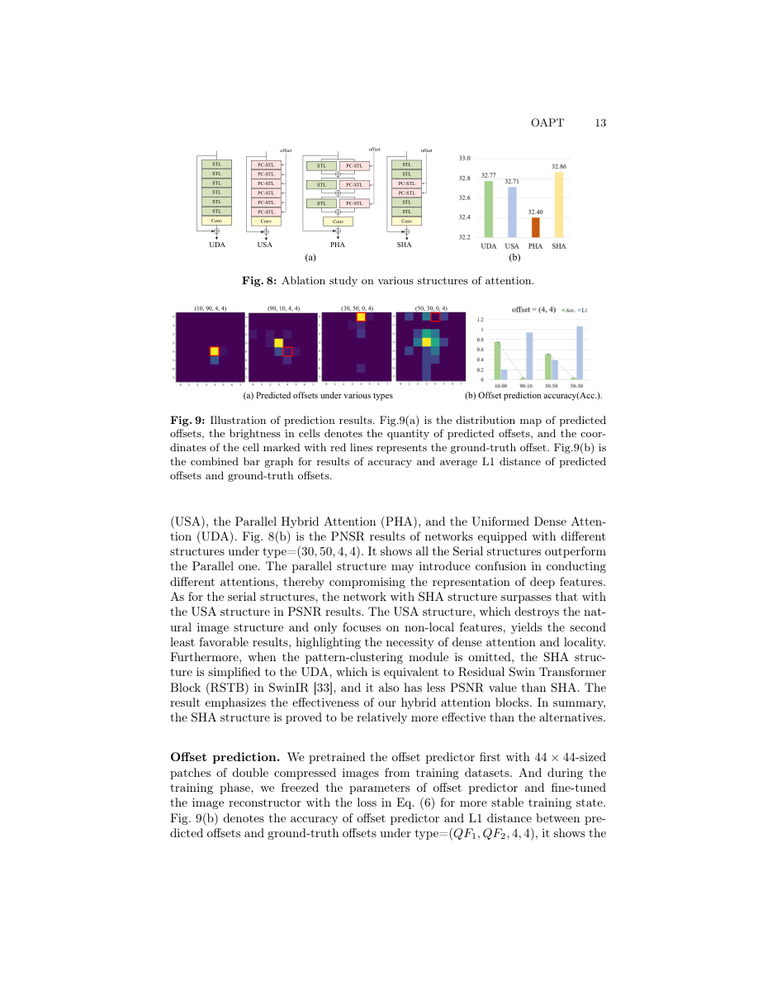
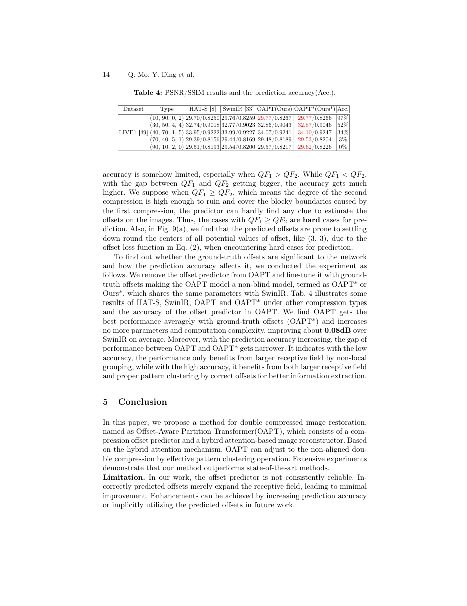

# OAPT: attention organized by JPEG history

OAPT：按JPEG压缩历史组织注意力

Primary source: ECCV 2024 proceedings PDF, 19 pages. Read the complete PDF, including the supplied appendices. Page numbers are 1-based PDF pages. Figures were inspected against page renders; full-page images deliberately retain labels, legends and neighboring context. This is an analytical reading, not an independent reproduction.

一手来源：ECCV 2024 proceedings PDF, 19 pages。已阅读完整 PDF 及文件内附录；页码均为从 1 起算的 PDF 页码。图表已对照页面渲染核查；完整页面截图保留标签、图例及邻近上下文。本报告是分析性阅读，并非独立复现实验。

## 1. 核心思想一句话总结（Elevator Pitch）

<!-- pair:1-1:en -->

OAPT estimates misaligned JPEG grids and groups matching artifact patterns, combining that sparse attention with local attention to improve double-compression restoration.

<!-- pair:1-1:zh -->

OAPT估计JPEG网格偏移，以同模式分组和局部注意力改善二次压缩恢复。

## 2. 论文背景与动机（Background & Motivation）

<!-- pair:2-1:en -->

### Key concepts and the problem

JPEG divides an image into 8×8 blocks, transforms each into spatial-frequency coefficients, then rounds coefficients using quantization steps. Rounding loses information and can leave visible boundaries. A quality factor controls compression strength but is not itself a physical noise level. If an image is cropped between two JPEG saves, the second block grid can cross four blocks of the first. One final block then contains regions with different compression histories. This is why a single-compression restorer can face a different statistical problem after a second save. [§3.1]

<!-- pair:2-1:zh -->

### 必要概念与问题

JPEG把图像分为8×8块，将每块变换为空间频率系数，再按量化步长取整。取整丢失信息，也可能留下可见边界。质量因子控制压缩强度，但本身不是物理噪声量。若两次JPEG保存之间裁剪图像，第二次网格的一个块可能横跨第一次的四个块，使最终同一块中出现不同压缩历史。因此二次保存后，单次压缩恢复器面对的统计问题可能改变。［§3.1］

<!-- pair:2-2:en -->

### Figure 1: evidence to inspect

**How to read.** Inspect the two compression grids and the aligned versus shifted examples. “Four patterns” means up to four overlap regions, not four universal artifact classes. [PDF p.2]

<!-- pair:2-2:zh -->

### Figure 1：如何检查这项证据

**如何读。** 查看两次压缩网格及对齐、错位示例；“四种模式”指最多四个重叠区域，不是四种普遍固定的伪影类别。［PDF p.2］

<!-- pair:2-4:en -->

**Key observation.** A shift in both dimensions partitions an 8×8 block into four parts; zero shift along one dimension reduces this to two, and fully aligned grids to one.

**Why this supports the claim, and its limitations.** Regions in the same relative position across blocks share a structural compression pattern, although their actual image content and quantization errors differ. The method exploits that structural similarity rather than asserting identical errors.

<!-- pair:2-4:zh -->

**关键观察。** 两个方向均偏移时，8×8块被分成四部分；一个方向零偏移时变成两部分，完全对齐则是一部分。

**推理桥与局限。** 不同块内相同相对位置的区域共享压缩结构模式，但实际图像内容和量化误差并不相同。方法利用的是结构相似性，不是假定误差完全相等。

<!-- pair:2-5:en -->

A transformer’s attention compares feature vectors and mixes information according to their similarity. Window attention limits comparisons to nearby pixels to save computation. Uniform sparse attention reaches farther by sampling separated locations. OAPT changes the grouping rule: first bring corresponding JPEG-pattern regions together, apply ordinary window attention there, then undo the rearrangement. Dense local attention remains necessary because regrouping breaks ordinary spatial neighborhoods. This is a degradation-specific prior rather than simply a larger network. [§§3.2–3.3]

<!-- pair:2-5:zh -->

Transformer注意力比较特征向量，再按相似性混合信息。窗口注意力把比较限定在邻近像素以节省计算；均匀稀疏注意力通过分散采样扩大范围。OAPT改变分组规则：先把相同JPEG模式的区域放在一起，在其中执行普通窗口注意力，再撤销重排。由于重组破坏原有空间邻域，仍必须保留稠密局部注意力。这是针对退化结构的先验，而不只是增大网络。［§§3.2–3.3］

## 3. 核心方法/模型详解（The Core Method/Model）

<!-- pair:3-1:en -->

### Figure 2: evidence to inspect

**How to read.** Read the offset predictor separately from the reconstruction backbone. Within each hybrid block, distinguish standard and pattern-clustered Swin layers. [PDF p.5]

<!-- pair:3-1:zh -->

### Figure 2：如何检查这项证据

**如何读。** 先区分偏移预测器与重建骨干，再在混合模块内部区分普通Swin层和模式聚类Swin层。［PDF p.5］

<!-- pair:3-3:en -->

**Key observation.** The predictor uses only the upper-left 44×44 patch and a lightweight ResNet-18-derived network with depthwise-separable convolutions.

**Why this supports the claim, and its limitations.** Six hybrid blocks form the reconstructor; each combines four standard and two pattern-clustered layers. The predicted offset controls rearrangement, while learned attention estimates useful content. Predictor pretraining followed by freezing avoids conflating offset learning with the reconstruction stage.

<!-- pair:3-3:zh -->

**关键观察。** 预测器只使用左上角44×44图块，采用由ResNet-18修改而来的轻量网络和深度可分离卷积。

**推理桥与局限。** 重建器含六个混合块，每块组合四个普通层和两个模式聚类层。预测偏移控制重排，学习式注意力估计有用内容。预测器先预训练后冻结，使偏移学习与重建阶段分开。

$$
y=\operatorname{JPEG}(\operatorname{Shift}_{i,j}(\operatorname{JPEG}(x,QF_1)),QF_2).
$$

<!-- pair:3-5:en -->

Equation (7), PDF p.8, defines the training corruption: x is the clean image, y the final degraded image, and Shift removes the first i rows and j columns before the second JPEG. Both quality factors range from 5 to 95; i,j are integers 0–7. Because block phase repeats every eight pixels, larger translations have the same grid phase modulo eight, although cropping still changes image content. A single model is trained across this range.

<!-- pair:3-5:zh -->

式(7)，PDF p.8，定义训练退化：x是干净图，y是最终退化图；Shift在第二次JPEG前删除前i行与j列。两个质量因子均取5–95，i、j为0–7整数。块相位每八像素重复，因此更大平移具有相同模八网格相位，但裁剪仍改变图像内容。单个模型覆盖这些设置。

$$
[\hat r,\hat c]=\operatorname{Round}(7\operatorname{Sigmoid}([r',c'])),\qquad \mathcal L_{\rm offset}=|\hat r-r|+|\hat c-c|.
$$

<!-- pair:3-7:en -->

Equations (1)–(2), PDF p.6: the last linear layer emits r′,c′, the sigmoid maps to (0,1), scaling and rounding produce two integers in 0–7. If its outputs after sigmoid are 0.57 and 0.29, the predicted phase is (4,2). If truth is (4,3), the L1 offset error is 1. The printed formula includes rounding in the training loss but does not specify a differentiable estimator through Round; reproducing the predictor requires checking the implementation rather than silently assuming ordinary gradients pass through it.

<!-- pair:3-7:zh -->

式(1)–(2)，PDF p.6：最后线性层输出r′、c′，sigmoid映射到(0,1)，乘7取整得到0–7的两个整数。若sigmoid后为0.57与0.29，预测相位为(4,2)；真值若为(4,3)，L1偏移误差为1。印刷公式把取整包括在训练损失内，却未说明穿过Round的可微估计器；复现预测器必须核对代码，不能默认普通梯度能穿过取整。

<!-- pair:3-8:en -->

### Figure 3: evidence to inspect

**How to read.** Follow split → cluster → inverse cluster, keeping track of where each part returns. [PDF p.6]

<!-- pair:3-8:zh -->

### Figure 3：如何检查这项证据

**如何读。** 跟踪拆分→聚类→逆聚类，留意每一部分最后回到哪里。［PDF p.6］

<!-- pair:3-10:en -->

**Key observation.** For a worked example with a 4-row, 2-column partition, an 8×8 block divides into areas 8, 24, 8 and 24 pixels.

**Why this supports the claim, and its limitations.** Matching parts from many blocks are packed into four feature groups; attention mixes tokens within the regrouped windows, then inverse clustering restores coordinates. A wrong phase still changes spatial reach but no longer guarantees matching compression patterns. Grouping is a permutation, not a loss of pixels, and does not make attention global over the entire image.

<!-- pair:3-10:zh -->

**关键观察。** 以4行、2列分割为最小例子，8×8块四部分面积为8、24、8、24像素。

**推理桥与局限。** 多个块的对应部分拼成四个特征组，在重排后的窗口内进行注意力混合，再逆聚类恢复坐标。错误相位仍改变空间覆盖，但不再保证压缩模式匹配。分组是排列而非丢弃像素，也不意味着全图所有像素之间都执行注意力。

$$
\begin{aligned}[x_1,x_2,x_3,x_4]&=\operatorname{PC}(X_{\rm LN},o),\\\hat X&=\operatorname{invPC}(\operatorname{WMSA}([x_1,x_2,x_3,x_4]),o),\\\operatorname{Attention}(Q,K,V)&=\operatorname{Softmax}(QK^\top/\sqrt d+B)V.\end{aligned}
$$

<!-- pair:3-12:en -->

Equations (4)–(5), PDF p.7: o is the predicted phase, LN normalizes feature channels, PC permutes patterns, and WMSA applies windowed multi-head attention. Q,K,V are learned query/key/value projections; d is a head’s feature dimension and B a learned relative-position bias. Softmax normalizes each query’s scores into weights. If two token scores are equal and their values are 2 and 6, the weighted output is 4; a stronger match shifts weight toward one value. Residual connections and a two-layer feature transformation surround attention (Eq.3). The reconstruction loss is the smooth Charbonnier penalty, √(‖Î−I‖²+ε²), ε=10⁻³ (Eq.6). It penalizes pixel error, not perceptual authenticity.

<!-- pair:3-12:zh -->

式(4)–(5)，PDF p.7：o为预测相位，LN归一化特征通道，PC排列模式，WMSA执行窗口多头注意力。Q、K、V是学习的查询、键、值投影，d是每头特征维数，B是学习式相对位置偏置。Softmax把每个查询的得分归一化为权重。若两个token得分相同、值为2与6，加权输出就是4；匹配更强会把权重偏向其中一个。注意力外围有残差连接和两层特征变换（式3）。重建使用平滑Charbonnier惩罚√(‖Î−I‖²+ε²)，ε=10⁻³（式6），惩罚的是像素误差，不是感知真实性。

## 4. 实验与结果分析（Experiments & Results）

<!-- pair:4-1:en -->

Training uses DIV2K and Flickr2K, 224×224 patches, Adam and four V100 GPUs. The reconstruction network is initialized from SwinIR JPEG restoration weights; other baselines have different pretraining, and FBCNN is not fine-tuned in the grayscale comparison. PSNR and SSIM favor smaller pixel error and stronger structural similarity; PSNR-B also penalizes blocking. For unpaired internet images, NIQE and BRISQUE estimate natural-image quality without a clean reference, with lower scores preferred. They cannot verify recovered content. [§4.1–4.3]

<!-- pair:4-1:zh -->

训练采用DIV2K、Flickr2K、224×224图块、Adam和四张V100。重建网络从SwinIR JPEG恢复权重初始化，其他基线预训练不同，灰度比较中的FBCNN没有微调。PSNR和SSIM分别偏好较小像素误差与较强结构相似度，PSNR-B还惩罚块效应。无配对网络图像使用NIQE与BRISQUE，分数越低越好；这些无参考自然图像质量估计无法核实恢复内容。［§4.1–4.3］

<!-- pair:4-2:en -->

### Table 1: evidence to inspect

**How to read.** Read each row as (first quality, second quality, row offset, column offset); do not pool incomparable conditions before checking the baseline. [PDF p.9]

<!-- pair:4-2:zh -->

### Table 1：如何检查这项证据

**如何读。** 每行条件为首次质量、第二次质量、行偏移、列偏移；在确认基线前不要混合不同条件。［PDF p.9］

<!-- pair:4-4:en -->

**Key observation.** The reported average +0.16 dB is relative to FBCNN, not every strongest baseline.

**Why this supports the claim, and its limitations.** Against SwinIR, the paper reports about +0.06 dB; for LIVE1 (30,50,4,4), 32.77→32.86 dB. OAPT is not best in every row: Classic5 (50,30,4,4) gives 32.97 versus ART’s 33.02. Parameters increase 11.49→12.96M relative to SwinIR, while MACs are 293.42→293.60G. This supports a small accuracy gain at small arithmetic overhead, not zero total cost.

<!-- pair:4-4:zh -->

**关键观察。** 报告的平均+0.16 dB是相对FBCNN，而非每个最强基线。

**推理桥与局限。** 相对SwinIR，论文报告约+0.06 dB；LIVE1的(30,50,4,4)为32.77→32.86 dB。OAPT并非每行最优：Classic5的(50,30,4,4)为32.97，而ART为33.02。相对SwinIR参数11.49→12.96M，乘加量293.42→293.60G。这支持以很小算术开销获得小幅精度收益，而非总成本为零。

<!-- pair:4-5:en -->

### Table 2: evidence to inspect

**How to read.** Compare color restoration separately; follow the same dataset and compression tuple across methods. [PDF p.9]

<!-- pair:4-5:zh -->

### Table 2：如何检查这项证据

**如何读。** 彩色恢复应单独比较，在同一数据集、同一压缩组合内跨方法阅读。［PDF p.9］

<!-- pair:4-7:en -->

**Key observation.** ICB at (30,50,4,4) improves 34.93→35.08 dB over SwinIR; the paper reports approximately +0.08 dB on average for color.

**Why this supports the claim, and its limitations.** Gains extend beyond grayscale, but baseline counts are smaller and no confidence intervals establish whether every hundredth of a dB is stable.

<!-- pair:4-7:zh -->

**关键观察。** ICB的(30,50,4,4)相对SwinIR从34.93升至35.08 dB；论文报告彩色平均约+0.08 dB。

**推理桥与局限。** 收益超出灰度，但基线数量更少，也没有置信区间证明每个百分之一dB的变化都稳定。

<!-- pair:4-8:en -->

### Table 3: evidence to inspect

**How to read.** Inspect compression-round columns as a transfer test, then the separate single-compression rows. [PDF p.11]

<!-- pair:4-8:zh -->

### Table 3：如何检查这项证据

**如何读。** 把压缩次数列作为迁移测试阅读，再看独立的单次压缩部分。［PDF p.11］

<!-- pair:4-10:en -->

**Key observation.** Despite double-compression training, the paper tests 2, 4, 5 and 7 random compression rounds and single compression.

**Why this supports the claim, and its limitations.** OAPT retains modest advantages over the compared transformers. Therefore “untested beyond two JPEG passes” would be false. What remains unestablished is broad reliability across arbitrary resizing, codec mixtures and real editing histories; blind NIQE/BRISQUE results offer weaker evidence than paired clean references.

<!-- pair:4-10:zh -->

**关键观察。** 虽然训练为二次压缩，论文实际测试2、4、5、7轮随机压缩及单次压缩，OAPT仍相对所比Transformer保留小幅优势。

**推理桥与局限。** 因此“未测试两次之外的JPEG压缩”是不实表述。尚未建立的是对任意缩放、混合编码器和真实编辑历史的普遍可靠性；无参考NIQE／BRISQUE证据弱于具有干净参考的配对测试。

<!-- pair:4-11:en -->

### Figure 7: evidence to inspect

**How to read.** Separate the plugin diagram from the PSNR bars, and note that HAT-S* receives ground-truth offsets. [PDF p.12]

<!-- pair:4-11:zh -->

### Figure 7：如何检查这项证据

**如何读。** 把插件图和PSNR柱图区分开，注意HAT-S*使用真实偏移。［PDF p.12］

<!-- pair:4-13:en -->

**Key observation.** Inserting clustering and inverse clustering around HAT-S attention gives roughly +0.03 dB average improvement without added learned parameters or nominal attention complexity.

**Why this supports the claim, and its limitations.** This isolates the usefulness of rearrangement more directly than the full model comparison, but supplies privileged offset information. It does not show that a blind plugin needs no predictor, memory movement or wall-clock overhead.

<!-- pair:4-13:zh -->

**关键观察。** 在HAT-S注意力前后加入聚类与逆聚类，平均约+0.03 dB，不增加学习参数或名义注意力复杂度。

**推理桥与局限。** 这比完整模型比较更直接地检验重排价值，但提供了特权偏移信息，不能说明盲插件不需要预测器、内存搬运或实际时间开销。

<!-- pair:4-14:en -->

### Figure 6: evidence to inspect

**How to read.** Compare attribution support for the same selected region; starred models use true offsets. [PDF p.12]

<!-- pair:4-14:zh -->

### Figure 6：如何检查这项证据

**如何读。** 比较相同选定区域的归因覆盖；带星号模型使用真实偏移。［PDF p.12］

<!-- pair:4-16:en -->

**Key observation.** The regrouped models draw on a broader set of input locations, consistent with nonlocal access after permutation.

**Why this supports the claim, and its limitations.** This supports the receptive-field explanation, but neither proves that each selected pixel is causally necessary nor measures general restoration accuracy. The controlled attention ablation tests the local/nonlocal balance next.

<!-- pair:4-16:zh -->

**关键观察。** 重组模型依赖更广输入位置，与排列后的非局部访问一致。

**推理桥与局限。** 这支持感受野解释，但不证明每个被归因像素都因果必要，也不度量总体恢复精度；接下来受控注意力消融检验局部与非局部的平衡。

<!-- pair:4-17:en -->

### Figure 8: evidence to inspect

**How to read.** Read equal-parameter alternatives: all dense, all sparse, parallel hybrid and serial hybrid. [PDF p.13]

<!-- pair:4-17:zh -->

### Figure 8：如何检查这项证据

**如何读。** 阅读参数相同的全稠密、全稀疏、并行混合、串行混合四种结构。［PDF p.13］

<!-- pair:4-19:en -->

**Key observation.** Serial hybrid reaches the highest displayed PSNR; all-sparse and parallel designs trail it.

**Why this supports the claim, and its limitations.** This shows that grouping alone is insufficient: the natural local geometry still matters. The authors’ explanation that parallel branches “confuse” features is a hypothesis, whereas the measured ranking is direct evidence limited to the tested condition.

<!-- pair:4-19:zh -->

**关键观察。** 串行混合获得最高展示PSNR，全稀疏和并行设计落后。

**推理桥与局限。** 这说明只有聚类不够，自然局部几何仍重要。作者关于并行分支会“混淆”特征的解释是机制假说；测得的排序才是直接证据，而且局限于所测条件。

<!-- pair:4-20:en -->

### Figure 9: evidence to inspect

**How to read.** Read predicted-phase distributions against the true-phase markers, then accuracy alongside offset distance. [PDF p.13]

<!-- pair:4-20:zh -->

### Figure 9：如何检查这项证据

**如何读。** 将预测相位分布与真实相位标记比较，再同时看准确率与偏移距离。［PDF p.13］

<!-- pair:4-22:en -->

**Key observation.** When the second JPEG is much stronger, first-grid evidence can be overwritten and predictions concentrate around central phases.

**Why this supports the claim, and its limitations.** L1 offset regression encourages central values when evidence is ambiguous. Exact classification accuracy and restoration quality need not move together, because even an incorrect permutation may enlarge spatial access. Table 4 quantifies that distinction.

<!-- pair:4-22:zh -->

**关键观察。** 第二次JPEG强得多时，第一次网格线索可能被覆盖，预测会集中于中间相位。

**推理桥与局限。** 证据含糊时，L1偏移回归倾向中心值。精确分类准确率与恢复质量不一定同步，因为错误排列也可能扩大空间访问；表4量化了这一区别。

<!-- pair:4-23:en -->

### Table 4: evidence to inspect

**How to read.** Compare blind OAPT and oracle-offset OAPT* at both high and low prediction accuracy. [PDF p.14]

<!-- pair:4-23:zh -->

### Table 4：如何检查这项证据

**如何读。** 在偏移预测准确率高低两种情况下，比较盲OAPT与真实偏移OAPT*。［PDF p.14］

<!-- pair:4-25:en -->

**Key observation.** At (10,90,0,2), accuracy is 97% and both score 29.77 dB.

**Why this supports the claim, and its limitations.** At (90,10,2,0), accuracy is 0%, yet OAPT gives 29.57 versus SwinIR 29.54 and oracle 29.62. Thus restoration gains can survive incorrect phase estimates, while true phase still helps. The most important limitation is unreliable offset identification, not an absolute inability to handle repeated JPEG.

<!-- pair:4-25:zh -->

**关键观察。** (10,90,0,2)时准确率97%，两者均29.77 dB；(90,10,2,0)时准确率0%，OAPT仍为29.57，SwinIR为29.54，真实偏移版本为29.62。

**推理桥与局限。** 因此错误相位下恢复收益仍可存在，但真实相位仍有帮助。最重要局限是偏移识别不可靠，而非完全不能处理多轮JPEG。

## 5. 论文的贡献与影响（Contribution & Impact）

<!-- pair:5-1:en -->

OAPT’s reusable idea is to make an attention partition reflect a degradation’s geometry. The arithmetic cost of a permutation is small, but deployment must count its memory traffic and the predictor. Evidence is moderate-to-strong for modest benchmark gains, moderate for the grouping mechanism because oracle offsets are used in the cleanest plugin test, and weak for unrestricted real-world generalization. A direct next experiment would compare a distribution over offsets with a single rounded estimate, keeping reconstruction capacity and runtime fixed. Stratifying by QF order and measuring calibration versus oracle gain would test whether uncertainty-aware grouping repairs the documented failure mode.

<!-- pair:5-1:zh -->

OAPT可复用的思想是让注意力分区反映退化几何。排列的算术成本小，但部署仍须计入内存搬运和预测器。对基准上小幅收益的证据中等偏强；对分组机制的证据中等，因为最干净的插件实验使用真实偏移；对无限制真实世界泛化的证据弱。下一步可在固定重建容量、运行时间下比较偏移概率分布与单一取整估计，再按质量因子顺序分层，测量校准误差与真实偏移增益，检验不确定性感知分组是否修复已发现的失效模式。

## 6. 结论（Conclusion）

<!-- pair:6-1:en -->

**Final judgment.** OAPT is a precise example of degradation-aware architecture: infer a periodic grid, rearrange matching patterns, and preserve local attention around them. The strongest practical result is a modest quality improvement over closely related transformers, not a universal +0.16 dB advantage. Multi-round tests extend the evidence beyond the training model, while offset failures bound confidence. It is worth reproducing with explicit predictor and data-movement costs.

<!-- pair:6-1:zh -->

**最终判断。** OAPT是退化感知架构的明确实例：推断周期网格，重排对应模式，同时保留局部注意力。最强实践结果是相对近邻Transformer的小幅质量改善，而非普遍+0.16 dB。多轮测试使证据超出训练退化，偏移失效则限定可信范围。复现时应明确计入预测器和数据搬运成本。
