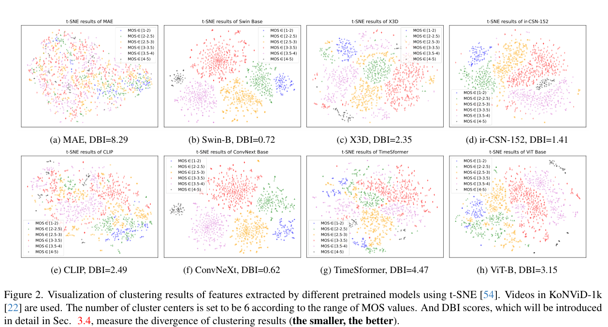
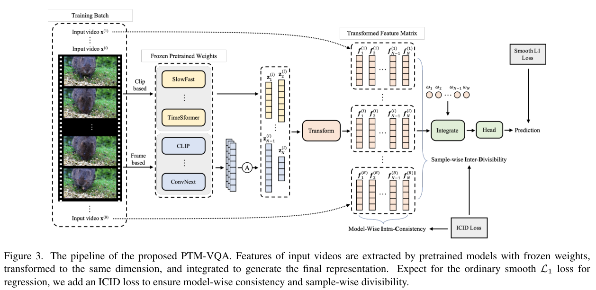
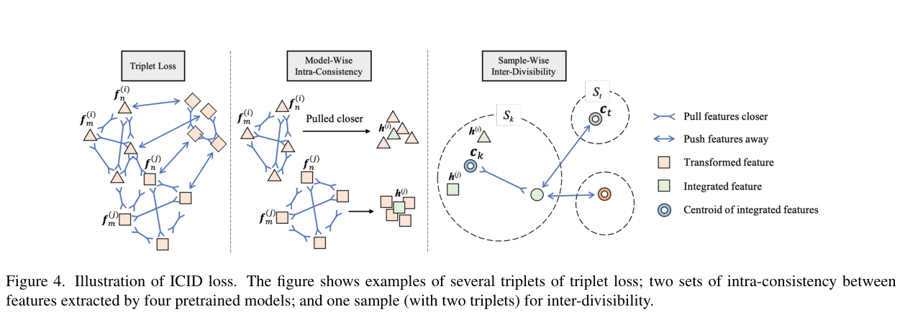
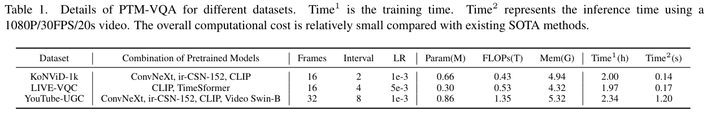
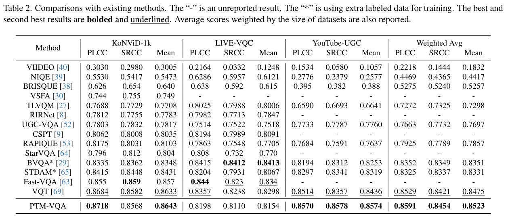
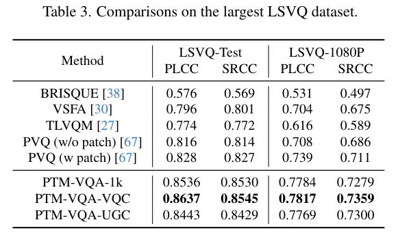
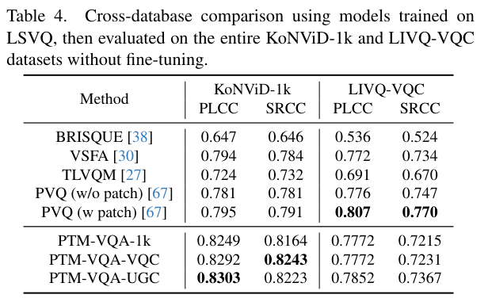
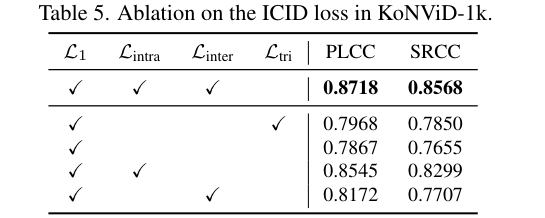
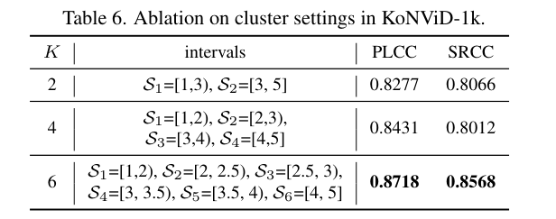
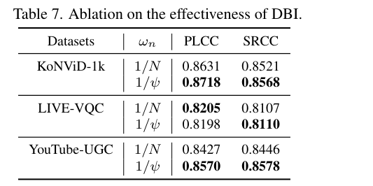

# PTM-VQA: Teaching Frozen Models to Agree on Video Quality

PTM-VQA：让冻结模型围绕视频质量达成一致

Source: [CVPR 2024 accepted paper](https://openaccess.thecvf.com/content/CVPR2024/papers/Yuan_PTM-VQA_Efficient_Video_Quality_Assessment_Leveraging_Diverse_PreTrained_Models_from_CVPR_2024_paper.pdf), proceedings pp.2835–2844, retrieved 2026-11-11. Numbered visual objects and load-bearing equations were checked against the rendered PDF. This analysis does not reproduce the training experiments.

来源：[CVPR 2024接收版论文](https://openaccess.thecvf.com/content/CVPR2024/papers/Yuan_PTM-VQA_Efficient_Video_Quality_Assessment_Leveraging_Diverse_PreTrained_Models_from_CVPR_2024_paper.pdf)，论文集2835–2844页，获取于2026-11-11。编号图表及承重公式已与渲染后的PDF核验。本分析没有复现训练实验。

## 1. 核心思想一句话总结（Elevator Pitch）

<!-- pair:1-1:en -->

PTM-VQA combines frozen visual models through small trainable adapters, teaching their features to agree about video quality rather than object identity.

<!-- pair:1-1:zh -->

PTM-VQA用小型适配器整合冻结视觉模型，让特征围绕视频质量而非物体类别对齐。

## 2. 论文背景与动机（Background & Motivation）

<!-- pair:2-1:en -->

### Key concepts: quality without a clean reference

Video quality assessment (VQA) predicts how good a video looks to viewers. No-reference VQA means the model receives only the potentially degraded video, with no pristine counterpart for comparison. The training label is a mean opinion score (MOS), the average of multiple human judgments. MOS is not an objective category such as “dog”: two dog videos can differ greatly in blur, shaking, or visual appeal. Human labeling is expensive; KoNViD-1k contains only 1,200 clips with about 114 judgments per clip (§§1, 4.1).

<!-- pair:2-1:zh -->

### 必要概念：没有干净参考的视频质量评估

视频质量评估VQA预测观众认为视频看起来有多好。无参考VQA意味着模型只接收可能已经退化的视频，没有干净版本可供比较。训练标签是平均意见分MOS，即多名观众评分的平均值。MOS不是“狗”这样的客观类别：同样拍狗的两段视频，模糊、抖动或视觉吸引力可能完全不同。人工标注成本很高，KoNViD-1k只有1,200段视频，每段平均约114次评分。（§§1、4.1）

<!-- pair:2-2:en -->

A pretrained model is a feature extractor learned previously on a larger task, such as recognizing objects, matching images to text, or classifying actions. A feature vector is a compact numerical description of the input. Different pretraining tasks preserve different clues: image classifiers emphasize appearance; action models can encode movement; text-image models may capture semantic or aesthetic associations. PTM-VQA freezes these extractors and trains only small transformations and a prediction head. Frozen does not mean free: every selected backbone still participates in inference (§§3.1–3.2).

<!-- pair:2-2:zh -->

预训练模型是在更大任务上提前学好的特征提取器，例如物体识别、图文匹配或动作分类。特征向量是输入内容的紧凑数值描述。不同预训练任务保留不同线索：图像分类器强调外观，动作模型可以编码运动，图文模型可能捕获语义或审美关联。PTM-VQA冻结这些提取器，只训练小型变换模块和预测头。但冻结不等于免费：推理时每一个被选中的主干模型仍须运行。（§§3.1–3.2）

<!-- pair:2-3:en -->

How to read: Figure 2 asks whether frozen features already separate quality levels. Compare the colored MOS groups across the eight panels, then read the Davies–Bouldin Index (DBI) beneath each; lower DBI means tighter, better-separated groups.

<!-- pair:2-3:zh -->

如何读：图2考察冻结特征是否已经能够区分质量层次。比较八个面板中按MOS着色的分组，再读每个面板下方的Davies–Bouldin指数DBI；较低DBI表示组内更紧、组间更分离。

<!-- pair:2-5:en -->

The key observation is that ConvNeXt and Swin-B show DBI 0.62 and 0.72, whereas MAE has 8.29. This supports the hypothesis that pretrained representations differ in their usefulness for quality. It cannot prove that the pictures reveal an intrinsic, label-free quality geometry: §3.1 explicitly uses MOS-based groups and Large Margin Nearest Neighbor metric learning, and t-SNE is only a two-dimensional visualization. A model’s low DBI is a task-dependent selection clue, not a guarantee that it will be best alone or in every ensemble.

<!-- pair:2-5:zh -->

关键观察是ConvNeXt与Swin-B的DBI为0.62和0.72，而MAE为8.29。这一差异支持预训练表示对质量任务的适用性并不相同，但不能证明这些图揭示了天然、无标签的质量几何结构：§3.1明确使用MOS分组及大间隔最近邻度量学习，t-SNE也只是一种二维可视化。低DBI是与具体任务有关的选择线索，不保证模型单独使用或放进任意组合都最好。

## 3. 核心方法/模型详解（The Core Method/Model）

<!-- pair:3-1:en -->

### Run one clip through the complete mechanism

Take a shaky but recognizable video of a dog, with illustrative MOS 2.2. An image model may confidently identify the dog while an action model notices unstable movement. The frozen models extract their own vectors. Two-layer trainable adapters turn them into 128-dimensional vectors in a common space. A consistency loss pulls the same clip’s adapted vectors toward one another; a quality-group loss pulls their aggregate toward other clips near MOS 2.2 and away from high-quality groups. A weighted average combines the vectors and a linear head predicts the score. At test time the MOS and groups are not inputs: only video features and the learned transformations are used (§§3.2–3.4).

<!-- pair:3-1:zh -->

### 让一段视频走完完整机制

设想一段拍狗的视频，内容可辨认，但画面抖动，教学示例中的MOS为2.2。图像模型可能很有把握地识别出狗，而动作模型注意到运动不稳定。冻结模型先各自提取向量，两层可训练适配器再把它们变成共同空间中的128维向量。一致性损失拉近同一视频经过不同适配器得到的向量；质量分组损失则让聚合向量靠近MOS约2.2的视频、远离高质量组。加权平均融合向量，最后由线性预测头给出评分。测试时MOS和分组都不作为输入，只使用视频特征及已经学到的变换。（§§3.2–3.4）

<!-- pair:3-2:en -->

How to read: Figure 3 is the dataflow. Follow the frame-based and clip-based input branches into frozen models, then the Transform modules, Integrate block, and prediction head. The lower loss arrows apply during training.

<!-- pair:3-2:zh -->

如何读：图3给出数据流。沿逐帧与视频片段两条分支，依次阅读冻结模型、Transform变换模块、Integrate融合模块及预测头。下方损失箭头只在训练时起作用。

<!-- pair:3-4:en -->

The key observation is that frame-model outputs are averaged over sampled frames, whereas clip models consume a sampled sequence. Each adapter contains two fully connected layers, normalization, and GELU activations. This supports combining different feature dimensions without updating the large extractors. It cannot restore temporal detail that frame averaging or sparse sampling discarded. The generic SlowFast/TimeSformer labels in the diagram illustrate possible backbones; actual combinations differ by dataset in Table 1.

<!-- pair:3-4:zh -->

关键观察是逐帧模型的输出会在采样帧之间取平均，而片段模型直接接收采样序列。每个适配器包含两层全连接层、归一化和GELU激活。这支持在不更新大型提取器的前提下，融合维度各异的特征；但无法找回被逐帧平均或稀疏采样丢掉的时序细节。图中SlowFast、TimeSformer等名称表示可用主干的示意，实际组合按数据集而不同，具体见表1。

<!-- pair:3-5:en -->

### Weighted integration: a normalized vote in feature space

Equation 1, PDF p.4, defines the aggregate $\mathbf h^{(i)}$ for clip $i$ from $N$ adapted vectors $\mathbf f_n^{(i)}\in\mathbb R^{128}$. Each positive coefficient $\omega_n$ indicates the contribution of model $n$:

<!-- pair:3-5:zh -->

### 加权融合：在特征空间中归一化投票

PDF第4页的式1把视频$i$的$N$个适配后向量$\mathbf f_n^{(i)}\in\mathbb R^{128}$融合成$\mathbf h^{(i)}$。正系数$\omega_n$表示模型$n$的贡献：

$$
\mathbf h^{(i)}=\frac{\sum_{n=1}^{N}\omega_n\mathbf f_n^{(i)}}{\sum_{n=1}^{N}\omega_n}.
$$

<!-- pair:3-7:en -->

For a minimal scalar example, adapted values 1 and 3 with weights 2 and 1 produce $5/3$, not their sum 5. Equal weights recover the ordinary average; multiplying every weight by the same constant changes nothing. The learned head converts the aggregate to MOS. These are feature weights, not confidence-calibrated probabilities or a direct average of pretrained quality scores. Poorly aligned feature spaces would make averaging meaningless, which motivates the losses.

<!-- pair:3-7:zh -->

在一个最小标量例子中，适配后的值为1与3，权重为2与1，结果是$5/3$，而不是它们的加权和5。相同权重退化为普通平均；把全部权重乘以同一个常数不会改变结果。学习得到的预测头再把聚合向量变成MOS。这些权重不是经过校准的置信概率，也不是直接平均预训练模型给出的质量分数。如果特征空间没有对齐，平均就缺乏意义，因此需要下面的损失。

<!-- pair:3-8:en -->

How to read: Figure 4 asks why ordinary triplet learning is insufficient. Read the left sample-to-sample comparison, the middle same-video/different-model alignment, and the right quality-centroid comparison.

<!-- pair:3-8:zh -->

如何读：图4回答普通三元组学习为何不足。依次阅读左侧样本对样本的比较、中间同一视频不同模型之间的对齐，以及右侧与质量组中心的比较。

<!-- pair:3-10:en -->

The key observation is that ICID changes two relationships, not just one loss coefficient. Intra-consistency aligns different model views of the same video; inter-divisibility separates groups of videos defined by human quality scores. This supports the intended removal of object-identity shortcuts: equally recognizable dogs can still belong to different quality groups. It cannot prove that all content dependence disappears. Averaging around a group center may also hide multiple causes of poor quality, and hard group boundaries discard some continuous-score information.

<!-- pair:3-10:zh -->

关键观察是ICID改变了两种关系，而不只是调一个损失系数。组内一致性对齐同一视频的不同模型视角；组间可分性把按人工质量分数划分的视频组分开。这支持削弱物体类别捷径的设计目标：同样容易识别的狗仍可属于不同质量组。但它不能证明所有内容依赖都消失了。围绕组中心平均也可能掩盖导致低质量的不同原因，而硬分组边界会丢掉一部分连续分数信息。

<!-- pair:3-11:en -->

### Intra-consistency: agree across models

Equation 3, PDF p.5, penalizes angular disagreement. Cosine similarity is the dot product of two vectors divided by their lengths; it is 1 for identical directions, 0 for orthogonal directions, and −1 for opposite directions. The paper prints:

<!-- pair:3-11:zh -->

### 组内一致性：让模型之间达成一致

PDF第5页的式3惩罚方向不一致。余弦相似度是两个向量的点积除以各自长度：同方向为1，正交为0，反方向为−1。论文原式为：

$$
\mathcal L_{\mathrm{intra}}=\frac{2}{N(N-1)}\sum_{n=1}^{N}\sum_{\substack{m=1\\m\ne n}}^{N}\left(1-\frac{\mathbf f_n^{(i)}\cdot\mathbf f_m^{(i)}}{\lVert\mathbf f_n^{(i)}\rVert_2\lVert\mathbf f_m^{(i)}\rVert_2}\right).
$$

<!-- pair:3-13:en -->

All vectors in this expression belong to the same clip $i$; $n,m$ index models. The printed sum counts ordered pairs and retains a leading factor 2, so it is twice the usual ordered-pair mean. With two orthogonal vectors, its value is 2; with identical directions, it is 0. That constant rescales optimization but does not change the alignment target. We preserve the published form rather than silently changing it to an unordered-pair average. Zero-length vectors and the implementation’s numerical stabilization require code-level checking, which this source reading does not supply.

<!-- pair:3-13:zh -->

该式中的向量都来自同一个视频$i$，$n,m$索引不同模型。原文同时对有序向量对求和并保留前导系数2，因此数值是通常有序对平均的两倍。两个正交向量时为2，同方向时为0。该常数改变优化尺度，但不改变对齐目标。这里保留发表版本，不悄悄改成无序对平均。零向量及实现中的数值稳定处理需要检查代码，本次原文阅读不能替代这一步。

<!-- pair:3-14:en -->

### Inter-divisibility: compare with quality groups

A triplet loss uses an anchor, a positive example that should be near, and a negative example that should be farther away. Equation 2 uses Euclidean distances with margin $\alpha$. Equation 5 replaces individual positives and negatives with centroids, the arithmetic means of integrated vectors in quality groups $S_k$ and $S_t$:

<!-- pair:3-14:zh -->

### 组间可分性：与质量分组比较

三元组损失使用一个锚点、应当靠近的正例，以及应当更远的负例。式2使用欧氏距离和间隔$\alpha$。式5把单独的正负例替换成质心，也就是质量组$S_k$与$S_t$中聚合向量的算术平均：

$$
\mathcal L_{\mathrm{inter}}=\max\left(\lVert\mathbf h^{(i)}-\mathbf c_k\rVert_2-\lVert\mathbf h^{(i)}-\mathbf c_t\rVert_2+\alpha,0\right),\qquad \mathbf c_k=\frac{1}{\lvert S_k\rvert}\sum_{\{j:x^{(j)}\in S_k\}}\mathbf h^{(j)}.
$$

<!-- pair:3-16:en -->

Here $i$ belongs to group $k$, and $t$ is a different quality group; this expression expands Eq.5 using Eq.2. For distances 0.20 to the correct center and 0.23 to a wrong center, the reported $\alpha=0.05$ gives loss 0.02. Moving the wrong center to distance 0.30 makes the loss zero. In the example clip, MOS 2.2 belongs to the 2–2.5 group. Its semantic content can differ from other group members; the constraint uses quality, not dog identity. Smooth L1 regression still preserves continuous MOS supervision, while Eq.6 adds the ICID terms with $\beta=0.2$. Centroids reduce dependence on particular triplets, but require nonempty, meaningful groups; bin-edge cases and heterogeneous distortions remain limitations.

<!-- pair:3-16:zh -->

其中$i$属于组$k$，$t$是另一质量组；此处把式5按式2展开。若到正确中心距离为0.20，到错误中心为0.23，论文采用的$\alpha=0.05$会得到0.02的损失；把错误中心推到0.30后，损失变成零。示例视频的MOS为2.2，属于2–2.5组。它与同组视频的语义内容可以不同，因为约束使用的是质量而不是“狗”这一类别。平滑L1回归仍保留连续MOS监督，式6再以$\beta=0.2$加入ICID项。质心降低了对具体三元组抽样的依赖，但要求分组非空且有意义；分箱边界附近的样本与不同退化原因混合，仍是局限。

<!-- pair:3-17:en -->

### DBI: choose and weight the frozen models

The Davies–Bouldin Index compares within-group scatter with between-group separation. In Eq.7, PDF p.6, $\mathbf z^{(i)}$ denotes extracted features before the trainable adapter, $\mathbf c_k$ is a group centroid in that feature space, and $d_k$ is the mean distance to that centroid:

<!-- pair:3-17:zh -->

### DBI：选择冻结模型并确定权重

Davies–Bouldin指数比较组内散布与组间距离。PDF第6页的式7中，$\mathbf z^{(i)}$是可训练适配器之前提取的特征，$\mathbf c_k$是该特征空间中的组中心，$d_k$是样本到中心的平均距离：

$$
\psi=\frac{1}{K}\sum_{k=1}^{K}\max_{t\ne k}\frac{d_k+d_t}{\lVert\mathbf c_k-\mathbf c_t\rVert_2},\qquad d_k=\frac{1}{\lvert S_k\rvert}\sum_{i\in S_k}\lVert\mathbf z^{(i)}-\mathbf c_k\rVert_2,\qquad \omega_n=\frac{1}{\psi_n}.
$$

<!-- pair:3-19:en -->

For two groups with scatter 0.1 each and center distance 1, DBI is 0.2; reducing their separation to 0.25 raises DBI to 0.8. The latter model receives one quarter of the inverse-DBI weight before normalization. Low DBI therefore favors compact, distinct quality groups. However, the paper does not specify a universal selection threshold or an exhaustive optimization over model combinations. Its KoNViD combination includes CLIP but not Swin-B despite Swin-B’s lower Figure 2 DBI. Quality labels enter selection, so a clean reproduction must compute selection statistics only from training data and tune choices without consulting test labels. The text does not establish enough detail to certify that separation; this is a verification gap, not evidence that leakage occurred.

<!-- pair:3-19:zh -->

若两个组的散布都为0.1、中心距离为1，DBI为0.2；若中心距离缩小为0.25，DBI升至0.8。归一化之前，后者得到的倒数DBI权重只有前者四分之一。因此，低DBI倾向于选择紧凑且可分的质量组。但论文没有给出通用选择阈值，也没有穷举所有模型组合。KoNViD组合使用CLIP而未使用Swin-B，尽管图2中Swin-B的DBI更低。质量标签参与了模型选择，所以严格复现必须只用训练数据计算选择统计，并避免通过测试标签调节组合。正文信息不足以认证这一步完全分离；这是待核验的细节，并不是发生数据泄漏的证据。

## 4. 实验与结果分析（Experiments & Results）

<!-- pair:4-1:en -->

### Evaluation design and metric meaning

The first three datasets use ten random 80/20 train/test splits; results are mean correlations. LSVQ uses its official split. Pearson linear correlation (PLCC) measures linear association with MOS; Spearman rank correlation (SRCC) measures agreement in ordering. Higher positive values are better, but both coefficients mathematically range from −1 to 1, despite §4.1 describing only [0,1]. Correlation is not a percentage of correct quality predictions. Training uses a V100 GPU for 60 epochs, 224×224 center crops, and AdamW; test predictions average four temporal clips times five spatial crops (§§4.1–4.2). No model training or benchmark reproduction was performed for this note.

<!-- pair:4-1:zh -->

### 评测设计与指标含义

前三个数据集采用十次随机80/20训练、测试划分，结果是相关系数的平均值；LSVQ使用官方划分。皮尔逊线性相关系数PLCC衡量与MOS的线性关联，斯皮尔曼秩相关系数SRCC衡量排序一致性。较大的正值更好，但两个系数在数学上都取值于−1至1，尽管§4.1只写了[0,1]。相关系数不是质量预测正确率。训练使用V100显卡、60轮、224×224中心裁剪与AdamW；测试时平均四个时间片段乘以五个空间裁剪的预测。（§§4.1–4.2）本笔记没有重新训练模型或复现基准。

<!-- pair:4-2:en -->

How to read: Table 1 establishes the resource budget. Read model combination and sampling columns together with Param, FLOPs, memory, training hours, and inference seconds for the specified 20-second 1080p/30FPS input.

<!-- pair:4-2:zh -->

如何读：表1明确资源预算。把模型组合与采样设置同参数量、计算量、内存、训练小时数及推理秒数一起读；推理输入指定为20秒、1080p、30FPS的视频。

<!-- pair:4-4:en -->

The key observation is that the KoNViD configuration uses ConvNeXt, ir-CSN-152, and CLIP with 0.66M trainable parameters, 0.43T FLOPs, and 0.14 seconds reported inference time. LIVE-VQC uses two models, 0.30M parameters and 0.17 seconds; YouTube-UGC uses four models, 0.86M parameters and 1.20 seconds. Training times are 1.97–2.34 hours. This supports low adaptation cost in the tested configuration, but cannot equate the trainable parameter count with the total deployed backbone size. Sparse views and frozen pretrained computation matter; the numbers are not the cost of inspecting every original-resolution frame, nor are they independent of hardware and preprocessing.

<!-- pair:4-4:zh -->

关键观察是KoNViD配置使用ConvNeXt、ir-CSN-152和CLIP，可训练参数为0.66M、计算量0.43T FLOPs，报告推理时间为0.14秒。LIVE-VQC使用两个模型、0.30M参数、0.17秒；YouTube-UGC使用四个模型、0.86M参数、1.20秒。训练时间为1.97–2.34小时。这支持所测试配置的适配成本较低，但不能把可训练参数量当成部署时全部主干模型的大小。稀疏视图与冻结预训练计算都很重要；这些数值不是逐帧检查原始分辨率视频的成本，也不是与硬件和预处理无关的常数。

<!-- pair:4-5:en -->

How to read: Table 2 tests in-dataset accuracy. Read each dataset’s PLCC/SRCC pair before the dataset-size-weighted average. An asterisk marks methods using extra labeled quality data; a dash means unreported, not zero.

<!-- pair:4-5:zh -->

如何读：表2检验数据集内精度。先看每个数据集的PLCC/SRCC，再看按数据集大小加权的平均值。星号标记使用额外质量标注数据的方法，横线表示未报告而不是零。

<!-- pair:4-7:en -->

The key observation is a mixed result: PTM-VQA’s weighted mean 0.8523 exceeds VQT’s 0.8475, and YouTube-UGC mean 0.8574 exceeds 0.8436. On KoNViD its PLCC is 0.8718, but SRCC 0.8568 is below Fast-VQA’s 0.859 and VQT’s 0.8582. On LIVE-VQC, its mean 0.8154 is below BVQA’s 0.8413 and Fast-VQA’s 0.834. This supports competitive aggregate accuracy, not winning every dataset or criterion. It cannot establish statistical significance for the 0.0048 weighted-mean gap without run-level uncertainty and matched evaluation details. Historical “SOTA” wording is the authors’ claim, not a current leaderboard audit.

<!-- pair:4-7:zh -->

关键观察是结果有胜有负：PTM-VQA的加权平均0.8523高于VQT的0.8475，YouTube-UGC平均0.8574也高于0.8436。KoNViD上的PLCC为0.8718，但SRCC 0.8568低于Fast-VQA的0.859及VQT的0.8582。在LIVE-VQC上，其平均0.8154低于BVQA的0.8413和Fast-VQA的0.834。这支持总体表现有竞争力，而不是每个数据集、每项指标都获胜。缺少逐次运行不确定性及匹配评测细节时，不能断言0.0048的加权均值差距具有统计显著性。历史性的“SOTA”表述是作者主张，不是对当前排行榜的核查。

<!-- pair:4-8:en -->

How to read: Table 3 tests the selected backbone combinations on the larger LSVQ benchmark. The suffixes -1k, -VQC, and -UGC identify combinations, not proof of zero-shot transfer from those small datasets.

<!-- pair:4-8:zh -->

如何读：表3把选定的主干组合放到更大的LSVQ基准上。后缀-1k、-VQC、-UGC表示组合来源，并不代表从这些小数据集直接零样本迁移。

<!-- pair:4-10:en -->

The key observation is that PTM-VQA-VQC reaches 0.8637/0.8545 PLCC/SRCC on LSVQ-Test and 0.7817/0.7359 on LSVQ-1080P, above the listed PVQ patch baseline. This supports adapting the combinations to a larger labeled training setting. It cannot establish performance without LSVQ supervision; Table 4, not Table 3, is the explicit cross-database test. The 1080p subset also lowers correlations, showing that resolution or content distribution still matters.

<!-- pair:4-10:zh -->

关键观察是PTM-VQA-VQC在LSVQ-Test上达到0.8637/0.8545的PLCC/SRCC，在LSVQ-1080P上为0.7817/0.7359，高于表中带patch的PVQ基线。这支持这些组合能够适配到更大的有标签训练场景，但不能说明完全不使用LSVQ监督时也有同样效果；明确的跨数据集测试是表4，而不是表3。1080p子集上的相关性也更低，说明分辨率或内容分布仍然重要。

<!-- pair:4-11:en -->

How to read: Table 4 is the genuine cross-database check: models trained on LSVQ are evaluated on complete KoNViD-1k and LIVE-VQC without finetuning. Compare each destination separately.

<!-- pair:4-11:zh -->

如何读：表4才是真正的跨数据集验证：在LSVQ训练后，不做微调，直接在完整KoNViD-1k与LIVE-VQC上测试。两个目标数据集要分别比较。

<!-- pair:4-13:en -->

The key observation is strong KoNViD transfer but weaker LIVE-VQC transfer. PTM-VQA-UGC has KoNViD PLCC 0.8303 versus PVQ’s 0.795; PTM-VQA-VQC reaches SRCC 0.8243 versus 0.791. On LIVE-VQC, the best PTM row is 0.7852/0.7367, below PVQ’s 0.807/0.770. This supports partial cross-domain generalization and directly limits the paper’s broad wording that transfer is strong on both datasets. It cannot establish universal robustness to capture devices or authentic distortion mixtures.

<!-- pair:4-13:zh -->

关键观察是迁移到KoNViD较强，但到LIVE-VQC较弱。PTM-VQA-UGC的KoNViD PLCC为0.8303，对比PVQ的0.795；PTM-VQA-VQC的SRCC为0.8243，对比0.791。但在LIVE-VQC上，PTM最佳一行为0.7852/0.7367，低于PVQ的0.807/0.770。这支持部分跨域泛化，同时直接限定了论文关于两个数据集都迁移良好的宽泛措辞。它不能证明对所有采集设备或真实退化混合都稳健。

<!-- pair:4-14:en -->

How to read: Table 5 asks whether the proposed constraints matter. Compare regression alone, regression with ordinary triplets, either ICID component, and both components under the KoNViD setup.

<!-- pair:4-14:zh -->

如何读：表5检验所提约束是否必要。比较仅回归、回归加普通三元组、单独加入任一ICID项，以及同时加入两项的KoNViD结果。

<!-- pair:4-16:en -->

The key observation is that the full objective reaches 0.8718/0.8568, compared with regression-only 0.7867/0.7655 and ordinary triplet 0.7968/0.7850. Intra-only gives 0.8545/0.8299; inter-only 0.8172/0.7707. This supports a substantial contribution from alignment and a further benefit from combining both terms, under the reported setup. It cannot prove that centroid triplets are best among all metric-learning alternatives, or that each term helps every dataset equally. No per-run error bars are shown.

<!-- pair:4-16:zh -->

关键观察是完整目标达到0.8718/0.8568，而仅回归为0.7867/0.7655，普通三元组为0.7968/0.7850。仅组内一致性为0.8545/0.8299，仅组间可分性为0.8172/0.7707。这支持特征对齐带来较大贡献，同时组合两项还能进一步改善，但范围限于报告的设置。它不能证明质心三元组优于所有度量学习替代方案，也不能说明每项损失在所有数据集上都同等有效。表中没有逐次运行误差条。

<!-- pair:4-17:en -->

How to read: Table 6 asks how coarse the MOS groups should be. Read the actual interval boundaries, not just the number of groups K.

<!-- pair:4-17:zh -->

如何读：表6考察MOS分组应有多细。除了组数K，还要阅读具体区间边界。

<!-- pair:4-19:en -->

The key observation is that six uneven intervals give 0.8718/0.8568, compared with two groups at 0.8277/0.8066 and four at 0.8431/0.8012. The six-way split narrows the populated middle region to half-point intervals while keeping the tails wider. This supports that the grouping design matters. It cannot isolate group count from boundary placement, because both change together, nor justify arbitrarily many groups: the authors explicitly stop at six to maintain enough samples per group in a batch.

<!-- pair:4-19:zh -->

关键观察是六个不等宽区间得到0.8718/0.8568，两组为0.8277/0.8066，四组为0.8431/0.8012。六组设置把样本较多的中间分数段分成半分区间，两端仍保持较宽。这支持分组设计确实重要，但不能把组数与边界位置的影响分开，因为两者同时变化；也不能推论组越多越好，作者明确停在六组，以保证每个批次各组有足够样本。

<!-- pair:4-20:en -->

How to read: Table 7 isolates inverse-DBI weighting from equal weighting for the selected models. Compare the two rows within each dataset, not across datasets.

<!-- pair:4-20:zh -->

如何读：表7针对已选模型，单独比较倒数DBI权重与均等权重。应在每个数据集内部比较两行，而不是跨数据集比较。

<!-- pair:4-22:en -->

The key observation is improved KoNViD PLCC/SRCC from 0.8631/0.8521 to 0.8718/0.8568, and improved YouTube-UGC from 0.8427/0.8446 to 0.8570/0.8578. LIVE-VQC is mixed: PLCC falls 0.8205→0.8198 while SRCC rises 0.8107→0.8110. This supports useful but nonuniform weighting gains. It cannot support “DBI always improves accuracy.” The separate random-selection study reports mean PLCC 0.7917±0.0578 across ten combinations, suggesting selection matters, but does not replace a complete, equally budgeted comparison of search strategies.

<!-- pair:4-22:zh -->

关键观察是KoNViD的PLCC/SRCC从0.8631/0.8521提高到0.8718/0.8568，YouTube-UGC从0.8427/0.8446提高到0.8570/0.8578。LIVE-VQC则有升有降：PLCC从0.8205降至0.8198，SRCC从0.8107升至0.8110。这支持加权有用但并非一致获益，不能说明“DBI总能提高精度”。另一个随机选模实验在十种组合上给出PLCC 0.7917±0.0578，提示选模确实重要，但不等价于对各种搜索策略进行完整、等预算比较。

<!-- pair:4-23:en -->

Evidence strength is therefore uneven. Within the displayed KoNViD ablation, ICID has strong support; aggregate benchmark competitiveness has moderate support because splits, outside pretraining, and uncertainty need careful accounting. Universal cross-database superiority is unsupported by Table 4. The efficiency claim is meaningful for trainable adaptation and the specific sampled inference setup, not for total pretraining cost or guaranteed full-frame coverage.

<!-- pair:4-23:zh -->

因此证据强度并不一致。在所展示的KoNViD消融中，ICID得到强支持；总体基准竞争力得到中等支持，因为划分、外部预训练与不确定性仍须仔细核算。普遍的跨数据集优势不被表4支持。效率主张对于可训练适配成本与特定采样推理设置有意义，但不能扩展成总预训练成本低或保证覆盖每个完整画面。

## 5. 论文的贡献与影响（Contribution & Impact）

<!-- pair:5-1:en -->

Before this approach, finetuning quality models or combining specialized pretrained signals could consume many trainable parameters. PTM-VQA instead keeps diverse general-purpose extractors fixed, learns small adapters, aligns them with two quality-aware constraints, and chooses/weights candidates through label-informed geometry. The new contribution is this combination of transfer, alignment, and selection; it is not a new human quality label or a reference-free guarantee of human satisfaction. The tradeoff is multiple deployed backbones and dependence on the source dataset’s quality bins.

<!-- pair:5-1:zh -->

此前的方法可能需要微调质量模型，或者组合专用预训练信号，从而更新大量参数。PTM-VQA则固定多种通用提取器，学习小型适配器，利用两类质量约束对齐特征，并通过带标签信息的几何结构选择和加权候选。新增贡献是迁移、对齐与选择的组合，而不是新的人类质量标签，也不是无参考地保证人类满意。代价是部署多个主干，并依赖源数据集的质量分箱。

<!-- pair:5-2:en -->

The next step should test precisely where the evidence is weakest. First, repeat selection inside each training split and report every model choice, avoiding test-label influence. Second, compare centroid groups with continuous quality distances near bin boundaries. Third, inspect LIVE-VQC failures by device, motion, and distortion type, then test whether adding a motion-sensitive model helps without increasing training data. Finally, report total backbone parameters and end-to-end decode/crop/inference latency, with sensitivity to sparse sampling. These are proposed checks, not completed experiments.

<!-- pair:5-2:zh -->

下一步应对准证据最薄弱的环节。首先，在每次训练划分内部重新选模并报告全部选择，避免测试标签影响。其次，在分箱边界附近，把质心分组与连续质量距离比较。第三，按设备、运动及退化类型分析LIVE-VQC失败，再测试不增加训练数据时引入运动敏感模型能否改善。最后，报告全部主干参数与解码、裁剪、推理的端到端延迟，并考察稀疏采样敏感性。这些是建议验证，不是已经完成的实验。

## 6. 结论（Conclusion）

<!-- pair:6-1:en -->

Final judgment: PTM-VQA is a useful recipe when quality labels are scarce and pretrained features are readily available. Its strongest idea is to align diverse frozen representations around quality rather than to assume object-recognition features are already sufficient. The paper supports competitive averages and effective adaptation, with clear dataset exceptions. It does not establish a universal best model, zero-cost inference, or unrestricted cross-domain transfer. Reuse the mechanism, but carry the trainable-versus-total-cost distinction and the LIVE-VQC counterexamples with it.

<!-- pair:6-1:zh -->

最终判断：当质量标签稀缺而预训练特征容易获得时，PTM-VQA是一套值得参考的方案。最重要的思想是围绕质量对齐多种冻结表示，而不是假定物体识别特征天然足够。论文支持有竞争力的平均表现和有效的轻量适配，同时也有明确的数据集例外。它不能证明存在普遍最优模型、零成本推理或不受限制的跨域迁移。复用其机制时，应同时保留可训练成本与总成本的区别，以及LIVE-VQC上的反例。
