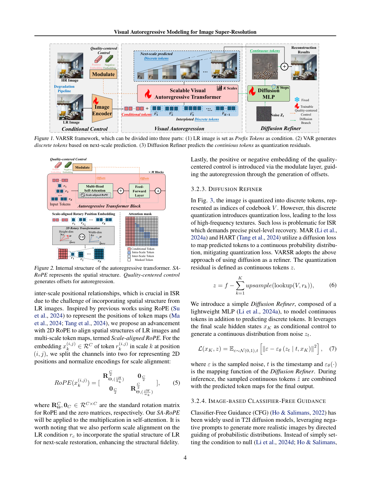
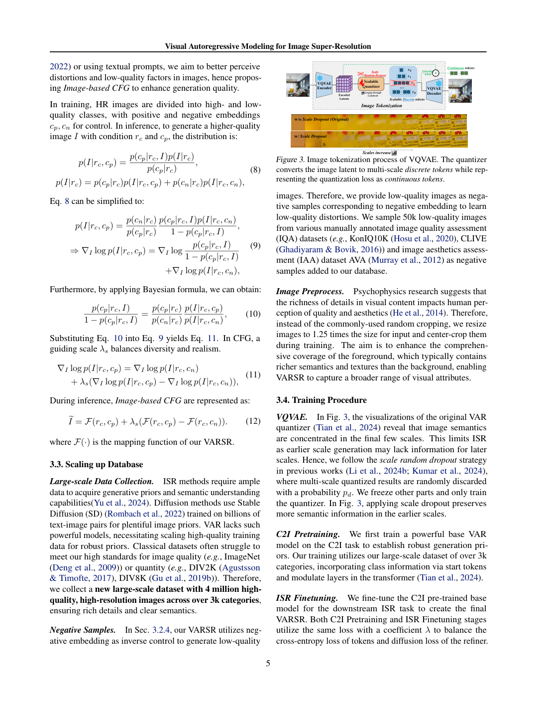
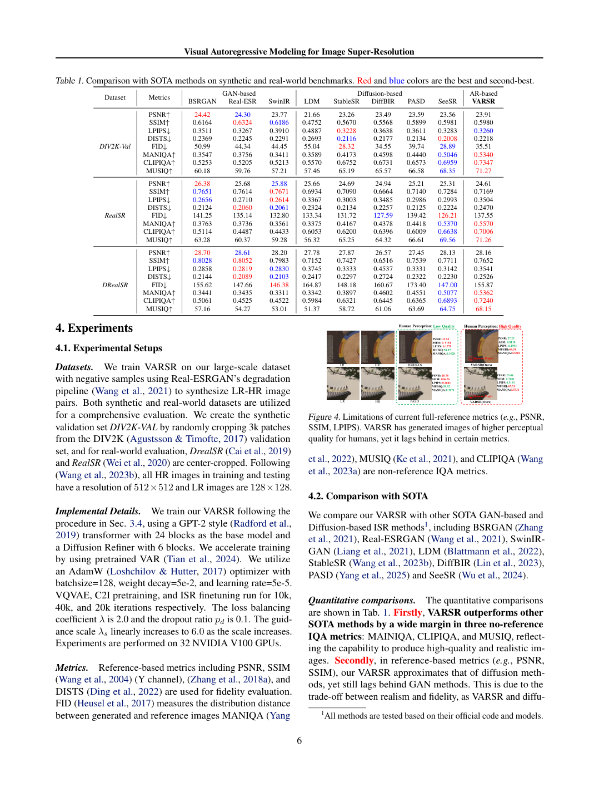
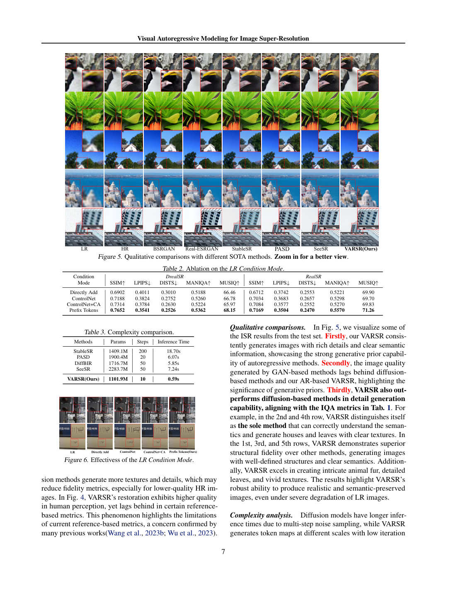
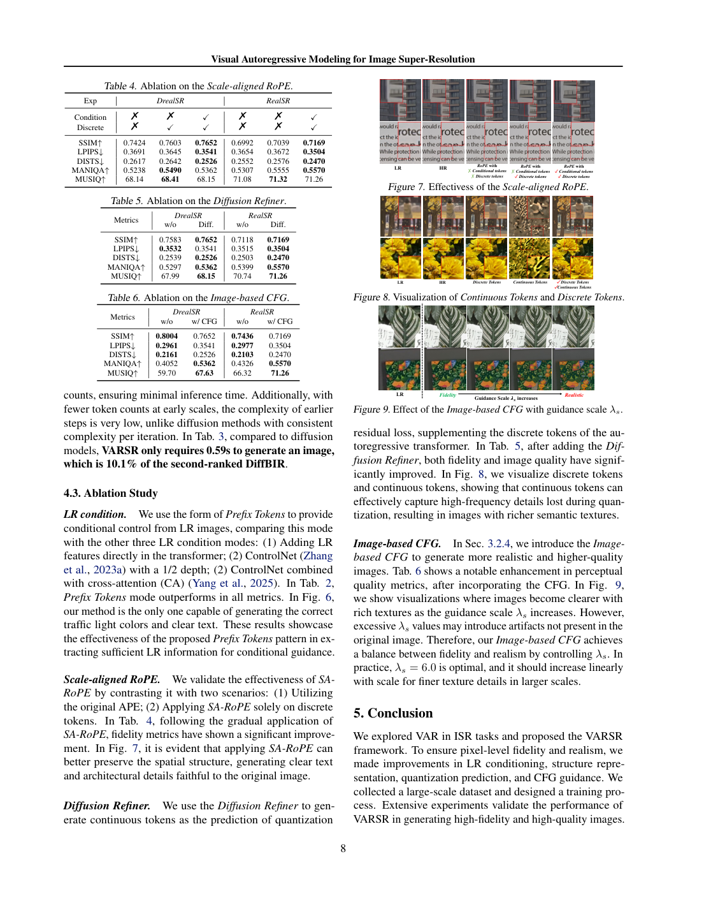
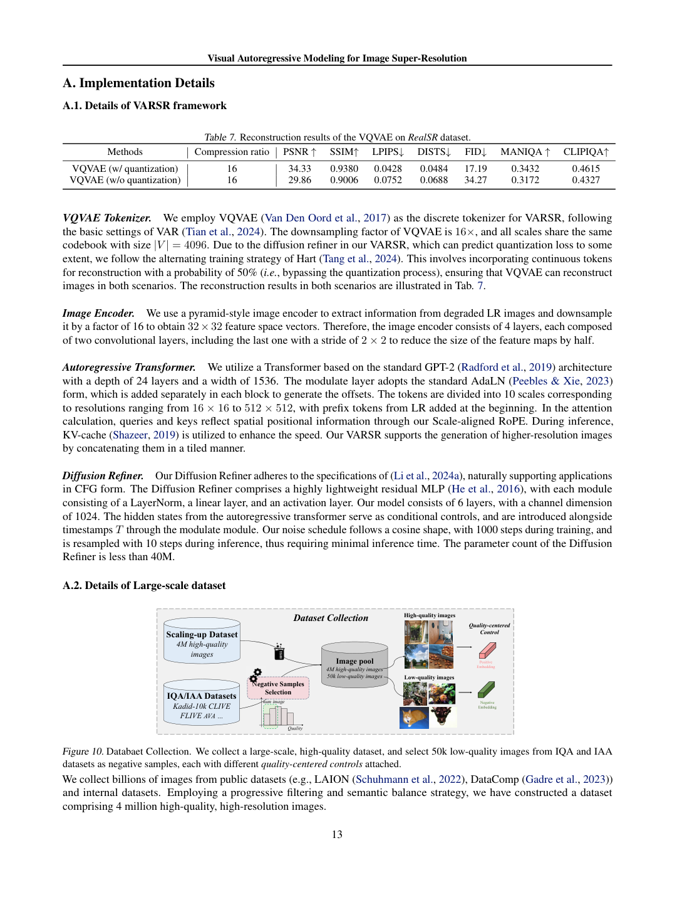
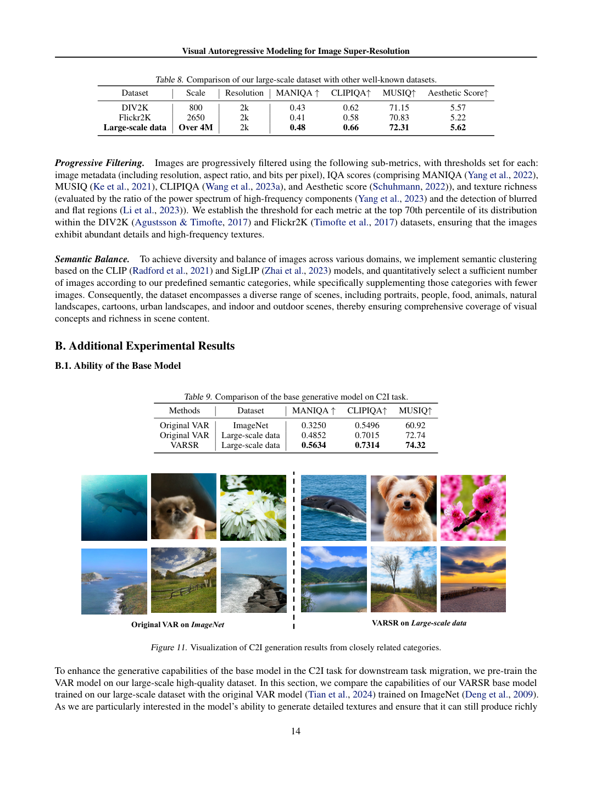
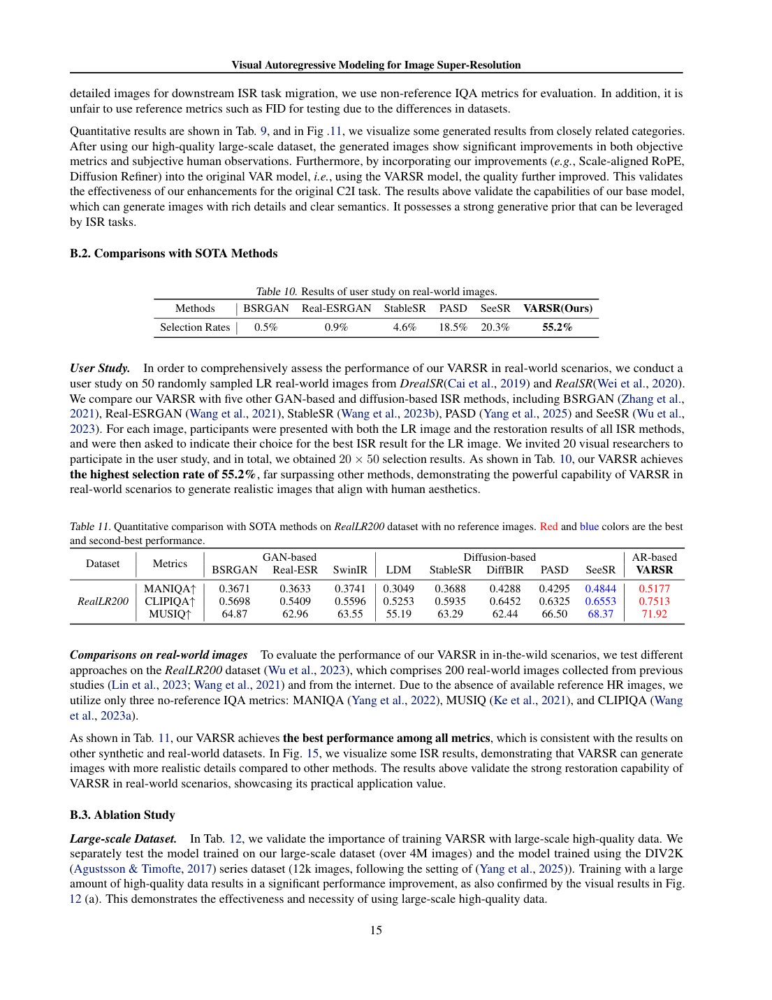
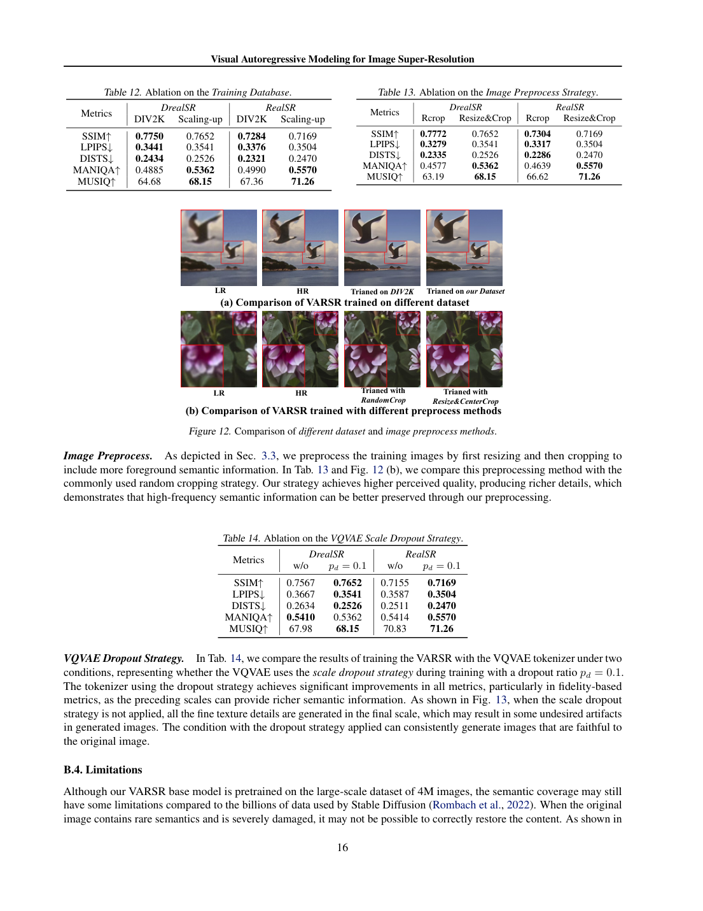
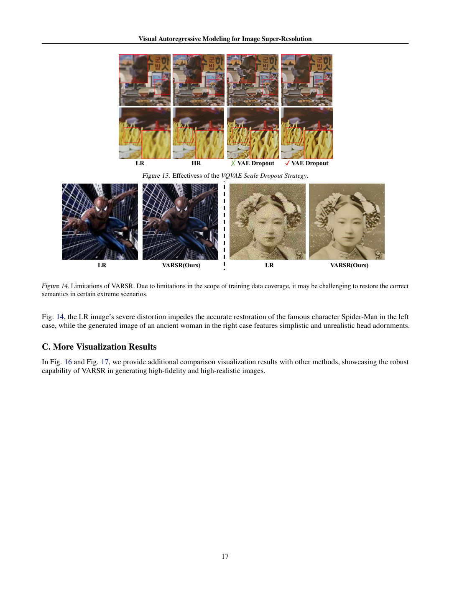

# Visual Autoregressive Modeling for Image Super-Resolution

面向图像超分辨率的视觉自回归建模

Source: [Visual Autoregressive Modeling for Image Super-Resolution](https://arxiv.org/abs/2501.18993v1), arXiv:2501.18993v1, 31 January 2025. Page references count PDF pages, including the supplement. Figures are verified source-page facsimiles; captions and adjacent evidence remain visible. Numerical claims are paper-reported, not independently reproduced.

来源：[Visual Autoregressive Modeling for Image Super-Resolution](https://arxiv.org/abs/2501.18993v1)，arXiv:2501.18993v1, 31 January 2025。页码按 PDF 物理页计，含补充材料。配图为已目视核验的原文页面，保留图注与相邻证据。数值来自论文，未独立复现实验。

## 1. 核心思想一句话总结（Elevator Pitch）

<!-- pair:1-1:en -->

VARSR generates coarse-to-fine image tokens from a low-resolution prefix, then restores continuous residual detail with a small diffusion refiner.

<!-- pair:1-1:zh -->

VARSR 以低清前缀逐尺度生成图像 token，再用小型扩散精修器补充连续残差细节。

## 2. 论文背景与动机（Background & Motivation）

<!-- pair:2-1:en -->

### Why combine discrete generation and continuous refinement?
Pixel-regression SR often averages uncertain high-frequency details; diffusion SR can produce attractive alternatives but requires many evaluations. VARSR transfers a visual autoregressive prior to restoration. Unlike raster autoregression, it predicts all tokens of the next spatial scale together. This reduces sequential stages, but quantizing image features into a finite codebook can discard detail. The paper therefore separates a discrete structural prediction from a continuous residual refinement. “Autoregressive” here means dependence between scales, not necessarily one token at a time. [§§1–2]

<!-- pair:2-1:zh -->

### 为什么结合离散生成与连续精修？
像素回归超分辨率常把不确定高频细节平均掉；扩散超分能生成好看的替代图像，却需要多次求值。VARSR 将视觉自回归先验迁移到修复。它不同于逐像素扫描式自回归，而是同时预测下一空间尺度的全部 token，减少串行阶段；但有限码本量化会丢失细节，因此论文将离散结构预测与连续残差精修分开。“自回归”在此指尺度间依赖，不一定逐 token 生成。[§§1–2]

<!-- pair:2-2:en -->

The key vocabulary: a VQ tokenizer maps continuous features to codebook indices; a transformer predicts those indices; a prefix is observed conditioning inserted before predicted tokens; classifier-free guidance combines conditional predictions to emphasize a desired quality condition. Neither more natural texture nor a higher no-reference score proves that an ambiguous face or logo has been faithfully recovered.

<!-- pair:2-2:zh -->

关键术语：VQ 分词器将连续特征映射为码本索引；Transformer 预测索引；前缀是放在待预测 token 之前的已观测条件；无分类器引导组合不同条件预测，以加强所需质量条件。纹理更自然或无参考分数更高，都不证明歧义人脸或标志被忠实恢复。

## 3. 核心方法/模型详解（The Core Method/Model）

<!-- pair:3-2:en -->

**How to read:** Compare the LR prefix path, scale mask, and aligned coordinate locations.

**Key observation:** Figures 1–2 (p. 4) connect the whole system to its attention design. Figure 1 runs from the low-resolution prefix through next-scale prediction to a residual diffusion refiner. Figure 2 shows the attention mask: a scale may consult the low-resolution condition and already generated scales, but not future scales. Its coordinate diagram aligns positions across different grid sizes. **Boundary:** These are architecture diagrams, not measured proof of fidelity.

This supports the proposed information-flow design.

<!-- pair:3-2:zh -->

**如何读：** 对比低清前缀路径、尺度掩码与对齐坐标位置。

**关键观察：** 图 1–2（第 4 页）将整个系统与注意力设计连接起来。图 1 从低清前缀经过下一尺度预测，进入残差扩散精修器。图 2 的注意力掩码让当前尺度查看低清条件和已生成尺度，但不能查看未来尺度；坐标图将不同网格大小的位置对齐。**边界：** 这是架构示意，不是保真度实测证据。

这一观察支持所提信息流设计。

<!-- pair:3-3:en -->

### 1. Predict an entire next scale
Let $r_k$ be the token map at scale $k$, and $c$ include the observed low-resolution prefix. The autoregressive factorization is

<!-- pair:3-3:zh -->

### 1. 预测整个下一尺度
令 $r_k$ 为第 $k$ 尺度的 token 图，$c$ 包含已观测的低清前缀，自回归分解为

$$
p(r_1,\ldots,r_K\mid c)=\prod_{k=1}^{K}p(r_k\mid r_{<k},c).
$$

<!-- pair:3-5:en -->

The encoder maps the low-resolution input into a prefix with the final-scale spatial size. That preserves spatial correspondence more directly than a global class token. The main transformer has 24 layers and width 1536, around 1.1B parameters; the tokenizer uses a 4096-entry codebook and 16× latent downsampling. There are ten autoregressive scales. Parallel prediction within a scale cuts sequential dependency, but does not make computation or memory free. [§3.1, Appendix A]

<!-- pair:3-5:zh -->

编码器把低清输入映射为与最终尺度同空间大小的前缀，比全局类别 token 更直接地保留空间对应。主 Transformer 为 24 层、宽度 1536，约 11 亿参数；分词器使用 4096 项码本和 16 倍潜空间下采样，共十个自回归尺度。尺度内并行减少串行依赖，但不意味着没有计算或显存成本。[§3.1、附录 A]

<!-- pair:3-6:en -->

### 2. Align position, not just token order
Scale-aligned RoPE splits channel coordinates for height and width and maps a location $(i,j)$ on an $h_k\times w_k$ grid into common coordinates $(iH/h_k,jW/w_k)$. Thus position 1 on a two-cell axis and position 2 on a four-cell axis map to the same relative location. Applying this to both predicted tokens and the LR prefix makes cross-scale attention spatially interpretable. It is a coordinate alignment, not image registration that corrects arbitrary motion. [§3.2]

<!-- pair:3-6:zh -->

### 2. 对齐位置，而非仅对齐 token 顺序
尺度对齐 RoPE 为高、宽划分通道坐标，并将 $h_k\times w_k$ 网格上的 $(i,j)$ 映射到共同坐标 $(iH/h_k,jW/w_k)$。因此，两格轴上的位置 1 与四格轴上的位置 2 对应相同相对位置。对生成 token 与低清前缀同时使用该机制，让跨尺度注意力具有空间含义。它是坐标对齐，不是能校正任意运动的图像配准。[§3.2]

<!-- pair:3-8:en -->

**How to read:** Compare the early scales, dropped scales, and residual branch separately.

**Key observation:** Figure 3 (p. 5) visualizes multi-scale quantization, scale dropout, and continuous residuals. Early token maps carry coarse semantics; later maps progressively fill structure. Randomly dropping scales during tokenizer training prevents all information from concentrating in the last scale. **Boundary:** The residual panel motivates recovering what the sum of discrete codebook features misses; it does not establish that the residual is pure sensor noise.

This supports the division of discrete structure and continuous detail.

<!-- pair:3-8:zh -->

**如何读：** 对比分别查看早期尺度、被丢弃尺度与残差分支。

**关键观察：** 图 3（第 5 页）展示多尺度量化、尺度 dropout 与连续残差。早期 token 图承载粗语义，后续逐步补充结构。分词器训练中随机丢弃尺度，防止信息全部集中于最后尺度。**边界：** 残差面板说明需要恢复离散码本特征和未覆盖的部分，但不能把残差理解为纯传感器噪声。

这一观察支持离散结构与连续细节的分工。

<!-- pair:3-9:en -->

### 3. Refine the missing continuous feature
For continuous encoded target $f$ and codebook $V$, define a residual after all quantized scales:

<!-- pair:3-9:zh -->

### 3. 精修缺失的连续特征
给定连续目标特征 $f$ 与码本 $V$，全部量化尺度之后的残差为

$$
z=f-\sum_{k=1}^{K}\operatorname{upsample}_k\!\left(V[r_k]\right),\qquad\mathcal L_{ref}=\mathbb E\|\epsilon-\epsilon_\theta(z_t\mid t,x_K)\|_2^2.
$$

<!-- pair:3-11:en -->

Here $x_K$ denotes the final-scale transformer hidden state, which conditions a six-layer, width-1024 MLP of fewer than 40M parameters. Gaussian-noised residual $z_t$ is denoised with ten steps, then added back to the discrete representation before decoding. Ten residual-denoising steps and ten autoregressive scales are different processes. A minimal example with scalar features: target feature 0.80 minus quantized feature sum 0.65 leaves residual 0.15; the refiner learns that missing feature, not an entirely new scene. [§3.3, Eqs. 6–7]

<!-- pair:3-11:zh -->

其中 $x_K$ 为最终尺度 Transformer 隐状态，用于条件化六层、宽度 1024、参数少于 4000 万的 MLP。加高斯噪声的残差 $z_t$ 经十步去噪，再加回离散表征后解码。十步残差去噪与十个自回归尺度是不同过程。最小例子（标量特征）：目标特征 0.80 减去量化特征和 0.65，残差为 0.15；精修器学习缺失特征，不是重新生成整幅场景。[§3.3、式 6–7]

<!-- pair:3-12:en -->

### 4. Guide toward quality, with an explicit trade-off
Positive and negative quality conditions $c_p,c_n$ are constructed from high- and low-quality images. The paper writes guidance schematically as

<!-- pair:3-12:zh -->

### 4. 引导质量，同时承认折中
高、低质量图像构成正负质量条件 $c_p,c_n$。论文将引导示意写为

$$
\widetilde I=F(r_c,c_p)+\lambda_s\left[F(r_c,c_p)-F(r_c,c_n)\right].
$$

<!-- pair:3-14:en -->

At $\lambda_s=0$ this is the positive prediction; larger values extrapolate away from the negative. For illustrative outputs 0.8 and 0.6, $\lambda_s=2$ gives 1.2, showing why stronger guidance can overshoot. This arithmetic is a teaching example, not a claim that the implementation mixes unclipped RGB pixels. Equation 11’s probability expression should be treated as motivation, not an exact normalized Bayesian identity for arbitrary guidance strength. The ablations directly show a fidelity/perception trade-off.

<!-- pair:3-14:zh -->

当 $\lambda_s=0$ 时就是正条件预测；更大值沿远离负条件的方向外推。假设示意输出为 0.8 与 0.6，$\lambda_s=2$ 得到 1.2，说明强引导可能过冲。这是教学算例，不是说实现直接混合未裁剪 RGB 像素。式 11 的概率表达应视为动机，而非任意引导强度下严格归一化的贝叶斯恒等式。消融直接显示保真与感知折中。

## 4. 实验与结果分析（Experiments & Results）

<!-- pair:4-1:en -->

**Evidence grade:** Strong for the reported within-paper numerical comparisons and mechanism descriptions; moderate for broader transfer claims; unsupported as a guarantee of exact recovery on arbitrary unseen inputs. No independent reproduction was performed.

<!-- pair:4-1:zh -->

**证据评级：** 文内数值比较与机制描述得到强支持；更广泛迁移主张为中等支持；任意未见输入精确恢复的保证不受支持。这里未进行独立复现。

<!-- pair:4-2:en -->

### Training and evaluation context
The pipeline constructs approximately four million high-quality images over 3,000 categories and 50,000 negative-quality images. Tokenizer training uses scale-dropout probability 0.1 and a 50% quantizer-bypass branch; subsequent class-to-image and SR training transfer that prior. Reported stages are 10k tokenizer, 40k class-to-image, and 20k SR iterations on 32 V100 GPUs, with batch 128 and AdamW. Preprocessing resizes to 1.25× then center-crops. These data and preprocessing choices are part of the method’s cost and causal story, not incidental details. [Appendix A]

<!-- pair:4-2:zh -->

### 训练与评估背景
流程构建约 400 万张、覆盖 3000 类的高质量图像及 5 万张负质量图像。分词器训练使用 0.1 尺度 dropout 概率和 50% 量化旁路；随后类别生成与超分训练迁移该先验。报告阶段为分词器 1 万次、类别生成 4 万次、超分 2 万次迭代，使用 32 张 V100、批量 128 和 AdamW。预处理先缩放到 1.25 倍再中心裁剪。这些数据与预处理选择是方法成本及因果解释的一部分，不是无关细节。[附录 A]

<!-- pair:4-4:en -->

**How to read:** Compare metric arrows before comparing the sharpness of example images.

**Key observation:** Table 1 and Figure 4 (p. 6) make the perceptual objective visible. On RealSR, VARSR has PSNR 24.61 versus BSRGAN 26.38, and LPIPS 0.3504 versus SwinIR 0.2614, both worse for VARSR. Its MANIQA 0.5570 and MUSIQ 71.26 exceed SeeSR 0.5370/69.56. Figure 4 illustrates sharp, detailed output, but the numeric comparison prevents calling this a universal fidelity advance. **Boundary:** PSNR/SSIM reward matched reference structure, LPIPS/DISTS are reference perceptual distances, and no-reference IQA measures appearance.

This supports a perception–fidelity trade-off.

<!-- pair:4-4:zh -->

**如何读：** 对比比较示例清晰度前先看指标箭头。

**关键观察：** 表 1 与图 4（第 6 页）明确体现感知目标。RealSR 上 VARSR 的 PSNR 24.61 低于 BSRGAN 的 26.38，LPIPS 0.3504 也差于 SwinIR 的 0.2614；但 MANIQA 0.5570、MUSIQ 71.26 高于 SeeSR 的 0.5370/69.56。图 4 展示清晰细致的输出，数值比较却不支持普遍保真进步。**边界：** PSNR/SSIM 奖励与参考匹配的结构，LPIPS/DISTS 是参考感知距离，无参考 IQA 则衡量外观。

这一观察支持感知与保真折中。

<!-- pair:4-6:en -->

**How to read:** Compare the full comparison, conditioning ablation, and runtime table independently.

**Key observation:** The dense p. 7 combines four distinct checks. Figure 5 compares birds, plants, and buildings against ground truth and restoration baselines; inspect shape as well as detail. Table 2 favors prefix conditioning: DRealSR SSIM 0.7652 versus direct addition 0.6902, ControlNet 0.7188, and extra cross-attention 0.7314. Figure 6 shows corresponding conditioning effects on spatial content including traffic-light/text details. Table 3 reports 0.59 seconds/image versus DiffBIR 5.85 and StableSR 18.70, about 9.9× faster than DiffBIR in that setup. **Boundary:** These timings do not include amortized pretraining cost and should not be transferred to another GPU without matching resolution, batch size, and timing scope.

This supports prefix-conditioning effectiveness and setup-specific speed.

<!-- pair:4-6:zh -->

**如何读：** 对比独立查看完整比较、条件消融与速度表。

**关键观察：** 信息密集的第 7 页包含四类检查。图 5 将鸟类、植物和建筑与真值及修复基线对比，既要看细节也要看形状。表 2 支持前缀条件：DRealSR SSIM 为 0.7652，直接相加 0.6902，ControlNet 0.7188，额外交叉注意力 0.7314。图 6 展示条件方式对空间内容的影响，包括信号灯/文字细节。表 3 报告每图 0.59 秒，而 DiffBIR 为 5.85、StableSR 为 18.70；在该设置下约比 DiffBIR 快 9.9 倍。**边界：** 这些时间未计入摊销的预训练成本，迁移到其他 GPU 时必须匹配分辨率、批量和计时范围。

这一观察支持前缀条件有效及特定设置下的速度优势。

<!-- pair:4-8:en -->

**How to read:** Compare one controlled component at a time and the direction of every metric.

**Key observation:** Tables 4–6 and Figures 7–9 (p. 8) test the three central mechanisms. Applying scale-aligned RoPE to both branches raises DRealSR SSIM from 0.7424 to 0.7652, though MANIQA is slightly higher when only discrete tokens use it. The refiner raises SSIM 0.7583→0.7652 but slightly worsens LPIPS 0.3532→0.3541. Quality CFG raises MANIQA 0.4052→0.5362 while SSIM falls 0.8004→0.7652 and LPIPS worsens 0.2961→0.3541. Figure 7 illustrates spatial structure, Figure 8 separates discrete/refined output, and Figure 9 sweeps guidance strength. They explain the trade-off rather than erasing it. **Boundary:** Table 6’s guided MUSIQ is 67.63, not the 68.15 of the main DRealSR table.

This supports different components optimizing different objectives.

<!-- pair:4-8:zh -->

**如何读：** 对比逐个查看受控组件及每项指标方向。

**关键观察：** 表 4–6 与图 7–9（第 8 页）检验三个核心机制。两分支都使用尺度对齐 RoPE，使 DRealSR SSIM 从 0.7424 提高至 0.7652，但仅离散 token 使用时 MANIQA 略高。精修器使 SSIM 从 0.7583 升至 0.7652，却使 LPIPS 从 0.3532 略差到 0.3541。质量 CFG 使 MANIQA 从 0.4052 升到 0.5362，但 SSIM 从 0.8004 降到 0.7652，LPIPS 从 0.2961 变差到 0.3541。图 7 展示空间结构，图 8 分离离散/精修输出，图 9 扫描引导强度；它们解释折中，而非消除折中。**边界：** 表 6 的引导后 MUSIQ 为 67.63，不是主表 DRealSR 的 68.15。

这一观察支持不同组件优化不同目标。

<!-- pair:4-10:en -->

**How to read:** Compare the literal quantization row labels and the quality-filtering branches.

**Key observation:** Table 7 and Figure 10 (p. 13) clarify tokenizer and data dependencies. The reconstruction table labels PSNR 34.33 “with quantization” and 29.86 “without quantization”; that reported direction should not be silently reversed to fit a simplistic quantization-loss story. Figure 10 shows the curated high/low-quality branches, making quality-conditioned training dependent on dataset selection and quality scorers. **Boundary:** Their biases can propagate into guidance.

This supports the dependence on tokenizer and data preparation.

<!-- pair:4-10:zh -->

**如何读：** 对比量化行的原始标签与质量筛选分支。

**关键观察：** 表 7 与图 10（第 13 页）澄清分词器及数据依赖。重建表将 PSNR 34.33 标为“有量化”，29.86 标为“无量化”；不能为了迎合简单的量化损失故事擅自颠倒标签。**边界：** 图 10 展示高/低质量筛选分支，说明质量条件训练依赖数据选择与质量评分器，其偏差可能传入引导。

这一观察支持对分词器与数据准备的依赖。

<!-- pair:4-12:en -->

**How to read:** Compare dataset statistics separately from class-to-image pretraining results.

**Key observation:** Tables 8–9 and Figure 11 (p. 14) support the scale of data preparation and class-conditioned pretraining. Table 8 lists the assembled dataset sources; Table 9 evaluates class-to-image generation before SR transfer; Figure 11 gives visual examples of that prior. **Boundary:** This is enabling evidence for a stronger generative model, not an isolated test that autoregressive architecture alone caused the SR improvement.

This supports a strong pretrained prior as an enabling factor.

<!-- pair:4-12:zh -->

**如何读：** 对比将数据统计与类别生成预训练结果分开阅读。

**关键观察：** 表 8–9 与图 11（第 14 页）支持数据准备规模与类别条件预训练。表 8 列出汇集的数据来源；表 9 评估超分迁移之前的类别生成；图 11 展示该先验的生成示例。**边界：** 这些说明生成模型基础更强，但不能单独证明超分进步全部来自自回归架构。

这一观察支持强预训练先验是支持因素。

<!-- pair:4-14:en -->

**How to read:** Compare the human-study population and the reference-free test setting.

**Key observation:** Tables 10–11 (p. 15) add preference and real-LR evidence. Twenty visual researchers make 1,000 choices over 50 images, with VARSR selected 55.2% versus SeeSR 20.3%. This is a narrow participant population. On RealLR200, MANIQA/CLIPIQA/MUSIQ are 0.5177/0.7513/71.92 versus SeeSR 0.4844/0.6553/68.37. **Boundary:** With no paired reference, those figures establish quality-score preference, not exact reconstruction accuracy.

This supports preference and quality-score advantages.

<!-- pair:4-14:zh -->

**如何读：** 对比人工实验参与者群体及无参考测试设置。

**关键观察：** 表 10–11（第 15 页）补充人工偏好与真实低清证据。20 位视觉研究者在 50 张图上作出 1000 次选择，VARSR 获选 55.2%，SeeSR 为 20.3%；参与者群体较窄。RealLR200 上 MANIQA/CLIPIQA/MUSIQ 为 0.5177/0.7513/71.92，SeeSR 为 0.4844/0.6553/68.37。**边界：** 没有配对参考时，这些数值支持质量分数偏好，不代表精确重建准确率。

这一观察支持偏好与质量分数优势。

<!-- pair:4-16:en -->

**How to read:** Compare the data, crop, and dropout controls without merging their effects.

**Key observation:** Tables 12–14 and Figure 12 (p. 16) separate data, crop, and dropout effects. Larger data improves perceptual scores but DRealSR SSIM falls 0.7750→0.7652 and LPIPS worsens 0.3441→0.3541. The center-crop recipe similarly trades SSIM 0.7772→0.7652 for MUSIQ 63.19→68.15; Figure 12 illustrates the altered visual outcome. Scale dropout improves SSIM 0.7567→0.7652 and LPIPS 0.3667→0.3541, yet MANIQA falls slightly 0.5410→0.5362. **Boundary:** “All components improve all metrics” would contradict these controls.

This supports distinct contributions and trade-offs from each training choice.

<!-- pair:4-16:zh -->

**如何读：** 对比分别查看数据、裁剪与 dropout 控制，不混淆效应。

**关键观察：** 表 12–14 与图 12（第 16 页）分离数据、裁剪及 dropout 效应。更大数据提高感知分数，但 DRealSR SSIM 从 0.7750 降至 0.7652，LPIPS 从 0.3441 变差至 0.3541。中心裁剪方案也以 SSIM 0.7772→0.7652 换取 MUSIQ 63.19→68.15；图 12 展示对应视觉变化。尺度 dropout 改善 SSIM 0.7567→0.7652、LPIPS 0.3667→0.3541，但 MANIQA 略降 0.5410→0.5362。**边界：** “所有组件改善所有指标”与这些控制实验矛盾。

这一观察支持各训练选择的不同贡献与折中。

<!-- pair:4-18:en -->

**How to read:** Compare the identity and hairstyle failures, not just texture sharpness.

**Key observation:** Figures 13–14 (p. 17) finish with both a positive ablation and explicit failures. Figure 13 visualizes scale-dropout effects. Figure 14 shows an altered Spider-Man identity and simplified historical hairstyle: the model resolves ambiguous inputs toward familiar or simpler patterns. These are substantive failure cases for semantic fidelity, not minor cosmetic imperfections, and limit applications where identity or historical detail matters.

This supports a concrete semantic-fidelity limitation.

<!-- pair:4-18:zh -->

**如何读：** 对比身份与发型失败，而非仅看纹理清晰度。

**关键观察：** 图 13–14（第 17 页）以正面消融和明确失败结束。图 13 展示尺度 dropout 效果；图 14 出现被改变的蜘蛛侠身份和被简化的历史发型，说明模型把歧义输入推向熟悉或更简单的模式。这是语义保真上的实质性失败，不是轻微美观缺陷，会限制身份或历史细节重要的应用。

这一观察支持具体的语义保真局限。

## 5. 论文的贡献与影响（Contribution & Impact）

<!-- pair:5-1:en -->

### Future directions and contribution
VARSR contributes a practical bridge from next-scale autoregression to restoration: an LR prefix, cross-scale position alignment, continuous residual recovery, and quality-conditioned guidance. The evidence supports speed and perceptual quality, while many paired fidelity metrics decline. Architecture, large curated data, and guidance all contribute, so claims about a single cause need matched controls. Useful follow-ups include equal-data/equal-compute baselines, uncertainty-aware outputs for identities and text, and separating refiner gains from guidance gains at a fixed fidelity target.

<!-- pair:5-1:zh -->

### 贡献与后续方向
VARSR 提供了将下一尺度自回归迁移到修复的实用桥梁：低清前缀、跨尺度位置对齐、连续残差恢复与质量条件引导。证据支持速度和感知质量，但多个配对保真指标下降。架构、大规模精选数据与引导都起作用，单一因果归因需要匹配控制。值得继续做等数据/等算力基线、身份与文字的不确定性感知输出，以及在固定保真目标下分离精修器与引导收益。

## 6. 结论（Conclusion）

<!-- pair:6-1:en -->

**Final judgment:** VARSR is an efficient generative SR design, not evidence that discrete tokens solve faithful reconstruction. Its best lesson is architectural: use coarse discrete predictions for structure and a small continuous model for what quantization misses. Its main caution is empirical: sharper, preferred images can score worse against the true reference and can change semantic identity.

<!-- pair:6-1:zh -->

**最终判断：** VARSR 是高效的生成式超分设计，不证明离散 token 已解决忠实重建。最值得借鉴的是架构分工：粗离散预测承载结构，小型连续模型补充量化遗漏。最重要的经验警示是：更清晰、更受偏爱的图像，可能与真值距离更大，并改变语义身份。
