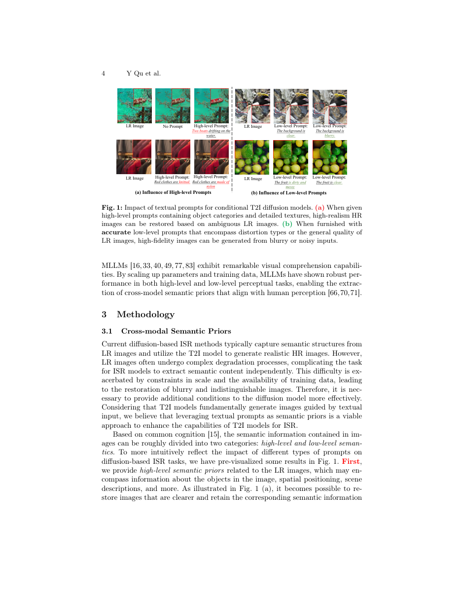
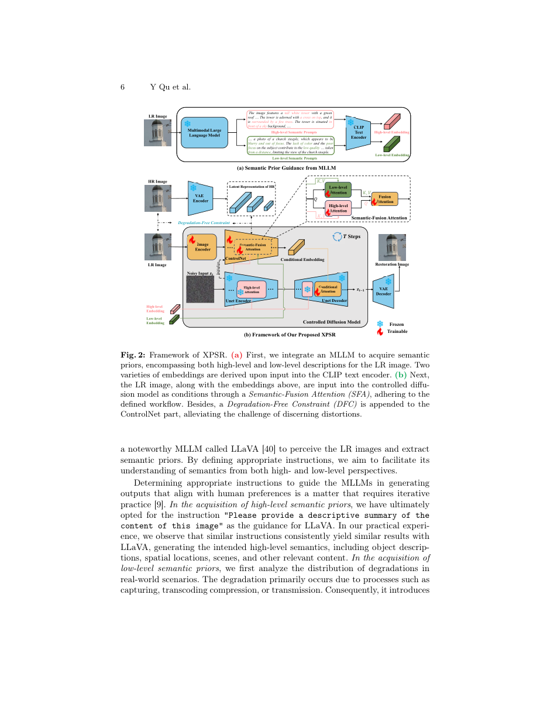
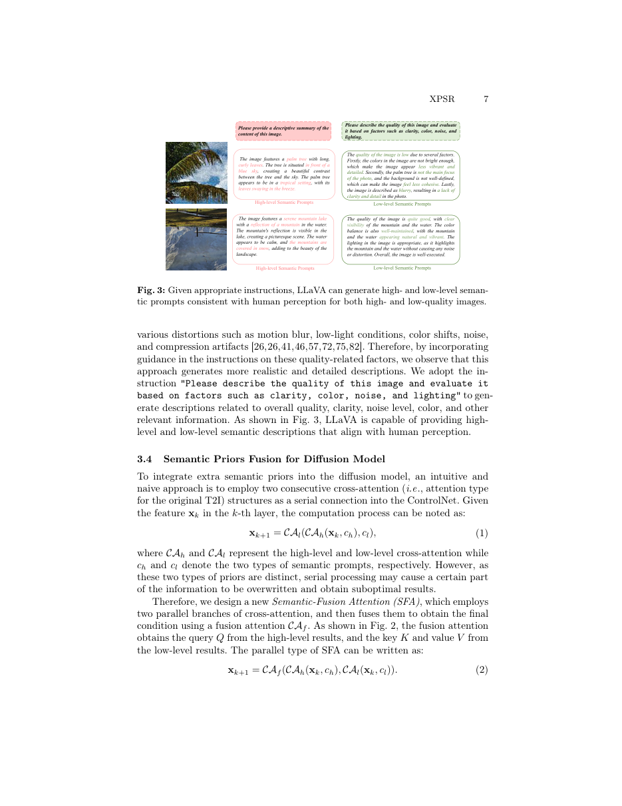
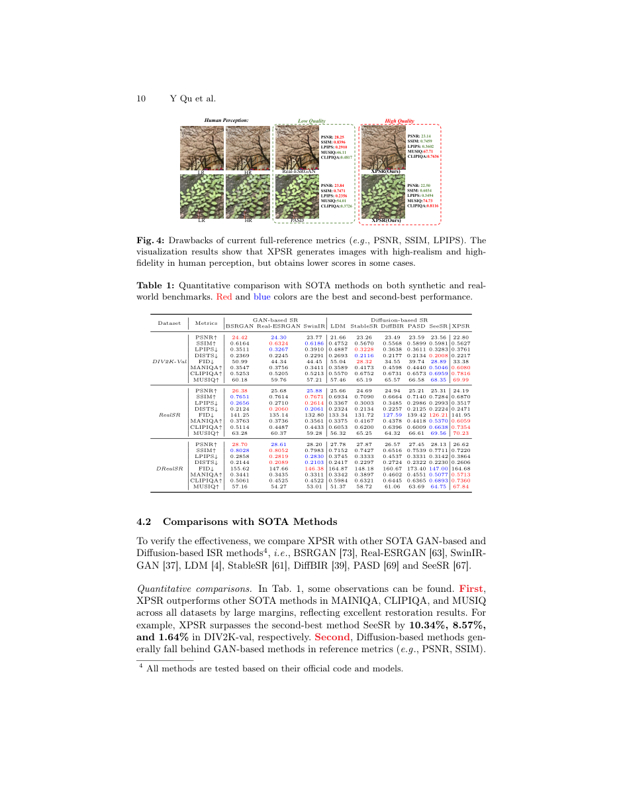
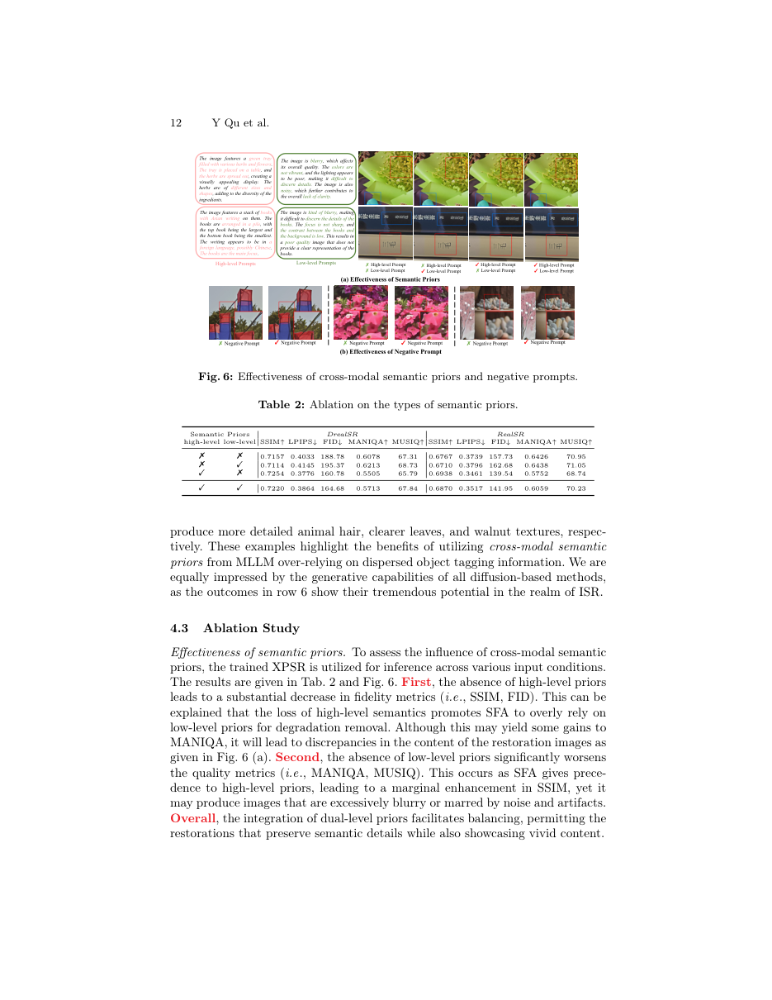
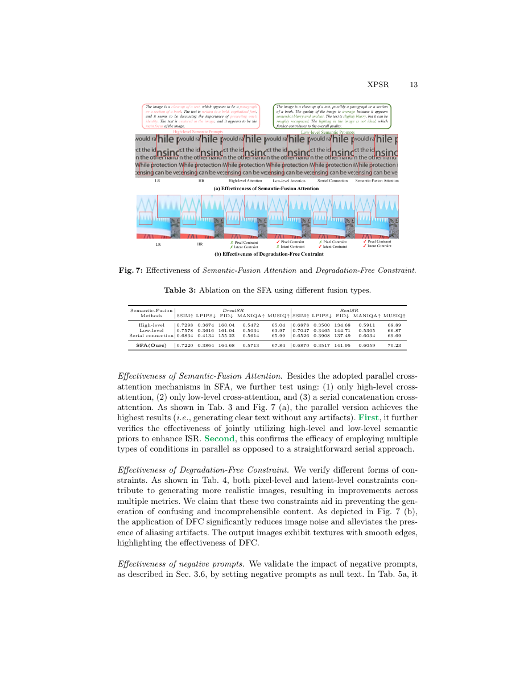
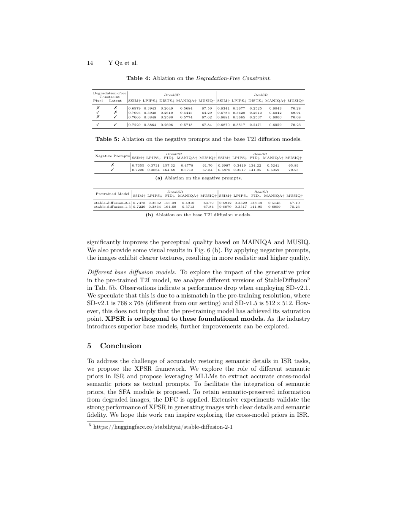

# XPSR: separating what is present from what is damaged

XPSR：把画面内容与图像损坏分开理解

Primary source: ECCV 2024 proceedings PDF, 19 pages. Read the complete PDF, including the supplied appendices. Page numbers are 1-based PDF pages. Figures were inspected against page renders; full-page images deliberately retain labels, legends and neighboring context. This is an analytical reading, not an independent reproduction.

一手来源：ECCV 2024 proceedings PDF, 19 pages。已阅读完整 PDF 及文件内附录；页码均为从 1 起算的 PDF 页码。图表已对照页面渲染核查；完整页面截图保留标签、图例及邻近上下文。本报告是分析性阅读，并非独立复现实验。

## 1. 核心思想一句话总结（Elevator Pitch）

<!-- pair:1-1:en -->

XPSR combines content and degradation descriptions with clean-feature supervision, improving perceptual super-resolution while exposing a measurable fidelity trade-off.

<!-- pair:1-1:zh -->

XPSR融合内容与退化描述并监督干净特征，提高超分观感，也显露保真代价。

## 2. 论文背景与动机（Background & Motivation）

<!-- pair:2-1:en -->

### Key concepts and the problem

A badly blurred photograph can correspond to many sharp originals. Super-resolution must therefore combine observed pixels with a prior: learned expectations about plausible images. A diffusion model supplies such a prior by repeatedly predicting and removing noise. A latent diffusion model performs this process in a compressed feature representation, decoded to pixels by a variational autoencoder (VAE). Plausibility alone is insufficient: a convincing leaf or letter can still be the wrong one. XPSR asks whether language can describe both the scene and its damage, while the image branch learns not to preserve that damage. [§§1,3.1–3.2]

<!-- pair:2-1:zh -->

### 必要概念与问题

严重模糊的照片可能对应许多清晰原图。因此超分辨率必须结合观测像素与先验，即对合理图像的学习式预期。扩散模型通过反复预测、去除噪声提供这类先验；潜空间扩散在压缩特征表示中执行这一过程，再用变分自编码器（VAE）解码成像素。仅有合理外观还不够：可信的叶片或字母也可能是错的。XPSR探索能否用语言同时描述场景和损坏，并让图像分支学会不保留损坏。［§§1,3.1–3.2］

<!-- pair:2-2:en -->

A multimodal large language model refers to a model that reads images and generates text. Here LLaVA supplies high-level descriptions of objects, scene and position, and low-level descriptions of clarity, color, noise and lighting. CLIP’s text encoder maps these sentences to numerical embeddings for attention. “Low-level” is still language about image quality, not a measured blur kernel. Earlier conditioning methods use tags, captions or image features; XPSR adds two semantic streams, a dedicated fusion rule, and supervision against clean image/latent features. These three changes must be evaluated separately.

<!-- pair:2-2:zh -->

多模态大语言模型读取图像并生成文字。这里LLaVA提供物体、场景、位置的高层描述，以及清晰度、颜色、噪声、照明的低层描述；CLIP文本编码器把句子转换为供注意力使用的数值嵌入。“低层”仍是关于质量的语言，不是实测模糊核。此前条件方法使用标签、描述或图像特征；XPSR加入两个语义流、专门融合规则以及与干净图像／潜特征对齐的监督。这三项变化需要分别评估。

<!-- pair:2-3:en -->

### Figure 1: evidence to inspect

**How to read.** Compare changes caused by high-level object/texture descriptions with those caused by quality descriptions. [PDF p.4]

<!-- pair:2-3:zh -->

### Figure 1：如何检查这项证据

**如何读。** 比较高层物体／纹理描述与质量描述分别引起的变化。［PDF p.4］

<!-- pair:2-5:en -->

**Key observation.** The selected examples show that prompts can change both semantic content and artifact appearance.

**Why this supports the claim, and its limitations.** They motivate separating the two instructions, but also demonstrate a risk: language steers output, so an incorrect description can steer it away from the original. These examples do not establish caption accuracy over the test distribution.

<!-- pair:2-5:zh -->

**关键观察。** 选定例子显示提示词能同时改变语义内容和伪影外观，支持把两类指令分开；也暴露风险：语言能引导输出，错误描述同样能使输出偏离原图。

**推理桥与局限。** 这些示例不能建立整个测试分布上的描述准确率。

## 3. 核心方法/模型详解（The Core Method/Model）

<!-- pair:3-1:en -->

### Figure 2: evidence to inspect

**How to read.** Follow the LR image into LLaVA and ControlNet, then distinguish frozen Stable Diffusion modules from trained control and attention modules. [PDF p.6]

<!-- pair:3-1:zh -->

### Figure 2：如何检查这项证据

**如何读。** 跟踪低分辨率图像进入LLaVA与ControlNet的路径，再区分冻结的Stable Diffusion模块与训练的控制、注意力模块。［PDF p.6］

<!-- pair:3-3:en -->

**Key observation.** The two text streams enter parallel branches in Semantic-Fusion Attention (SFA).

**Why this supports the claim, and its limitations.** The fused image-conditioned representation controls denoising through added Conditional Attention. High-level semantics also condition the U-Net, while low-level semantics are used in ControlNet rather than directly in the noisy U-Net branch. Clean image and clean latent targets supervise intermediate ControlNet representations only during training. There is no clean reference available at inference.

<!-- pair:3-3:zh -->

**关键观察。** 两路文字进入语义融合注意力（SFA）的并行分支；融合后的图像条件表示通过新增条件注意力控制去噪。

**推理桥与局限。** 高层语义也条件化U-Net，低层语义则用于ControlNet，而不是直接进入处理噪声的U-Net分支。干净图像与干净潜表示只在训练时监督ControlNet中间特征；推理时没有干净参考图。

<!-- pair:3-4:en -->

### Figure 3: evidence to inspect

**How to read.** Read the actual instructions and the two kinds of answers; notice that a quality description can mix physical degradation with aesthetic judgments. [PDF p.7]

<!-- pair:3-4:zh -->

### Figure 3：如何检查这项证据

**如何读。** 阅读真实指令与两种回答，并注意质量描述可能混合物理退化和审美判断。［PDF p.7］

<!-- pair:3-6:en -->

**Key observation.** The high-level instruction requests a descriptive summary; the low-level one explicitly asks about clarity, color, noise and lighting.

**Why this supports the claim, and its limitations.** The palm example additionally discusses composition and focus of attention. Thus these prompts are rich but noisy semantic observations, not guaranteed ground truth about the camera or codec. A robust method must tolerate this mismatch rather than treat the sentences as exact measurements.

<!-- pair:3-6:zh -->

**关键观察。** 高层指令要求内容摘要，低层指令明确询问清晰度、色彩、噪声和照明。

**推理桥与局限。** 棕榈树示例还讨论构图与注意焦点。因此这些提示是丰富却带噪的语义观察，不是相机或编码器的保证真值。稳健方法应容忍这种不匹配，而不是把句子当作精确测量。

<!-- pair:3-7:en -->

### Worked example

A minimal full-path example: a blurred leaf image yields “green leaves on a branch” and “soft edges, weak contrast.” After text encoding, the same image feature x queries each semantic stream separately. The high-level result emphasizes what should be retained; the quality-related result signals what may be damage. A third attention joins these results, ControlNet delivers the resulting condition to the frozen denoiser, and iterative denoising plus VAE decoding produces the enlarged image. During training, projected intermediate features must match clean multi-scale targets. If the description wrongly says “flowers,” there is no formal guarantee that the image branch will overrule it. This example explains roles rather than asserting exact neural activations. [§§3.3–3.6]

<!-- pair:3-7:zh -->

### 最小例子

最小完整例：模糊叶片得到“枝条上的绿叶”和“边缘柔软、对比度弱”两段描述。文本编码后，同一图像特征x分别查询两个语义流；高层结果强调应保留什么，质量结果提示什么可能是损坏。第三个注意力融合两者，ControlNet把条件送入冻结去噪器，迭代去噪与VAE解码输出放大图像。训练时，投影后的中间特征必须匹配干净多尺度目标。若描述错成“花朵”，没有形式保证图像分支必能否决它。这个例子解释模块角色，而非宣称真实神经激活值。［§§3.3–3.6］

$$
x_{k+1}=\mathcal{CA}_f\big(\mathcal{CA}_h(x_k,c_h),\mathcal{CA}_l(x_k,c_l)\big).
$$

<!-- pair:3-9:en -->

Equation (2), PDF p.7: xk is the kth-layer feature, ch/cl are high/low-level text embeddings, and CA denotes cross-attention, which obtains queries from one representation and keys/values from another. Fusion CAf uses high-level results as queries and low-level results as keys/values. Unlike serial CA_l(CA_h(x,ch),cl), neither initial branch consumes the already modified output of the other. The authors argue this avoids overwriting; the empirical ablation tests that argument, but parallelism alone does not mathematically guarantee preservation of all information.

<!-- pair:3-9:zh -->

式(2)，PDF p.7：xk是第k层特征，ch／cl为高低层文本嵌入，CA为交叉注意力，从一个表示获取查询、另一个获取键和值。融合CAf以高层结果为查询、低层结果为键和值。与串行CA_l(CA_h(x,ch),cl)不同，两个初始分支都不读取另一支已经修改过的输出。作者认为这能避免覆盖，消融对此作经验检验，但并行本身不从数学上保证所有信息都被保留。

$$
\mathcal L_{\rm DFC}=\sum_{i=1}^{3}\lVert x_{{\rm hr},i}-\hat x_i\rVert_1+\sum_{j=1}^{3}\lVert z_{{\rm hr},j}-\hat z_j\rVert_1,\qquad\mathcal L=\mathcal L_D+\lambda\mathcal L_{\rm DFC}.
$$

<!-- pair:3-11:en -->

Equations (3) and (5), PDF pp.8–9: each x̂i is a three-channel image predicted from an encoder scale, compared with the downsampled clean image xhr,i; each ẑj is a projected latent feature compared with clean latent zhr,j at that scale. L1 adds absolute differences; LD is squared noise-prediction error, with noise sampled from a standard Gaussian (Eq.4). The weight λ=0.05 controls this additional training pressure. For six illustrative scalar residuals 1,0,2,0,1,0, DFC totals 4 and contributes 0.2 to the objective. Real tensors require the implementation’s reduction convention, so this is not an expected training-loss magnitude. These auxiliary heads encourage clean conditioning, not a hard constraint guaranteeing artifact-free output.

<!-- pair:3-11:zh -->

式(3)、(5)，PDF pp.8–9：每个x̂i是从一层编码特征预测的三通道图，与同尺度下采样干净图xhr,i比较；每个ẑj是投影潜特征，与同尺度干净潜表示zhr,j比较。L1累加绝对差，LD是标准高斯噪声的平方预测误差（式4）。λ=0.05控制额外训练压力。若六个示意标量残差为1、0、2、0、1、0，DFC总和4，对目标贡献0.2。真实张量需要核对实现中的归约约定，不能把它当作预期训练损失量级。这些辅助头鼓励干净条件，并非保证输出无伪影的硬约束。

$$
\widetilde\epsilon=\hat\epsilon+\lambda_s(\hat\epsilon-\hat\epsilon_{\rm neg}).
$$

<!-- pair:3-13:en -->

Equation (6), PDF p.9: classifier-free guidance combines two noise predictions; only the high-level prompt is replaced by negative words such as “blurry” and “noise,” while image and low-level conditions remain. λs=5.5. For one illustrative component with predictions 0.2 and 0.3, the guided value is −0.35. Guidance extrapolates away from a negative condition, so stronger guidance is not automatically more faithful. Training freezes Stable Diffusion and updates ControlNet plus added Conditional Attention; testing uses 20 DDPM steps.

<!-- pair:3-13:zh -->

式(6)，PDF p.9：无分类器引导组合两次噪声预测；只有高层提示被“模糊”“噪声”等负面词替换，图像和低层条件保留，λs=5.5。若某个示意分量两次预测为0.2与0.3，引导后为−0.35。引导是在远离负条件的方向外推，更强引导不自动意味着更保真。训练冻结Stable Diffusion，仅更新ControlNet与新增条件注意力；测试用20步DDPM采样。

## 4. 实验与结果分析（Experiments & Results）

<!-- pair:4-1:en -->

Training combines DIV2K, DIV8K, Flickr2K, Unsplash2K, OST and 5,000 FFHQ face images with synthetic Real-ESRGAN degradations. The 100k-step run uses eight A800 GPUs and SD1.5. Testing uses synthetic DIV2K patches and cropped real DRealSR/RealSR pairs, with 128×128 LR and 512×512 HR. These pretrained systems differ in data, architecture and conditioning costs, so the table is an end-to-end comparison, not a matched-compute causal experiment. [§4.1]

<!-- pair:4-1:zh -->

训练结合DIV2K、DIV8K、Flickr2K、Unsplash2K、OST、5,000张FFHQ人脸，以及Real-ESRGAN合成退化；以SD1.5为基础，在八张A800上训练100k步。测试使用合成DIV2K图块和裁剪后的真实DRealSR／RealSR配对图，低分辨率128×128、高分辨率512×512。不同预训练系统的数据、架构、条件获取成本不同，因此主表是端到端比较，不是同算力因果实验。［§4.1］

<!-- pair:4-2:en -->

Metrics answer different questions. PSNR/SSIM compare reference pixels and structure, higher better. LPIPS and DISTS compare learned perceptual features, lower better. FID measures distance between generated and reference feature distributions, lower better, but not correctness of an individual scene. MANIQA, MUSIQ and CLIPIQA estimate image quality without a reference, higher better. A favorable no-reference score can reward plausible invented texture. None alone establishes whether a restored letter, face or object is true.

<!-- pair:4-2:zh -->

指标回答不同问题：PSNR／SSIM比较参考像素与结构，越高越好；LPIPS和DISTS比较学习式感知特征，越低越好；FID测生成与参考特征分布距离，越低越好，但不判定单个场景正确性；MANIQA、MUSIQ、CLIPIQA无须参考图估计质量，越高越好。良好的无参考分数也可能奖励合理却虚构的纹理。单个指标都不能证明恢复的字母、人脸或物体真实。

<!-- pair:4-3:en -->

### Table 1: evidence to inspect

**How to read.** Read reference-based and no-reference metrics separately, preserving the direction arrows. Use the actual SeeSR and XPSR values before interpreting percentages. [PDF p.10]

<!-- pair:4-3:zh -->

### Table 1：如何检查这项证据

**如何读。** 把有参考和无参考指标分开，保留升降方向；解释百分比前先读取SeeSR与XPSR原值。［PDF p.10］

<!-- pair:4-5:en -->

**Key observation.** On DIV2K, MANIQA is 0.5046→0.6080, CLIPIQA 0.6959→0.7816, MUSIQ 68.35→69.99.

**Why this supports the claim, and its limitations.** Differences are +0.1034, +0.0857 and +1.64 score units; relative changes are approximately 20.49%, 12.32% and 2.40%. The paper’s “10.34%, 8.57%, 1.64%” wording is therefore not standard relative-change arithmetic. Meanwhile PSNR falls 23.56→22.80, LPIPS worsens 0.3283→0.3761 and FID 28.89→33.38. The supported conclusion is improved no-reference perceptual quality with a measurable reference-fidelity trade-off, not simultaneous superiority in all senses.

<!-- pair:4-5:zh -->

**关键观察。** DIV2K上MANIQA为0.5046→0.6080，CLIPIQA为0.6959→0.7816，MUSIQ为68.35→69.99。

**推理桥与局限。** 差值是+0.1034、+0.0857、+1.64个分数单位，相对变化约20.49%、12.32%、2.40%。因此论文“10.34%、8.57%、1.64%”不是通常的相对增幅算法。同时PSNR从23.56降至22.80，LPIPS从0.3283恶化至0.3761，FID从28.89恶化至33.38。证据支持无参考感知质量提高并伴随可测保真权衡，而非所有意义上的同时领先。

<!-- pair:4-6:en -->

### Figure 4: evidence to inspect

**How to read.** Compare the reference crop and each restoration, then read both fidelity and quality scores beside it. [PDF p.10]

<!-- pair:4-6:zh -->

### Figure 4：如何检查这项证据

**如何读。** 先比较参考裁图与恢复图，再读旁边的保真和质量分数。［PDF p.10］

<!-- pair:4-8:en -->

**Key observation.** The examples show that sharper-looking texture can receive worse reference scores.

**Why this supports the claim, and its limitations.** They illustrate metric disagreement, not proof that reference metrics are universally invalid. The panel’s “human perception” labels are author judgments; this proceedings PDF does not report the previously quoted 64.3% six-method user preference study. That statistic is not carried into this source-grounded note.

<!-- pair:4-8:zh -->

**关键观察。** 这些例子展示更锐利纹理也可能获得更差参考分数，说明指标分歧，并不证明参考指标普遍无效。

**推理桥与局限。** 面板中的“人类感知”标签是作者判断；本会议PDF没有报告此前引用的六方法用户偏好64.3%研究，因此本篇基于来源的笔记不保留该统计。

<!-- pair:4-9:en -->

### Table 2: evidence to inspect

**How to read.** Compare no priors, low only, high only and both; this ablation changes inference conditions of the trained model. [PDF p.12]

<!-- pair:4-9:zh -->

### Table 2：如何检查这项证据

**如何读。** 比较无先验、仅低层、仅高层、两者都有；这项消融改变训练后模型的推理条件。［PDF p.12］

<!-- pair:4-11:en -->

**Key observation.** On DRealSR, high-only SSIM is 0.7254 versus 0.7220 with both, while MANIQA rises 0.5505→0.5713 when low-level priors are added.

**Why this supports the claim, and its limitations.** Low-only MANIQA is even higher, 0.6213, but FID worsens to 195.37 versus 164.68 with both. Thus the dual stream balances content and quality; it does not maximize every metric. Because this removes conditions after training, some loss may reflect a train/test condition mismatch.

<!-- pair:4-11:zh -->

**关键观察。** DRealSR上仅高层SSIM为0.7254，两者都有为0.7220；加入低层先验后MANIQA从0.5505升至0.5713。

**推理桥与局限。** 仅低层MANIQA甚至更高，为0.6213，但FID恶化到195.37，两者都有为164.68。因此双流是在内容与质量之间平衡，不是最大化所有指标。由于是在训练后删除条件，部分损失也可能来自训练／测试条件不匹配。

<!-- pair:4-12:en -->

### Figure 6: evidence to inspect

**How to read.** Inspect the semantic-prior variants separately from the negative-prompt variants. [PDF p.12]

<!-- pair:4-12:zh -->

### Figure 6：如何检查这项证据

**如何读。** 把语义先验变体与负面提示变体分开检查。［PDF p.12］

<!-- pair:4-14:en -->

**Key observation.** The semantic examples show content changes when a stream is absent; the negative-prompt examples show changes in clarity and texture.

**Why this supports the claim, and its limitations.** These make the trade-off tangible but remain selected outputs. They cannot distinguish correct recovered details from visually plausible inventions without reference-based inspection and broader evaluation.

<!-- pair:4-14:zh -->

**关键观察。** 语义示例显示缺少某一流时内容会改变，负面提示示例显示清晰度和纹理变化。

**推理桥与局限。** 这使权衡直观，但仍是选定输出；没有参考核查和更广泛评估，就无法区分正确恢复细节与外观合理的虚构。

<!-- pair:4-15:en -->

### Table 3: evidence to inspect

**How to read.** Compare high-only, low-only, serial fusion and SFA under the same benchmark columns. [PDF p.13]

<!-- pair:4-15:zh -->

### Table 3：如何检查这项证据

**如何读。** 在相同基准列内比较仅高层、仅低层、串行融合与SFA。［PDF p.13］

<!-- pair:4-17:en -->

**Key observation.** SFA generally improves the quality-oriented balance relative to serial fusion, but high-only attention can retain stronger reference measures.

**Why this supports the claim, and its limitations.** This supports the architectural choice as a trade-off, not an information-preservation theorem. The qualitative text example in Figure 7 is useful because recognizable glyphs make semantic mistakes especially consequential.

<!-- pair:4-17:zh -->

**关键观察。** SFA相对串行融合通常改善偏质量的平衡，但仅高层注意力可能保留更强参考指标。

**推理桥与局限。** 这支持其作为权衡选择，而不是信息保留定理。图7的文字示例尤其有意义，因为可辨识字形使语义错误的后果更突出。

<!-- pair:4-18:en -->

### Figure 7: evidence to inspect

**How to read.** Read panel (a) for fusion design and panel (b) for pixel/latent constraints; compare with HR rather than merely choosing the sharpest crop. [PDF p.13]

<!-- pair:4-18:zh -->

### Figure 7：如何检查这项证据

**如何读。** (a)检查融合设计，(b)检查像素／潜空间约束；应与HR比较，而不只是挑最锐利裁图。［PDF p.13］

<!-- pair:4-20:en -->

**Key observation.** The text and repeated-edge examples display different failure modes: letter-like artifacts and residual aliasing.

**Why this supports the claim, and its limitations.** Using both constraints reduces visible noise in the selected edge example. This links feature supervision to output behavior, but neither a crisp text crop nor a clean edge guarantees exact transcription or geometry across inputs.

<!-- pair:4-20:zh -->

**关键观察。** 文字与重复边缘示例显示不同失效：似字母伪影和残留混叠。

**推理桥与局限。** 在选定边缘示例中，双约束减少可见噪声。这把特征监督与输出行为联系起来，但清楚文字或干净边缘都不保证所有输入的精确转写与几何。

<!-- pair:4-21:en -->

### Table 4: evidence to inspect

**How to read.** Compare the four combinations of pixel and latent supervision. [PDF p.14]

<!-- pair:4-21:zh -->

### Table 4：如何检查这项证据

**如何读。** 比较像素监督与潜空间监督的四种组合。［PDF p.14］

<!-- pair:4-23:en -->

**Key observation.** The combined constraint is the intended balance, while individual metrics vary across rows.

**Why this supports the claim, and its limitations.** Its mechanistic evidence is more direct than a comparison against another entire SR system because the supervision is the intervention. It remains an empirical regularizer; the name “Degradation-Free” should not be read as a formal guarantee of zero degradation.

<!-- pair:4-23:zh -->

**关键观察。** 双约束是作者希望获得的平衡，各单项指标仍随行变化。

**推理桥与局限。** 因为干预对象就是监督方式，这比跨完整SR系统比较更直接支持机制，但它仍是经验正则项；“Degradation-Free”这一名称不能解读为零退化的形式保证。

<!-- pair:4-24:en -->

### Table 5: evidence to inspect

**How to read.** Read negative guidance and the SD1.5/SD2.1 comparison as separate experiments. [PDF p.14]

<!-- pair:4-24:zh -->

### Table 5：如何检查这项证据

**如何读。** 将负面引导与SD1.5／SD2.1比较作为两项独立实验阅读。［PDF p.14］

<!-- pair:4-26:en -->

**Key observation.** Negative prompts improve no-reference quality while some reference metrics worsen.

**Why this supports the claim, and its limitations.** Changing the frozen foundation model also changes results; the authors suggest a pretraining-resolution mismatch for SD2.1, but do not isolate that cause. Consequently the gains cannot be attributed entirely to cross-modal semantics independently of backbone and guidance settings.

<!-- pair:4-26:zh -->

**关键观察。** 负面提示提高无参考质量，同时部分参考指标变差。

**推理桥与局限。** 替换冻结基础模型也改变结果；作者推测SD2.1预训练分辨率不匹配，但没有隔离这一原因。因此不能把收益完全归因于跨模态语义而不考虑骨干和引导设置。

## 5. 论文的贡献与影响（Contribution & Impact）

<!-- pair:5-1:en -->

XPSR contributes a concrete interface between language-based content/quality descriptions and image-conditioned diffusion. Its strongest evidence is consistent no-reference metric improvement; evidence for exact semantic fidelity is weaker and sometimes opposed by reference metrics. A useful next experiment would deliberately corrupt only the object description or only the degradation description, hold random seeds fixed, and measure content errors separately from perceptual quality. A second would compare calibrated human preferences with exact text/identity preservation. Both test the documented ambiguity of semantic conditioning rather than assuming a better quality score resolves it.

<!-- pair:5-1:zh -->

XPSR给出了语言内容／质量描述与图像条件扩散之间的具体接口。最强证据是无参考指标持续改善；精确语义保真的证据较弱，有时还与参考指标相反。下一步可只污染物体描述或只污染退化描述，固定随机种子，把内容错误与感知质量分别测量；另一项实验应把经校准的人类偏好与精确文字／身份保留共同评估。这两者都直接检验语义条件的已知歧义，而不是假定更高质量分数已经解决问题。

## 6. 结论（Conclusion）

<!-- pair:6-1:en -->

**Final judgment.** Read XPSR as a controlled way to combine two imperfect semantic signals with clean-feature training. Parallel fusion and pixel/latent supervision are the mechanisms; Table 1 supplies both its strongest gain and its clearest caution. It is valuable for perceptual restoration research, but restored evidence-sensitive content should not be treated as recovered truth without separate verification.

<!-- pair:6-1:zh -->

**最终判断。** 应把XPSR理解为一种受控结合两类不完美语义信号与干净特征训练的方法。机制是并行融合与像素／潜空间监督；表1同时提供最强收益与最明确警示。它对感知恢复研究有价值，但涉及证据真实性的恢复内容，未经独立核查不能当成找回的真相。
